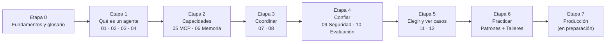

# AI Engineering — guía de estudio: de "uso un chat" a "construyo agentes"

Una **ruta de estudio abierta** para quien quiere pasar de **usar** la IA a **diseñar, construir, evaluar y desplegar** sistemas con LLM y agentes. Está escrita desde la práctica de un desarrollador backend (Java/TypeScript), con la analogía de **una cocina profesional**, diagramas, niveles **junior → mid → senior**, escaleras de entrevista y ejercicios.

> **Esta carpeta no es [`ia-agentes/`](../ia-agentes).** Aquella enseña a **usar** subagentes de Claude Code para escribir software más rápido; esta enseña a **construir** los sistemas de IA en sí (LLM, herramientas, MCP, memoria, orquestación, evaluación, producción). Son complementarias.

> 🍳 **La analogía de toda la guía:** el modelo es **un cocinero muy hábil que solo escribe notas y olvida todo al salir**; tú eres **el jefe de cocina**: lees sus notas, abres la despensa, enciendes el fuego y le devuelves el resultado. Un agente es ese ciclo repetido hasta que dice "listo".

## 1 · ¿Para quién es?

| Perfil | Cómo aprovecharla |
|---|---|
| 🟢 **Junior** | Sigue la ruta en orden; haz los ejercicios; usa las analogías |
| 🟡 **Mid (backend)** | Salta a las etapas 2 a 5; céntrate en seguridad y evaluación; practica en tu stack |
| 🔴 **Senior** | Ve a los ⭐ de cada tema, las escaleras de entrevista y las secciones 🧩 (criterio y riesgos) |

**Requisitos:** programar en algún lenguaje, Git, consumir APIs REST y manejar JSON. **No** hace falta saber Python (la guía practica primero en **Java**).

## 2 · La ruta de estudio

> 📅 **¿Cómo repartirlo en el tiempo?** → [**Guía de estudio día a día**](guia-de-estudio.md): un día de taller, el siguiente de despliegue, y repasos cada pocos días.

| Etapa | Qué aprendes | Dónde | Tiempo 🧩 | Sabes que lo entendiste cuando… |
|---|---|---|---|---|
| **0 · Fundamentos** | Vocabulario y por qué importa | [Glosario](#8--glosario-de-términos-imprescindibles) · [Ingeniería de contexto](conceptos/ingenieria-de-contexto.md) | 1–2 h | Explicas LLM, token, prompt y embedding en una frase |
| **1 · Qué es un agente** | Agente vs. workflow, modelos, contexto, herramientas y bucle | [01](agentic-ai/01-agentes-y-workflows.md) · [02](agentic-ai/02-modelos-y-proveedores.md) · [03](agentic-ai/03-prompts-contexto-y-salidas-estructuradas.md) · [04](agentic-ai/04-herramientas-y-bucle-del-agente.md) | 4–6 h | Escribes (en papel) el bucle de un agente con lista blanca y tope |
| **2 · Capacidades** | MCP; memoria, búsqueda y RAG | [05](agentic-ai/05-mcp.md) · [06](agentic-ai/06-memoria-busqueda-y-rag.md) | 3–4 h | Distingues host, cliente y servidor MCP y las 3 memorias |
| **3 · Coordinar** | Patrones, multiagente, estado y grafos | [07](agentic-ai/07-orquestacion-y-multiagente.md) · [08](agentic-ai/08-langchain-langgraph-y-deep-agents.md) · [Catálogo de patrones](patrones/README.md) | 4–6 h | Decides qué va en código y qué en el LLM |
| **4 · Confiar** | Seguridad, guardrails, humano en el bucle, trazas, evaluación, costos | [09](agentic-ai/09-seguridad-guardrails-y-humano-en-el-bucle.md) · [10](agentic-ai/10-observabilidad-evaluacion-y-costos.md) | 3–5 h | Completas la lista de verificación de seguridad para un caso real |
| **5 · Elegir y ver casos** | Frameworks, criterios y 6 proyectos | [11](agentic-ai/11-frameworks-y-como-elegir.md) · [12](agentic-ai/12-proyectos-del-curso.md) · [Diagramas UML](agentic-ai/diagramas-uml.md) | 2–3 h | Defiendes una elección de framework con criterios |
| **6 · Practicar** | Los mismos oficios en **Java, Quarkus, TypeScript y Python** | [Talleres](talleres/README.md) | 30–50 h | Tienes agentes funcionando, probados **sin llamar al modelo real** |
| **7 · Producción** | Nube, despliegue, observabilidad y gobernanza a escala | [Production Track](llm-production/README.md) | _en preparación_ | — |

> 🧩 Los tiempos son **estimaciones mías** de lectura y práctica, no medidas.

### Mapa de 17 conceptos

Además del recorrido de arriba, usamos como **lista de verificación** una hoja de ruta de **17 conceptos** en 5 fases publicada por **Amigoscode** (la imagen no se copia aquí; es suya). Sirve para detectar **qué nos falta**. Estado honesto:

| Fase | Concepto | Dónde está | Taller |
|---|---|---|---|
| **1 · Fundamentos** | Tokens · ventana de contexto · temperatura | [02 · §3](agentic-ai/02-modelos-y-proveedores.md) | W01b |
| | Prompt engineering · salidas estructuradas | [03](agentic-ai/03-prompts-contexto-y-salidas-estructuradas.md) | W01 ✅ |
| **2 · Significado y recuperación** | Embeddings · similitud · bases vectoriales · chunking · RAG | [06 · §3](agentic-ai/06-memoria-busqueda-y-rag.md) | W11a, W11b, W11 |
| **3 · Acción** | Tool calling · agentes · MCP | [04](agentic-ai/04-herramientas-y-bucle-del-agente.md), [01](agentic-ai/01-agentes-y-workflows.md), [07](agentic-ai/07-orquestacion-y-multiagente.md), [05](agentic-ai/05-mcp.md) | W02–W04, W08, W09 |
| **4 · Calidad** | Evals · guardrails | [10](agentic-ai/10-observabilidad-evaluacion-y-costos.md), [09](agentic-ai/09-seguridad-guardrails-y-humano-en-el-bucle.md) | W06, W07, W15 |
| **5 · Producción** | Ajuste fino o RAG | [06 · §4](agentic-ai/06-memoria-busqueda-y-rag.md) | — (decisión, no práctica) |
| | Operar en producción (costo, velocidad, errores) | [10 · producción](agentic-ai/10-observabilidad-evaluacion-y-costos.md) + Production Track | W14 |

**Lo que tiene este repo y esa hoja no:** orquestación y multiagente, patrones, humano en el bucle, seguridad de herramientas y MCP, frameworks, y talleres con pruebas sin llamar al modelo real. La **base** de varios documentos viene de un curso; la lista de **qué reforzar** viene de esta hoja y de la práctica.

## 3 · Cómo está hecho cada documento

Todos los temas siguen el mismo molde, para que se estudien igual:

| Sección | Para qué |
|---|---|
| **🍳 Con la cocina** | La idea en una imagen, más una frase "en palabras de la calle" |
| **Contenido + diagramas** | UML/Mermaid: clases, secuencias, estados y componentes |
| **Qué debe dominar cada nivel** | 🟢 junior · 🟡 mid · 🔴 senior |
| **Escaleras de entrevista** | La respuesta de un junior, la capa de un mid y el cierre de un senior |
| **🛠️ Ejercicios** | Qué taller practica ese tema |

**Marcas de honestidad:** 🔎 *por verificar* · 🧩 *aporte mío, no del curso* · ⚠️ *riesgo* · ⭐ *lo que más rinde*.

## 4 · Por qué importa

### De software basado en reglas a software basado en intenciones

| | Software tradicional | Software basado en intenciones (LLM-powered) |
|---|---|---|
| Cómo se especifica el comportamiento | Lógica condicional explícita, escrita a mano (`if status == PAID then ...`). | Una intención en lenguaje natural + un modelo que razona sobre qué hacer con ella. |
| Quién decide el "cómo" | El desarrollador, en tiempo de diseño. | El modelo, en tiempo de ejecución — elige qué herramienta invocar, en qué orden, con qué datos. |
| Qué falla si el caso no fue previsto | Un `else` no contemplado — bug o crash. | El modelo puede razonar sobre un caso nuevo sin que alguien haya escrito esa rama — con el riesgo simétrico de que "razone mal" si no hay guardrails (ver sección 5, Fase 5). |

Esto no reemplaza la ingeniería de software clásica (SOLID, hexagonal, TDD — el resto de este repo) — la **envuelve**: un agente sigue necesitando arquitectura, testing y buenas prácticas; lo nuevo es que una de sus piezas centrales (la decisión de qué hacer) ya no es código determinista, sino un modelo probabilístico invocado vía API.

## 5 · Mapa de carpetas

| Carpeta | Qué contiene |
|---|---|
| [`agentic-ai/`](agentic-ai/README.md) | **12 temas** (agentes, MCP, memoria, orquestación, seguridad, evaluación…), proyectos y [diagramas UML](agentic-ai/diagramas-uml.md) |
| [`conceptos/`](conceptos/ingenieria-de-contexto.md) | Conceptos reutilizables (empieza con **ingeniería de contexto**) |
| [`patrones/`](patrones/README.md) | Catálogo de patrones agénticos: explicación, caso de uso y especificación |
| [`guia-de-estudio.md`](guia-de-estudio.md) | **Calendario día a día:** taller → despliegue → repaso |
| [`talleres/`](talleres/README.md) | **Plan de práctica** (el código vive en un repo aparte, `ai-engineering-labs`): Java/Spring AI → Quarkus → TypeScript/NestJS → Python/FastAPI |
| [`llm-production/`](llm-production/README.md) | Producción: despliegue en la nube (**en preparación**) |
| [`../ia-agentes/`](../ia-agentes) | Subagentes y pipelines de Claude Code (usar agentes, no construirlos) |

## 6 · Estado (honesto)

| Pieza | Estado |
|---|---|
| Teoría: 12 temas + diagramas | ✅ Escrita (notas depuradas de un curso de pago) |
| Catálogo de patrones: explicación | ✅ · especificaciones ⏳ · implementaciones ⏳ |
| Talleres (Java/Spring AI primero) | ⏳ Plan hecho; **sin código todavía** |
| Producción (nube, despliegue) | ⏳ Por empezar |
| Verificación de versiones y APIs | 🔎 Cada taller empieza leyendo la documentación vigente |

## 7 · Equivalencia con el roadmap original de 14 semanas

La guía partió de una hoja de ruta pública de 7 fases (fuente: *@aiseekhobhai*); estos son sus equivalentes:

| Fase del roadmap | Equivalente en esta guía |
|---|---|
| 0 · Fundamentos de IA | Etapa 0 y [02](agentic-ai/02-modelos-y-proveedores.md) |
| 1 · Interacción con LLMs (prompting, salidas estructuradas) | [03](agentic-ai/03-prompts-contexto-y-salidas-estructuradas.md) |
| 2 · Gestión del conocimiento (RAG) | [06](agentic-ai/06-memoria-busqueda-y-rag.md) (superficial) |
| 3 · Herramientas (function calling, MCP, ReAct) | [04](agentic-ai/04-herramientas-y-bucle-del-agente.md) · [05](agentic-ai/05-mcp.md) |
| 4 · Agentes autónomos (LangGraph, multiagente) | [07](agentic-ai/07-orquestacion-y-multiagente.md) · [08](agentic-ai/08-langchain-langgraph-y-deep-agents.md) |
| 5 · IA en producción (guardrails, evals, despliegue) | [09](agentic-ai/09-seguridad-guardrails-y-humano-en-el-bucle.md) · [10](agentic-ai/10-observabilidad-evaluacion-y-costos.md) · [Production Track](llm-production/README.md) |
| 6 · Portafolio (5 proyectos) | [Talleres](talleres/README.md) (capstone) |

## 8 · Glosario de términos imprescindibles

| Término | Definición corta |
|---|---|
| **LLM** (Large Language Model) | Modelo entrenado sobre grandes volúmenes de texto que predice la siguiente secuencia de tokens más probable — la base de todo lo demás en este documento (GPT, Claude, Gemini, Llama). |
| **Prompting** | La técnica de diseñar la entrada (instrucciones, ejemplos, contexto) que se le da a un LLM para obtener la salida deseada — incluye Zero-Shot, Few-Shot (dar ejemplos) y Chain-of-Thought (pedir razonamiento paso a paso). |
| **Structured Outputs** | Forzar que la respuesta de un LLM cumpla un schema (JSON Schema) exacto y validable, en vez de texto libre que hay que parsear con heurísticas frágiles. |
| **Embeddings** | Representación numérica (un vector) del significado semántico de un texto — dos textos con significado similar producen vectores cercanos entre sí en ese espacio. Es la base matemática de RAG y de cualquier búsqueda semántica. |
| **RAG** (Retrieval-Augmented Generation) | Patrón donde, antes de responder, el sistema **recupera** información relevante (vía embeddings + una base de datos vectorial) y se la agrega al prompt del LLM — así el modelo responde con datos propios/actualizados que no tenía en su entrenamiento. |
| **Chunking** | Dividir un documento largo en fragmentos más chicos antes de generar sus embeddings — el tamaño y la estrategia de corte (por párrafo, por tokens, con solapamiento) afecta directamente la calidad del retrieval en RAG. |
| **Function Calling** | Mecanismo por el cual un LLM puede indicar "quiero ejecutar esta función con estos argumentos" (en vez de solo generar texto) — el modelo decide **cuándo** y **con qué datos** invocar una herramienta externa; el código de la aplicación es quien efectivamente la ejecuta y le devuelve el resultado. |
| **MCP** (Model Context Protocol) | Protocolo abierto (de Anthropic) que estandariza cómo un modelo/agente se conecta a herramientas y fuentes de datos externas — en vez de integrar cada herramienta de forma ad-hoc por proveedor, MCP define una interfaz común reusable entre distintos clientes de IA. |
| **ReAct** (Reason + Act) | Patrón de agente donde el modelo alterna explícitamente entre **razonar** (pensar el siguiente paso en lenguaje natural) y **actuar** (invocar una herramienta), observando el resultado antes de decidir el siguiente ciclo — la base conceptual de casi todo agente que usa herramientas. |
| **Agent** (Agente) | Un sistema que usa un LLM como "motor de decisión" para perseguir un objetivo de forma semi-autónoma: puede usar herramientas, mantener memoria/estado, y decidir sus propios pasos intermedios — a diferencia de un simple llamado prompt-in/texto-out. |
| **Guardrails** | Controles (de input y de output) que limitan lo que un sistema de IA puede recibir o producir — filtros de contenido, validación de que la respuesta no se sale del dominio permitido, límites de costo/tokens, detección de prompt injection. |
| **AI Evals** (Evaluación de IA) | Métricas y procesos sistemáticos para medir la calidad de las respuestas de un sistema de IA (precisión, relevancia, alucinación, latencia, costo) — el equivalente de una suite de tests automatizados, pero para un sistema cuyo output no es 100% determinista. |

## 9 · Relación con el resto del repo

- [`ia-agentes/`](../ia-agentes) — una vez completada la Fase 3-4 (Function Calling, MCP, orquestación de agentes), tiene sentido volver a `ia-agentes/compiler/` y entender/extender esa capa de compilación con criterio propio, no solo copiarla.
- [`ddd/`](../ddd) y [`software-architectures/`](../software-architectures) — un agente en producción (Fase 5) sigue siendo una aplicación de software: necesita capas claras (¿dónde vive la lógica de orquestación vs. el adaptador HTTP del microservicio FastAPI?), no una excepción a las reglas del resto del repo.
- [`frameworks/`](../frameworks) — el microservicio de la Fase 5 (FastAPI) es Python, fuera del alcance actual de `frameworks/` (Spring Boot, NestJS) — evaluar más adelante si amerita su propia carpeta `frameworks/fastapi/` cuando se practique en profundidad.
- [`system-design/`](../system-design) — cachear con Redis (Fase 5) conecta directo con los patrones de cache ya vistos en [`01-scale-from-zero-to-millions.md`](../system-design/01-scale-from-zero-to-millions.md).

## 10 · Fuentes, atribución y aviso

- **Las notas de [`agentic-ai/`](agentic-ai/README.md)** son un **estudio propio** (resumen, reordenación, diagramas y criterio) del curso *AI Engineer Agentic Track* de **Ed Donner** en Udemy. **No son el curso ni su transcripción**: para el material original, el código y las explicaciones completas, cursa el original y consulta [su repositorio](https://github.com/ed-donner/agents).
- Lo que el instructor afirma (fechas, precios, comparaciones) se trata como **su opinión**; la guía marca 🔎 lo no verificado.
- Las ideas de patrones provienen de [*Building Effective Agents*](https://www.anthropic.com/research/building-effective-agents) (Anthropic).
- **No es consejo financiero**: los ejemplos de trading son educativos y con datos ficticios.

## Referencias

- Hoja de ruta base de 14 semanas — fuente: *@aiseekhobhai* (recurso público que originó la estructura de fases de este documento).
- [Anthropic — Model Context Protocol](https://modelcontextprotocol.io/) — especificación oficial de MCP.
- [Anthropic — Building Effective Agents](https://www.anthropic.com/research/building-effective-agents) — guía de referencia sobre patrones de agentes (incluye ReAct y arquitecturas multi-agente).
- [OpenAI — Prompt Engineering Guide](https://platform.openai.com/docs/guides/prompt-engineering) y [Structured Outputs](https://platform.openai.com/docs/guides/structured-outputs) — Fase 1.
- [LangGraph — Documentation](https://langchain-ai.github.io/langgraph/) — orquestación multi-agente, Fase 4.
- Yao, S. et al. — [*ReAct: Synergizing Reasoning and Acting in Language Models*](https://arxiv.org/abs/2210.03629) (2022) — paper original del patrón ReAct.
