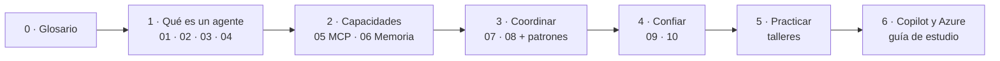

# AI Engineering — de "uso un chat" a "construyo agentes"

Una **ruta de estudio abierta** para pasar de **usar** la IA a **diseñar, construir, evaluar y operar** sistemas con LLM y agentes. Escrita desde la práctica de un desarrollador backend (Java/TypeScript), con la analogía de **una cocina profesional**, diagramas, niveles **junior → mid → senior** y escaleras de entrevista.

> **Esta carpeta no es [`ia-agentes/`](../ia-agentes).** Aquella enseña a **usar** subagentes de Claude Code; esta enseña a **construir** los sistemas de IA (LLM, herramientas, MCP, memoria, orquestación, evaluación). Son complementarias.

> 🍳 **La analogía:** el modelo es **un cocinero muy hábil que solo escribe notas y olvida todo al salir**; tú eres **el jefe de cocina**: lees sus notas, abres la despensa, enciendes el fuego y le devuelves el resultado. Un agente es ese ciclo repetido hasta que dice "listo".

## 1 · Qué hay aquí

| Carpeta | Qué contiene |
|---|---|
| [`conceptos/`](conceptos/README.md) | **10 temas**: agentes, modelos, prompts y contexto, herramientas, MCP, memoria y RAG, orquestación, frameworks y grafos, seguridad, observabilidad y evaluación |
| [`patrones/`](patrones/README.md) | Catálogo de patrones agénticos: explicación, caso de uso y especificación |
| [`talleres/`](talleres/README.md) | **Plan de práctica**: Java/Spring AI → Quarkus → TypeScript/NestJS → Python/FastAPI. El código vive en el [repo de ejercicios](https://github.com/edzamo/ai-engineering-labs) |
| [`guia-de-estudio.md`](guia-de-estudio.md) | **Calendario día a día**: taller, curso de Copilot o Azure, y repasos |

**Para quién:** 🟢 **junior** sigue el orden y hace los ejercicios · 🟡 **mid (backend)** salta a los temas 04–10 y practica en su stack · 🔴 **senior** va a los ⭐, las escaleras de entrevista y las secciones 🧩. **Requisitos:** programar, Git, APIs REST y JSON; no hace falta Python.

## 2 · La ruta

| Etapa | Qué aprendes | Sabes que lo entendiste cuando… |
|---|---|---|
| **0 · Glosario** | Vocabulario | Explicas LLM, token, prompt y embedding en una frase |
| **1 · Qué es un agente** | Agente vs. workflow, modelos, contexto, herramientas y bucle ([01](conceptos/01-agentes-y-workflows.md) · [02](conceptos/02-modelos-y-proveedores.md) · [03](conceptos/03-prompts-contexto-y-salidas-estructuradas.md) · [04](conceptos/04-herramientas-y-bucle-del-agente.md)) | Escribes (en papel) el bucle de un agente con lista blanca y tope |
| **2 · Capacidades** | MCP; memoria y RAG ([05](conceptos/05-mcp.md) · [06](conceptos/06-memoria-busqueda-y-rag.md)) | Distingues host, cliente y servidor MCP y las 3 memorias |
| **3 · Coordinar** | Multiagente, grafos y frameworks ([07](conceptos/07-orquestacion-y-multiagente.md) · [08](conceptos/08-frameworks-y-grafos.md) · [patrones](patrones/README.md)) | Decides qué va en código y qué en el LLM |
| **4 · Confiar** | Seguridad, evaluación y costos ([09](conceptos/09-seguridad-guardrails-y-humano-en-el-bucle.md) · [10](conceptos/10-observabilidad-evaluacion-y-costos.md)) | Completas la lista de seguridad de un caso real |
| **5 · Practicar** | Los mismos oficios en 4 stacks ([talleres](talleres/README.md)) | Agentes funcionando, probados **sin llamar al modelo real** |
| **6 · Copilot y Azure** | Copilot en modo agente y despliegue en Azure ([guía de estudio](guia-de-estudio.md)) | Una feature hecha con el agente, con pruebas, y desplegada |

### Mapa de 17 conceptos

Además del recorrido de arriba, usamos como **lista de verificación** una hoja de ruta de **17 conceptos** en 5 fases publicada por **Amigoscode** (la imagen no se copia aquí; es suya). Sirve para detectar **qué nos falta**. Estado honesto:

| Fase | Concepto | Dónde está | Taller |
|---|---|---|---|
| **1 · Fundamentos** | Tokens · ventana de contexto · temperatura | [02 · §3](conceptos/02-modelos-y-proveedores.md) | W01b |
| | Prompt engineering · salidas estructuradas | [03](conceptos/03-prompts-contexto-y-salidas-estructuradas.md) | W01 ✅ |
| **2 · Significado y recuperación** | Embeddings · similitud · bases vectoriales · chunking · RAG | [06 · §3](conceptos/06-memoria-busqueda-y-rag.md) | W11a, W11b, W11 |
| **3 · Acción** | Tool calling · agentes · MCP | [04](conceptos/04-herramientas-y-bucle-del-agente.md), [01](conceptos/01-agentes-y-workflows.md), [07](conceptos/07-orquestacion-y-multiagente.md), [05](conceptos/05-mcp.md) | W02–W04, W08, W09 |
| **4 · Calidad** | Evals · guardrails | [10](conceptos/10-observabilidad-evaluacion-y-costos.md), [09](conceptos/09-seguridad-guardrails-y-humano-en-el-bucle.md) | W06, W07, W15 |
| **5 · Producción** | Ajuste fino o RAG | [06 · §4](conceptos/06-memoria-busqueda-y-rag.md) | — (decisión, no práctica) |
| | Operar en producción (costo, velocidad, errores) | [10 · producción](conceptos/10-observabilidad-evaluacion-y-costos.md) | W14 |

**Lo que tiene este repo y esa hoja no:** orquestación y multiagente, patrones, humano en el bucle, seguridad de herramientas y MCP, frameworks, y talleres con pruebas sin llamar al modelo real. La **base** de varios documentos viene de un curso; la lista de **qué reforzar** viene de esta hoja y de la práctica.

## 3 · Cómo está hecho cada documento

| Sección | Para qué |
|---|---|
| **🍳 Con la cocina** | La idea en una imagen, más una frase "en palabras de la calle" |
| **Contenido + diagramas** | UML/Mermaid |
| **Qué debe dominar cada nivel** | 🟢 junior · 🟡 mid · 🔴 senior |
| **Escaleras de entrevista** | La respuesta de un junior, la capa de un mid y el cierre de un senior |
| **🛠️ Ejercicios** | Qué taller practica ese tema |

**Marcas:** 🔎 *por verificar* · 🧩 *aporte propio* · ⚠️ *riesgo* · ⭐ *lo que más rinde*.

## 4 · Por qué importa

| | Software tradicional | Software basado en intenciones (LLM) |
|---|---|---|
| Cómo se especifica | Lógica explícita (`if status == PAID …`) | Una intención en lenguaje natural + un modelo que razona |
| Quién decide el "cómo" | El desarrollador, al diseñar | El modelo, al ejecutar: qué herramienta, en qué orden |
| Qué falla si el caso no estaba previsto | Un `else` no contemplado | El modelo puede razonar el caso nuevo… o razonar mal sin guardrails |

Esto **no reemplaza** la ingeniería clásica (SOLID, hexagonal, TDD, el resto de este repo): la **envuelve**. Un agente sigue necesitando arquitectura y pruebas; lo nuevo es que una pieza central, decidir qué hacer, es un modelo probabilístico.

## 5 · Estado (honesto)

| Pieza | Estado |
|---|---|
| Conceptos: 10 temas + diagramas | ✅ Escritos (🔎 verificar versiones y APIs al practicar) |
| Patrones: explicación | ✅ · especificaciones ⏳ · implementaciones ⏳ |
| Talleres (Java/Spring AI primero) | ⏳ W00 y W01 hechos; el resto en curso |
| Copilot + Azure | ⏳ Curso por tomar |

## 6 · Glosario

| Término | Definición corta |
|---|---|
| **Token** | La unidad de texto con la que trabaja un modelo (palabra, trozo o signo). Límites, velocidad y precio se miden en tokens. → [02](conceptos/02-modelos-y-proveedores.md) |
| **Workflow** | Pasos **fijos escritos por ti**, con un LLM en uno o varios; **tú** decides el camino. → [chuleta](conceptos/01-agentes-y-workflows.md) |
| **Harness** | Todo el **código alrededor del modelo**: bucle, herramientas, controles, memoria y trazas. Tanto un agente como un workflow viven dentro de uno. → [chuleta](conceptos/01-agentes-y-workflows.md) |
| **LLM** (Large Language Model) | Modelo entrenado sobre grandes volúmenes de texto que predice la siguiente secuencia de tokens más probable — la base de todo lo demás en este documento (GPT, Claude, Gemini, Llama). |
| **Prompting** | La técnica de diseñar la entrada (instrucciones, ejemplos, contexto) que se le da a un LLM para obtener la salida deseada — incluye Zero-Shot, Few-Shot (dar ejemplos) y Chain-of-Thought (pedir razonamiento paso a paso). |
| **Structured Outputs** | Forzar que la respuesta de un LLM cumpla un schema (JSON Schema) exacto y validable, en vez de texto libre que hay que parsear con heurísticas frágiles. |
| **Embeddings** | Representación numérica (un vector) del significado semántico de un texto — dos textos con significado similar producen vectores cercanos entre sí en ese espacio. Es la base matemática de RAG y de cualquier búsqueda semántica. |
| **RAG** (Retrieval-Augmented Generation) | Patrón donde, antes de responder, el sistema **recupera** información relevante (vía embeddings + una base de datos vectorial) y se la agrega al prompt del LLM — así el modelo responde con datos propios/actualizados que no tenía en su entrenamiento. |
| **Chunking** | Dividir un documento largo en fragmentos más chicos antes de generar sus embeddings — el tamaño y la estrategia de corte (por párrafo, por tokens, con solapamiento) afecta directamente la calidad del retrieval en RAG. |
| **Function Calling** | Mecanismo por el cual un LLM puede indicar "quiero ejecutar esta función con estos argumentos" (en vez de solo generar texto) — el modelo decide **cuándo** y **con qué datos** invocar una herramienta externa; el código de la aplicación es quien efectivamente la ejecuta y le devuelve el resultado. |
| **MCP** (Model Context Protocol) | Protocolo abierto (de Anthropic) que estandariza cómo un modelo/agente se conecta a herramientas y fuentes de datos externas — en vez de integrar cada herramienta de forma ad-hoc por proveedor, MCP define una interfaz común reusable entre distintos clientes de IA. |
| **ReAct** (Reason + Act) | Patrón de agente donde el modelo alterna explícitamente entre **razonar** (pensar el siguiente paso en lenguaje natural) y **actuar** (invocar una herramienta), observando el resultado antes de decidir el siguiente ciclo — la base conceptual de casi todo agente que usa herramientas. |
| **Agent** (Agente) | Un sistema que usa un LLM como "motor de decisión" para perseguir un objetivo de forma semi-autónoma: puede usar herramientas, mantener memoria/estado, y decidir sus propios pasos intermedios — a diferencia de un simple llamado prompt-in/texto-out. |
| **Guardrails** | Controles (de input y de output) que limitan lo que un sistema de IA puede recibir o producir — filtros de contenido, validación de que la respuesta no se sale del dominio permitido, límites de costo/tokens, detección de prompt injection. |
| **AI Evals** (Evaluación de IA) | Métricas y procesos sistemáticos para medir la calidad de las respuestas de un sistema de IA (precisión, relevancia, alucinación, latencia, costo) — el equivalente de una suite de tests automatizados, pero para un sistema cuyo output no es 100% determinista. |

## 7 · Relación con el resto del repo

[`ia-agentes/`](../ia-agentes) (usar agentes) · [`ddd/`](../ddd) y [`software-architectures/`](../software-architectures) (un agente en producción sigue siendo software con capas claras) · [`system-design/`](../system-design) (cachés, colas y escala) · [`cloud/`](../cloud) (despliegue).

## 8 · Fuentes y aviso

- Las notas de [`conceptos/`](conceptos/README.md) son un **estudio propio** (resumen, reordenación, diagramas y criterio) del curso *AI Engineer Agentic Track* de **Ed Donner** en Udemy. **No son el curso ni su transcripción**: para el material original, cursa el curso y consulta [su repositorio](https://github.com/ed-donner/agents). Lo que el instructor afirma se trata como **su opinión**; 🔎 marca lo no verificado.
- Las ideas de patrones vienen de [*Building Effective Agents*](https://www.anthropic.com/research/building-effective-agents) (Anthropic).
- Referencias: [Model Context Protocol](https://modelcontextprotocol.io/) · [LangGraph](https://langchain-ai.github.io/langgraph/) · [ReAct (Yao et al., 2022)](https://arxiv.org/abs/2210.03629) · [OpenAI: prompting](https://platform.openai.com/docs/guides/prompt-engineering) y [salidas estructuradas](https://platform.openai.com/docs/guides/structured-outputs).
- **No es consejo financiero**: los ejemplos de trading son educativos y con datos ficticios.
