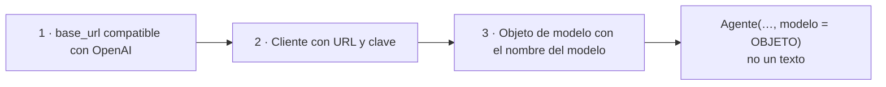

# 02 · Modelos y proveedores — llamar a un LLM y cambiar de uno a otro

> **Tema 2 de 12.** Fuentes: semanas 1, 2, 4 y 5.
> ⬅️ [01 · Agentes y workflows](01-agentes-y-workflows.md) · ➡️ [03 · Prompts, contexto y salidas estructuradas](03-prompts-contexto-y-salidas-estructuradas.md) · [Índice](README.md)

---

## 🍳 Con la cocina

Todos los proveedores aceptan **el mismo formulario de pedido**; solo cambian **la dirección de la cocina**, **tu credencial** y **el nombre del plato**. Si en el pedido escribes solo un **texto** (`"gpt-5.4-mini"`), el sistema supone que es **de la casa (OpenAI)**. Un buen ingeniero **no ata su cocina a un proveedor**: deja el pedido en un formulario y cambia dirección, credencial y plato.

> En palabras de la calle: **cambiar de proveedor cuesta tres datos: URL, clave y nombre del modelo. Lo que sí ata son las herramientas alojadas y las trazas.**

---

## 1 · Tamaños y proveedores

| Tamaño | OpenAI | Anthropic | Google | Cuándo |
|---|---|---|---|---|
| 🟢 Pequeño | GPT Nano | Claude Haiku | Gemini Flash Lite | Tareas simples, volumen |
| 🟡 Mediano | GPT Mini | Claude Sonnet | Gemini Flash | Equilibrio |
| 🔴 Grande | GPT | Claude Opus | Gemini Pro | Lo difícil, juzgar |

- **Quién fabrica y quién ejecuta:** OpenAI, Anthropic, Google y DeepSeek **fabrican**; **Groq** y similares son proveedores de **inferencia** de modelos abiertos; **Ollama** corre modelos pequeños en tu máquina; **OpenRouter** es una **pasarela** con una sola cuenta (cobra un margen pequeño). 🔎 Datos y versiones cambian rápido.
- **Dónde comparar:** artificialanalysis.ai (los *benchmarks* no lo son todo).
- **Los modelos fallan o desaparecen** (errores 404 y 503): en producción, **modelo de respaldo y reintentos**.

## 2 · Cambiar de proveedor

| Marco | Cómo se le pasa el modelo |
|---|---|
| Agents SDK | **Objeto** `OpenAIChatCompletionsModel(model, openai_client)` |
| CrewAI | `llm:` en el YAML (LiteLLM) |
| LangChain | Texto `proveedor:modelo` (dos puntos) |
| Google ADK | Gemini por defecto; `LiteLlm(model="openai/…")` para otros |
| Strands | **Objeto** `OpenAIModel(client_args={...}, model_id=…)` |
| Pydantic AI | Texto `openai-chat:gpt-5.4-mini` u objeto `OpenAIChatModel` |
| MAF · Agno · Mastra | Cliente · objeto `OpenAIChat` · `proveedor/modelo` |
| **Spring AI** 🧩 | Starter del proveedor + `ChatClient`; para Gemini, `spring-ai-starter-model-google-genai` 🔎 |

> 🔎 Boceto de clase, no verificado: verifica los nombres exactos en la documentación del marco antes de usarlos.

### Tu caso: Gemini gratuito

- **Sin tarjeta.** Al ser compatible con la API de OpenAI, **el código casi no cambia**: URL base de Gemini, clave y nombre del modelo.
- En el `.env`: **dos entradas con el mismo valor**, `GOOGLE_API_KEY` y `GEMINI_API_KEY` (unas librerías buscan una y otras la otra).
- ⚠️ El plan gratuito tiene **límites de uso** y, según las condiciones de Google, **los datos enviados pueden usarse para mejorar sus productos**: **no mandes información sensible**.
- La **suscripción a Claude no incluye clave de API** (se factura aparte).

### Lo que sí ata a un proveedor

| Cosa | Por qué |
|---|---|
| **Herramientas alojadas** (búsqueda web, archivos, intérprete de código, MCP alojado) | Exigen la API y los modelos de **ese** proveedor |
| **Trazas** | Van a su plataforma y usan su clave |
| **Salidas estructuradas** | No todos los proveedores las soportan igual |

> 🧩 Es **desacoplar el agente del proveedor**: igual que **puertos y adaptadores**. En Java, una interfaz de modelo y un adaptador por proveedor.

## 3 · Costo, velocidad y no determinismo

- **Velocidad ≠ calidad:** en una demo, Gemini Flash Lite tardó ~2 s; Kimi K2.6 ~77 s pero **su resultado fue el elegido**; GPT-OSS 120B < 1,5 s. Elegir modelo **por paso** es diseño.
- **Costo observado (según el instructor):** búsquedas de Deep Research con un modelo mini ~5 ¢ frente a ~22 ¢ con uno grande y más búsquedas; el equipo de ingeniería de la semana 3 costó **~4 US$**. **Vigila los costos y usa claves con presupuesto fijo.**
- **Empieza con un modelo grande y luego baja de tamaño** cuando el prompt es fiable (los pequeños son poco fiables ante la ambigüedad) y **mide la caída de calidad**.
- **Memoria = ilusión:** el modelo no tiene estado; **reenvías el historial** en cada llamada y pagas esos tokens.
- **Cada ejecución es distinta:** se mide con **muchas ejecuciones**, no con una.

## 4 · Qué debe dominar cada nivel

| Nivel | Debe poder... |
|---|---|
| 🟢 **Junior** | Cambiar URL, clave y modelo; elegir tamaño por tarea; guardar claves en `.env`. |
| 🟡 **Mid** | Pasar un modelo de otro proveedor como **objeto** al agente; prever modelo de respaldo; estimar costo. |
| 🔴 **Senior** | **Desacoplar** agente y proveedor; saber qué lo ata (herramientas alojadas, trazas); probar **sin llamar al modelo real**; fijar presupuesto y reducir de modelo con métrica. |

## 5 · Escalera de entrevista

**"¿Cómo cambias de proveedor de modelos en un framework de agentes?"**
- 🟢 "Cambio la URL, la clave y el nombre del modelo."
- 🟡 "Creo un cliente con la URL compatible y paso al agente un objeto de modelo, no un texto."
- 🔴 "Desacoplo el agente del proveedor; ojo con lo que sí ata (herramientas alojadas, trazas) y con las diferencias entre proveedores, como el soporte de salidas estructuradas."

**"¿Cómo controlas costos?"**
- 🟢 "Uso modelos pequeños."
- 🟡 "Clave con presupuesto, tope de iteraciones y modelo según la tarea."
- 🔴 "Modelo grande para ajustar el prompt y luego reducir con una métrica; costo por ejecución como métrica; respaldo y reintentos."

## 🛠️ Ejercicios (taller)

| Taller | Qué haces |
|---|---|
| **W00** | Proyecto Spring Boot + Spring AI + **modelo falso** para pruebas + clave de Gemini |
| **W01** | Primer agente; cambia entre el modelo falso y Gemini **sin tocar el agente** |
| **Reflexión escrita** | Lista qué de tu diseño te ataría a un proveedor |

## 🔗 Relacionado

[01 · Agentes](01-agentes-y-workflows.md) · [10 · Observabilidad y costos](10-observabilidad-evaluacion-y-costos.md) · [11 · Frameworks](11-frameworks-y-como-elegir.md) · [Plan de talleres](../talleres/README.md)
