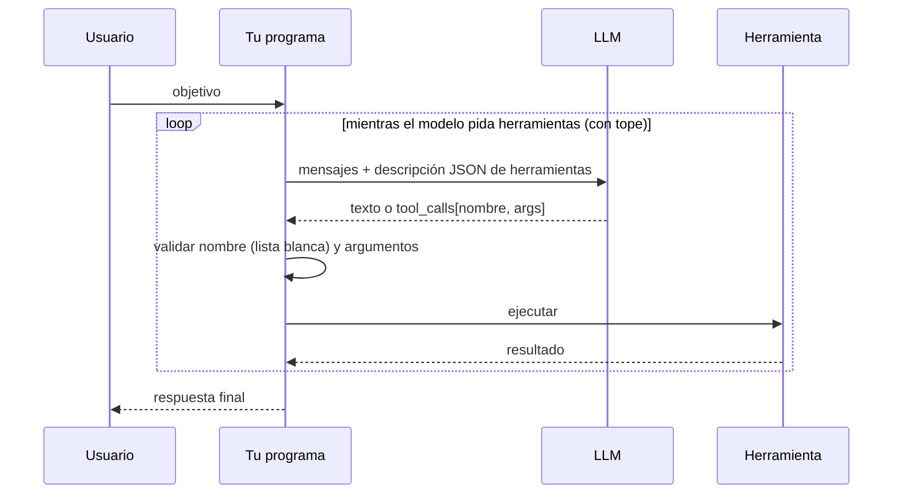
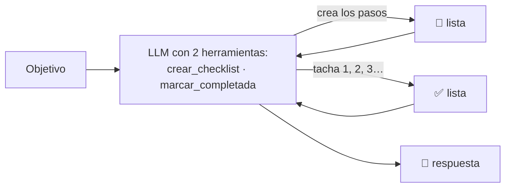

# 04 · Herramientas y bucle del agente

> **Tema 4 de 12** — el corazón técnico. Fuentes: semanas 1, 2, 3, 4 y 5 (el mismo bucle en nueve marcos).
> ⬅️ [03 · Prompts y contexto](03-prompts-contexto-y-salidas-estructuradas.md) · ➡️ [05 · MCP](05-mcp.md) · [Índice](README.md) · [Diagramas UML](diagramas-uml.md)

---

## 🍳 Con la cocina

El cocinero **nunca enciende el fuego él mismo: pide por escrito** *"dame 200 g de harina"*. **Tú** decides si abres la despensa, **la abres, pesas y le devuelves la bolsa**. Si pide algo que no está en la lista de la despensa, **no se lo das**. La **etiqueta de cada estante** (nombre, para qué sirve, qué datos hay que dar) es **la descripción JSON de la herramienta**.

> En palabras de la calle: **el modelo pide, tu código ejecuta, y el control vive en tu código: lista blanca, validar argumentos y tope de iteraciones.**

---

## 1 · El bucle del agente ⭐



**Un agente = un `while`:** si la respuesta termina con `tool_calls`, ejecuta, añade la petición y el resultado (con su **`tool_call_id`**) a los mensajes y vuelve a llamar. Con un `if` se rompía al pedir tres cosas a la vez.

Boceto ilustrativo (mío; los nombres varían por SDK):

```python
while True:
    resp = llamar_llm(messages, tools=herramientas)
    if resp.finish_reason != "tool_calls":
        return resp.content
    messages.append(resp.message)
    for call in resp.message.tool_calls:
        args = json.loads(call.arguments)
        resultado = HERRAMIENTAS[call.name](**args)     # lista blanca, nunca globals()
        messages.append({"role": "tool", "tool_call_id": call.id, "content": resultado})
```

| Detalle | Qué es |
|---|---|
| Descripción JSON | Nombre, descripción (cuándo usarla) y parámetros (qué datos dar). Los marcos la **autogeneran** desde tu función |
| `tool_call_id` | A qué petición responde cada resultado |
| `bind_tools` (LangChain) | Declara herramientas pero **no ejecuta**: el modelo solo **pide** (`.tool_calls`) y el bucle lo escribes tú |

## 2 · Cómo se declara una herramienta en cada marco

| Marco | Declaración | Notas |
|---|---|---|
| Agents SDK | `@function_tool` + docstring + *type hints* | Describe cada argumento |
| CrewAI | `@tool("nombre")`; `tools=[SerperDevTool()]` en el agente | Búsqueda gratis con Serper |
| LangChain | `@tool` → `.name`, `.description`, `.args`, `.invoke()` | |
| ADK · Pydantic AI · MAF · Agno | **Función simple**, sin decorador | docstring + tipos bastan |
| Strands | `@tool` | |
| Mastra | `createTool({ id, description, inputSchema: z.object(...) , execute })` | **Zod** |
| **Spring AI** 🧩 | `@Tool` sobre un método | 🔎 verificar |
| **Quarkus LangChain4j** 🧩 | `@Tool` en un bean, `@RegisterAiService(tools=…)` | 🔎 verificar |

**Los frameworks solo automatizan este bucle.** El instructor recomienda **empezar sin ninguno** y dice que elegir uno importa menos de lo que parece.

## 3 · Controles que viven en tu código 🔒

| Control | Por qué |
|---|---|
| **Lista blanca** (`HERRAMIENTAS[nombre]`), nunca `globals()` | Con `globals()` el modelo podría pedir `exec` u otra función que no le diste |
| **Validar argumentos** | Son texto generado por un modelo |
| **Tope de iteraciones** | Un `while` sin límite gasta sin parar |
| **Permisos y aprobación en lo irreversible** | Como un *gate*; ver [09 · Seguridad](09-seguridad-guardrails-y-humano-en-el-bucle.md) |
| **Filtrar qué herramientas se exponen** | Mínimo privilegio (ej.: de 5 herramientas de Tavily se da **una**) |
| **Mirar la traza** | Si no, el modelo puede "inventar" que usó la herramienta |

## 4 · Las herramientas moldean el comportamiento ⭐

**El checklist como herramienta de planificación:** dos herramientas casi triviales (**crear una lista** y **marcar un elemento**) hacen que el modelo **planifique y tache** solo, y **dedique más tiempo a la tarea**. Es lo que hace sentir *agente* a Claude Code o Codex.



- En la semana 5 es la base del **tablero SQLite compartido** (objetivos y pasos) que usan **todos** los marcos: el bucle de planificación sale **de las herramientas y el prompt**, no de que el LLM "sepa" que está en un bucle.
- **La lección de diseño:** **las herramientas que das moldean cómo se comporta el agente**, no solo qué puede hacer. Lo mismo vale para `registrar_pregunta_desconocida` del gemelo digital.

## 5 · "Magia" de los frameworks: caché de herramientas

CrewAI **recuerda** el resultado de una herramienta si la llamas dos veces con **los mismos argumentos** y no la vuelve a ejecutar. Para un `list_files` **sin parámetros** devolvía siempre el estado inicial aunque se hubiera escrito un archivo. Se arregla asignando a cada herramienta una función de caché que **siempre devuelve falso**. Moraleja: **al primer comportamiento raro, abre la traza antes de tocar el código.** → [11 · Frameworks](11-frameworks-y-como-elegir.md).

## 6 · ¿Herramienta propia o servidor MCP?

**Tus propias funciones ya son herramientas**; no necesitas MCP para ellas. MCP sirve para **usar las herramientas de otros** o **compartir las tuyas**. → [05 · MCP](05-mcp.md).

## 7 · Qué debe dominar cada nivel

| Nivel | Debe poder... |
|---|---|
| 🟢 **Junior** | Definir una herramienta con descripción y tipos; explicar que el modelo **pide** y tu código **ejecuta**. |
| 🟡 **Mid** | Escribir el bucle (`while` + `tool_call_id`), limitarlo y devolver errores al modelo; usar una función como herramienta en varios marcos. |
| 🔴 **Senior** | Tratar cada herramienta como **superficie de ataque** (lista blanca, validación, permisos, mínimo privilegio); diseñar herramientas que **moldeen** el comportamiento; saber qué esconde cada framework. |

## 8 · Escaleras de entrevista

**"¿Cómo funciona el tool calling y cómo lo haces seguro?"**
- 🟢 "El modelo indica qué función y datos; mi código la ejecuta."
- 🟡 "Paso el JSON de las herramientas, reviso `tool_calls`, ejecuto, devuelvo el resultado con su id y repito en un `while`."
- 🔴 "El modelo solo genera texto: valido nombre y argumentos contra una lista blanca, pongo tope de iteraciones y permisos en lo irreversible."

**"¿Cómo haces que un agente planifique?"**
- 🟢 "Se lo pido en el prompt."
- 🟡 "Le doy herramientas de lista de tareas: crear y marcar."
- 🔴 "Las herramientas moldean el comportamiento; compruebo en la traza que realmente planifica y mido si mejora el resultado."

## 🛠️ Ejercicios (taller)

| Taller | Qué haces |
|---|---|
| **W02** | **Bucle a mano** y luego con `@Tool` en Spring AI; **lista blanca**, validación y **tope**; un modelo falso que nunca termina debe cortar en el tope |
| **Q1** | Mismo agente con `AiService` en Quarkus |
| **Reflexión escrita** | Lista las herramientas de un caso de tu trabajo y marca cuáles tienen **efectos** (esas llevan aprobación) |

## 🔗 Relacionado

[01 · Agentes](01-agentes-y-workflows.md) · [05 · MCP](05-mcp.md) · [09 · Seguridad](09-seguridad-guardrails-y-humano-en-el-bucle.md) · [Patrón 6 · Agente](../patrones/06-agente/README.md) · [Plan de talleres](../talleres/README.md)
