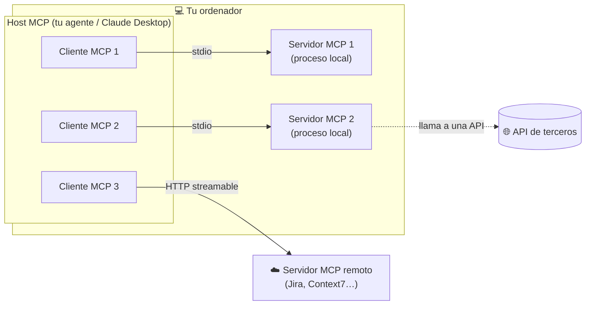
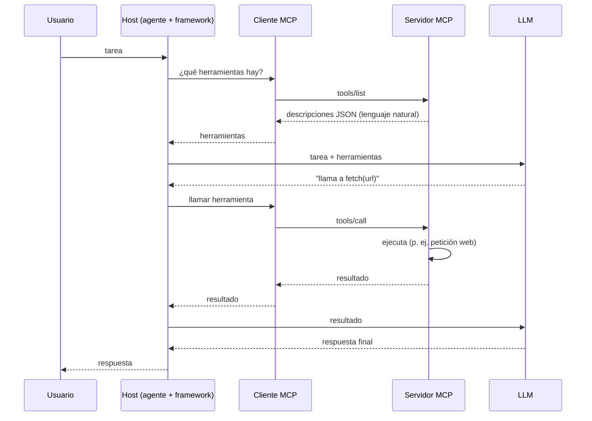

# 05 · MCP — conectar herramientas de otros a tu agente

> **Tema 5 de 12.** Fuente principal: semana 6 del curso (con adelantos de las semanas 2 a 5). MCP **no es un framework ni un agente: es un estándar de conexión**.
> ⬅️ [04 · Herramientas y bucle](04-herramientas-y-bucle-del-agente.md) · ➡️ [06 · Memoria, búsqueda y RAG](06-memoria-busqueda-y-rag.md) · [Índice](README.md) · [Diagramas UML](diagramas-uml.md)

---

## 🍳 Con la cocina

Hasta ahora cada cocina fabricaba sus propios utensilios. **MCP es la toma de corriente estándar de la cocina:** cualquier electrodoméstico de cualquier marca se enchufa y funciona, sin que tengas que saber cómo está hecho por dentro. Anthropic lo llama **"un puerto USB-C para aplicaciones de IA"**.

> En palabras de la calle: **MCP es una norma para enchufar herramientas de otros a tu agente. No es un framework, no es un agente y no hace falta para tus propias herramientas.**

**Siete ideas:** 1) es un estándar, no un framework · 2) host, cliente y servidor son roles de MCP, no los de siempre · 3) un servidor hace dos cosas útiles: **listar** herramientas y **llamarlas** · 4) lo habitual es un servidor local por `stdio` · 5) **no crees un servidor para tu propia herramienta** · 6) divulgación progresiva de herramientas · 7) trátalo como una **dependencia de terceros**.

---

## 1 · Qué es MCP (y qué no) ⭐

**No es:** un framework de agentes, ni una forma de programar agentes, ni la implementación de las herramientas. **Es:** un **protocolo** (acuerdo) para integrar **herramientas, recursos y prompts** de otros en tu agente. En la práctica **solo las herramientas** se usan; los recursos algo; los prompts casi nada.

**Los tres roles** (confunden porque no significan lo de siempre):

| Rol | Qué es | Ejemplo |
|---|---|---|
| **Host MCP** | **Tu programa** con el LLM (el *harness*) | Claude Desktop, Claude Code, Codex, **tu agente** |
| **Cliente MCP** | **Código dentro del host**; **uno por cada servidor** | Lo crea el SDK/framework por ti |
| **Servidor MCP** | **Otro proceso** con las herramientas de un tercero | Fetch, Playwright, filesystem, Context7 |



### Las 3 arquitecturas (el punto más importante)

| # | Dónde corre el servidor | Qué hace por dentro | Transporte | Cuándo |
|---|---|---|---|---|
| 1 | **Local** | Funcionalidad local (ej. archivos) | `stdio` | Muy común al construir tus agentes |
| 2 | **Local** | **Envuelve una API remota** (clima, bolsa, `fetch`) | `stdio` | **El caso más habitual** |
| 3 | **Remoto** | Servicio de un tercero (Jira, Context7) | **HTTP streamable** | Más común con productos finales (Claude Desktop) |

> 🧩 **Idea clave:** el "recuadro naranja" (servidor MCP) **solo describe una API en lenguaje natural y la ejecuta**. Que corra en tu máquina **no significa** que el trabajo ocurra en tu máquina: la mayoría de las veces hace una petición web.

### Los dos transportes

| Transporte | Cómo funciona | Cuándo |
|---|---|---|
| **`stdio`** | El cliente **arranca un proceso hijo** y habla por **entrada/salida estándar** | **Casi siempre** en servidores locales |
| **HTTP streamable** | Conexión HTTP (con envío continuo). **Sustituye al antiguo SSE** | **Obligatorio** para servidores remotos |

**Los "parámetros" de un servidor** (es solo un diccionario que describe cómo arrancarlo):

| Tipo | Ejemplo |
|---|---|
| Python | `{"command": "uvx", "args": ["mcp-server-fetch"]}` |
| JavaScript | `{"command": "npx", "args": ["-y", "@playwright/mcp@latest"]}` |
| Docker | un contenedor "dockerizado" (menos habitual) |
| Remoto | `{"url": "https://mcp.context7.com/mcp"}` |

`uvx` ≈ `uv tool run`; `npx` ≈ su equivalente en Node: ejecutan un paquete en un entorno aislado y repetible.

### Dos cosas que sí o sí

- **Ponle `timeout`** (p. ej. 60 s): la primera vez descarga el paquete y el valor por defecto (5 s) falla.
- **Mira las descripciones que trae:** son el trabajo de los expertos que lo escribieron (ej.: `fetch` incluye la frase "aunque en un principio no tenías acceso a Internet, esta herramienta te permite hacerlo", añadida porque los modelos se negaban por entrenamiento). Eso es lo que compras con MCP.

### Escepticismo del instructor (que comparto)

| Argumento | Mi lectura |
|---|---|
| MCP **no es la innovación**; lo es Playwright | Correcto: MCP es el cable |
| **LangChain y otros ya tenían ecosistemas** de herramientas | Cierto; MCP ganó por estándar y adopción |
| Tus propias funciones **ya son herramientas** (decorador o función simple) | Por eso **MCP no es para tus herramientas** |
| El ecosistema es un **"Salvaje Oeste"** | ⚠️ Seguridad: ver abajo |
| **Valor real:** estándar consensuado, enorme ecosistema, y que **un usuario final** integre servicios sin programar | Razonable |
| Cedido a la **Agentic AI Foundation** (Linux Foundation) | Gobernanza neutral |

⚠️ **Seguridad (🧩 mía, el curso lo toca poco):** un servidor MCP es **código de un tercero ejecutándose en tu máquina con tus permisos** (si usas `npx`/`uvx`). Trátalo como una dependencia: **revisa el origen, fija la versión, limita sus carpetas y claves** y filtra qué herramientas se exponen al agente. Las **herramientas alojadas** (MCP alojado de OpenAI) además te atan a un proveedor.


---

## 2 · El patrón de integración



Es **el mismo bucle de la [04 · Herramientas y bucle](04-herramientas-y-bucle-del-agente.md)** (`finish_reason == "tool_calls"` → ejecutar → volver al modelo); MCP solo estandariza **cómo se listan y se llaman** las herramientas.

---

## 3 · Construir tu propio servidor MCP ⭐

**FastMCP** (de Anthropic, `mcp.server.fastmcp`): análogo a FastAPI.

```python
from mcp.server.fastmcp import FastMCP
from accounts import Account

mcp = FastMCP("accounts_server")

@mcp.tool()
async def get_balance(name: str) -> float:
    """Get the cash balance of the given account name.
    Args:
        name: The name of the account holder
    """
    return Account.get(name).balance

if __name__ == "__main__":
    mcp.run(transport="stdio")
```

- **La docstring es el producto:** se convierte en la descripción para el LLM.
- **Herramientas del servidor de cuentas** (tu fork `backend/accounts_server.py`): consultar saldo, consultar posiciones, **comprar**, **vender**, **cambiar estrategia**. **Recursos** (`@mcp.resource("accounts://…/{name}")`): lectura de cuenta y estrategia.
- **Se consume con `uv run`** del módulo (no hace falta publicarlo): `{"command": "uv", "args": ["run", "accounts_server.py"]}`.
- El módulo `accounts.py` **lo escribió el equipo de ingeniería de la semana 3**.

### ¿Cuándo crear un servidor MCP? (la respuesta del instructor)

| ✅ Sí | ❌ No |
|---|---|
| **Compartir** tus herramientas con otros equipos/lenguajes | **Para tus propias herramientas** de un agente: **ya tienes la función** |
| Integrar de forma **coherente** muchas herramientas en una empresa | Añade **complejidad** (un límite de proceso, entrada/salida) sin necesidad |
| **Aprender** cómo funciona por dentro | — |

> 🧩 **Para ti en Arkano:** un servidor MCP **encaja** si varios equipos/lenguajes (Java, TS) tienen que **consumir las mismas herramientas** del banco; **no** para una función que solo usa un agente. (Quarkus tiene extensiones para MCP 🔎; no cubierto en el curso.)

Directorios de servidores: **Glama**, **Smithery** (descargas, parámetros listos).

---

### Caso: MCP con Playwright (navegador)

Microsoft empaquetó **23 herramientas de navegador** en el servidor MCP `@playwright/mcp`; `get_tools()` las descubre y se las das al agente en vez de escribir 23 `@tool`. Transporte **`stdio`** (arranca el servidor como proceso con `npx`); los otros llegan en la semana 6.

- El agente de gpt-5.4-mini **lo logró dando muchos rodeos** (navegar, captura, ejecutar JavaScript…); GPT-5.5 también tardó. Lección: **mejorar el prompt y leer la traza**.
- ⚠️ **Un navegador real es autonomía real.** Usa `--isolated`, restringe dominios con middleware y **no uses tu sesión con cuentas reales**.
- Requisitos: Node ≥ 22; si lo instalas con el IDE abierto, **reinícialo**.

---

## ✅ MCP en cada marco del curso

| Marco | Cómo se enchufa un servidor MCP |
|---|---|
| Agents SDK | `MCPServerStdio` / HTTP, dentro de `async with`; `create_static_tool_filter` para limitar |
| LangChain | `MultiServerMCPClient({...})` → `await client.get_tools()` |
| Google ADK | `McpToolset(connection_params=StdioConnectionParams(...))` |
| Strands · Pydantic AI · MAF · Agno | `MCPClient` · `MCPToolset` (con `async with agent`) · `MCPStdioTool` · `MCPTools` |
| Mastra | `MCPClient` → `listTools()` |
| CrewAI | `mcps=["https://…"]` en el agente (con un fallo conocido con guiones en los nombres en la 1.14) |
| **Spring AI** 🧩 | Starter de cliente MCP (y de servidor) 🔎 ver [talleres](../talleres/README.md) |
| **Quarkus** 🧩 | `quarkus-langchain4j-mcp` (cliente) y `quarkus-mcp-server` (servidor) 🔎 |

El **mismo `stdio` + `uvx`/`npx`** funciona en todos; cambia el nombre de la clase.

## 🧩 Lista de verificación al adoptar un servidor MCP

| Pregunta | Por qué |
|---|---|
| ¿Quién lo escribió y dónde está el código? | Es **código de un tercero con tus permisos** |
| ¿Fijé la **versión**? | `npx -y paquete@latest` cambia sin avisar |
| ¿Qué **carpetas, claves y red** ve? | Mínimo privilegio |
| ¿Expongo **solo las herramientas** necesarias? | Filtro estático de herramientas |
| ¿Las **descripciones** son seguras? | Una descripción maliciosa también es contexto para el modelo (inyección) 🔎 |
| ¿Hay **aprobación humana** para herramientas con efectos? | [09 · Seguridad](09-seguridad-guardrails-y-humano-en-el-bucle.md) |

## Qué debe dominar cada nivel

| Nivel | Debe poder... |
|---|---|
| 🟢 **Junior** | Explicar host, cliente y servidor MCP; usar un servidor con `uvx`/`npx` y `stdio`; saber que `timeout` y el filtro de herramientas existen. |
| 🟡 **Mid** | Distinguir las 3 arquitecturas y los 2 transportes; construir un servidor con **FastMCP**; combinar memoria, búsqueda y RAG por MCP; decidir **código vs. `as_tool`**. |
| 🔴 **Senior** | Decidir **cuándo MCP aporta y cuándo no**; tratar los servidores como **dependencias de terceros** (seguridad, versión, permisos); diseñar **divulgación progresiva** de herramientas; medir con **métrica de negocio** y **trazas propias**; orquestar por código lo fijo y por LLM solo la incertidumbre. |

## Escaleras de entrevista

**"¿Qué es MCP y por qué importa?"**
- 🟢 "Un estándar para conectar herramientas a un agente."
- 🟡 "Un protocolo con host, cliente y servidor: el servidor lista y ejecuta herramientas, normalmente por stdio."
- 🔴 "Estandariza la integración de herramientas de terceros; su valor es el ecosistema, no la implementación. Lo trato como una dependencia externa: reviso origen, fijo versión, limito permisos y filtro herramientas."

**"¿Cuándo crearías un servidor MCP?"**
- 🟢 "Para compartir mis herramientas."
- 🟡 "Cuando varios equipos o lenguajes deben usarlas; para un agente propio basta una función."
- 🔴 "Si hay consumidores heterogéneos y un contrato estable; añade un límite de proceso, así que no lo uso para herramientas internas de un solo agente."

**"¿stdio o HTTP?"**
- 🟢 "stdio en local, HTTP en remoto."
- 🟡 "stdio arranca un proceso hijo; HTTP streamable sustituye a SSE y es obligatorio en remoto."
- 🔴 "stdio es simple pero acopla ciclo de vida y permisos al host; en remoto necesito autenticación, TLS y control de acceso."

**"¿Cómo reduces el contexto con muchas herramientas?"**
- 🟢 "Doy menos herramientas."
- 🟡 "Filtro las que expone el servidor."
- 🔴 "Divulgación progresiva: meta-herramientas para descubrir y consultar bajo demanda, filtro por tarea y mido el efecto en calidad y costo."

**"¿Cómo orquestas varios agentes en producción?"**
- 🟢 "Un agente jefe."
- 🟡 "Código para el orden fijo y LLM solo para decisiones inciertas."
- 🔴 "Empiezo con workflow en código y una métrica; añado autonomía solo si mejora el resultado; trazas propias, tope de iteraciones y aprobación humana en acciones con efectos."

---

## 🛠️ Ejercicios (taller)

| Taller | Qué haces |
|---|---|
| **W08** | **Cliente MCP** en Spring AI: usar `fetch`/`filesystem` con **filtro de herramientas** (solo las permitidas llegan al modelo) |
| **W09** | **Servidor MCP propio** (cuentas/pagos ficticios) y consumirlo desde otro cliente |
| **Q3** | Cliente y servidor MCP en Quarkus; **un servidor consumido desde Spring y Quarkus** |
| **N3 · P2** | Servidor MCP con el SDK de TypeScript y con FastMCP; **el mismo servidor desde 3 lenguajes** |
| **Reflexión escrita** | ¿Qué herramienta de tu trabajo compartirías por MCP y cuál **no**? (con la regla "compartir, no uso interno") |

## 🔗 Relacionado

[04 · Herramientas](04-herramientas-y-bucle-del-agente.md) · [06 · Memoria y RAG](06-memoria-busqueda-y-rag.md) · [09 · Seguridad](09-seguridad-guardrails-y-humano-en-el-bucle.md) · [11 · Frameworks](11-frameworks-y-como-elegir.md) · [Diagramas UML §3](diagramas-uml.md) · [Plan de talleres](../talleres/README.md)
