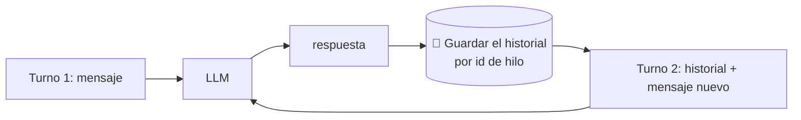
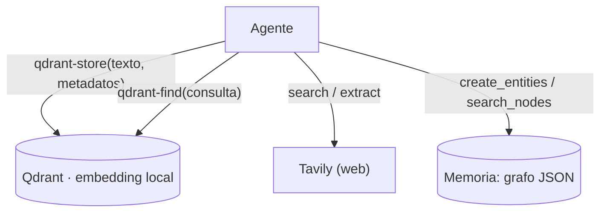

# 06 · Memoria, búsqueda y RAG agéntico

> **Tema 6 de 12.** Fuentes: semana 2 (sesiones), semana 4 (checkpointer) y semana 6 (memoria, Tavily, Qdrant). **Aviso honesto:** el RAG del curso es **superficial**; para rigor, el curso *Core Track* (que descartaste) o el *Production Track*.
> ⬅️ [05 · MCP](05-mcp.md) · ➡️ [07 · Orquestación y multiagente](07-orquestacion-y-multiagente.md) · [Índice](README.md)

---

## 🍳 Con la cocina

Hay **tres cuadernos** en la cocina: la **comanda de hoy** (el historial de la conversación, **memoria corta**), el **cuaderno de recetas y clientes** que se conserva de un día para otro (**memoria larga**) y la **biblioteca del barrio** donde el cocinero va a buscar lo que no sabe (**búsqueda y RAG**). El cocinero **no recuerda nada por sí mismo**: lo que parece memoria es **lo que tú le pones otra vez sobre la mesa**.

> En palabras de la calle: **la memoria no existe en el modelo; es una lista de mensajes que tú guardas y reenvías, o una base de datos que el agente consulta con herramientas.**

---

## 1 · Memoria corta: una lista guardada

- **Cada llamada empieza de cero.** Para recordar reenvías **toda la lista** (y pagas esos tokens).
- **Cómo se guarda en cada marco:**

| Marco | Memoria corta |
|---|---|
| Agents SDK | `SQLiteSession(id)` o `to_input_list()` + mensaje nuevo |
| LangGraph / `create_agent` | `checkpointer=MemorySaver()` + `thread_id` en cada llamada; **los nodos no cambian** |
| CrewAI | `memory=True` (oculta; difícil de diagnosticar) |
| Spring AI 🧩 | `ChatMemory` con repositorio (en memoria o JDBC) 🔎 |

- **Límite:** la ventana de contexto → se **recorta** o se **resume** (middleware de resumen).
- **`thread_id` = una conversación o un proceso.** En un backend: uno por cliente o por proceso de negocio. Cambiar de `thread_id` = empezar sin memoria.

### Memoria persistente con checkpointer (LangGraph / `create_agent`)

| Capacidad | Cómo |
|---|---|
| Cada `invoke` empieza de cero | — |
| **Memoria** | `compile(checkpointer=MemorySaver())` + `config={"configurable": {"thread_id": "…"}}`; los nodos no cambian |
| **Persistente** | `SqliteSaver.from_conn_string("memory.db")`; en producción Postgres 🔎 |
| Ver estado / historial | `graph.get_state(config)` / `graph.get_state_history(config)` (un checkpoint por superpaso) |
| **Rebobinar y reanudar** | misma `thread_id` + `checkpoint_id` anterior → `invoke` |

- **`thread_id` = una conversación o proceso.** En un backend: uno por cliente o por proceso de negocio.
- **Frente a "truncar mensajes":** en un flujo con muchos pasos puedes reanudar **desde cualquier punto**. En banca: **auditoría, reintentos tras fallo y aprobación humana a mitad del proceso**.
- 🧩 **Modelar un flujo de negocio (p. ej. el cobro con control) como grafo con estado persistido** se parece a las **sagas y estados de pago** que ya conoces.

---

## 2 · Memoria larga, búsqueda web y RAG agéntico (con servidores MCP)

Las siete piezas ya están en [ingeniería de contexto](../conceptos/ingenieria-de-contexto.md); aquí se ven **con servidores reales**:

| Pieza | Servidor MCP | Qué hace |
|---|---|---|
| **Memoria a largo plazo** | `server-memory` (Anthropic) | **Grafo de conocimiento** en JSON: *entidades*, *relaciones*, *observaciones*; herramientas `create_entities`, `create_relations`, `search_nodes`… En el proyecto, **una base por investigador** (`./memory/<nombre>.db`) |
| **Búsqueda web** | **Tavily** (clave gratuita sin tarjeta) | Reemplaza la búsqueda de pago de OpenAI (semana 2). Herramientas: `search`, `extract`, `crawl`, `map`, `research` |
| **RAG agéntico** | **Qdrant** (local, sin clave) | Dos herramientas: `qdrant-store` y `qdrant-find`; usa un *embedding* local (all-MiniLM-L6-v2). El agente **decide** qué guardar y qué buscar |
| **Datos de mercado** | **Massive** (antes Polygon.io) o simulador propio | Cotizaciones; si no hay clave, `market_server.py` simula precios |
| **Contexto de API al día** | **Context7** (remoto) | Documentación actualizada de librerías |

**Filtro estático de herramientas:** `create_static_tool_filter(allowed_tool_names=["tavily-search"])` — de las 5 herramientas de Tavily solo se expone **una**. 🧩 Principio del mínimo privilegio aplicado a herramientas.

**Divulgación progresiva de herramientas ⭐ (la idea nueva):** Massive pasó de **10–20 herramientas** (una por endpoint) a **meta-herramientas** para **explorar su propia API** (buscar qué hay, consultar, llamar), inspirándose en las *skills* de la [08 · LangChain, LangGraph y Deep Agents](08-langchain-langgraph-y-deep-agents.md): **no llenar el contexto de lo que no se usa** y dar al agente **un único camino coherente**. Resultado en el proyecto: **17 herramientas en 6 servidores** (el año anterior ~40).

**RAG en una frase del instructor:** montar un RAG a mano es **difícil y largo** (le dedicó una semana en otro curso); con un servidor MCP de Qdrant **solo hay que conocer los parámetros**. 🧩 Matiz: es **cómodo para empezar**; para un caso real hay que decidir *chunking*, embeddings, evaluación y datos sensibles.

⚠️ **MCP alojado (cuarta forma):** OpenAI puede **ejecutar el cliente y el servidor MCP en su lado**; **solo funciona con modelos de OpenAI** → te ata al proveedor. El instructor sugiere **ignorarlo** y quedarse con `stdio`/HTTP.

---

## 3 · Los cuatro oficios y sus herramientas

| Oficio | Para qué | Opción del curso | 🧩 Cuidado |
|---|---|---|---|
| **Memoria corta** | Seguir la conversación | Sesión / checkpointer | Resumir si es larga |
| **Memoria larga** | Recordar entre conversaciones | Servidor de memoria (grafo en JSON); una base **por agente** | Datos personales: ver [09](09-seguridad-guardrails-y-humano-en-el-bucle.md) |
| **Búsqueda web** | Datos actuales | Serper, Tavily (gratis) o la alojada de OpenAI (de pago, atada) | Fecha actual en el prompt |
| **RAG** | Datos propios por significado | Qdrant (local) como herramienta `store` / `find` | Chunking, embeddings y evaluación **no** se enseñan |

> 🧩 **Idea:** el **RAG agéntico** es solo **dar al agente las herramientas de guardar y buscar** y dejar que decida; no sustituye el diseño de un RAG para un caso real.

## 4 · Qué debe dominar cada nivel

| Nivel | Debe poder... |
|---|---|
| 🟢 **Junior** | Explicar que el modelo no recuerda y que se **reenvía el historial**; usar una sesión o un `thread_id`. |
| 🟡 **Mid** | Persistir el estado (SQLite/JDBC), resumir contexto largo, usar un servidor de memoria y de búsqueda; distinguir memoria corta, larga y RAG. |
| 🔴 **Senior** | Decidir **qué recordar y por cuánto tiempo** (privacidad); diseñar un RAG con chunking y **evaluación**; controlar costo del historial; separar memoria por agente/cliente. |

## 5 · Escalera de entrevista

**"¿Cómo das memoria a un agente?"**
- 🟢 "Guardo el historial y lo reenvío."
- 🟡 "Persisto el estado por `conversationId` y resumo cuando se alarga; para datos de otras sesiones uso una memoria larga o un RAG."
- 🔴 "Separo memoria corta y larga, decido qué se guarda y por cuánto (datos personales), la aíslo por cliente y evalúo si recuperar mejora el resultado."

## 🛠️ Ejercicios (taller)

| Taller | Qué haces |
|---|---|
| **W05** | **Memoria y estado** en Spring AI: historial por `conversationId`, repositorio JDBC y **reanudar** tras reiniciar la app |
| **W11** | **RAG agéntico**: pgvector o Qdrant como herramienta; el agente guarda y recupera datos propios |
| **Reflexión escrita** | ¿Qué recordaría y qué **no** recordaría un agente de tu banco? |

## 🔗 Relacionado

[03 · Contexto](03-prompts-contexto-y-salidas-estructuradas.md) · [05 · MCP](05-mcp.md) · [08 · LangGraph y checkpoints](08-langchain-langgraph-y-deep-agents.md) · [Ingeniería de contexto](../conceptos/ingenieria-de-contexto.md) · [Plan de talleres](../talleres/README.md)
