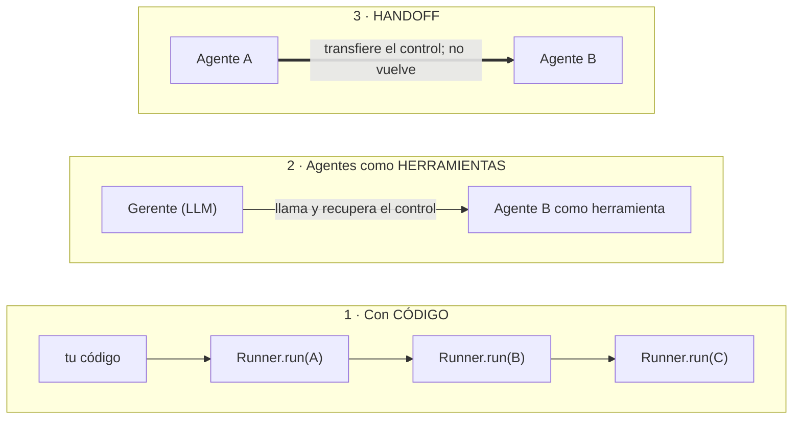
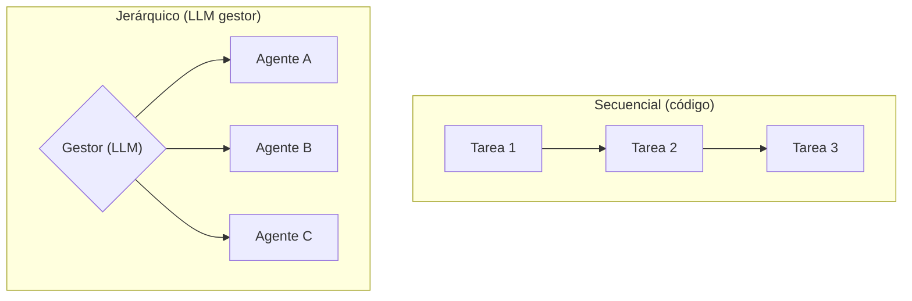

# 07 · Orquestación y multiagente

> **Tema 7 de 12.** Fuentes: semanas 1 (patrones), 2 (código vs agentes), 3 (CrewAI), 5 (orquestador + trabajadores) y 6 (trader + investigador). Los casos completos están en [12 · Proyectos](12-proyectos-del-curso.md).
> ⬅️ [06 · Memoria y RAG](06-memoria-busqueda-y-rag.md) · ➡️ [08 · LangChain, LangGraph y Deep Agents](08-langchain-langgraph-y-deep-agents.md) · [Índice](README.md) · [Catálogo de patrones](../patrones/README.md)

---

## 🍳 Con la cocina

Una cocina con **varios cocineros** necesita **un criterio de reparto**: o **tú escribes quién hace qué y en qué orden** (el jefe de sala con reloj), o **le das la comanda a un chef ejecutivo** que decide. La **regla de oro del curso**: *lo que tiene orden fijo lo manda el reloj; lo que es incierto lo decide el chef.* Y **empieza con un solo cocinero**: añade otros solo cuando el primero se quede corto.

> En palabras de la calle: **código para lo fijo, LLM solo para lo incierto; y un solo agente hasta que falle.**

---

## 1 · Patrones de workflow, de un vistazo

| # | Patrón | 🍳 | Quién reparte | Cuándo | Detalle |
|---|---|---|---|---|---|
| 1 | **Prompt chaining** | Línea de cocina | Código | Pasos secuenciales con puertas | [📄](../patrones/01-prompt-chaining/README.md) |
| 2 | **Routing** | Expedidor | LLM clasifica | Categorías distintas | [📄](../patrones/02-routing/README.md) |
| 3 | **Parallelization** | Cocineros a la vez | Código | Tareas independientes | [📄](../patrones/03-parallelization/README.md) |
| 4 | **Orchestrator-worker** | Chef ejecutivo | **LLM** | Subtareas desconocidas | [📄](../patrones/04-orchestrator-worker/README.md) |
| 5 | **Evaluator-optimizer** | Chef que prueba | LLM juzga | Calidad medible | [📄](../patrones/05-evaluator-optimizer/README.md) |

---

## 2 · Tres formas de orquestar agentes ⭐

| | **Código** | **Agente como herramienta** (`as_tool`) | **Handoff** (`handoffs=[…]`) |
|---|---|---|---|
| Quién decide el orden | **Tú** | El LLM | El LLM |
| Fiabilidad y predecibilidad | ⭐ La más alta | Media | **Baja**: costó que funcionara; hubo que forzar la herramienta del receptor |
| Portabilidad | Total | **Común a todos los frameworks** | **Propia del SDK** (inyecta instrucciones suyas: "vudú") |
| Autonomía | Baja | Alta | Alta |
| Postura del instructor | ⭐ La que usa en producción | Segunda opción | **La evita** |

- **Detalle práctico:** el **nombre de un agente usado como herramienta no puede tener espacios**.
- **El SDR del curso** (tres vendedores con estilos distintos en paralelo con `gather` + un agente **selector** + un **enviador** con herramienta) es **paralelización + juez + herramienta**: nada nuevo en concepto. Con código sabes qué pasa en cada paso.
- **Regla:** elige entre **código** (estable, comprensible) y **LLM** (autonomía, "estilo Claude Code"); lo de *handoffs* sí o no es la decisión menor. **Mide** si la autonomía mejora el resultado.

---

## 3 · La misma idea en cada marco

| Marco | Secuencial (código) | Agente como herramienta | Jerárquico / handoff |
|---|---|---|---|
| Agents SDK | `Runner.run` encadenados | `agent.as_tool()` | `handoffs=[…]` (**evitar**) |
| CrewAI | `process=sequential` | — | `process=hierarchical` + `manager_agent` |
| LangGraph | Aristas del grafo | Nodo que llama a otro agente | Aristas condicionales |
| `create_agent` · Deep Agents | — | **Subagentes** (`task`) | Subagentes con herramientas propias |
| Spring AI 🧩 | Servicios en secuencia | Agente envuelto como `@Tool` | — |

- **CrewAI:** el modo **jerárquico** es la orquestación por LLM; el secuencial, la orquestación por código. El gestor reparte, pero **sube costo e impredecibilidad** (mismo riesgo del patrón 4).
- **Contexto entre agentes:** en CrewAI, sin `context:` cada tarea recibe **todas** las salidas anteriores; con `context:`, solo las listadas. Es **magia que conviene saber** ([11](11-frameworks-y-como-elegir.md)).

## 4 · Dos casos reales del curso (resumen)

| Caso | Quién orquesta | Qué decide el LLM | Lección |
|---|---|---|---|
| **Trader + investigador** (semana 6) | **Código** llama a los 4 traders (`asyncio.gather`) | El trader decide **cuándo** investigar (`as_tool`) | Orden fijo → código; incertidumbre → LLM |
| **Orquestador + 5 trabajadores** (semana 5) | **Un LLM (ADK)** lanza trabajadores | El orden y la corrección de errores | Inestable: el instructor admite que un **flujo de código sería más seguro** |

Más detalle en [12 · Proyectos](12-proyectos-del-curso.md). El **tablero compartido de tareas** (SQLite con objetivos y pasos) es el único canal entre agentes.

### ⚠️ Cuando el orquestador es un LLM (advertencia del propio instructor)

- El orquestador **es un LLM** que decide el orden: **inestable**, puede ejecutar mal o fallar con modelos pequeños (el MCP de Playwright se cortó a ratos). **Una alternativa más segura es un flujo de código que llame a cada agente por orden.** Aquí usó LLM **a propósito** para mostrar el bucle.
- Cuando ves **pasos numerados en un prompt**, es una **señal de alerta**: quizá deba ser código.
- **Costo y no determinismo:** cada ejecución es distinta; no apta para producción sin evaluación.
- 🧩 Lanzar **procesos hijos** desde un LLM (`launch_worker`) es una **herramienta con efectos**: en un entorno real exige límites, aprobación y registro (lo visto en [09 · Seguridad y humano en el bucle](09-seguridad-guardrails-y-humano-en-el-bucle.md): middleware).

## 5 · Reglas para decidir

| Regla | Detalle |
|---|---|
| **Un agente primero** | Si falla en tareas complejas, divide **por prompts y herramientas distintos**, no por "roles humanos" |
| **Código por defecto** | Cede el orden al LLM solo con evidencia de mejora |
| **Pasos numerados en un prompt = señal de alerta** | Quizá deba ser código |
| **A2A solo entre organizaciones distintas** | Dentro de un mismo sistema basta una función o una herramienta MCP |
| **Mide** | Resultado, costo y fiabilidad **por ejecución**, con muchas ejecuciones |
| **Acota** | Topes de iteraciones y de costo; aprobación humana en acciones con efectos |

## 6 · Qué debe dominar cada nivel

| Nivel | Debe poder... |
|---|---|
| 🟢 **Junior** | Explicar los 5 patrones y la diferencia entre código y LLM como orquestador. |
| 🟡 **Mid** | Elegir entre código, agente-herramienta y handoff; construir un orquestador con trabajadores; manejar fallos parciales. |
| 🔴 **Senior** | Defender **código por defecto** con evidencia; medir si la autonomía compensa; acotar con topes, aprobaciones y trazas; evitar dividir en "roles humanos" sin una razón de contexto. |

## 7 · Escaleras de entrevista

**"¿Cuándo orquestar con código y cuándo con un LLM?"**
- 🟢 "Con código si conozco los pasos; con LLM si necesito que decida."
- 🟡 "El código es más predecible y fácil de depurar; los agentes-herramienta dan autonomía; los handoffs son específicos del framework."
- 🔴 "Empiezo con código y solo cedo control al LLM si una métrica demuestra mejora; pago con menos fiabilidad y determinismo, y lo acoto con topes, guardrails y trazas."

**"¿Cómo coordinas varios agentes?"**
- 🟢 "Un agente jefe que reparte."
- 🟡 "Un orquestador con herramientas para lanzarlos y un tablero compartido de tareas."
- 🔴 "Si el orden es conocido, lo hago en código; cedo el orden al LLM solo si lo justifica una métrica; con topes, aprobación humana en acciones con efectos y trazas."

## 🛠️ Ejercicios (taller)

| Taller | Qué haces |
|---|---|
| **W03** | Chaining con puerta (procesar un pago), routing y paralelización; fallo parcial manejado |
| **W04** ⭐ (×2) | **Gerente con agentes-herramienta**: reunión → funcionalidades → tareas (**tu PoC3**); validar el plan (formato y tope de subtareas) |
| **W13** (×2) | **Multiagente con tablero compartido**: dos trabajadores toman tareas sin pisarse |
| **Q4** | PoC3 en Quarkus |
| **Reflexión escrita** | Para tu flujo reunión → funcionalidades → tareas, marca qué es **código** y qué es **LLM** |

## 🔗 Relacionado

[01 · Agentes](01-agentes-y-workflows.md) · [Catálogo de patrones](../patrones/README.md) · [12 · Proyectos](12-proyectos-del-curso.md) · [Diagramas UML §6–7](diagramas-uml.md) · [`ia-agentes/`](../../ia-agentes) · [Plan de talleres](../talleres/README.md)
