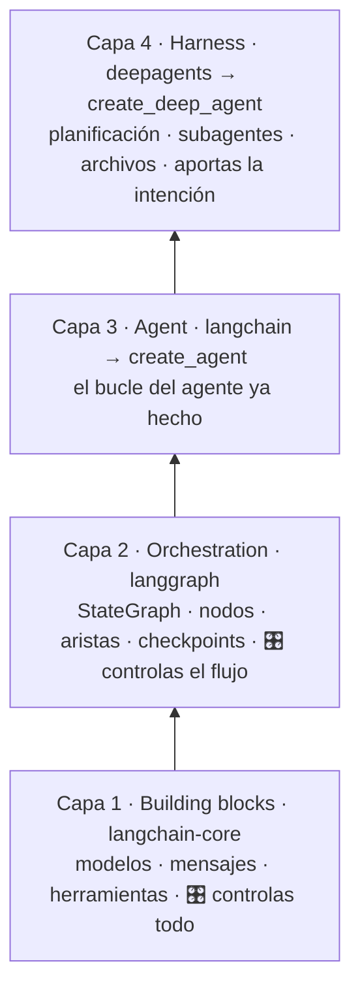
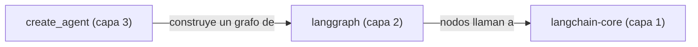
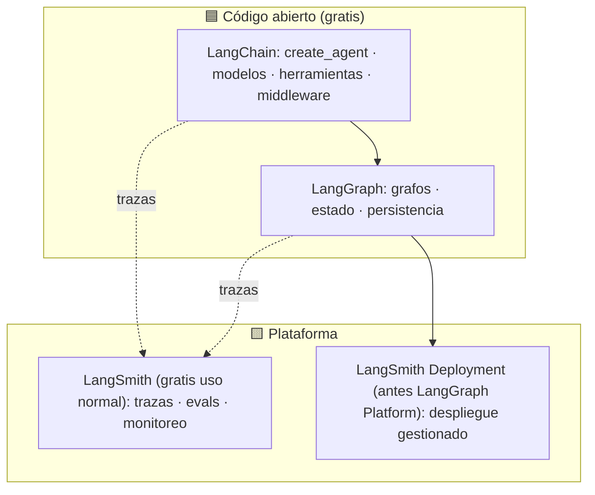
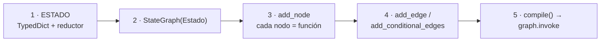
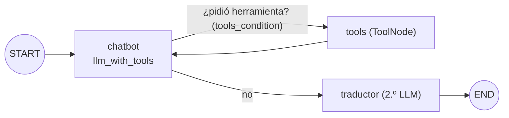
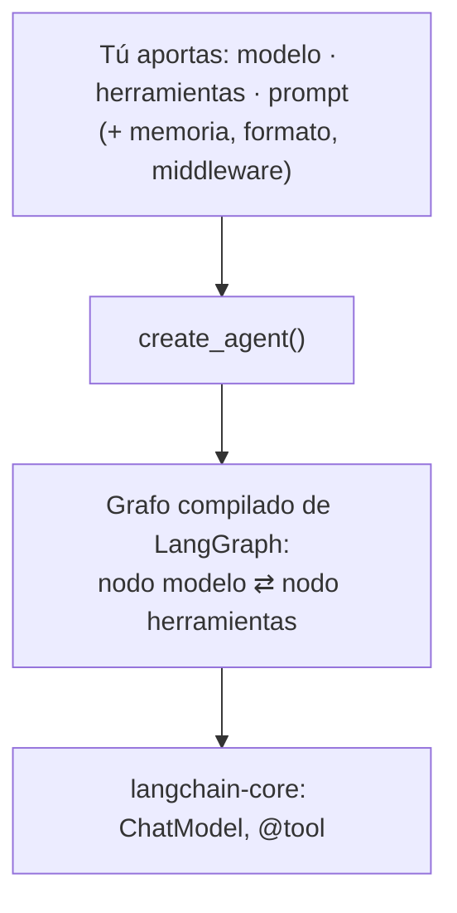
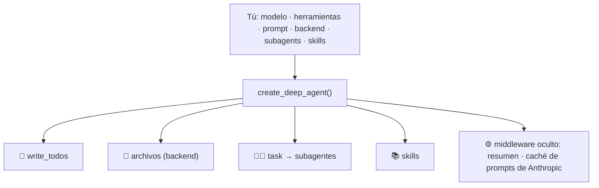
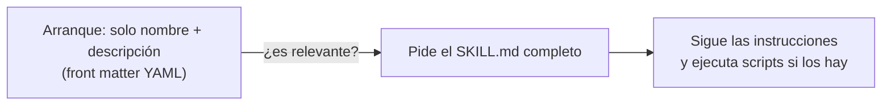

# 08 · LangChain, LangGraph y Deep Agents — las cuatro capas

> **Tema 8 de 12** (el ecosistema que más explica "qué hay debajo" de un agente). Fuente: semana 4. Los **proyectos** (Sidekick) están en [12](12-proyectos-del-curso.md).
> ⬅️ [07 · Orquestación](07-orquestacion-y-multiagente.md) · ➡️ [09 · Seguridad y humano en el bucle](09-seguridad-guardrails-y-humano-en-el-bucle.md) · [Índice](README.md) · [Diagramas UML](diagramas-uml.md)

---

## 🍳 Con la cocina

Es **toda la cadena de suministro de la cocina**, en cuatro pisos: **ingredientes crudos** (capa 1), **plano con el recorrido de cada comanda** (capa 2), **cocina con el servicio ya montado** (capa 3) y **restaurante llave en mano** (capa 4). Lo difícil no es cocinar: es **saber en qué piso estás**. Casi siempre te conviene el **piso 3**.

> En palabras de la calle: **"LangChain" son cuatro cosas distintas; abajo controlas todo, arriba te dan todo hecho y ves menos.**

---

## 1 · Las cuatro capas de LangChain



| Capa | Paquete | 🍳 | Equivale a | Cuándo |
|---|---|---|---|---|
| 1 | `langchain-core` | Ingredientes crudos | Cliente de chat + `@Tool` (Spring AI `ChatClient`) | Control total |
| 2 | `langgraph` | Plano con flujo de comandas | Motor de workflow / máquina de estados 🧩 (sin equivalente directo en Spring AI/Quarkus) | Flujos con estado, ramas, reanudar |
| 3 | `create_agent` | Servicio ya montado | `Agent` + `Runner` (Agents SDK); AiService (Quarkus) | **Por defecto** |
| 4 | `create_deep_agent` | Llave en mano | Claude Agent SDK / subagentes de Claude Code | Tareas largas y abiertas |

**La confusión circular:** `create_agent` (en el producto *LangChain*) construye un grafo de *LangGraph* cuyos nodos llaman a *langchain-core*. Son paquetes distintos con el mismo apellido.



### El ecosistema (qué es qué)



| Nombre | ¿Lo necesito? |
|---|---|
| LangChain (empresa) | No |
| `langchain-core`, LangGraph, LangChain (`create_agent`) | ✅ capas 1, 2 y 3 |
| **LangSmith** (trazas y evals) | ✅ cuenta gratis; ⚠️ sube las trazas a su plataforma, sin datos reales |
| LangSmith Deployment | ❌ de pago |
| Deep Agents | 🟡 capa 4 |

### Capa 1 · lo único que hay que mirar (Lab 1)

`bind_tools` **no ejecuta nada**: el modelo solo **pide** usar una herramienta (`.tool_calls`) y **tú** escribes el bucle. Es el de la [04 · Herramientas y bucle](04-herramientas-y-bucle-del-agente.md):

```python
llm_with_tools = llm.bind_tools([get_share_price])
resp = llm_with_tools.invoke(messages)          # trae .tool_calls
messages.append(resp)
for call in resp.tool_calls:
    if call["name"] == "get_share_price":       # 🧩 allowlist: nunca ejecutar por nombre sin validar
        out = get_share_price.invoke(call["args"])
        messages.append(ToolMessage(content=str(out), tool_call_id=call["id"]))
final = llm_with_tools.invoke(messages)
```

| Pieza | Código | Equivale a |
|---|---|---|
| Modelo | `ChatOpenAI(model=…)`; otro proveedor: añade `base_url` y `api_key` | Cliente de chat |
| Verbo universal | `invoke` / `stream` / `ainvoke` | — |
| Herramienta | `@tool` + docstring + tipos → `.name`, `.description`, `.args`, `.invoke()` | `@function_tool` / `@Tool` |
| Salida estructurada | `llm.with_structured_output(MiModelo)` | `output_type` / `output_pydantic` |

---

## 2 · LangGraph: estado, nodos y aristas ⭐

### Los 5 pasos



| Término | Qué es | 🍳 | Equivale a |
|---|---|---|---|
| **Grafo** | El flujo completo | Plano de la cocina | Workflow / máquina de estados |
| **Estado** | Instantánea de la información | La **comanda** que viaja de estación en estación | Objeto de contexto inmutable |
| **Nodo** | Función `estado → estado nuevo` | Una estación | Un paso / handler |
| **Arista / condicional** | Qué viene después / según una condición | El expedidor decide | Transición / router |
| **Reductor** | Cómo **fusionar** lo que devuelve un nodo con el estado | El jefe que integra las notas de varios cocineros | `merge` / reducer de Redux |
| `START` / `END` | Entrada y salida | Puertas de la cocina | — |

```python
class State(TypedDict):
    messages: Annotated[list, add_messages]     # add_messages = el REDUCTOR (viene incluido)

def mi_nodo(state: State) -> dict:              # no modifica "state": devuelve algo nuevo
    return {"messages": [llm.invoke(state["messages"])]}
```

- 🧩 Un grafo **no necesita LLM**; orquesta cualquier función.
- **El agente dibujado:** el `if`/`for` desordenado del bucle a mano (capa 1), pero **como diagrama**.




**Memoria, `thread_id` y rebobinado:** → [06 · Memoria](06-memoria-busqueda-y-rag.md#memoria-persistente-con-checkpointer-langgraph--create_agent).

---

## 3 · `create_agent`: la capa por defecto ⭐



| Capacidad | Cómo (código de mi fork) | Equivale a |
|---|---|---|
| Agente mínimo | `create_agent(model="openai:gpt-5.4-mini", system_prompt="…")`; `agent.invoke({"messages":[…]})`; `result["messages"][-1].content` | `Agent` + `Runner` |
| Modelo como texto | `"proveedor:modelo"` (**dos puntos**; LiteLLM usa barra) | Atajo para no crear `ChatOpenAI` |
| Herramientas | `tools=[get_weather, get_population]` | `function_tools` |
| Memoria | `checkpointer=MemorySaver()` + `thread_id` | Día 2, integrado |
| Estructura | `response_format=CityReport` → `result["structured_response"]` | `output_type` |
| **Middleware** | `middleware=[…]` | Interceptores / AOP |
| **MCP** | `MultiServerMCPClient({...})` → `await client.get_tools()` | Cliente MCP |
| Asíncrono | `await agent.ainvoke(...)` | No bloquea (el agente espera E/S lenta) |
| Ver el grafo | `agent` en un notebook | Confirma que por dentro es el grafo de la sección 2 |

**Se pierde:** control del diseño del grafo. Si necesitas ramas y aprobaciones propias, bajas a LangGraph (sección 2).


**Middleware y aprobación humana:** → [09 · Seguridad y humano en el bucle](09-seguridad-guardrails-y-humano-en-el-bucle.md). **MCP con Playwright:** → [05 · MCP](05-mcp.md).

---

## 4 · Deep Agents y skills (capa 4)



- **Trae sin pedirlo:** lista de tareas (`write_todos`), archivos, `task` para delegar y skills.
- **Subagente = un diccionario:** `name`, `description`, `system_prompt` (+ `tools`, `skills`).
- **Backend:** `FilesystemBackend(root_dir=sandbox, virtual_mode=True)`. ⚠️ Restringe rutas pero **no es un contenedor**.
- **Lab:** investigar redes de recarga y comparar Tesla Model Y vs. Ford Mustang con subagentes → `charging.md`, `fleet.md`, `fleet.pptx`. En la traza había **mucho middleware que nadie escribió**.

### Skills ⭐



- **`SKILL.md`** (front matter + Markdown), una carpeta por skill. Inventado por Anthropic; hoy lo soportan Codex y otros.
- **Divulgación progresiva:** barato en contexto, por eso caben muchas.

| | Skills | Herramientas |
|---|---|---|
| Pensadas para | Quien **usa** un agente hecho (Claude Code, Codex) | Quien **construye** el agente |
| Fiabilidad | **Menor:** tokens libres para ejecutar un script | **Mayor:** esquema + **decodificación restringida** |

> 🧩 **Instrucciones y estilo → skill; acciones con efectos → herramienta con esquema.**

**Conexión con tu kit `ia-agentes`:** ya usas subagentes y skills de Claude Code/Copilot. Deep Agents es **lo mismo pero programable**.

**⚠️ Lo que el curso no dice:** mucha autonomía + middleware oculto = difícil de auditar; cada subagente suma llamadas (~22 s en el ejemplo); `GoogleSerperRun` está **obsoleto**; una skill con scripts es **código que alguien ejecutará**: revisa su origen.

---

## 5 · Qué debe dominar cada nivel

| Nivel | Debe poder... |
|---|---|
| 🟢 **Junior** | Nombrar las 4 capas y saber en cuál está; usar `create_agent` con herramientas y memoria; explicar estado, nodo y arista. |
| 🟡 **Mid** | Dibujar un agente como grafo (con arista condicional); usar `checkpointer` y rebobinar; escribir un middleware; distinguir skills de herramientas. |
| 🔴 **Senior** | Elegir la capa por **control vs. comodidad**; diseñar el estado y el reductor; desconfiar de la magia de las capas altas y **auditar con trazas**; modelar un flujo de negocio como grafo con estado persistido (sagas, estados de pago). |

## 6 · Escaleras de entrevista

**"¿Qué es el estado en LangGraph y por qué es inmutable?"**
- 🟢 "La información compartida entre pasos."
- 🟡 "Cada nodo devuelve un estado nuevo; un reductor lo combina."
- 🔴 "Eso permite paralelismo sin pisarse y hace posibles los checkpoints y el rebobinado; el reductor define la semántica de fusión."

**"¿Qué capa de LangChain usarías?"**
- 🟢 "`create_agent`, que es lo más fácil."
- 🟡 "Capa 3 por defecto; bajo a LangGraph si necesito control de flujo, estado persistente o aprobaciones."
- 🔴 "Capa 3 y, si el flujo de negocio exige ramas y reanudación auditables, LangGraph; evito la capa 4 en producción por su opacidad."

## 🛠️ Ejercicios (taller)

> El curso usa Python aquí; **tus talleres lo traducen a Java**, donde **no hay un equivalente directo de LangGraph** 🧩.

| Taller | Qué haces |
|---|---|
| **W05** | **Estado y reanudación** en Java: repositorio de estado por proceso + máquina de estados (lo más parecido a un grafo con checkpoints) |
| **N4** | Estado y aprobación humana en NestJS |
| **Lectura** | Dibuja en papel el grafo de un **flujo de cobro** con ramas (reintento, rechazo, aprobación) y marca dónde guardarías un checkpoint |

## 🔗 Relacionado

[06 · Memoria](06-memoria-busqueda-y-rag.md) · [09 · Seguridad](09-seguridad-guardrails-y-humano-en-el-bucle.md) · [11 · Frameworks](11-frameworks-y-como-elegir.md) · [Diagramas UML §5](diagramas-uml.md) · [Plan de talleres](../talleres/README.md)
