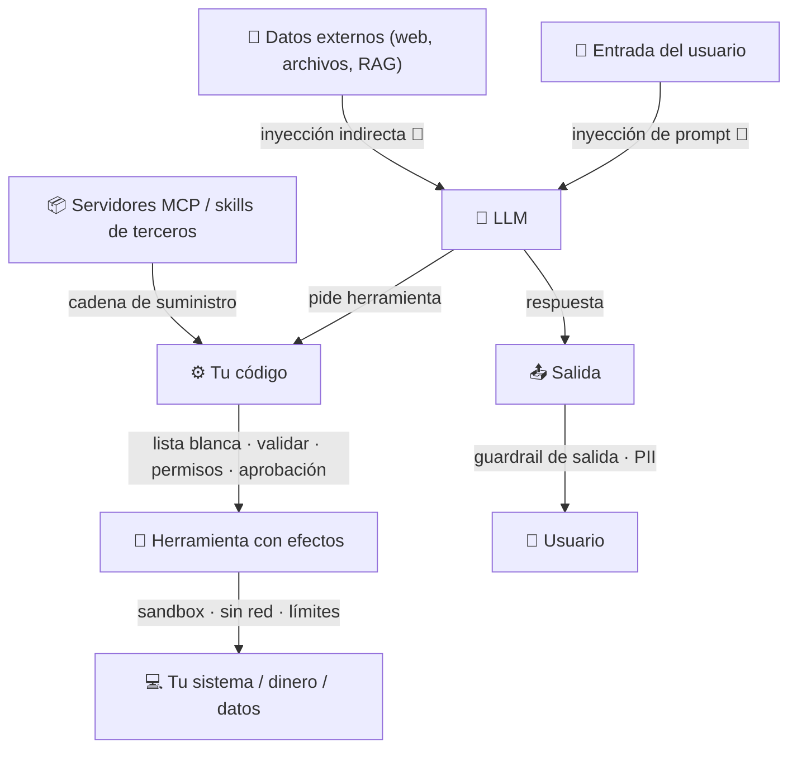

# 09 · Seguridad, guardrails y humano en el bucle

> **Tema 9 de 12.** **El curso lo trata de pasada, y es lo que más pesa en banca**: por eso este documento reúne todo lo disperso (semanas 1, 2, 3, 4 y 6) y añade una **lista de amenazas** (🧩 mía). Nada aquí es "garantía": es **criterio de diseño**.
> ⬅️ [08 · LangChain y LangGraph](08-langchain-langgraph-y-deep-agents.md) · ➡️ [10 · Observabilidad, evaluación y costos](10-observabilidad-evaluacion-y-costos.md) · [Índice](README.md)

---

## 🍳 Con la cocina

La cocina necesita **higiene y reglas**: un cocinero que **lava las manos** (guardrails), una **puerta con llave** para la despensa peligrosa (permisos), un **jefe que firma antes de gastar** en cosas grandes (aprobación humana) y una **cocina de pruebas aislada** donde se ensaya lo que huele raro (sandbox). **Un agente con herramientas es un cocinero con llaves**: las llaves se reparten con cuidado.

> En palabras de la calle: **el modelo propone; tu código dispone. Cada herramienta con efectos lleva permiso, límite, registro y, si es irreversible, firma humana.**

---

## 1 · Mapa de amenazas (🧩 mío, ordenado por dónde ocurren)



| Amenaza | Qué pasa | Control principal | Dónde se ve en el curso |
|---|---|---|---|
| **Herramienta con efectos** | El modelo pide algo destructivo | Lista blanca + validar + **aprobación humana** | [04](04-herramientas-y-bucle-del-agente.md), sec. 3 |
| **Código generado** | Se ejecuta en tu máquina | **Sandbox** (contenedor efímero, sin red) | Semana 3 |
| **Datos personales (PII)** | Se filtran a un modelo o a una traza | Middleware de PII; trazas locales | Semana 4 |
| **Costo / bucles** | Un agente gasta sin parar | Tope de iteraciones y de llamadas; presupuesto de la clave | Semanas 1, 4 |
| **Publicar un agente** | Repositorio público, claves, abuso | Secretos de plataforma; presupuesto; guardrail de salida | Semana 1 |
| **Dependencia de terceros** | Un servidor MCP o skill hace de más | Revisar origen, fijar versión, filtrar herramientas | Semana 6 |
| **Inyección de prompt** 🔎 | Texto externo da órdenes al modelo | Separar datos de instrucciones; aprobación en acciones con efectos | **No se enseña** |

---

## 2 · Guardrails (qué son y cómo implementarlos)

### Guardrails

- **Tipos del SDK:** entrada (**solo el primer agente**), salida (**solo el último**) y de herramientas; si salta el ***tripwire***, **lanza una excepción**. **Corren en paralelo por defecto**: aunque salten, **ya pudieron ejecutarse herramientas** (🧩 cuidado con efectos laterales).
- ⭐ **Postura del instructor (la valiosa):** acepta el concepto, no la implementación del SDK. **Un guardrail = otra llamada al modelo con salida estructurada + un `if`** donde tú quieras; para herramientas, comprobar **dentro de la herramienta**. Es **portable a cualquier framework** y más fácil de depurar. Es tu patrón evaluador y tu `tdd-gate.sh`.

---

## 3 · Middleware y aprobación humana

### Middleware: código en puntos del bucle ⭐

Código en **puntos del bucle**: antes del modelo, después, o **alrededor de cada herramienta**.

```python
@wrap_tool_call
def log_tool_calls(request, handler):
    call = request.tool_call
    print(f"[middleware] {call['name']} {call['args']}")
    return handler(request)            # aquí se ejecuta la herramienta real
```

| Con middleware puedes… | 🧩 En tu mundo |
|---|---|
| Registrar cada llamada | Auditoría de qué hizo el agente |
| **Bloquear** (no llamar a `handler`) | Allowlist/denylist de herramientas o dominios |
| Resumir conversaciones largas (incluido) | Controlar el contexto |
| **Pedir aprobación humana** (incluido) | Aprobar acciones irreversibles |

---

### Los middlewares (con los nombres del código real)

| Middleware | Para qué | 🧩 Tu mundo |
|---|---|---|
| `TolerateToolErrors` (propio, `awrap_tool_call`) | Si una herramienta falla, **devuelve el error al modelo** para que decida en vez de lanzar excepción | Resiliencia |
| `TodoListMiddleware` | Plan visible; la UI lo muestra y va tachando | Trazabilidad |
| `PIIMiddleware("email")`, `PIIMiddleware("credit_card", apply_to_tool_results=True)` | **Oculta datos personales** (también en los resultados de herramientas) | **Cumplimiento de datos** |
| `ModelCallLimitMiddleware(run_limit=30)` | **Tope de llamadas** | Costo y bucles |
| `HumanInTheLoopMiddleware(interrupt_on={...})` | **Pausa antes de herramientas sensibles** | Aprobación de acciones con efectos |

---

### Aprobación humana (human-in-the-loop) ⭐

1. El agente intenta usar una herramienta marcada en `interrupt_on` (p. ej. `send_push_notification`).
2. **Se interrumpe** y devuelve qué quiere ejecutar; el estado queda en el checkpointer (necesita `thread_id`).
3. Reanudas con un **comando**, **no con un mensaje**: `Command(resume={"decisions": [{"type": "approve"}]})`.
4. Las decisiones posibles: **`approve`**, **`edit`** (ejecutar con otros parámetros) o **`reject`** (omite la herramienta y vuelve al modelo con un motivo).

🧩 **Es lo que se necesita para un pago:** el agente **propone**, una persona **autoriza**, y todo queda registrado en el estado.

---

## 4 · Ejecutar código generado por un LLM: sandbox con Docker ⭐

CrewAI **eliminó** `allow_code_execution=True` (riesgo de ejecutar en tu máquina + venden sandboxes en la nube de pago). El curso lo reconstruye con **4 herramientas propias** sobre un directorio `sandbox/`:

| Herramienta | Qué hace | ¿Docker? |
|---|---|---|
| `list_sandbox_files` | Lista archivos del directorio | No |
| `read_sandbox_file` | Lee un archivo | No |
| `write_sandbox_file` | Escribe/sobrescribe un archivo | No |
| `run_sandbox_python` | Ejecuta un `.py` **dentro de un contenedor efímero** | **Sí** |

El comando (tu fork, `engineering_team/tools/sandbox_tools.py`):

```text
docker run --rm -v <sandbox>:/workspace -w /workspace \
  ghcr.io/astral-sh/uv:python3.13-bookworm-slim uv run <archivo>      # timeout 300 s
```

- `--rm`: el contenedor se borra al terminar. `-v`: **lo único visible es el directorio montado**. `timeout`: corta bucles infinitos. Devuelve `exit code`, `stdout` y `stderr` etiquetados (los tests de `unittest` escriben en **stderr**).
- Imagen de Astral con `uv` ya instalado; el sandbox es un proyecto `uv` (`uv init` + `uv add gradio`) que se **reinicia en cada ejecución**.

**🧩 Lo que añadiría yo (no lo hace el curso)** ⚠️ — como en el negocio bancario:

| Falta en la referencia | Mejora |
|---|---|
| El contenedor tiene **red** | `--network none` (o allowlist) |
| Sin límites de recursos | `--memory`, `--cpus`, `--pids-limit` |
| `write_sandbox_file(filename)` no valida la ruta | Rechazar `..` y rutas absolutas (path traversal) |
| Corre como root dentro del contenedor | `--user` no root, `--read-only` donde se pueda |
| Las tareas las escribe el humano | Correcto: **no leer requisitos de Internet o de un usuario sin control** (instructor) |

> En palabras de la calle: **lo que un LLM escribe se ejecuta en una caja cerrada, sin red, con reloj y sin acceso al resto de tu máquina.**

El instructor lo presenta como *"nuestro propio Claude Code"*: un agente con herramientas de archivos + ejecución. Es la idea de la semana 1 (LLM + herramientas + bucle) llevada a código.

---

## 5 · Riesgos de publicar un agente

**Riesgos de publicar (🔒 lo valioso):**

| Riesgo | Control |
|---|---|
| Un Space de Hugging Face es **un repositorio público** | **Nunca** subir el `.env`; claves como **Secretos** de la plataforma |
| **Costos** de una API de pago expuesta | Modelo barato, **clave con presupuesto fijo**, limitación de tasa, retirar el despliegue |
| **Salidas sin control** | Guardrail de salida (LLM juez) antes de exponerlo |

---

### ⚠️ Lo que yo vigilaría del Sidekick (🧩)

1. **41 herramientas** a un solo agente es mucho: más confusión de herramientas, más costo. Filtra por tarea.
2. **PII por regla** (`email`, `credit_card`): revisa qué patrones cubre antes de confiar en él con datos reales.
3. La **aprobación humana** debe cubrir **toda herramienta con efectos** (escritura, envío, pago), no solo la notificación.
4. `request_human_help` como herramienta que el agente **llama** para pedir ayuda es un buen truco: convierte "no sé" en una pausa, no en una invención.

## 6 · Lista de verificación para un agente con efectos (🧩)

| # | Pregunta | Sí/No |
|---|---|:-:|
| 1 | ¿Cada herramienta con efectos tiene **lista blanca, validación y permisos mínimos**? | ☐ |
| 2 | ¿Las **irreversibles** requieren **aprobación humana** con registro de quién aprobó? | ☐ |
| 3 | ¿Hay **tope** de iteraciones, de llamadas y de costo? | ☐ |
| 4 | ¿Los datos personales se **filtran** antes del modelo y de las trazas? | ☐ |
| 5 | ¿El código generado corre **aislado** (sin red, sin root, con límites)? | ☐ |
| 6 | ¿Los servidores MCP y skills tienen **origen y versión fijados**? | ☐ |
| 7 | ¿Hay **pruebas de inyección** y de abuso en CI? | ☐ |
| 8 | ¿La **traza** permite reconstruir qué hizo el agente? | ☐ |

## 7 · Qué debe dominar cada nivel

| Nivel | Debe poder... |
|---|---|
| 🟢 **Junior** | Guardar claves como secretos; explicar que el modelo no ejecuta, tu código sí; usar un tope de iteraciones. |
| 🟡 **Mid** | Escribir un middleware (registro/bloqueo); añadir aprobación humana; ejecutar código en un contenedor; filtrar herramientas de un servidor MCP. |
| 🔴 **Senior** | Diseñar **seguridad por capas** (lista blanca, aprobación, aislamiento, PII, trazas); tratar servidores MCP y skills como **dependencias de terceros**; **probar** inyecciones y abusos; justificar qué autonomía se concede y qué evidencia hay. |

## 8 · Escaleras de entrevista

**"¿Cómo ejecutas de forma segura código que genera un LLM?"**
- 🟢 "En un contenedor, no en mi máquina."
- 🟡 "Contenedor efímero, un solo directorio montado y tiempo máximo."
- 🔴 "Además sin red, con límites de CPU y memoria, usuario no root, validación de rutas, requisitos controlados por mí y registro de cada ejecución."

**"¿Cómo metes a una persona en el flujo de un agente?"**
- 🟢 "Que apruebe antes de acciones importantes."
- 🟡 "Middleware de human-in-the-loop sobre las herramientas sensibles; el agente se pausa y se reanuda con una decisión."
- 🔴 "Interrupción con estado persistido, decisiones approve/edit/reject, solo en herramientas con efectos, con registro de quién aprobó qué."

**"¿Cómo implementas guardrails?"**
- 🟢 "Reviso la entrada y la salida antes de usarlas."
- 🟡 "Con una llamada de comprobación que devuelve salida estructurada y un `if` que corta."
- 🔴 "Propios y portables, dentro de las herramientas cuando hay efectos; cuido que no corran en paralelo con acciones irreversibles."

**"¿Cómo expones un agente a Internet?"**
- 🟢 "Claves como secretos, nunca en el repositorio."
- 🟡 "Más un presupuesto fijo en la clave, un modelo barato y limitación de tasa."
- 🔴 "Lo trato como superficie de ataque: costos acotados, guardrails de salida, validación de entradas, permisos mínimos y trazas."

## 🛠️ Ejercicios (taller)

| Taller | Qué haces |
|---|---|
| **W06** ⭐ | **Aprobación humana** en Spring AI + *advisors* (PII, registro, tope de llamadas): un pago **no se ejecuta** sin `approve`; `reject` vuelve al modelo con motivo |
| **W12** | **Sandbox seguro**: ejecutar código generado en Docker (sin red, límites, no root); un intento de salir del directorio o usar red **falla** |
| **Q2** | Guardrails de entrada y salida de herramientas en Quarkus |
| **W15** | Casos de **abuso e inyección** como parte de las pruebas |
| **Reflexión escrita** | Completa la lista de verificación §6 para un agente de tu trabajo |

## 🔗 Relacionado

[04 · Herramientas](04-herramientas-y-bucle-del-agente.md) · [05 · MCP](05-mcp.md) · [10 · Observabilidad y evaluación](10-observabilidad-evaluacion-y-costos.md) · [Diagramas UML §4](diagramas-uml.md) · [Plan de talleres](../talleres/README.md)
