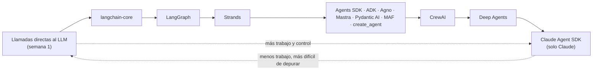
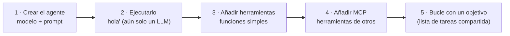
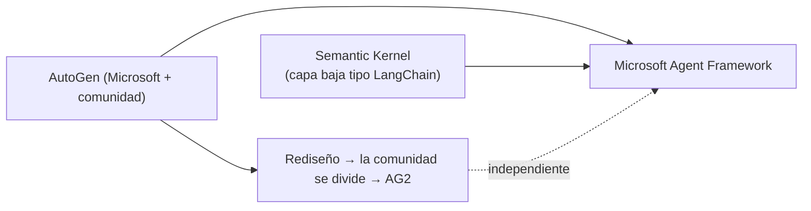
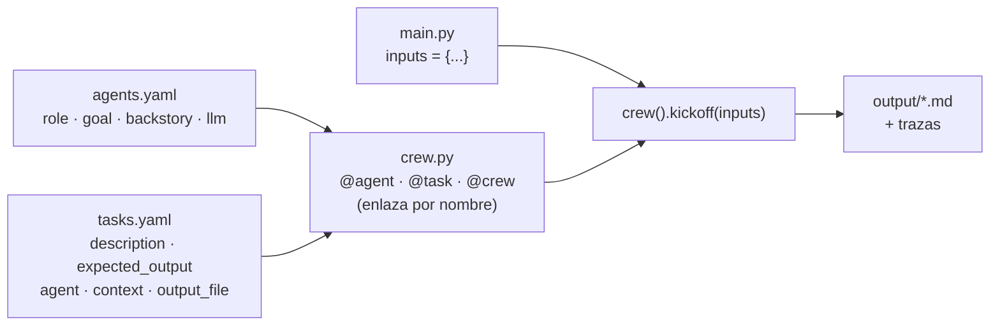
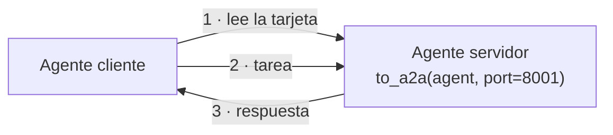

# 11 · Frameworks y cómo elegir

> **Tema 11 de 12.** Fuentes: semanas 3 (CrewAI), 5 (seis marcos) y 6 (cierre). **Tesis del curso (y mía):** *una vez que conoces un marco, los conoces todos*; elige por tu equipo y tu ecosistema, no por la sintaxis.
> ⬅️ [10 · Observabilidad y evaluación](10-observabilidad-evaluacion-y-costos.md) · ➡️ [12 · Proyectos del curso](12-proyectos-del-curso.md) · [Índice](README.md)

---

## 🍳 Con la cocina

Los frameworks son **marcas de cocina**: otra decoración, otros nombres para los utensilios, **los mismos fogones**. Unas son **cocinas vacías** (tú pones todo), otras **traen brigada contratada** (CrewAI) y otras son un **restaurante llave en mano** (Deep Agents, Claude Agent SDK). Cuanto más equipada, **menos trabajo… y menos ves** lo que pasa por dentro.

> En palabras de la calle: **cambian los nombres de las piezas, no las piezas. Elige por tu equipo y tu ecosistema, y mira siempre la traza.**

---

## 0 · La escala de abstracción (de menos a más equipado)

El instructor se inclina por el **extremo izquierdo** (menos opacidad), "pero cada uno elegirá un punto según el problema, la madurez del proyecto y las competencias del equipo".

## 1 · Los 5 pasos: la receta común a todos

**El ejercicio común:** una **lista de tareas en SQLite** (`board.py`) con **objetivos y pasos**; el agente la maneja con 3 herramientas (`show_todos`, `plan_steps`, `complete_task`) y usa el **MCP de archivos de Anthropic** (`@modelcontextprotocol/server-filesystem`, limitado a una carpeta) para leer `notes.txt`, traducirlo y escribir `spanish.txt`. Es la idea de la [04 · Herramientas y bucle](04-herramientas-y-bucle-del-agente.md) (checklist como planificación), pero **persistida y compartida**.

---

## 2 · Los marcos en una tabla ⭐

| | Agents SDK (sem. 2) | CrewAI (sem. 3) | `create_agent` (sem. 4) | **Google ADK** | **Strands** (AWS) | **Pydantic AI** | **MAF** (Microsoft) | **Agno** | **Mastra** |
|---|---|---|---|---|---|---|---|---|---|
| Prompt | `instructions` | YAML | `system_prompt` | `instruction` | `system_prompt` | `instructions` | `instructions` | `instructions` | `instructions` |
| Herramienta | `@function_tool` | `@tool` | `@tool` | función simple | `@tool` | función simple | función simple | función simple | `createTool` + **Zod** |
| Ejecutar | `Runner.run` | `kickoff` | `invoke` | `Runner.run_async` | `invoke_async` | `agent.run` | `agent.run` | `agent.arun` | `agent.generate` |
| Resultado | `final_output` | — | `messages[-1]` | eventos | — | `.output` | `.text` | `.content` | `.text` |
| Modelo | objeto o texto | `llm:` (YAML) | `prov:mod` | Gemini / `LiteLlm` | **objeto** `OpenAIModel` | `prov:mod` / `OpenAIChatModel` | **cliente** `OpenAIChatClient` | objeto `OpenAIChat` | `proveedor/modelo` (Vercel AI SDK) |
| MCP | `MCPServerStdio` | — | `MultiServerMCPClient` | `McpToolset` | `MCPClient` | `MCPToolset` | `MCPStdioTool` | `MCPTools` | `MCPClient` |
| Observabilidad | OpenAI Traces | CrewAI Traces | LangSmith | **`adk web` local** | OTel (Langfuse) | Logfire | telemetría | AgentOS (pago) | **Studio** local (puerto 4111) |
| Lenguajes | Py | Py | Py | Py, TS… | Py, TS | Py | **Py, .NET** | Py | **TS nativo** |
| Rasgo | Ligero | Opinionado, YAML | Capas, middleware | Gemini por defecto, UI web | Crudo, Bedrock por defecto | Tipado fuerte, v2 beta | Sucesor de AutoGen + Semantic Kernel | ~3 µs por agente | De los autores de Gatsby |
| Pega | Handoffs poco portables | Magia oculta | Capas confusas | Algo pesado | Joven | Sin orquestación | Muchos renombrados | v2 con cambios | Más "fontanería" |

### Lo que conviene recordar de cada uno

- **Google ADK:** `LlmAgent(model, name, instruction, tools=[funciones])`; MCP con `McpToolset(connection_params=StdioConnectionParams(...))`; **`adk web`** abre una UI **local** con chat, diagrama del agente y trazas (lanzar desde el directorio correcto). 🧩 **Es el más natural con Gemini** (modelo por defecto) y la observabilidad **no sale de tu máquina**. Para otro modelo: `LiteLlm(model="openai/…")` (`uv add "google-adk[extensions]"`).
- **Strands:** el más ligero (`Agent(model, system_prompt, tools)`); si Arkano usa AWS/Bedrock es la opción natural; si no, no es prioritario. **Fija la versión.**
- **Pydantic AI:** la opción **tipada y sobria**; su punto fuerte son las **salidas estructuradas**; el MCP exige `async with agent:`.
- **MAF:** ver abajo.
- **Agno:** lo diferente es la **velocidad de creación de agentes** (útil si creas muchos por petición); lo demás es igual.
- **Mastra:** TypeScript nativo; **Zod** (equivale a Pydantic) para el esquema de herramientas; **Studio** local; usa el SDK de IA de Vercel. Lab en `lab.md` (no notebook): `npm install`, `npm run step1…step5`, `npm run dev`. Requiere Node 24+. 🧩 Útil como referencia si haces Next.js.

### Microsoft Agent Framework (MAF) ⭐ (Arkano)

- **SDK oficial de agentes de Microsoft**, sucesor de **AutoGen** y **Semantic Kernel**; AutoGen se mantiene pero se va retirando.
- **Python y .NET** (el instructor no cita Java). 🔎 **Confirmar antes de depender de él en Quarkus**; Semantic Kernel tenía SDK de Java.
- Trae **workflows tipo grafo** (no cubiertos), **telemetría**, y **muchos renombrados en 2026**: joven y cambiante, **fija la versión**.
- Código: `Agent(client=OpenAIChatClient(model=…), instructions=…, tools=[…])`; `await agent.run(…)` → `.text`; MCP con `async with filesystem:`.

---

## 3 · CrewAI en detalle: agente, tarea y crew

| Concepto | Qué es | Diferencia con el Agents SDK |
|---|---|---|
| **Agent** | LLM + `role` + `goal` + `backstory` (+ `llm`, `tools`, `mcps`, `memory`) | Allí había solo `instructions`; aquí **tres campos** que el framework combina |
| **Task** | `description` + `expected_output` + `agent` (+ `context`, `output_file`, `output_pydantic`) | No existía; es el user prompt estructurado |
| **Crew** | Agentes + tareas + `process` | — |

- **Receta de 5 pasos** (🍳 abrir una cocina nueva): `crewai create crew <nombre>` → editar los dos YAML → completar `crew.py` → ajustar `inputs` en `main.py` → `crewai run`.
- **Variables con llaves** (`{company}`, `{current_date}`) en el YAML se rellenan con `inputs`.
- **Buena práctica del instructor:** poner un **criterio de éxito** en `goal` y repetir lo importante en agente *y* tarea.
- **Una tarea por agente** es lo habitual; el nombre en `crew.py` debe coincidir **exacto** con la clave del YAML. 🧩 Un typo o una sangría mala da errores tipo "key not found", poco claros.
- **Cambiar de modelo:** vía LiteLLM, campo `llm:` por agente (`openai/…`, OpenRouter, Gemini 🔎 Guía 9). Se pueden **mezclar modelos por agente**.

**Trampas de arranque (te afectan):**

1. `GEMINI_API_KEY` (no solo `GOOGLE_API_KEY`); pon las dos.
2. **Borra el `.env` interno** que crea `crewai create` (pisa el tuyo).
3. Una `OPENAI_API_KEY` exportada en el shell **gana** sobre el `.env` (CrewAI no usa `override`).
4. En Mac con Apple Silicon, si falla la resolución de paquetes: `uv python pin 3.13` en la carpeta del proyecto (o 3.11/3.12).
5. `uv tool install crewai==1.14.4` (fijar versión; rompe compatibilidad a menudo).

---

## 4 · La "magia" escondida de los marcos opinionados ⭐

El instructor lo llama *"vudú del framework"*: ventajas reales, pero **comportamiento que no escribiste**.

| Magia | Qué hace | Riesgo | Cómo se ve |
|---|---|---|---|
| **Contexto implícito** | Sin `context:`, cada tarea recibe **todas** las salidas anteriores; con `context:` solo las listadas | Un agente ve más de lo que crees | Traza → mensajes del LLM |
| **Caché de herramientas** | Misma herramienta + mismos argumentos = devuelve el resultado anterior sin ejecutar | `list_files` devolvía siempre el estado inicial aunque se hubiera escrito un archivo | Traza: el agente "no ve" lo que acaba de escribir |
| **Memoria unificada** (`memory=True`) | Los agentes reciben herramientas para leer/escribir memoria | Difícil de diagnosticar si falla | Trazas |
| **Prompts inyectados** | CrewAI añade textos propios ("entrega el contenido completo, no un resumen") | El prompt final no es el tuyo | Traza → pestaña Mensajes |

**Arreglo de la caché** (🧩 caso real, en tu fork `engineering_team/tools/sandbox_tools.py`): recorrer las herramientas y asignarles una `cache_function` que siempre devuelve `False`.

**Trazas:** `crewai traces enable` / `tracing=True`; para guardarlas: cuenta gratis en `app.crewai.com` + `crewai login`. ⚠️ Suben prompts y salidas a la plataforma de CrewAI: no usarlas con datos reales.

> 🧩 Regla mía: **con un framework opinionado, la primera vez que algo "se comporta raro", abre la traza antes de tocar el código.**

---

## 5 · A2A (Agent-to-Agent) ⭐ — la opinión que importa

Estándar de Google (hoy en la Linux Foundation): cada agente publica una **tarjeta** en `/.well-known/agent-card.json` (nombre, descripción, capacidades) y otros agentes lo **descubren y le delegan tareas**.

| Argumento del instructor | Mi lectura |
|---|---|
| El **revuelo supera a la adopción** (mercados A2A vacíos) | 🔎 su impresión, no un dato medido |
| Resuelve un problema **aún no urgente**: antes hay que saber construir *un* buen sistema de agentes | Razonable |
| Se vende como **complemento** de MCP, pero **MCP también llama a otro agente como herramienta** (ej.: Firecrawl) | El punto más sólido |
| Será importante cuando haya agentes de **distintas empresas** colaborando | Plausible |

🧩 **Regla para ti:** **A2A solo si dos equipos u organizaciones distintas deben hacer colaborar agentes sin compartir código.** Dentro de un mismo sistema (el flujo de Arkano) basta una **función o una herramienta MCP**. Lo repite el día 5: *"si el agente es código que escribiste tú, A2A no tiene nada que ver"*.

---

## 6 · Cómo elegir (resumen del curso, con mi lectura)

| Criterio | Pregunta | Pista |
|---|---|---|
| **Equipo** | ¿Qué sabe tu equipo? | Si es Java → Spring AI / Quarkus; si es TS → Vercel AI SDK / Mastra |
| **Ecosistema** | ¿Nube y proveedor? | Gemini → ADK; Microsoft → MAF; AWS → Strands |
| **Observabilidad** | ¿Dónde viven las trazas? | Local (`adk web`, Studio) o plataforma remota ⚠️ |
| **Transparencia** | ¿Puedo depurar lo que esconde? | Capas altas = opacidad |
| **Madurez** | ¿Cambia de nombres cada mes? | Fijar versión (MAF, Strands, Pydantic AI v2) |
| **Lenguaje** | ¿Python es obligatorio? | **No**: casi todos tienen TS, y hay opciones en Java |

> 🧩 **Para ti en Arkano:** el criterio práctico es el **ecosistema de Arkano** (Java/Quarkus/Microsoft), no la sintaxis. Microsoft Agent Framework es **Python y .NET** (no Java 🔎): confirma antes de depender de él.

## 7 · Qué debe dominar cada nivel

| Nivel | Debe poder... |
|---|---|
| 🟢 **Junior** | Explicar los 5 pasos (agente, ejecutar, herramientas, MCP, bucle); crear un agente en un marco. |
| 🟡 **Mid** | Elegir por ecosistema (Gemini→ADK, AWS→Strands, Microsoft→MAF, TS→Mastra); usar la UI local de observabilidad; explicar qué es A2A y cuándo **no** hace falta. |
| 🔴 **Senior** | Decidir **si un marco aporta o basta con código propio**; reconocer y neutralizar la magia (caché, contexto implícito, memoria); mantener el agente **desacoplado** del marco; fijar versión. |

## 8 · Escaleras de entrevista

**"¿Qué framework de agentes usarías?"**
- 🟢 "El que mejor conozca el equipo."
- 🟡 "Depende del ecosistema: Gemini → ADK, Microsoft → MAF, AWS → Strands; todos hacen lo mismo."
- 🔴 "Evalúo si aporta algo frente a código propio; elijo por observabilidad, tipado, soporte del proveedor y madurez, fijo versión y mantengo el agente desacoplado del framework."

**"¿Qué ventajas y riesgos tiene un framework opinionado como CrewAI?"**
- 🟢 "Es fácil y rápido de arrancar."
- 🟡 "Estructura los prompts y trae herramientas, pero esconde comportamiento: contexto implícito, caché de herramientas, memoria."
- 🔴 "Ahorra tiempo en prototipos, pero para producción reviso las trazas, desactivo lo que no entiendo y mido si compensa frente a código propio."

**"¿Para qué sirve A2A y en qué se diferencia de MCP?"**
- 🟢 "Para que agentes se hablen entre sí."
- 🟡 "MCP conecta un agente con herramientas; A2A conecta agentes entre sí, con una tarjeta de descubrimiento."
- 🔴 "A2A importa entre organizaciones o equipos distintos; dentro de un sistema propio un agente como herramienta basta. Hoy su adopción es limitada: lo vigilo pero no lo adopto."

## 🛠️ Ejercicios (taller)

| Taller | Qué haces |
|---|---|
| **Cierre Ruta 2** | **Matriz de decisión Spring AI vs. Quarkus** (madurez, ecosistema, arranque, memoria, pruebas, MCP, equipo) |
| **N1 · P1** | El mismo agente en NestJS (Vercel AI SDK) y en Python (ADK o Agents SDK) |
| **Reflexión escrita** | Elige un framework para un caso de tu trabajo y defiéndelo con los 6 criterios de §6 |

## 🔗 Relacionado

[04 · Herramientas](04-herramientas-y-bucle-del-agente.md) · [07 · Orquestación](07-orquestacion-y-multiagente.md) · [08 · LangChain](08-langchain-langgraph-y-deep-agents.md) · [10 · Evaluación](10-observabilidad-evaluacion-y-costos.md) · [Plan de talleres](../talleres/README.md)
