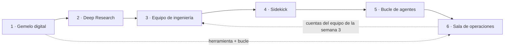
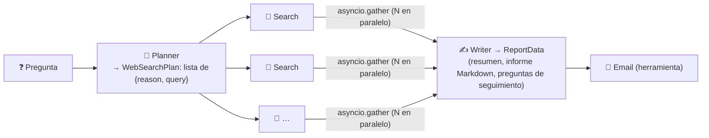
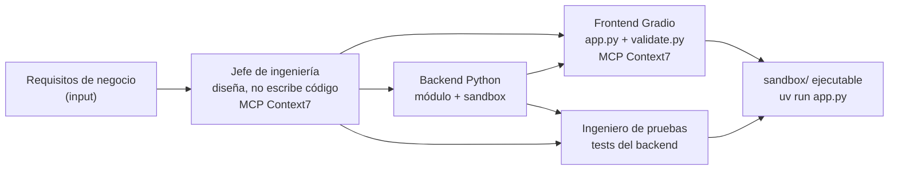
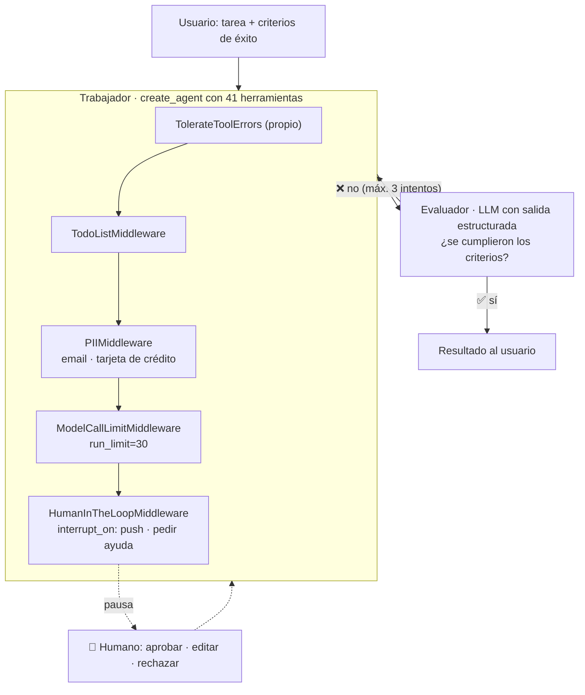
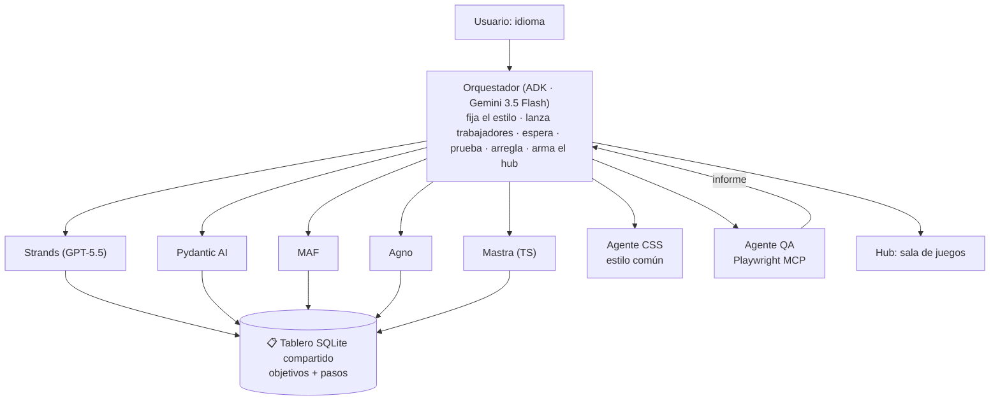
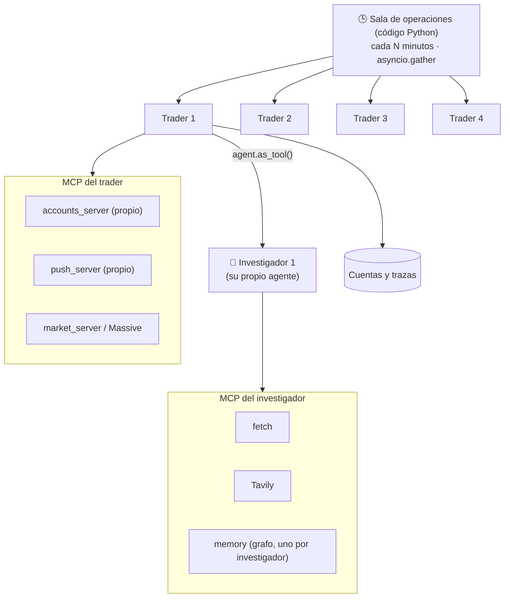

# 12 · Proyectos del curso — qué se construyó y qué copiar

> **Tema 12 de 12.** Seis proyectos, cada uno **ilustra un oficio** de los temas 01 a 11. Aquí están **resumidos** como arquitecturas reutilizables; el código está en tu fork [`edzamo/agents`](https://github.com/edzamo/agents).
> ⬅️ [11 · Frameworks](11-frameworks-y-como-elegir.md) · [Índice](README.md) · [Diagramas UML](diagramas-uml.md)

---

## 🍳 Con la cocina

Los proyectos son **los banquetes de práctica**: cada uno monta un menú entero con las técnicas que se vieron antes. No se aprende de **copiarlos**, sino de **ver qué técnica ensaya cada uno** y qué se les olvidó (casi siempre **seguridad y evaluación**).

> En palabras de la calle: **un proyecto sirve para ver el oficio en acción, no para repetir el menú.**

## 0 · Mapa de proyectos

| # | Proyecto | Marco | Qué ensaya | Temas |
|---|---|---|---|---|
| 1 | **Gemelo digital** | Llamadas directas | Prompt + 2 herramientas + `while`; riesgos de publicar | [01](01-agentes-y-workflows.md), [04](04-herramientas-y-bucle-del-agente.md), [09](09-seguridad-guardrails-y-humano-en-el-bucle.md) |
| 2 | **Deep Research** | Agents SDK | Cadena + paralelización + salida estructurada; costo y calidad | [03](03-prompts-contexto-y-salidas-estructuradas.md), [07](07-orquestacion-y-multiagente.md), [10](10-observabilidad-evaluacion-y-costos.md) |
| 3 | **Equipo de ingeniería** | CrewAI | 4 agentes secuenciales; **sandbox con Docker**; magia oculta | [07](07-orquestacion-y-multiagente.md), [09](09-seguridad-guardrails-y-humano-en-el-bucle.md), [11](11-frameworks-y-como-elegir.md) |
| 4 | **Sidekick** | LangChain | Trabajador + **evaluador**; **middleware**; aprobación humana | [08](08-langchain-langgraph-y-deep-agents.md), [09](09-seguridad-guardrails-y-humano-en-el-bucle.md), [10](10-observabilidad-evaluacion-y-costos.md) |
| 5 | **Bucle de agentes** | 6 marcos + ADK | **Orquestador + trabajadores** con tablero compartido | [07](07-orquestacion-y-multiagente.md), [11](11-frameworks-y-como-elegir.md) |
| 6 | **Sala de operaciones** | Agents SDK + MCP | **Código orquesta**, agente-herramienta, 6 servidores MCP, trazas propias | [05](05-mcp.md), [06](06-memoria-busqueda-y-rag.md), [07](07-orquestacion-y-multiagente.md), [10](10-observabilidad-evaluacion-y-costos.md) |

> 🧩 **El hilo que se cierra:** el módulo de cuentas lo escribió el equipo de CrewAI (proyecto 3) y lo reutiliza el servidor MCP del proyecto 6.

---

## 1 · Gemelo digital (llamadas directas)

**Qué es:** un chatbot que representa a una persona (perfil de LinkedIn + resumen), **el "currículum del futuro"**, desplegado en Internet. Es prompt + 2 herramientas + el bucle `while`.

| Pieza | Para qué |
|---|---|
| Prompt del sistema (papel · contexto · reglas) | Quién es y cómo responde |
| `registrar_interes` | Anota correo, nombre y notas y **notifica al móvil** (Pushover) |
| `registrar_pregunta_desconocida` | Anota lo que **no supo responder** para decidir qué añadir a su contexto: **ciclo de mejora con datos reales** |
| 4 módulos | `context.py`, `tools.py`, `styles.py` (lo hizo Claude Code), `app.py` (función `chat` + Gradio) |

**Consejos de prompt:** **di qué hacer** (*"reconduce a lo profesional"*) en vez de solo qué evitar; **repetir una instrucción clave** sesga al modelo hacia lo que quieres; **sin instrucciones contradictorias** (el gemelo respondió sobre el queso porque el resumen lo decía). Si el modelo no usa una herramienta, **refuerza su descripción**: el fallo es de orientación, no de "mal comportamiento".

**Riesgos de publicar (🔒 lo valioso):**

| Riesgo | Control |
|---|---|
| Un Space de Hugging Face es **un repositorio público** | **Nunca** subir el `.env`; claves como **Secretos** de la plataforma |
| **Costos** de una API de pago expuesta | Modelo barato, **clave con presupuesto fijo**, limitación de tasa, retirar el despliegue |
| **Salidas sin control** | Guardrail de salida (LLM juez) antes de exponerlo |

Despliegue en una línea: `uv run gradio deploy` desde `twin/` (CPU básica gratuita; secretos en *Settings*; reiniciar el Space). Token de Hugging Face **con permiso de escritura**.

---

## 2 · Deep Research (OpenAI Agents SDK)

> 🍳 Una **brigada de cuatro puestos**: la **planificadora** divide el encargo en búsquedas; los **buscadores** trabajan **a la vez**; la **redactora** escribe el informe; el **mesero** lo envía. El orden lo manda **el jefe de cocina** (tu código).

| Pieza | Detalle |
|---|---|
| **Búsqueda web** | **Herramienta alojada de OpenAI** (`WebSearchTool`): corre en **sus** servidores. Cuesta **~1 céntimo por búsqueda** (según el instructor; verifica tarifas) |
| **Orquestación** | **Código**: cinco funciones (planificar, buscar en paralelo, una búsqueda, redactar, enviar), cada una un `Runner.run` |
| **`yield` en `run`** | Convierte la función en **generador**; **Gradio** pinta cada actualización en la interfaz según llega |
| **Configuración** | Modelo por defecto y **número de búsquedas** sobrescribibles desde el `.env` |
| **Interfaz** | `simple.py` (Gradio básico) y `app.py` + `styles.py` **escritos por Claude Code** (a él se le da mal el CSS) |

**Lecciones que valen:**

- **Costo y calidad:** con GPT-5.4-mini y **5 búsquedas** (~5 céntimos) salió un informe bueno pero con errores; con **GPT-5.5 y 20 búsquedas** (~22 céntimos) la lista fue **correcta**. Y **solo se vio comparando con un criterio**: sin métrica, "parecía bien" en ambos.
- **Las herramientas alojadas son para prototipar**; en producción se construye la propia (**costo** y **dependencia de OpenAI**). Dice que la versión gratuita llega **la semana siguiente (CrewAI)**.
- **Hacia producción:** cuaderno para iterar prompts, **módulos** al estabilizar ([01 · Agentes y workflows](01-agentes-y-workflows.md)).
- **Retos del instructor:** (1) añadir un paso de **preguntas aclaratorias** antes de planificar; (2) **evaluar** si salen los frameworks correctos y ajustar; (3) rehacerlo con **orquestación por LLM** (agentes como herramientas) y **demostrar con métricas** si mejora: más libertad = **menos fiabilidad y determinismo** a cambio de resultados potencialmente mejores.
- 🧩 Es **cadena + paralelización + salida estructurada** del [catálogo](../patrones/README.md).

### Despliegue en Hugging Face Spaces (lo nuevo respecto a la semana 1)

`uv run gradio deploy`; los secretos se configuran en el Space. **Novedad:** **Hugging Face no permite enviar correo por SMTP desde el Space** (probable medida antispam) → usa **`USE_EMAIL=false` + Pushover**, o un proveedor con dominio verificado (SendGrid, Resend). El resto de riesgos (repo público, costos, guardrails) está en la [09 · Seguridad y humano en el bucle](09-seguridad-guardrails-y-humano-en-el-bucle.md#5--riesgos-de-publicar-un-agente).

### 🧩 Para ti, con Gemini

El proyecto **tal como está no corre**: la búsqueda alojada exige OpenAI. Habría que **escribir tu propia herramienta de búsqueda** (con una API gratuita) o usar un **servidor MCP de búsqueda**. Es un buen ejercicio de **desacoplar** y de **herramientas propias**.

---

## 3 · Equipo de ingeniería (CrewAI)

- **4 agentes y 4 tareas** (una por agente), secuencial; el diseño y el código viajan por `context:` (el instructor añadió el diseño al frontend y a las pruebas "sobre la marcha").
- **Pedido:** un gestor de cuentas para simulación bursátil (crear cuenta, depositar, comprar/vender con precios fijos, historial, ganancias/pérdidas, **sin comprar más de lo que se puede pagar**). Lo usará en la semana 6.
- **Iteración de prompts (lo valioso):** el diseñador "se emociona y escribe código" → se le prohíbe; el backend no importa paquetes de terceros ni toca UI; el frontend debe escribir un `validate.py`; el tester no debe romper `app.py`. Cada línea nació de un fallo observado en la traza.
- **Gradio 6 > fecha de corte del modelo:** los modelos escriben para Gradio 5 → se les avisa y se les da Context7.
- **Resultado:** funcionó a la primera en minutos por **~4 US$** (2 OpenAI + 2 OpenRouter). Mezcla: jefe GPT-5.5, backend Gemini 3.1 Pro Preview (OpenRouter), frontend Claude Opus 4.7 (OpenRouter), tester GPT-5.5.
- **Comparación (n = 1, subjetiva):** 1.º todo-GPT-5.5, 2.º mezcla, 3.º GPT+Claude (fallos de interfaz). El instructor mismo dice que **no demuestra** que un solo proveedor sea mejor y que es costoso (4–5 US$).
- **Su consejo de proceso:** debió empezar con un agente solo, **verlo fallar con una tarea compleja y recién entonces** pasar a un equipo; y hacerlo con **conjunto de pruebas y evaluación**. Lo dijo y no lo hizo "por tiempo". 🧩 Es la regla de siempre: no uses un equipo hasta que el agente solo falle.

**Retos de la semana (opcionales):** cambiar a jerárquico (jefe de ingeniería como gestor), añadir QA con ciclo de mejora, no borrar el sandbox y aceptar feedback, interfaz Gradio de control, y **Flows** para coordinar varios crews en paralelo.

---

## 4 · Sidekick (LangChain `create_agent`) ⭐

Un **compañero** al que le das una tarea y **criterios de éxito**; trabaja con herramientas hasta lograrlo, y un **evaluador** decide si cumplió. En tu fork: `sidekick.py` (la clase), `sidekick_tools.py` (41 herramientas: Playwright, Serper, Wikipedia, archivos, notificación push), `app.py` (Gradio).

### Los middlewares (con los nombres del código real)

| Middleware | Para qué | 🧩 Tu mundo |
|---|---|---|
| `TolerateToolErrors` (propio, `awrap_tool_call`) | Si una herramienta falla, **devuelve el error al modelo** para que decida en vez de lanzar excepción | Resiliencia |
| `TodoListMiddleware` | Plan visible; la UI lo muestra y va tachando | Trazabilidad |
| `PIIMiddleware("email")`, `PIIMiddleware("credit_card", apply_to_tool_results=True)` | **Oculta datos personales** (también en los resultados de herramientas) | **Cumplimiento de datos** |
| `ModelCallLimitMiddleware(run_limit=30)` | **Tope de llamadas** | Costo y bucles |
| `HumanInTheLoopMiddleware(interrupt_on={...})` | **Pausa antes de herramientas sensibles** | Aprobación de acciones con efectos |

### Aprobación humana (human-in-the-loop) ⭐

1. El agente intenta usar una herramienta marcada en `interrupt_on` (p. ej. `send_push_notification`).
2. **Se interrumpe** y devuelve qué quiere ejecutar; el estado queda en el checkpointer (necesita `thread_id`).
3. Reanudas con un **comando**, **no con un mensaje**: `Command(resume={"decisions": [{"type": "approve"}]})`.
4. Las decisiones posibles: **`approve`**, **`edit`** (ejecutar con otros parámetros) o **`reject`** (omite la herramienta y vuelve al modelo con un motivo).

🧩 **Es lo que se necesita para un pago:** el agente **propone**, una persona **autoriza**, y todo queda registrado en el estado.

### El evaluador (LLM como juez)

Una llamada **aparte**, sin herramientas, con **salida estructurada** (`EvaluatorOutput`: ¿criterios cumplidos? ¿falta información del usuario? comentarios). Recibe la petición, los criterios, las herramientas usadas y la última respuesta. Si no cumple, **el trabajador reintenta** con el comentario. Es el [patrón 5](../patrones/05-evaluator-optimizer/README.md) puesto en producción, con **tope de intentos** (3).

---

## 5 · El bucle de agentes (seis marcos coordinados) ⭐

**Idea:** un **orquestador (Google ADK)** lanza **cinco trabajadores**, cada uno en un marco distinto (Strands, Pydantic AI, MAF, Agno, Mastra), **en paralelo y como procesos independientes**. Cada uno construye **un minijuego** para aprender un idioma; al final un **agente de QA** los prueba con Playwright y el orquestador arma la página (hub). Resultado: una "sala de juegos" local en el idioma elegido.

**Las herramientas del orquestador** (de `orchestrator.py` en tu fork): `author_style`, `launch_worker`, `wait_for_team`, `test_game`, `relaunch_worker`, `build_hub`.

| Pieza | Para qué |
|---|---|
| **Bucle exterior** | El orquestador decide objetivos y los asigna |
| **Bucles interiores** | Cada trabajador toma su objetivo del tablero, planifica pasos, los tacha |
| **Tablero compartido (SQLite)** | La única comunicación entre agentes; el mecanismo que provoca el bucle |
| **Agente CSS aparte** | Una llamada con una tarea **bien acotada** rinde mejor |
| **Agente QA** | Prueba cada juego con Playwright (MCP); si falla, el orquestador **lo arregla** o **relanza** al trabajador |
| `config.py` | Modelos configurables (`ORCHESTRATOR_MODEL`, `WORKER_MODEL`); versión barata disponible |

**Cómo se ejecuta:** `uv run agent_loop.py` (opciones: idioma, omitir marcos). Tarda **~5 min con modelos grandes**. Los que no hayas creado se omiten.

**Lo que enseña (palabras del instructor):**
1. **Los seis marcos hacen lo mismo** y se pueden coordinar sin A2A.
2. **Qué es un bucle de agente de verdad:** un bucle dentro de otro bucle.
3. **El comportamiento autónomo sale de las herramientas y el prompt**, no de que el LLM "sepa" que está en un bucle: *"son LLM generando tokens probables"*.

---

## 6 · Sala de operaciones (trading autónomo con MCP) ⭐

**Autonomous Traders:** cuatro agentes *trader* operan en un mercado virtual (datos reales de Massive, o simulados) con **cuentas ficticias**. El instructor avisa tres veces: **solo educativo, no usar para decisiones reales**.

| Pieza | Decisión de diseño | Por qué |
|---|---|---|
| Coordinar a los 4 traders | **Código** (`asyncio.gather`, bucle cada N min) | Orden fijo → el LLM no aporta, solo restaría fiabilidad |
| Trader ↔ investigador | **LLM** (`as_tool`: el trader decide cuándo investigar) | Aquí sí hay incertidumbre: autonomía útil |
| Dos agentes (trader, investigador) | Prompts, herramientas y misiones distintos | **No** "porque así son los roles humanos": **ingeniería de contexto** |
| Modelos | Configurable por trader (`get_model`, `USE_MANY_MODELS`) | Comparar rendimiento y costo |
| Configuración (`.env`) | `RUN_EVERY_N_MINUTES` (60), `RUN_EVEN_WHEN_MARKET_IS_CLOSED` (false), `USE_MANY_MODELS` (false) | Control de ritmo y costo |
| Interfaz | Panel Gradio; luego API (FastAPI) + frontend (React) | — |

**Lo que el instructor deja claro (y yo subrayo):**
- Los agentes **generan decisiones verosímiles, no necesariamente correctas** → hay que **medir**: el rendimiento de la cartera es la métrica del mundo real.
- *"Probad con un solo agente con muchas herramientas, o con varios, y medid."* **No diseñó la arquitectura de antemano**: salió de **experimentar**.

---

## 7 · Qué copiar y qué dejar

| Proyecto | ✅ Copia | ❌ Deja |
|---|---|---|
| Gemelo | La herramienta `registrar_pregunta_desconocida` (ciclo de mejora con datos reales) | Desplegar con datos personales |
| Deep Research | Planificar → buscar en paralelo → redactar | La búsqueda alojada de OpenAI |
| Equipo de ingeniería | **El sandbox con Docker** (y endurecerlo) | Confiar en la caché de herramientas |
| Sidekick | **Middleware + aprobación humana + evaluador con tope** | 41 herramientas a la vez |
| Bucle de agentes | Tablero compartido; agente QA | **Orquestador LLM** para orden fijo |
| Sala de operaciones | **Código para lo fijo, `as_tool` para lo incierto**; trazas propias; estrategia con retroalimentación | Usarlo para decisiones reales de inversión (⚠️ solo educativo) |

## 8 · Qué debe dominar cada nivel

| Nivel | Debe poder... |
|---|---|
| 🟢 **Junior** | Explicar qué ensaya cada proyecto y reproducir el gemelo digital. |
| 🟡 **Mid** | Reconstruir Deep Research y el patrón trabajador + evaluador en su stack. |
| 🔴 **Senior** | Criticar cada arquitectura (qué le falta de seguridad y evaluación) y proponer la versión de producción. |

## 9 · Escaleras de entrevista

**"Cuéntame un proyecto de agentes que hayas construido o estudiado."**
- 🟢 "Un asistente que investiga en la web y escribe un informe."
- 🟡 "Un trabajador con herramientas y un evaluador que reintenta hasta cumplir criterios, con pausa para aprobación humana."
- 🔴 "Una sala de agentes coordinada por **código** (orden fijo) donde cada uno delega en un investigador **como herramienta** (incertidumbre), con trazas propias, métrica de negocio y bucle de retroalimentación; y sé qué le faltaba de seguridad y evaluación."

**"¿Qué cambiarías para llevarlo a producción?"**
- 🟢 "Subirlo a un servidor."
- 🟡 "Añadir pruebas, aprobación humana y límites de costo."
- 🔴 "Aislar la ejecución de código, filtrar PII, fijar versiones de servidores MCP, evaluar con casos fijos en CI y mantener trazas locales."

## 🛠️ Ejercicios (taller)

| Taller | Qué haces |
|---|---|
| **W04** | El gerente (PoC3), inspirado en el trader + investigador |
| **W07 + W06** | El Sidekick en Java: trabajador + evaluador + aprobación humana |
| **W13** | El tablero compartido de la semana 5 |
| **Capstone** | **Sala de conciliación** (datos ficticios): lo mejor de los proyectos 3, 4 y 6, **con** seguridad y evaluación |

## 🔗 Relacionado

[Índice](README.md) · [Diagramas UML §6](diagramas-uml.md) · [Plan de talleres](../talleres/README.md) · [Catálogo de patrones](../patrones/README.md)
