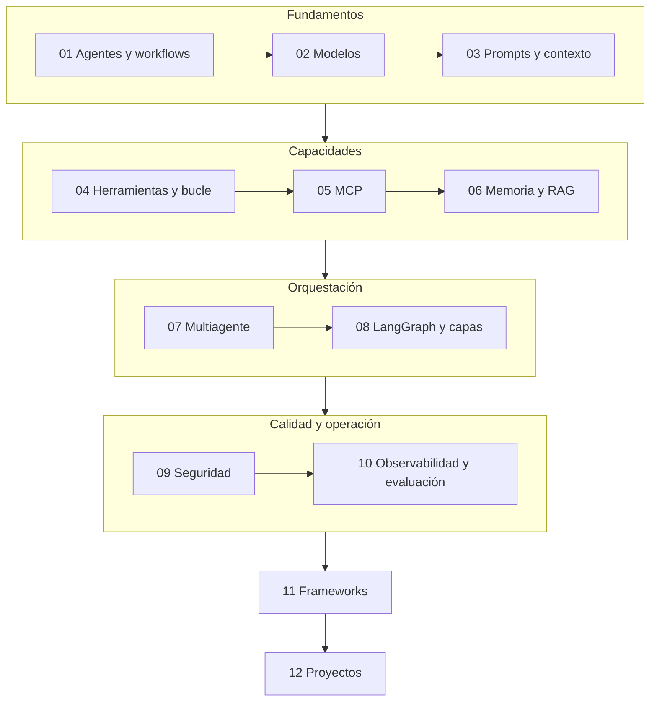

# AI Engineer — Agentic Track (curso reordenado por temas)

Apuntes del curso de Udemy **AI Engineer Agentic Track: The Complete Agent & MCP Course** (Ed Donner), **reorganizados por oficio** y no por el orden de las semanas del curso: un framework es una marca de cocina; un tema es un oficio. Cada documento trae la analogía de la **cocina**, diagramas, niveles junior/mid/senior, escaleras de entrevista y **ejercicios** (los [talleres](../talleres/README.md)).

> **Repo del curso:** <https://github.com/ed-donner/agents> · **Tu fork de práctica:** [`edzamo/agents`](https://github.com/edzamo/agents)
> ⚠️ Los documentos son **notas depuradas**, no una transcripción; las marcas 🔎 (por verificar) y 🧩 (aporte mío) distinguen lo que **no** viene del curso.

## 🗂️ Los 12 temas

| # | Tema | Qué responde | Bloque |
|---|---|---|---|
| **01** | [Agentes y workflows](01-agentes-y-workflows.md) | ¿Qué es un agente y cuándo conviene? | Fundamentos |
| **02** | [Modelos y proveedores](02-modelos-y-proveedores.md) | ¿Cómo llamo a un LLM y cambio de proveedor (Gemini incluido)? | Fundamentos |
| **03** | [Prompts, contexto y salidas estructuradas](03-prompts-contexto-y-salidas-estructuradas.md) | ¿Qué le pongo sobre la mesa y cómo leo su respuesta? | Fundamentos |
| **04** | [Herramientas y bucle del agente](04-herramientas-y-bucle-del-agente.md) ⭐ | ¿Cómo actúa un agente de verdad? | Capacidades |
| **05** | [MCP](05-mcp.md) ⭐ | ¿Cómo enchufo herramientas de otros? | Capacidades |
| **06** | [Memoria, búsqueda y RAG](06-memoria-busqueda-y-rag.md) | ¿Cómo recuerda y cómo consulta datos? | Capacidades |
| **07** | [Orquestación y multiagente](07-orquestacion-y-multiagente.md) | ¿Cómo reparto el trabajo entre agentes? | Orquestación |
| **08** | [LangChain, LangGraph y Deep Agents](08-langchain-langgraph-y-deep-agents.md) | ¿Qué hay debajo (estado, grafos, capas)? | Orquestación |
| **09** | [Seguridad, guardrails y humano en el bucle](09-seguridad-guardrails-y-humano-en-el-bucle.md) ⭐ | ¿Cómo evito que haga daño? | Calidad y operación |
| **10** | [Observabilidad, evaluación y costos](10-observabilidad-evaluacion-y-costos.md) ⭐ | ¿Cómo sé que funciona y cuánto cuesta? | Calidad y operación |
| **11** | [Frameworks y cómo elegir](11-frameworks-y-como-elegir.md) | ¿Qué marco uso y por qué? | Criterio |
| **12** | [Proyectos del curso](12-proyectos-del-curso.md) | ¿Qué se construyó y qué copiar? | Práctica |
| — | [Diagramas UML](diagramas-uml.md) | Clases, secuencia, estados, componentes y despliegue | Apoyo |

**Cómo estudiarlo (🧩):** el orden 01 → 12 sigue la dependencia (primero qué es, luego capacidades, luego coordinar, luego cuidar). Los **⭐** son los que más rinden. Para **entrevista** basta con los ⭐ + 01 + 07.

## 🧪 Dónde se practica y dónde se documenta

| | Este repo (`software-engineering`) | Fork de práctica (`agents`) |
|---|---|---|
| **Qué contiene** | Estos apuntes, [catálogo de patrones](../patrones/README.md), [conceptos](../conceptos/ingenieria-de-contexto.md), [**talleres**](../talleres/README.md) | Los laboratorios originales del curso (Python) |
| **Ruta local** | `ai-engineering/` | `~/Documents/Personal/github/agents` |
| **Proveedor de modelos** | Gemini gratis en los talleres | **Gemini** vía API compatible con OpenAI |

> 🔐 El `.env` está en el `.gitignore` del fork: nunca se sube. No subas tu `linkedin.pdf` ni `summary.txt`.

## 🔁 De dónde sale cada tema (trazabilidad con las semanas del curso)

| Semana del curso | Tema en el instructor | Dónde está ahora |
|---|---|---|
| **1** · Fundamentos | Agente, tool calling, gemelo digital | [01](01-agentes-y-workflows.md), [02](02-modelos-y-proveedores.md), [04](04-herramientas-y-bucle-del-agente.md), [12](12-proyectos-del-curso.md) |
| **2** · OpenAI Agents SDK | Piezas del SDK, orquestación, Gemini, guardrails, Deep Research | [03](03-prompts-contexto-y-salidas-estructuradas.md), [07](07-orquestacion-y-multiagente.md), [09](09-seguridad-guardrails-y-humano-en-el-bucle.md), [12](12-proyectos-del-curso.md) |
| **3** · CrewAI | Agentes, tareas, sandbox con Docker | [07](07-orquestacion-y-multiagente.md), [09](09-seguridad-guardrails-y-humano-en-el-bucle.md), [11](11-frameworks-y-como-elegir.md) |
| **4** · LangChain + LangGraph | Capas, estado, middleware, Sidekick | [06](06-memoria-busqueda-y-rag.md), [08](08-langchain-langgraph-y-deep-agents.md), [09](09-seguridad-guardrails-y-humano-en-el-bucle.md) |
| **5** · Marcos de agentes | Seis marcos, A2A, bucle de agentes | [11](11-frameworks-y-como-elegir.md), [12](12-proyectos-del-curso.md) |
| **6** · MCP | Arquitectura, servidor propio, sala de operaciones, 10 cosas | [05](05-mcp.md), [06](06-memoria-busqueda-y-rag.md), [10](10-observabilidad-evaluacion-y-costos.md), [12](12-proyectos-del-curso.md) |

## 🎓 Siguiente fase: practicar

Los **ejercicios** de cada tema están al final de cada documento y se agrupan en el [**plan de talleres**](../talleres/README.md): **Java con Spring AI → Quarkus → TypeScript (NestJS) → Python (FastAPI)**.

## ⚖️ Veredicto final del curso (mi opinión, tras estudiar las 6 semanas)

> 🧩 Es **mi lectura** de lo que quedó en las notas, no una medición. 🔎 Las horas son una estimación por las duraciones de las clases (2–11 min cada una, 132 lecciones).

**En una frase:** **un buen curso práctico de introducción a la ingeniería de agentes, con mucha repetición y poca profundidad; vale la pena si vienes de cero en agentes, y solo a ratos si ya construyes sistemas.**

| Semana | Aporte | Repetición | Valor para un senior backend sin experiencia en agentes |
|---|---|---|---|
| 1 · Fundamentos | Definición, workflow vs agente, bucle de herramientas | Media | 🟡 El mapa y el bucle |
| 2 · OpenAI Agents SDK | Piezas de un framework, salida estructurada, guardrails | Media | 🟢 Orquestación y modelos no OpenAI |
| 3 · CrewAI | Framework opinionado, **sandbox con Docker** | **Alta** | 🟡 Solo la "magia" oculta y el sandbox |
| 4 · LangChain + LangGraph | Capas, **estado, checkpoints, middleware, aprobación humana** | Baja | 🟢 **La más valiosa** |
| 5 · Marcos de agentes | Nueve marcos en una tabla | **Muy alta** | 🔴 Una tabla basta |
| 6 · MCP + proyecto | **Arquitectura de MCP**, cuándo usarlo, **las 10 cosas** | Media | 🟢 **Muy valiosa** |

**Qué hace bien**
- **Honestidad sobre el bombo:** reconoce que A2A está sobrevalorado hoy, que MCP **no** es para tus propias herramientas, que el marco "no importa tanto" y que en producción casi siempre gana el **workflow**.
- **Método:** mira las trazas, mide con una métrica de negocio, empieza simple, prompts como el primer arreglo.
- **Hacer, no solo oír:** cada concepto se prueba en un lab con código.
- **Un hilo que se cierra:** el mismo módulo de cuentas viaja de la semana 3 a la 6.

**Qué le falta**
- **Repetición:** seis marcos con el mismo ejercicio; la semana 5 cabe en una página.
- **Todo es Python y OpenAI-céntrico:** **nada de Java/Kotlin/.NET** (Microsoft Agent Framework se menciona de pasada) y varios laboratorios dependen de claves de pago.
- **Producción y seguridad, superficiales:** sin pruebas sistemáticas, sin evals rigurosas, sin amenazas (inyección de prompt, permisos de herramientas, cadena de suministro de servidores MCP). Lo remite al curso de producción.
- **Evidencia débil:** comparaciones con **una sola prueba** (n = 1) presentadas con confianza.
- **Marketing:** pide reseñas y promociona otros cursos al final.
- **Obsolescencia:** nombres y versiones cambian a diario; el curso fija versiones.

**¿Para quién?**

| Perfil | ¿Vale la pena? | Cómo aprovecharlo |
|---|---|---|
| **Junior / sin experiencia en agentes (con Python)** | ✅ **Sí** | Hacer los labs de las semanas 1, 2, 4 y 6; la 3 y la 5 en diagonal |
| **Mid con experiencia en backend** | 🟡 **Sí, selectivo** | Semanas 4 y 6 completas; el resto con estas notas |
| **Senior con experiencia previa en agentes/LLM** | 🔴 **Poco** | Unas **~15–20 %** de las horas aportan algo nuevo: MCP (arquitectura y criterio), middleware y checkpoints de LangGraph, y las 10 cosas |
| **Senior backend, nuevo en IA (tu caso)** | 🟡 **Útil como mapa**, no como formación profunda | Estas notas **sustituyen** ~70 % del vídeo; aprovecha para implementar PoC en **tu stack** |

**Comentario sugerido para Udemy** (edítalo a tu experiencia):

> *Curso muy práctico para entender el ciclo completo de un agente (herramientas, bucle, memoria, MCP) y el proyecto final integra bien las ideas. Lo más valioso: la arquitectura de MCP, LangGraph/middleware y las "10 cosas que importan" del cierre. Mejorable: la semana 5 (seis frameworks con el mismo ejercicio) y la 3 son muy repetitivas, todo gira en torno a Python y OpenAI, y producción/seguridad/evals quedan en la superficie. Para quien empieza en agentes es excelente; para desarrolladores senior conviene saltar contenido repetido y completarlo con prácticas de producción.*

## 🗺️ El currículo del instructor (resumen)

1 AI Builder (n8n) · 2 AI Coder (**usar** agentes: Claude Code, Codex…) · 3 AI Leader (negocio) · 4 Core Track (LLMs, RAG) · **5 Agentic Track (este: construir agentes)** · 6 [Production Track](../llm-production/README.md) (desplegar). Para **usar** agentes en tu trabajo, el curso 2 es el relacionado; este enseña a **construirlos**.

## 🔗 Relacionado

[Roadmap AI Engineering](../README.md) · [Talleres](../talleres/README.md) · [Catálogo de patrones](../patrones/README.md) · [Ingeniería de contexto](../conceptos/ingenieria-de-contexto.md) · [`ia-agentes/`](../../ia-agentes)
