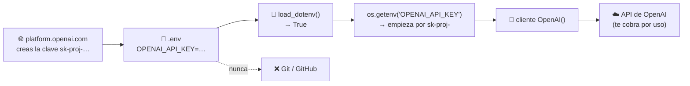

# Clase 05 · Semana 1, día 1 — Clave de OpenAI, archivo `.env` y primer notebook

> ⬅️ [04 · Setup Windows/Mac](04-setup-windows-mac-guia-rapida.md) · ➡️ [06 · Primeras llamadas a OpenAI](06-primeras-llamadas-openai-encadenar.md)
> 🗓️ **Semana 1 · Día 1** · tipo: 🟠 preparación · Cuaderno de hoy: `1_foundations` → **lab 1**
> **Qué vas a poder explicar al terminar:** por qué la API de OpenAI no es ChatGPT, cómo se crea y se guarda una clave sin exponerla, qué errores rompen todo en silencio, y cómo se ejecuta un notebook con el kernel correcto.

---

## 🍎 Con manzanas

- **ChatGPT** es **comprar la fruta en el mostrador**: eres cliente final.
- **La API** es **abrir una cuenta de proveedor mayorista**: tu programa hace pedidos solo y **te cobran por pedido**.
- **La clave API** es **la llave de esa cuenta**. Quien la tenga, pide a tu nombre y **a tu tarjeta**.
- **El `.env`** es **el cajón con llave** donde la guardas. Y el IDE tiene orden de **no mirar dentro**.

> En palabras de la calle: **la clave es como la tarjeta de crédito de tu programa: se guarda en un cajón, nunca en el mostrador.**

---

## 1 · API de OpenAI ≠ ChatGPT

| | ChatGPT | API de OpenAI |
|---|---|---|
| Para quién | Usuario final | Desarrolladores |
| Cómo se usa | Interfaz web | Código que llama al modelo |
| Cobro | Suscripción | **Por uso**, con saldo prepago |
| ¿Sirve tener cuenta de ChatGPT? | — | **No**: es otra cuenta y otra facturación |

Alternativas si no quieres pagar: OpenRouter, Gemini u Ollama local ([Guía 9](03-configurar-entorno-costos-mentalidad.md#3--costos-de-las-apis-cuánto-cuesta-de-verdad)).

## 2 · Crear la cuenta, saldo y clave (plataforma.openai.com)

1. **Cuenta** en `platform.openai.com`. Organización: pon algo educativo (tu nombre + "educación"); perfil: "estudiante".
2. **Saldo:** *Billing* → datos de pago → recargar **5 USD** (el mínimo). No se gastarán en todo el curso.
3. **Clave:** *Settings → API keys → Create new secret key*:
   - Clave **a nivel de organización**, proyecto **predeterminado**.
   - **Deja todos los permisos activados.** Si no, aparecen errores raros después.
   - **Cópiala al portapapeles antes de pulsar "Hecho"**: luego no se puede volver a ver. Si la pierdes, creas otra (y puedes borrar las viejas).
   - Empieza por `sk-proj-…`.

> 🔎 La clave que se muestra en el video es del instructor y no la reproduzco ni la necesito aquí.

## 3 · El archivo `.env` (donde más gente se atora)

Se crea en la **carpeta de nivel superior** del proyecto (`agents/`):

```
OPENAI_API_KEY=sk-proj-...tu clave...
```

| Regla | Por qué |
|---|---|
| El archivo se llama **exactamente `.env`** | Ni `.env.txt`, ni `.env.me`. Si no, no se lee. |
| La variable es **exactamente `OPENAI_API_KEY`** | El nombre mal escrito (por ejemplo `OPEN_API_KEY`) "no funciona" y no da un error claro. |
| **Sin espacios** antes ni después | Un espacio de más invalida la clave. |
| **Guardar el archivo** (`Ctrl/Cmd + S`) | El punto blanco en la pestaña = no guardado. El IDE no autoguarda como Google Docs. |
| Otros proveedores | `OPENROUTER_API_KEY` · `GOOGLE_API_KEY` **y** `GEMINI_API_KEY` (con el mismo valor, porque unas librerías buscan una y otras la otra) · Ollama local no necesita `.env`. |

> 🔎 La transcripción dice ".emv" y "open AI_API_key": son errores de dictado, se refieren a **`.env`** y **`OPENAI_API_KEY`**.

**La señal de "stop" junto al archivo:** el IDE ya está configurado para **ignorarlo** y **no enviar su contenido a una IA externa**. Es la señal buena.

> ⚠️ **Lo que falta y conviene hacer siempre:** confirmar que `.env` está en `.gitignore` para que **nunca** se suba a GitHub. 🔎 No lo menciona el instructor en esta clase; es práctica estándar y el repo suele traerlo.

### 📊 El viaje de la clave



## 4 · Primer notebook: kernel, celdas y orden

**Jupyter notebook** = texto explicativo + bloques de código llamados **celdas**. `Shift + Enter` ejecuta una celda.

| Concepto | Qué es | 🍎 Con manzanas |
|---|---|---|
| **Celda** | Un bloque de código ejecutable. | Una hoja de la receta |
| **Kernel** | El proceso de Python que ejecuta tus celdas en segundo plano. | El cocinero que sigue la receta |
| **Seleccionar kernel** | Elegir el entorno de Python que usará el notebook (el `.venv` creado por uv, tipo `.venv Python 3.12`). | Decirle al cocinero qué cocina usar |

Cómo se elige: *Select Kernel* (arriba a la derecha) → *Python Environments* → el recomendado que es el **`.venv`**. **Se hace la primera vez en cada notebook.**

**Trampa clásica de los notebooks:** importa el **orden en que ejecutas** las celdas, **no el orden en que se ven**. Si saltas una, aparece un **NameError** porque esa variable aún no existe.

## 5 · Las primeras celdas del lab 1 (`1_foundations`)

| Celda | Qué hace | Resultado esperado |
|---|---|---|
| 1 | Importa el cargador de `.env` (`from dotenv import load_dotenv`) 🔎 | Sin salida |
| 2 | Ejecuta `load_dotenv()` | Imprime **`True`** |
| 3 | Lee `OPENAI_API_KEY` y la imprime parcialmente | "La clave existe y empieza por `sk-proj-`" |
| 4 | Importa la clase `OpenAI` y crea una **instancia** | Sin error (la llamada real es la siguiente clase) |

> 🔎 La transcripción dice "load .vemv": se refiere a **`load_dotenv`** de la librería `python-dotenv`.

**Si algo falla**, el instructor lo mapea a su FAQ: ImportError → preguntas **5** y **25**; NameError → pregunta **4** (orden de las celdas); `load_dotenv` devuelve **`False`** → el `.env` no está en la carpeta superior, no se guardó o está mal nombrado.

## 6 · Qué debe dominar cada nivel

| Nivel | Debe poder... |
|---|---|
| 🟢 **Junior** | Crear una clave, guardarla en `.env` con el nombre correcto, guardarla (`Ctrl+S`) y verificarla con `load_dotenv()` → `True`. |
| 🟡 **Mid** | Explicar la diferencia API vs. producto de chat, qué es un kernel, y diagnosticar por qué falla una clave (nombre, espacios, ubicación, archivo sin guardar). |
| 🔴 **Senior** | Gestionar secretos con criterio: `.env` fuera de Git, claves por entorno y rotación, permisos mínimos, límites de gasto; y en producción pasar a un gestor de secretos en vez de archivos planos. |

## 7 · Escalera de respuesta para entrevista

**"¿Cómo manejas las claves de un proveedor de LLM en un proyecto?"**

- 🟢 *Frase junior:* "En un archivo `.env` que no se sube a Git, y las leo como variables de entorno."
- 🟡 *Capa mid:* "Uso `python-dotenv` para cargarlas, valido al arrancar que existan, y el nombre de la variable debe coincidir con el que espera el SDK. Una clave filtrada se revoca y se crea otra."
- 🔴 *Cierre senior:* "En local `.env`; en producción un gestor de secretos con rotación y permisos mínimos, límites de gasto por clave y alertas de uso. Además nunca van a un modelo ni a los logs."

## 🔗 Relacionado

- [Clase 03](03-configurar-entorno-costos-mentalidad.md) · [Clase 04](04-setup-windows-mac-guia-rapida.md) · [Índice del curso](../README.md)
- [Roadmap AI Engineering · Fase 0](../../README.md) — `.env`/API keys, "nunca hardcodeada".
- [Production Track](../../llm-production/README.md) — secretos y costos a escala.
