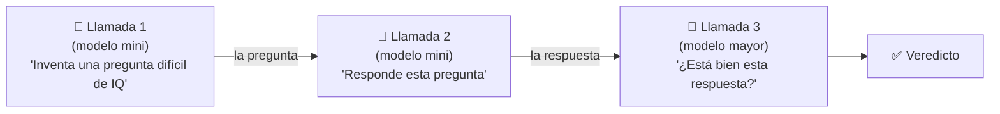

# Clase 06 · Semana 1, día 1 — Laboratorio 1: tus primeras llamadas a OpenAI y encadenarlas

> ⬅️ [05 · Clave, `.env` y notebook](05-openai-api-key-env-notebook.md) · ➡️ [07 · ¿Qué es un agente? (día 2)](07-que-es-un-agente-workflow-vs-agent.md)
> 🗓️ **Semana 1 · Día 1** · tipo: 🟠 laboratorio · Cuaderno: `1_foundations` → lab 1 (en tu fork [`agents`](../README.md#-dónde-se-practica-y-dónde-se-documenta))
> **Qué vas a poder explicar al terminar:** cómo se le "habla" a un LLM por código, qué forma tiene un mensaje, y por qué encadenar llamadas (la salida de una es la entrada de la otra) es el primer paso hacia un agente.

---

## 🍎 Con manzanas

Ya tienes la cuenta con el proveedor mayorista (clave en el `.env`). Hoy haces **tus primeros pedidos por escrito**:

1. **Un pedido simple:** escribes una nota "cuéntame algo curioso" y se la entregas. Te responde.
2. **Pedidos encadenados:** pides a un empleado que **invente una pregunta difícil**. Esa pregunta se la entregas a **otro empleado más fuerte** para que la responda. Y esa respuesta se la das a **un tercero** para que diga si está bien.

Nadie te dictó las preguntas ni las respuestas: **la salida de cada uno fue la entrada del siguiente**.

> En palabras de la calle: **encadenar es pasarle el trabajo de uno al siguiente, como una cadena de montaje de frutas: lavar, pesar, empacar.**

---

## 1 · La forma de un mensaje

OpenAI espera una **lista de diccionarios** (Python). Cada diccionario es un mensaje con **quién habla** (`role`) y **qué dice** (`content`).

```python
messages = [{"role": "user", "content": "Cuéntame algo curioso"}]
```

| Pieza | Qué es | 🍎 Con manzanas |
|---|---|---|
| `messages` | Lista con la conversación. | La libreta de pedidos |
| `role: "user"` | El mensaje viene de ti, el usuario. | "Esto lo escribió el cliente" |
| `content` | El texto del mensaje. | Lo que dice la nota |

## 2 · La llamada

```python
response = openai.chat.completions.create(model="gpt-5.4-nano", messages=messages)
print(response.choices[0].message.content)
```

| Parte | Qué hace |
|---|---|
| `openai` | El objeto cliente que creaste (la conexión con el proveedor). |
| `.chat.completions.create(...)` | **Hace el pedido** a la API de chat. |
| `model=` | **Qué modelo** responde (en la clase: *nano*, *mini* y uno mayor; el nombre exacto cambia con el tiempo). |
| `messages=` | **La libreta** con lo que quieres decir. |
| `response.choices[0].message.content` | **Donde viene el texto** de la respuesta dentro del objeto que devuelve. |

> 🔎 Los nombres exactos de modelos de la clase (GPT 5.4 nano / mini / 5.4) son los del video; cámbialos por los que tengas disponibles. La transcripción dice "choices0" por dictado: es `choices[0]`.

Resultado de la clase: "la miel nunca se estropea". **Es tu primera llamada a la API en la nube.**

## 3 · Encadenar tres llamadas



| Paso | Entrada | Salida |
|---|---|---|
| 1 | "Propón una pregunta difícil para evaluar el IQ. **Responde solo con la pregunta.**" | Un acertijo del reloj: ¿cuántas veces forman las manecillas 90° en 12 horas? |
| 2 | Esa pregunta como mensaje de usuario | "22 veces" con explicación |
| 3 | "Aquí hay una pregunta y esta es la posible respuesta. Evalúa si es correcta" (armado con un **f-string**) | "Correcta, con una salvedad: asumiendo un reloj estándar" |

Detalles útiles:

- **"Responde solo con la pregunta"**: una instrucción que limita la salida para que la **siguiente** llamada reciba algo limpio.
- **Mostrar bonito:** en Jupyter se puede renderizar la respuesta como Markdown en vez de imprimir texto crudo con caracteres especiales.
- **f-string:** una cadena de Python con `{variables}` dentro; sirve para **armar el prompt** de la llamada 3 con la pregunta y la respuesta.
- **Un modelo juzgando a otro** es un patrón real (evaluador). Aquí se usa de forma simple; en la Fase 5 del [roadmap](../../README.md) se vuelve *evals*.

> ✅ Esto **es** tu primer flujo de trabajo agéntico (ver [clase 07](07-que-es-un-agente-workflow-vs-agent.md#4--workflow-vs-agente-según-anthropic)): varias llamadas encadenadas por un camino que **tú** escribiste.

## 4 · Ejercicio del día (hazlo en tu fork)

Encadena **3 llamadas** para idear una oportunidad de negocio con IA agéntica:

1. Pide a un LLM **elegir un sector de negocio** que valga la pena explorar con IA agéntica.
2. Con ese sector, pídele **identificar un problema** del sector que se pueda resolver.
3. Con sector + problema, pídele **proponer una solución agéntica**.

- No hay solución oficial: es parecido a lo que ya hiciste con la pregunta del reloj.
- Si te sale algo interesante, puedes subirlo a `community_contributions/` del repo por **pull request** (la guía de Git está en `guides/`).
- Sirve para saber si estás listo para seguir.

## 5 · Trucos de la clase

- **Cursor autocompleta** (`Tab`) y tiene un **chat con agente** (`Cmd/Ctrl + L`): pégale un fragmento y pídele "explícame este código". Con el plan gratuito hay cupo limitado.
- Si algo te pierde del todo: el curso **Core Track** explica la API de chat a fondo; si Python te cuesta (listas, diccionarios, f-strings), los cursos **AI Builder** y **AI Coder**.
- Avance: con este día llevas **~3 %** del curso.

## 6 · Qué debe dominar cada nivel

| Nivel | Debe poder... |
|---|---|
| 🟢 **Junior** | Armar `messages` con `role` y `content`, llamar a `chat.completions.create` y leer `choices[0].message.content`. |
| 🟡 **Mid** | Encadenar llamadas pasando la salida de una como entrada de la siguiente, y limitar la salida con instrucciones ("responde solo con…") para que el siguiente paso reciba datos limpios. |
| 🔴 **Senior** | Elegir modelo por paso (barato para generar, fuerte para evaluar), controlar el costo de una cadena, y tratar la salida de un LLM como entrada **no confiable** del siguiente paso (validar formato antes de encadenar). |

## 7 · Escalera de respuesta para entrevista

**"¿Cómo harías que un sistema use varias llamadas a un LLM para resolver algo complejo?"**

- 🟢 *Frase junior:* "Divido el problema en pasos y llamo al modelo en cada uno, pasando el resultado del anterior al siguiente."
- 🟡 *Capa mid:* "Cada paso tiene su prompt y limito la salida para que el siguiente reciba algo limpio. Puedo usar un modelo pequeño para generar y uno más fuerte para evaluar."
- 🔴 *Cierre senior:* "Valido la salida de cada paso antes de encadenar, porque un error se arrastra; mido costo y latencia por paso; y si el recorrido es fijo lo dejo como flujo de trabajo en vez de darle libertad total al modelo."

## 🔗 Relacionado

- [Clase 05](05-openai-api-key-env-notebook.md) · [Clase 07](07-que-es-un-agente-workflow-vs-agent.md) · [Índice](../README.md)
- [Clase 01](01-primer-agente-n8n.md) — el mismo concepto, versión low-code.
- [Roadmap AI Engineering · Fase 1](../../README.md) — APIs de LLMs y salidas estructuradas.
