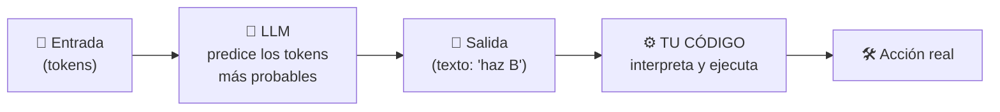

# Clase 07 · Semana 1, día 2 — ¿Qué es un agente? Definiciones y workflow vs agente

> ⬅️ [06 · Primeras llamadas](06-primeras-llamadas-openai-encadenar.md) · ➡️ Siguiente: _pendiente_ (patrones de diseño agénticos)
> 🗓️ **Semana 1 · Día 2 — "Agents and Agentic Patterns"** · tipo: 🟠 teoría
> **Qué vas a poder explicar al terminar:** las tres definiciones de agente, por qué el LLM solo genera tokens y **el agente es tu código**, y la diferencia workflow vs agente según Anthropic, con cuál conviene en producción.

---

## 🍎 Con manzanas

En la frutería, tres formas de describir a un "empleado autónomo":

1. **La vaga:** "alguien que hace tareas por ti sin que le dictes cada paso." (Como pedir "búscame mesa esta noche" y que él abra el navegador.)
2. **El que decide:** "en vez de que **tú** programes 'primero A, luego B', le preguntas al empleado **cuál hacer** y tu código obedece su respuesta."
3. **La definitiva (la del curso):** "**empleado + herramientas + repetir hasta cumplir el objetivo.**"

Y un recordatorio clave: **el empleado solo escribe notas** (texto). Quien **abre la caja y manda el pedido** es **tu código** que lee esa nota. El empleado no actúa, tú ejecutas lo que él dice.

> En palabras de la calle: **el agente no es el modelo, es el programa que lee lo que dice el modelo y actúa.**

---

## 1 · Las tres definiciones (de la más vieja a la más usada)

| # | Definición | Origen (según la clase) | Utilidad |
|---|---|---|---|
| 1 | Sistemas de IA que **hacen tareas por ti de forma independiente.** | OpenAI / Sam Altman; viene de *OpenAI Operator*, luego *GPT Agent* | Intuitiva pero **vaga** |
| 2 | Sistema donde **un LLM controla el flujo de trabajo.** | Anthropic y Hugging Face, principios de 2025 | **Precisa**: marca quién decide |
| 3 | **Un LLM que usa herramientas en un bucle para alcanzar un objetivo.** | Consolidada por Simon Willison, finales de 2025 | **La que adopta el curso** |

> 🔎 Los orígenes y fechas son los que cuenta el instructor en la clase; no los he verificado de forma independiente.

Esa tercera es la de la [clase 01](01-primer-agente-n8n.md#1--la-definición-que-usa-todo-el-curso): el agente de n8n **llamaba al LLM varias veces, con herramientas (leer y escribir la hoja, consultar precios), hasta cumplir el objetivo.**

## 2 · La idea que más pesa: el LLM solo genera tokens

- Un LLM es **un modelo de ciencia de datos**: recibe tokens y devuelve los más probables a continuación. **No ejecuta nada.**
- Si le das "puedes hacer A, B o C, ¿cuál?" y responde "B", **tu código** dice `if salida == "B": hacer_B()`.
- Decir que "el LLM controla el flujo" es **hablar a la ligera**: en realidad, **tú interpretas sus tokens para controlar el flujo**.
- Por eso, como AI Engineer, el modelo mental correcto es: **el agente es nuestro código**; el LLM es su cerebro.

| Idea | Llamada a un LLM | Agente |
|---|---|---|
| Qué es | Una consulta: texto entra, texto sale. | **Código que llama al LLM en bucle**, interpreta la salida, usa herramientas y decide si terminó. |
| Quién actúa | Nadie: solo devuelve texto. | **Tu código**, siguiendo lo que dice el LLM. |
| 🍎 | Una nota con una opinión | El empleado, el local y el bucle completo |

En herramientas como Claude Code a ese código se le llama *harness*; aquí lo llamamos "tu código".

## 3 · Lectura recomendada: "Building Effective Agents"

Entrada de blog de **Anthropic (2024)**, enlazada en los recursos del curso y ya citada en el [roadmap](../../README.md). Define gran parte de la terminología. **Lectura obligada.**

## 4 · Workflow vs agente (según Anthropic)

Anthropic llama **"sistemas agénticos"** a **ambos**. Es una clasificación de estilos, **no una verdad absoluta**.

| | **Workflow (flujo de trabajo)** | **Agente** |
|---|---|---|
| Camino | **Predefinido**: varias llamadas a LLM encadenadas por rutas fijas. | **Abierto**: el LLM decide cada paso siguiente. |
| ¿Puede un LLM decidir algo? | Sí (por ejemplo, ruta A o B), pero dentro de un mapa conocido. | Sí, y sobre **todo** lo que viene. |
| Probar | Se pueden **probar todas las rutas** de antemano. | Imposible prever todas; puede **iterar sin fin** o decidir que terminó. |
| 🍎 | Cadena de montaje con estaciones fijas | Empleado libre que resuelve el pedido como crea |
| Ejemplos de la clase | **Deep research** de ChatGPT/Claude: pregunta aclaratoria → búsquedas → informe → síntesis. *(Lo construirás en la semana 2.)* | **GPT Agent / Operator** (navega y reserva mesa), **Claude Code**, Codex. *(Sidekick en la semana 4.)* |

- **Zona gris:** muchos sistemas son algo abiertos pero con límites (por ejemplo, "máximo 5 iteraciones"). La clasificación sirve **para explicar**, no para etiquetar con rigidez.
- **Tu clase 06 era un workflow:** 3 llamadas encadenadas por un camino que tú fijaste.

### ¿Cuál se usa en producción?

> En sistemas comerciales reales, **la gente suele elegir workflows**: son **repetibles y comprobables**. Aunque un LLM decida algunas cosas, se prefiere que el sistema siga una ruta de código conocida. Eso **no** lo hace menos "agéntico".

## 5 · Qué debe dominar cada nivel

| Nivel | Debe poder... |
|---|---|
| 🟢 **Junior** | Dar la definición "LLM + herramientas + bucle + objetivo" y distinguir una llamada simple a un LLM de un agente. |
| 🟡 **Mid** | Explicar que el LLM solo genera tokens y el agente es el código que los interpreta; y diferenciar workflow de agente con un ejemplo de cada uno. |
| 🔴 **Senior** | Elegir workflow o agente según el caso: previsibilidad, pruebas, costo y riesgo; defender por qué producción suele ser workflow y cuándo el agente abierto compensa (tareas sin camino fijo) con límites de iteración y guardrails. |

## 6 · Escalera de respuesta para entrevista

**"¿Qué diferencia hay entre un workflow y un agente?"**

- 🟢 *Frase junior:* "En un workflow yo defino los pasos; en un agente el modelo decide los pasos."
- 🟡 *Capa mid:* "El workflow es una cadena de llamadas con rutas predefinidas, probables de antemano. El agente corre en bucle con herramientas y el LLM decide qué hacer hasta cumplir el objetivo. Anthropic llama sistema agéntico a los dos."
- 🔴 *Cierre senior:* "En producción prefiero workflow cuando el recorrido es conocido: es repetible, testeable y barato. Reservo el agente abierto para tareas sin camino fijo y le pongo límites de iteraciones, permisos mínimos y trazabilidad, porque con él no puedo enumerar de antemano todos los caminos."

**"¿Un LLM 'controla' el flujo?"**

- 🟢 "Sí, decide qué hacer." → 🟡 "Solo genera texto; mi código lo interpreta." → 🔴 "El agente es el código que interpreta los tokens; esa distinción define dónde pongo validación, permisos y límites."

## 🔗 Relacionado

- [Clase 01](01-primer-agente-n8n.md) · [Clase 06](06-primeras-llamadas-openai-encadenar.md) · [Índice](../README.md)
- [Roadmap AI Engineering · Fases 3 y 4](../../README.md) — ReAct y orquestación.
- [Production Track](../../llm-production/README.md) — por qué producción prefiere flujos predecibles.
