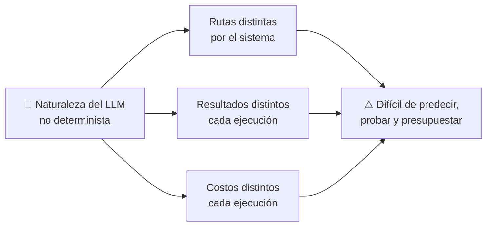
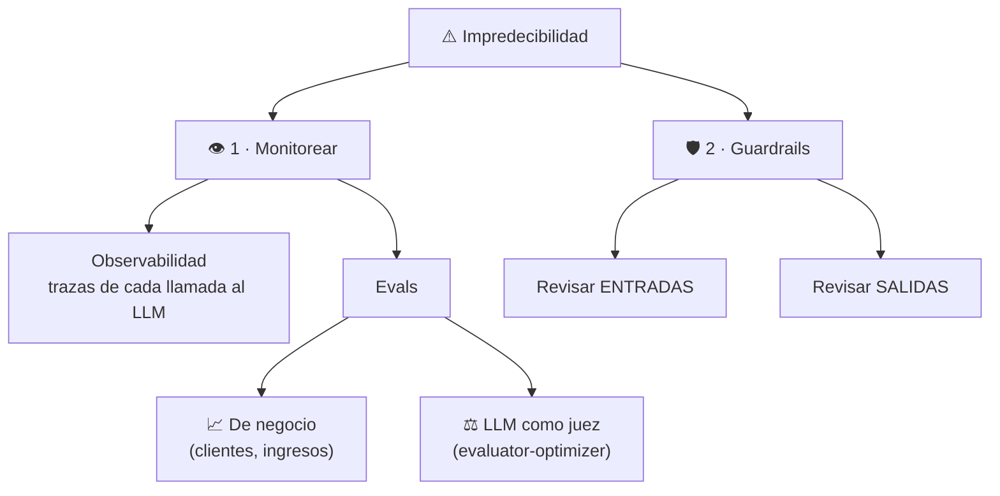
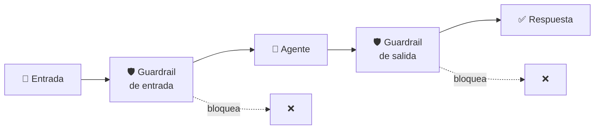
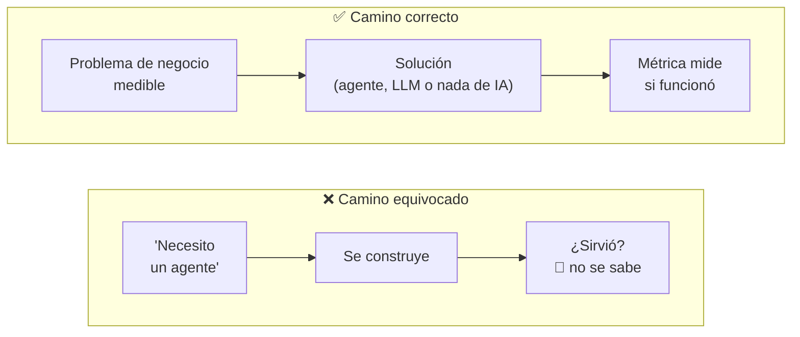
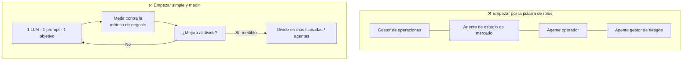

# Clase 09 · Semana 1, día 2 — Riesgos, trampas y cómo pensar como AI Engineer

> ⬅️ [08 · Patrones de diseño](08-patrones-de-diseno-agenticos.md) · ➡️ [10 · Modelos y proveedores (día 3)](10-modelos-y-proveedores-de-llm.md)
> 🗓️ **Semana 1 · Día 2 — "Agents and Agentic Patterns"** (cierre) · tipo: 🟠 teoría (sin laboratorio)
> **Qué vas a poder explicar al terminar:** por qué la IA agéntica es impredecible, cómo se mitiga (observabilidad, evals, guardrails), las dos trampas que hunden proyectos y por qué "alucinó" no es una excusa para un ingeniero.

---

## 🍎 Con manzanas

Contratar un **empleado brillante y creativo** tiene un precio: **cada día trabaja distinto**. Hoy cierra 10 pedidos con 5 llamadas; mañana usa 12 llamadas y se inventa un proveedor que no existe. Su gran virtud (flexibilidad) es también su talón de Aquiles (impredecible).

Para trabajar con él necesitas:

- **Cámaras y libro de registro** (observabilidad): ver qué hizo en cada pedido.
- **Una vara de medir** (evals): ¿cuántos clientes volvieron a comprar? ¿cuánto ganamos?
- **Candados** (guardrails): revisar lo que entra y lo que sale antes de dejarlo pasar.

Y **dos errores clásicos del dueño**: pedir "un empleado estrella" **sin saber qué problema quiere resolver**, y **tratarlo como a una persona** en vez de como un generador de texto probable.

> En palabras de la calle: **un agente es poderoso porque es flexible, y por eso mismo hay que medirlo y ponerle límites.**

---

## 1 · El gran riesgo: la impredecibilidad

Un LLM puede dar **respuestas diferentes cada vez**. Eso es parte de su poder, pero implica que el **camino**, el **resultado** y el **costo** pueden variar. Conecta con la [clase 03](03-configurar-entorno-costos-mentalidad.md#5--la-idea-que-más-importa-pensar-como-científico-de-datos).

## 2 · Cómo mitigarlo (dos grandes frentes)

### 2.1 · Monitorear (desarrollo y producción)

| Herramienta | Qué es | 🍎 |
|---|---|---|
| **Observabilidad (trazas)** | Ver **exactamente qué pasó** en cada llamada al LLM. | Las cámaras y el libro de registro |
| **Eval de negocio** | Medir contra el **objetivo comercial real**: ¿cuántos clientes potenciales? ¿cuánto ingreso generaron las ventas de mis agentes? | ¿Subió la caja? |
| **Eval con LLM como juez** | Otro LLM decide si la salida es buena: es el [patrón 5](../../patrones/05-evaluator-optimizer/README.md). Muy habitual para saber qué ocurre en producción. | El encargado de calidad |

> La eval **más importante** es la de negocio: un LLM juez opina; el dinero y los clientes **miden**.

### 2.2 · Guardrails (barreras de seguridad)

- OpenAI las define como mecanismos que garantizan que los agentes se comporten **de forma segura, coherente y dentro de los límites previstos**.
- **Son código tuyo**, un "andamiaje" alrededor del flujo del agente: normalmente **pruebas que añades**.
- **El LLM solo genera un resultado; no estás obligado a usarlo.** Lo revisas y decides.
- Se aplican a **entradas y salidas**, de cada agente o de todo el sistema.

Es la misma idea del **Gate** de la [cadena de prompts](../../patrones/01-prompt-chaining/README.md) y del `tdd-gate.sh` de tu kit: **código normal que decide si algo pasa**. Los iremos construyendo en las próximas semanas.

## 3 · Trampa 1: enamorarse de la solución

**El caso del "agente cultural"** (real, según el instructor):

| Pasó | Lección |
|---|---|
| El cliente pidió *"un agente cultural"* y se molestó cuando le preguntaron qué problema resolvía. | El hype hace que la gente pida **la solución** sin el problema (incluso con presupuesto reservado). |
| Al indagar: había **mala moral** y **alta rotación**. | El problema real es **medible**: la rotación de personal. |
| Un agente podría ser **una** de varias soluciones; antes convendría una **encuesta** para hallar la causa raíz. | Quizá la solución ni siquiera es un LLM. |

> 🍎 Es como decir *"quiero un empleado estrella"* sin decir si el problema es que **falta fruta**, que **sobra fruta dañada** o que **no llegan clientes**.

**El matiz insidioso:** un LLM genera contenido **verosímil**, no necesariamente **correcto**. Un "agente cultural" te dará con gusto consejos creíbles… y **creíble ≠ correcto**. La forma de saber si es correcto es **medirlo contra una métrica**. Con la métrica, un agente en bucle puede **mejorarla de verdad**: ahí está la IA agéntica exitosa.

## 4 · Trampa 2: antropomorfizar (tratarlo como persona)

- **Señal de alarma:** abrir la pizarra, dibujar cajas y ponerles **nombres y funciones humanas** antes de saber si hace falta.
- **Por qué es error:** los LLM **no son personas**: son **motores que generan tokens** probables.
- **La regla:** **empieza con un solo LLM, un prompt, un objetivo**. Mide con el resultado de negocio (ej. en correos de ventas: tasa de respuesta, clientes generados). Divide **solo si mejora de forma cuantificable**.
- **Matiz justo:** a veces copiar la estructura de un equipo humano **sí** resulta una buena arquitectura. Está bien probarlo, pero **llegando de forma intencionada y midiéndolo**, no porque "suena bien".

> ✅ **Esto responde la pregunta pendiente de la [clase 08](08-patrones-de-diseno-agenticos.md):** *"¿cómo sé si divido el problema o basta una sola llamada?"* → **Empieza con una; divide solo cuando lo medido demuestre que mejora.**

## 5 · Las tres conclusiones del instructor

1. **Construye un sistema de agentes porque resuelve un problema de negocio de forma medible.** Aunque parezca obvio, con el hype la gente pide agentes (o MCP) sin problema detrás: hay que **plantar cara y volver al problema**.
2. **Elige la arquitectura porque mejora la métrica**, no porque quede bien.
3. **Los LLM generan resultados creíbles, no necesariamente precisos.** Tu trabajo: **alinear la predicción del siguiente token con un resultado de negocio.**

## 6 · "Alucinó" no es excusa para un ingeniero

| Si eres... | "Alucinación" significa... |
|---|---|
| **Usuario de IA** (ChatGPT, Claude Code) | Que la herramienta se inventó algo (por ejemplo una API). Puedes quejarte. |
| **Ingeniero de IA** | **No es una opción culpar a la alucinación**: estás **construyendo** el sistema. |

Un LLM solo genera tokens plausibles según patrones de sus datos. **Interpretarlos, ponerles guardrails, anotarlos y hacerlos precisos es tu trabajo.** → "Tenemos que programarlo."

## 7 · ¿Qué significa "ingeniero agéntico"? (término ambiguo)

| Significado | Qué hace | Ejemplo en este repo |
|---|---|---|
| **A · Usa** agentes para construir sistemas | Programa con Claude Code, Codex, etc. | Tu [`ia-agentes/`](../../../ia-agentes) |
| **B · Diseña** agentes | Escribe código que **crea** agentes | Este curso y el [catálogo de patrones](../../patrones/README.md) |

Recomendación del instructor: **sé explícito** al decirlo para evitar confusión.

## 8 · Resumen del día 2 (avance: ~7 % del curso)

| Tema | Idea clave |
|---|---|
| Definición de agente | LLM + herramientas + bucle + objetivo ([clase 07](07-que-es-un-agente-workflow-vs-agent.md)) |
| Patrones | 5 de workflow + 1 de agente; **orientativos**, no inamovibles ([clase 08](08-patrones-de-diseno-agenticos.md)) |
| Riesgo | Impredecibilidad → observabilidad, evals, guardrails |
| Trampas | Solución sin problema · antropomorfizar |
| Mentalidad | LLM = predictor estadístico de tokens; el trabajo es alinearlo con negocio |

## 9 · Qué debe dominar cada nivel

| Nivel | Debe poder... |
|---|---|
| 🟢 **Junior** | Explicar por qué un agente puede dar resultados distintos y nombrar las dos mitigaciones: monitorear y guardrails. |
| 🟡 **Mid** | Distinguir eval de negocio y eval con LLM como juez; poner un guardrail de entrada y uno de salida; empezar con un solo LLM y medir antes de dividir. |
| 🔴 **Senior** | Traducir "quiero un agente" en un problema medible; defender que la arquitectura debe ganarse con datos; diseñar observabilidad (trazas) y límites de costo y de acción antes de producción. |

## 10 · Escalera de respuesta para entrevista

**"Un cliente te dice: necesito un agente de IA. ¿Qué haces?"**

- 🟢 *Frase junior:* "Le pregunto qué problema quiere resolver."
- 🟡 *Capa mid:* "Defino una métrica de negocio (ventas, rotación, tiempo) y empiezo con la solución más simple, un solo LLM, para medirla."
- 🔴 *Cierre senior:* "Compruebo si el problema ni siquiera necesita IA, y si la necesita, itero la arquitectura solo cuando los datos demuestran mejora. Agrego trazas, evals de negocio y guardrails antes de producción, porque un LLM genera contenido creíble, no necesariamente correcto."

**"¿Cómo manejas las alucinaciones?"**

- 🟢 "Verifico la respuesta." → 🟡 "Con guardrails de salida y validación contra fuentes." → 🔴 "No las veo como un fallo ajeno: son comportamiento esperado del modelo, así que el sistema debe detectarlas y acotarlas con validación, evals y límites de acción."

## 🔗 Relacionado

- [Clase 07](07-que-es-un-agente-workflow-vs-agent.md) · [Clase 08](08-patrones-de-diseno-agenticos.md) · [Catálogo de patrones](../../patrones/README.md) · [Índice](../README.md)
- [Roadmap · Fase 5](../../README.md) — AI Evals y Guardrails (aquí aparecen por primera vez).
- [Production Track](../../llm-production/README.md) — observabilidad y evals a escala.
