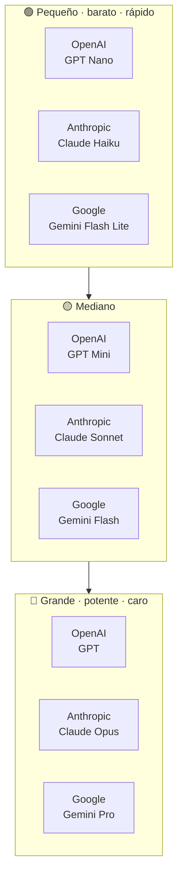
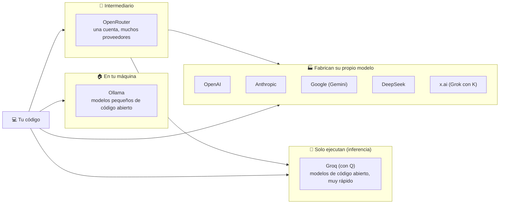
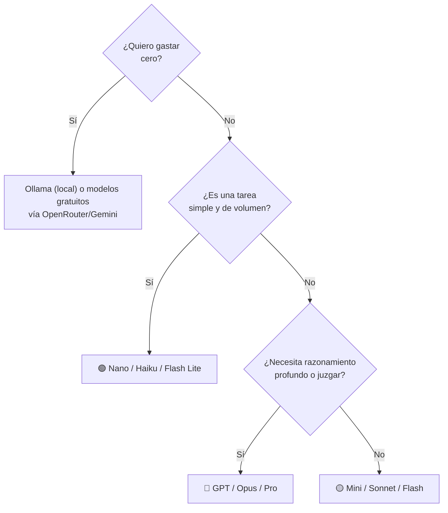

# Clase 10 · Semana 1, día 3 — Orquestando LLMs: el mapa de modelos y proveedores

> ⬅️ [09 · Riesgos y trampas](09-riesgos-y-trampas-de-la-ia-agentica.md) · ➡️ [11 · Lab 2](11-lab2-preguntar-a-varios-llm.md)
> 🗓️ **Semana 1 · Día 3 — "Orchestrating LLMs"** · tipo: 🟠 intro del laboratorio · hoy se hacen **muchas llamadas a distintos LLM**
> **Qué vas a poder explicar al terminar:** qué familias de modelos existen y cómo se ordenan por tamaño, quién *fabrica* un modelo y quién solo lo *ejecuta*, cómo funciona OpenRouter, y cómo correr modelos gratis o en tu máquina.

---

## 🍎 Con manzanas

La frutería compra fruta a **distintos mayoristas**:

- **Tres grandes marcas** (OpenAI, Anthropic, Google), cada una con **tres calidades**: la económica y rápida, la intermedia y la premium.
- **Productores** (los que *fabrican* el modelo) y **bodegas de reparto** (los que solo *ejecutan* modelos de otros: inferencia).
- **Una central de compras** (OpenRouter) que te deja pedir a todas con **una sola cuenta**, cobrando una pequeña comisión.
- **Tu propia huerta** (Ollama): modelos pequeños que corren en tu máquina, sin pagar a nadie.

> En palabras de la calle: **hay muchos proveedores y tamaños; eliges por costo, velocidad y calidad, y puedes cambiar sin reescribir todo.**

---

## 1 · Las tres grandes familias, en tres tamaños

| Tamaño | OpenAI | Anthropic | Google | Cuándo |
|---|---|---|---|---|
| 🟢 Pequeño | GPT Nano | Claude Haiku | Gemini Flash Lite | Tareas simples, mucho volumen, bajo costo |
| 🟡 Mediano | GPT Mini | Claude Sonnet | Gemini Flash | Equilibrio calidad y precio |
| 🔴 Grande | GPT | Claude Opus | Gemini Pro | Lo difícil: razonamiento complejo, evaluación |

**Versiones que usa el instructor** (hoy): GPT **5.4 nano**, **5.4 mini** y **5.5**; Gemini serie **3.1**. Salen modelos nuevos **cada semana**: usa los que tengas o los más recientes; solo cambia los números.

> 🍎 **Conexión con los patrones:** un modelo pequeño genera y uno grande evalúa ([patrón 5](../../patrones/05-evaluator-optimizer/README.md)); un modelo barato clasifica y uno fuerte responde lo difícil ([patrón 2](../../patrones/02-routing/README.md)). **Elegir tamaño por paso** es una decisión de ingeniería.

## 2 · Quién fabrica y quién ejecuta

| Proveedor | Qué es | Detalle del instructor |
|---|---|---|
| **OpenAI · Anthropic · Google** | Fabrican modelos, 3 tamaños cada uno | Los tres grandes |
| **DeepSeek** | Startup china de IA | Popular por lanzar de los primeros un modelo muy grande de **código abierto**; versiones pequeñas corren en tu equipo, la completa necesita un proveedor |
| **Groq (con Q)** | **Proveedor de inferencia**: plataforma en la nube que **ejecuta** modelos de código abierto, **muy rápido** | No fabrica modelos. ⚠️ No confundir con **Grok (con K)**, el LLM de x.ai (Elon Musk) |
| **Ollama** | Programa que corre **en tu computadora** y ejecuta modelos pequeños de código abierto | Gratis; es la vía "local" del curso |
| **OpenRouter** (`openrouter.ai`) | **No es un proveedor**: una **pasarela**. Una clave y una cuenta; él reenvía tus peticiones a OpenAI, Anthropic, Gemini, Groq, Grok… | Cobra un margen pequeño al recargar (≈5,5 % según el instructor 🔎). Evita saldos mínimos en cada proveedor y ayuda con límites de velocidad |

> 🔎 La transcripción escribe "Grok con Q" para el proveedor de inferencia; el nombre correcto es **Groq**. Los porcentajes y versiones son los que dice el instructor hoy; **cambian**, verifícalos antes de decidir.

## 3 · Dónde comparar modelos

**[artificialanalysis.ai](https://artificialanalysis.ai)**: compara modelos por **inteligencia, velocidad y costo** de forma cuantitativa.

> ⚠️ Los *benchmarks* **no lo son todo**: tómalos con escepticismo (tienen problemas), pero sirven de punto de partida para saber cuánto rinde y cuánto cuesta cada modelo.

## 4 · Cómo elegir (guía rápida)

Con modelos gratuitos o pequeños: **más experimentación, prompts más pulidos, pasos más pequeños, y conformarse a veces con menos**. El instructor insiste: **eso es parte del aprendizaje**, y el curso completo se puede hacer **sin gastar nada**.

## 5 · Recordatorios del día

1. **Recursos:** la página del curso, el repo con las guías y los cuadernos; léelos, traen cosas útiles.
2. **Actitud:** los problemas son donde más se aprende.
3. **La IA agéntica no es fiable por naturaleza:** depende de la experimentación y el desarrollo que hagas; sobre todo con modelos baratos o gratuitos. Acéptalo y experimenta.
4. Para fundamentos (prompt de sistema vs. de usuario, tokens, modelos de razonamiento vs. chat, la API de chat), el instructor remite a las **dos primeras semanas del Core Track**.

## 6 · Qué debe dominar cada nivel

| Nivel | Debe poder... |
|---|---|
| 🟢 **Junior** | Nombrar las tres familias y sus tres tamaños; decir que un modelo más grande es más potente pero más caro y lento. |
| 🟡 **Mid** | Diferenciar quién **fabrica** un modelo de quién solo lo **ejecuta**; explicar qué hace OpenRouter y cómo correr un modelo local con Ollama. |
| 🔴 **Senior** | Elegir modelo **por paso** del flujo (barato para clasificar, fuerte para juzgar), medir costo/latencia/calidad con datos propios (no solo benchmarks), y diseñar el sistema para **cambiar de proveedor** sin reescribir. |

## 7 · Escalera de respuesta para entrevista

**"¿Cómo eliges qué modelo usar?"**

- 🟢 *Frase junior:* "Uno pequeño para lo simple y uno grande para lo difícil, porque el grande cuesta más."
- 🟡 *Capa mid:* "Según costo, velocidad y calidad para esa tarea. Puedo usar un proveedor distinto por paso o una pasarela como OpenRouter para cambiar fácil."
- 🔴 *Cierre senior:* "Empiezo con el modelo más simple que cumpla la métrica de negocio y subo solo si los datos lo justifican. Abstraigo al proveedor para poder cambiar por precio o disponibilidad, y no me fío solo de benchmarks públicos: evalúo con mis propios casos."

**"¿Qué diferencia hay entre OpenRouter y Groq?"**

- 🟢 "OpenRouter es una pasarela y Groq ejecuta modelos rápido." → 🟡 "OpenRouter reenvía a muchos proveedores con una cuenta; Groq es un proveedor de inferencia de modelos abiertos." → 🔴 "Uno es intermediario (margen, límites, un punto de falla más); el otro es infraestructura. Elijo según latencia, costo y dependencia que acepto."

## 🔗 Relacionado

- [Clase 03 · costos](03-configurar-entorno-costos-mentalidad.md#3--costos-de-las-apis-cuánto-cuesta-de-verdad) · [Clase 05 · clave y `.env`](05-openai-api-key-env-notebook.md) · [Clase 09](09-riesgos-y-trampas-de-la-ia-agentica.md) · [Índice](../README.md)
- [Catálogo de patrones](../../patrones/README.md) — dónde se aplica elegir modelo por paso.
- [Production Track](../../llm-production/README.md) — multi-proveedor y costos en producción.
