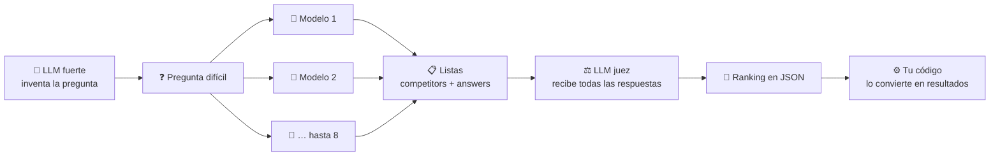
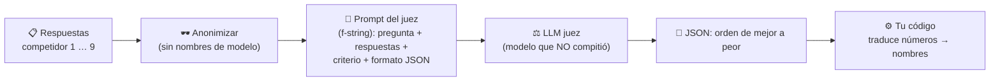

# Clase 11 · Semana 1, día 3 — Laboratorio 2: un LLM inventa la pregunta, otros la responden

> ⬅️ [10 · Modelos y proveedores](10-modelos-y-proveedores-de-llm.md) · ➡️ Siguiente: _pendiente_ (día 4: herramientas)
> 🗓️ **Semana 1 · Día 3 — "Orchestrating LLMs"** · tipo: 🟠 laboratorio (`1_foundations` → **lab 2**, en tu fork `agents`)
> ✅ Cubre las **3 partes del lab 2** (la pregunta, los modelos locales y el juez). Fuentes: transcripción del instructor y una explicación de tu ejecución hecha por otro modelo (marcada donde aplica).

---

## 🍎 Con manzanas

Un **concurso de empleados**. Al dueño no le toca inventar la pregunta: se la pide **al empleado más fuerte**. Esa pregunta se la reparte a **ocho empleados de distintas marcas**, cada uno responde, y al final se ve **quién lo hizo mejor**.

> En palabras de la calle: **un LLM crea el examen, varios LLM lo contestan y se comparan.**

## 1 · El plan del laboratorio

**Patrones que se mezclan** (el reto del instructor): **chaining** (pregunta → respuestas → juez), **fan-out** a varios modelos con la misma pregunta y **LLM como juez** ([patrón 5](../../patrones/05-evaluator-optimizer/README.md)).
> ✅ Confirmado por el instructor: los modelos **no se ejecutaron en paralelo** (llamadas una tras otra), "pero podríamos haberlo hecho"; cada uno respondió **de forma independiente**. Es fan-out en concepto, secuencial en ejecución.

## 2 · Lo que se hizo en esta parte

| Paso | Qué | Detalle útil |
|---|---|---|
| 1 | **Imports y claves** | Ejecutar la celda que carga el `.env` con **todas** las claves; guardar el archivo antes (`Ctrl/Cmd + S`). |
| 2 | **Comprobar claves** | Una celda imprime si cada clave existe (OpenAI, Anthropic, Google, DeepSeek…) y cómo empieza: OpenRouter → `sk-or…`. **No necesitas todas.** |
| 3 | **Pedir la pregunta a un LLM** | Prompt: pregunta **compleja y matizada**, de **respuesta breve**, que invite a **reflexionar** (no un acertijo matemático) y **"responde solo con la pregunta"**. |
| 4 | **Armar `messages`** | Lista de diccionarios con `role: user` (como en la [clase 06](06-primeras-llamadas-openai-encadenar.md)). |
| 5 | **Llamar y leer** | `openai.chat.completions.create(model=…, messages=…)` → `response.choices[0].message.content`. |

Resultado de la pregunta generada: *"¿Qué virtud humana puede convertirse en vicio si se lleva al extremo, y por qué? Responde en no más de dos frases."*

## 3 · El ejercicio completo, paso a paso

1. Un modelo **genera** una pregunta difícil.
2. Se envía a **varios modelos** como `{"role": "user", "content": ...}`.
3. Las respuestas se guardan en dos listas: **`competitors`** (quién) y **`answers`** (qué dijo).
4. **Otro modelo** recibe todas las respuestas y devuelve un **ranking en JSON**.
5. **Tu código** convierte ese JSON en resultados.

## 4 · Lo que realmente enseña (lo útil)

| Lección | Qué significa | 🍎 |
|---|---|---|
| **LLM como juez** | Un modelo evalúa a otros. Sirve cuando **no hay una respuesta fija correcta** (redacción, razonamiento, atención al cliente) y permite automatizar el control de calidad. | El encargado de calidad compara a los ocho empleados |
| **Cambiar de proveedor cuesta poco** | Casi todos los proveedores **copian la API de OpenAI**: basta cambiar **`base_url`, la clave y el nombre del modelo**; el resto del código queda igual. | Cambiar de mayorista sin rehacer el local |
| **Los modelos fallan o desaparecen** | En tu ejecución aparecieron errores **404** (modelo inexistente) y **503** (servicio caído). En producción: **modelo de respaldo + reintentos**. | Tener un segundo proveedor por si el primero no entrega |
| **Pedir JSON estricto y parsearlo** | La salida del modelo se vuelve **datos que tu código usa**. Es la base de los agentes. | Una nota con formato fijo que el sistema sí puede leer |

> 🔗 La lección del 404/503 se conecta con el [Production Track](../../llm-production/README.md): resiliencia, respaldo y reintentos.

## 5 · Extensiones para practicar (cuando toque implementarlas)

| Idea | Patrón que ejercita |
|---|---|
| Que **cada modelo critique** la respuesta de otro | Evaluator-optimizer entre pares |
| Que un modelo **reescriba** su respuesta tras leer el ranking | Ciclo de mejora ([patrón 5](../../patrones/05-evaluator-optimizer/README.md)) |
| Hacer las llamadas **concurrentes** | [Parallelization](../../patrones/03-parallelization/README.md) real |

Estas ideas encajan con el catálogo (casos de uso 3 y 5), no con el fork: ahí se aplicarían como práctica propia.

## 6 · Notas de la parte del instructor

- **Lo que repites se aprende:** hoy llamas a `chat.completions.create` hasta saberla de memoria.
- **Guía 9:** si configuras un solo proveedor extra, que sea **OpenRouter** (acceso gratis a muchos modelos). Claves con nombre **exacto** (`ANTHROPIC_API_KEY`…); no necesitas todas.
- **"Responde solo con la pregunta"** acota la salida para que sirva de entrada limpia al siguiente paso.
- **Aprender haciendo:** ejecuta, luego **adapta y experimenta**. Aportes a `community_contributions/` por pull request.

## 7 · Modelos locales con Ollama (resumen: **puedes saltarte este video**)

El instructor lo marca como opcional (necesita una máquina potente). Lo único que vale la pena llevarse:

| Idea | Detalle |
|---|---|
| **Ollama expone una API compatible con OpenAI** | Corre en `localhost:11434`. Usas **el mismo cliente** y solo cambias `base_url` (a `http://localhost:11434/v1`), la clave (cualquier texto) y el modelo. Es la misma lección de "cambiar de proveedor cuesta poco". |
| **El tamaño importa** | En un equipo común, modelos de **~3 GB o menos**. Los "mejores" (Llama 3.3: 43 GB y 70 mil millones de parámetros) **ahogan** la máquina. Para empezar: **Llama 3.2** (pequeño). |
| **Cuidado con el sufijo `-cloud`** | Un modelo de Ollama que termina en `cloud` **no corre en tu equipo**, corre en la nube. |
| **Comandos útiles** | `ollama pull <modelo>` (descargar) · `ollama ls` (listar) · `ollama rm <modelo>` (borrar) · `ollama serve` (arrancar). En un notebook, un `!` al inicio de la celda ejecuta un comando de terminal. |
| **Calidad vs. tamaño** | Los modelos pequeños suenan más "predecibles", como autocompletado; el de 20 mil millones (GPT-OSS) tardó ~23 s y saturó la GPU, pero respondió bien. |

Con los modelos locales el lab llegó a **9 participantes** (GPT-5 Nano, Claude Sonnet, Gemini, DeepSeek, GPT-OSS 120, Kimi K2.6, Llama 3.2, GPT-OSS 20B local y Gemma 4).

> Si no vas a usar modelos locales (no hace falta para el curso): **sáltalo**. Si algún día lo necesitas, las instrucciones detalladas están en el Core Track y en la Guía 9 del repo.

## 8 · El juez: la parte que sí vale la pena (cierre del lab)

| Decisión de diseño | Por qué |
|---|---|
| **Anonimizar** ("competidor 1…9") | Que el juez **no se sesgue** por conocer la marca del modelo |
| **Juez distinto a los competidores** (aquí Grok 4.3) | Un modelo que compitió **podría favorecerse** |
| **Criterio explícito** (claridad y solidez de argumentos, de mejor a peor) | Sin criterio, el juez opina sin base |
| **Salida en JSON** | Tu código puede **leerla y usarla**; el LLM solo genera tokens en ese formato |
| **Mapeo final en código** | El JSON trae números; el código los vuelve nombres |

> 🔑 **La idea del instructor:** esto **es** IA con capacidad de decisión: dejas que un LLM decida, pero todo se reduce a **generar tokens** en un formato que tu código interpreta (la [clase 07](07-que-es-un-agente-workflow-vs-agent.md#2--la-idea-que-más-pesa-el-llm-solo-genera-tokens) en acción).

**Resultado (anecdótico):** ganó **Kimi K2.6** (código abierto, vía OpenRouter); último, Llama 3.2 de 1B. El ranking coincide **aproximadamente** con el tamaño del modelo (compáralo en artificialanalysis.ai). El instructor mismo duda si el juez **prefirió lo más original** y no lo mejor: **todo juez LLM tiene sesgos**, así que conviene validarlo.

**¿Qué patrones fueron?** El instructor deja la pregunta abierta (hay debate en su Q&A). Mi lectura:

| Patrón | ¿Está? |
|---|---|
| **Prompt chaining** (pregunta → respuestas → juez) | ✅ |
| **Parallelization** (misma pregunta a 9 modelos, independientes; en el lab fue secuencial pero *podría ser paralelo*) | ✅ en concepto |
| **Evaluator-optimizer** | ⚠️ **Solo a medias**: hay juez, pero **no hay ciclo de regreso** al generador; es "LLM como juez" sin optimización |

**Ejercicio del instructor:** añadir más llamadas, hacer el flujo más sofisticado, incorporar otro patrón y subirlo por pull request a `community_contributions/`. (Mis ideas de extensión están en la sección 5.)

**Uso de negocio:** repartir una solicitud entre varios LLM y **elegir la mejor respuesta** mejora **calidad y resiliencia**; aplica a casi cualquier sector. El "LLM como juez" es muy habitual en flujos agénticos.

**Cierre del día 3:** se orquestaron LLM con **código Python** (nube y local) y se pusieron en práctica los patrones del día 2. **~10 % del curso.** Mañana (día 4): **herramientas**, pieza central de la IA agéntica.

## 9 · Qué debe dominar cada nivel

| Nivel | Debe poder... |
|---|---|
| 🟢 **Junior** | Verificar que sus claves están cargadas y hacer una llamada a un modelo para generar texto. |
| 🟡 **Mid** | Usar la salida de un LLM como entrada de otras llamadas, pedir **JSON** y parsearlo, y cambiar de proveedor tocando solo `base_url`, clave y modelo. |
| 🔴 **Senior** | Comparar modelos con la **misma entrada** y criterios definidos, **tolerar fallos** (respaldo, reintentos), controlar costo y no depender de un solo proveedor. |

## 10 · Escalera de entrevista

**"¿Cómo compararías el desempeño de varios LLM en una tarea?"**

- 🟢 "Les doy la misma pregunta a todos y comparo las respuestas."
- 🟡 "Con la misma entrada y un criterio claro; puedo usar otro LLM como juez."
- 🔴 "Con casos de prueba propios, criterios medibles, costo y latencia por modelo; un solo ejemplo no basta."

## 🔗 Relacionado

[Clase 10](10-modelos-y-proveedores-de-llm.md) · [Clase 06](06-primeras-llamadas-openai-encadenar.md) · [Catálogo de patrones](../../patrones/README.md) · [Índice](../README.md)
