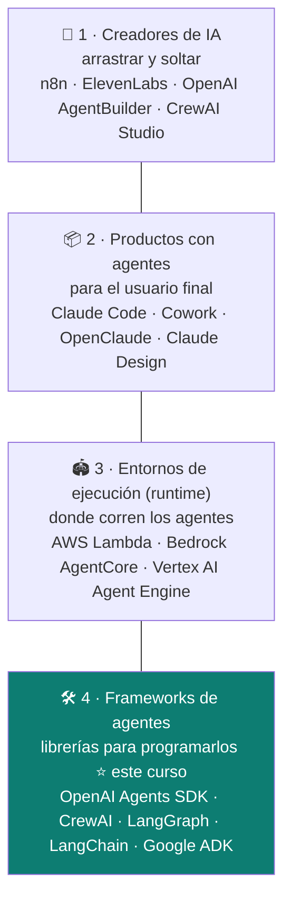
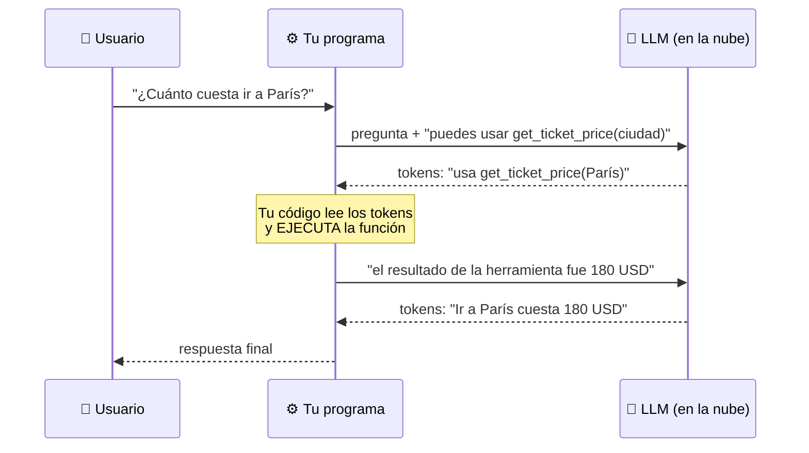
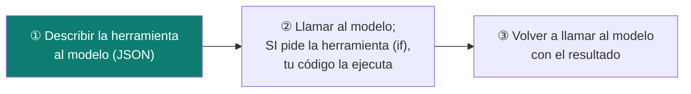
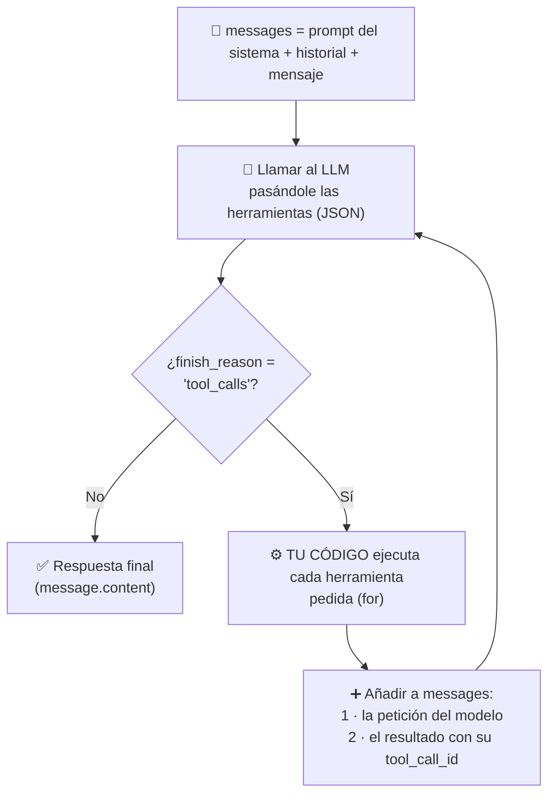
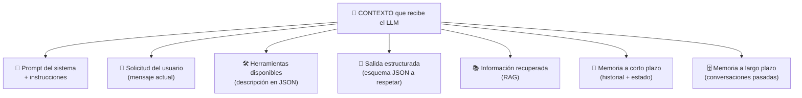
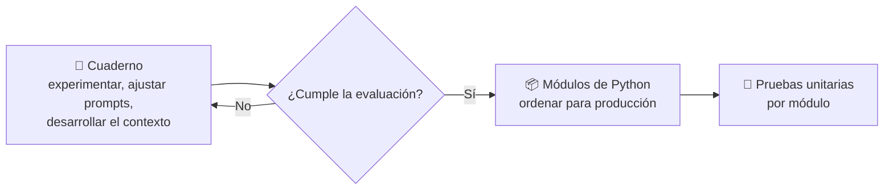

# Semana 1 · Notas ligeras (día 4 en adelante)

> Formato acordado: veredicto de cada clase + solo lo que vale la pena. Las clases 01 a 11 quedan en [`clases/`](clases/) hasta la depuración al cierre de la semana.
> ⬅️ [Índice del curso](README.md)

---

## Día 4 · Clase 17 — El panorama de los agentes (conceptual, sin código)

**Veredicto: 🟡 no hace falta verla completa.** Lo útil es el mapa de 4 categorías y las 3 ideas de abajo; el resto es repetición y promoción de otros cursos.

### 🍎 Con manzanas

El mundo de los agentes es como el **sector de las fruterías**: están los que venden **kits para armar tu propio puesto**, los **puestos ya armados**, los **mercados donde se instalan los puestos**, y los **proveedores de herramientas para construir puestos**. Y aquí estamos en el cuarto grupo.

### 1 · Las 4 categorías del ecosistema (visión del instructor)



| Categoría | Quién la usa | Cómo se relaciona contigo |
|---|---|---|
| 1 · Creadores | Gente de negocio, con o sin código | Lo que viste en n8n |
| 2 · Productos | Usuarios finales | **Tu caso de uso real:** Claude Code, Copilot (la meta que describiste de Arkano) |
| 3 · Runtime | Quien despliega | Tema del **Production Track** |
| 4 · Frameworks | Quien programa agentes | Tema del **Agentic Track** |

Ojo: el instructor dice que **el campo está sobrevalorado e inmaduro**, con terminología confusa y ofertas que se solapan. Es **su** clasificación, no un estándar.

### 2 · Qué hace un framework de agentes (tres cosas)

| Hace | Qué es | 🍎 |
|---|---|---|
| **Orquestación** | Encadenar llamadas a LLM | La cadena de montaje (ya la hiciste a mano) |
| **Llamada a herramientas (+ MCP)** | Dar poderes al LLM; el framework gestiona el JSON y la lectura de resultados | El empleado con teléfono y lápiz |
| **Entradas/salidas inteligentes** | Armar la mejor entrada y **salidas estructuradas**: pedir JSON y convertirlo en un objeto Python con código normal | Una nota con formato fijo que el sistema sí entiende |

Un framework es solo una **capa de abstracción** que evita repetir código. El bucle de agente suele venir incluido. Los hay **ligeros** (OpenAI Agents SDK, Google ADK, AWS Strands) y **dogmáticos** (CrewAI, LangGraph): rápidos si sigues su forma, incómodos si quieres otra.

### 3 · La idea que más vale: no necesitas un framework

- Anthropic, en *Building Effective Agents*, **recomienda empezar sin framework**.
- Por eso esta semana se construye **el bucle de agente desde cero**; después sí usan frameworks.
- **Spoiler del instructor:** elegir framework **importa menos de lo que parece**; pesa más la **habilidad del equipo** y si prefieres algo rígido o flexible. Todos hacen casi lo mismo.

### Qué debe dominar cada nivel

| Nivel | Debe poder... |
|---|---|
| 🟢 **Junior** | Decir que un framework solo simplifica código repetitivo y que no es obligatorio para crear un agente. |
| 🟡 **Mid** | Distinguir las 4 categorías (creador, producto, runtime, framework) y nombrar las 3 tareas de un framework (orquestar, herramientas/MCP, salidas estructuradas). |
| 🔴 **Senior** | Elegir framework por la **habilidad del equipo y el nivel de control que necesitas**, no por moda; saber que un agente se puede escribir sin ninguno, y por qué empezar sin framework ayuda a entender qué hace cada capa. |

### Escalera de entrevista

**"¿Necesitas un framework para construir un agente?"**

- 🟢 "No, es un LLM llamado en un bucle con herramientas; un framework solo lo simplifica."
- 🟡 "El framework abstrae orquestación, herramientas y salidas estructuradas. Anthropic recomienda empezar sin él."
- 🔴 "Empiezo sin framework para entender el flujo y lo adopto cuando me ahorra código repetitivo. Elijo por el equipo y por cuánto control necesito: uno ligero si quiero control, uno opinado si quiero velocidad."

---

## Día 4 · Clase 18 — Qué es realmente una herramienta (tool calling)

**Veredicto: 🟢 verla (es corta; a 1,5x).** Es el concepto central de la IA agéntica y lo explica muy bien. Para tu nivel el concepto puede sonarte familiar; lo valioso es la **forma de explicarlo**, útil en entrevistas. El laboratorio que sigue (lab 3) es donde se implementa.

### 🍎 Con manzanas

El empleado (LLM) está en un cuarto y **solo escribe notas**. Tú le dices: *"si necesitas el precio del billete a Londres, escribe `get ticket price London`"*. Cuando él escribe esa nota, **no hace nada más**: es **tu programa** el que la lee, **llama al proveedor**, y **vuelve a mostrarle** el resultado al empleado para que siga. **El empleado nunca toca el teléfono.**

> En palabras de la calle: **la "llamada a herramienta" es una nota que el modelo escribe y que tu código decide si ejecuta.**

### 1 · La verdad "aburrida" detrás de la magia



| Lo que parece | Lo que pasa de verdad |
|---|---|
| "El LLM ejecuta una función en mi computadora" | El LLM **solo genera tokens**. **Tu código** invoca la función |
| "Magia" | **Prompt bien formulado + JSON + sentencias `if`** |
| "Autonomía" | Una forma elegante de nombrar *dar una indicación e interpretar el resultado* |
| "Bucle de agente" | **Tu software** llama al LLM en bucle y decide cuándo llamar funciones; el LLM solo recibe y devuelve tokens |

### 2 · Dos demostraciones del instructor (se pueden hacer en un chat, sin código)

- **Herramienta sin herramienta:** prompt "eres asistente de una aerolínea; si necesitas un precio, responde `get ticket price London`". Ante "¿cuánto cuesta ir a París?" el modelo responde `get ticket price Paris`. **No hubo ninguna herramienta real**: solo un prompt y una respuesta interpretable.
- **Autonomía en 4 líneas:** "estás en una habitación; responde solo `ir al norte/este/sur/oeste`". El modelo elige solo una dirección. Si un código leyera eso y moviera un robot, diríamos que decidió de forma autónoma.

### 3 · ¿Para qué sirve el LLM si ya existe la función?

Pregunta clave de un estudiante: *"si ya tengo `get_ticket_price(ciudad)`, ¿para qué un LLM?"*
→ Porque el usuario no escribe `get_ticket_price(Paris)`, escribe **"¿cuánto cuesta ir a París?"**. El LLM aporta **entender significado e intención**: "costo" = "precio", París ≠ Londres, y **convertir lenguaje libre en una acción concreta**. Eso era un problema sin resolver hace pocos años.

### 4 · Conexión con tu trabajo

- Esto es **exactamente** cómo funcionan Claude Code y Copilot: el modelo pide leer o escribir un archivo y **el programa lo ejecuta, o lo bloquea**.
- Por eso tu `tdd-gate.sh` tiene sentido: es **código normal que intercepta la herramienta antes de ejecutarla**. Los guardrails viven **en tu código**, no en el modelo ([clase 09](clases/09-riesgos-y-trampas-de-la-ia-agentica.md#22--guardrails-barreras-de-seguridad)).

### Qué debe dominar cada nivel

| Nivel | Debe poder... |
|---|---|
| 🟢 **Junior** | Decir que "tool calling" (o "function calling") es dar al modelo funciones que puede pedir usar, y que **él no las ejecuta**. |
| 🟡 **Mid** | Explicar el ciclo: prompt con herramientas → el modelo devuelve la herramienta y sus argumentos → tu código ejecuta → devuelves el resultado → respuesta final. |
| 🔴 **Senior** | Ubicar los controles donde corresponde (validar argumentos, permisos, límites **antes** de ejecutar), y razonar que la autonomía es "prompt + interpretación", por lo que se puede acotar con código. |

### Escalera de entrevista

**"¿Cómo funciona el tool calling?"**

- 🟢 "El modelo indica qué función quiere usar y con qué datos; mi código la ejecuta."
- 🟡 "Le paso la descripción de las herramientas; devuelve el nombre y los argumentos; yo ejecuto, le entrego el resultado y repite hasta responder."
- 🔴 "El modelo solo genera tokens; el agente es mi bucle. Por eso valido argumentos y permisos antes de ejecutar cada herramienta y pongo topes de iteración: el control está en el código, no en el modelo."

---

## Día 4 · Clase 19 — Lab 3 (inicio): preparar el gemelo digital y repaso de fundamentos

**Veredicto: 🔴 casi toda se puede saltar** (a 2x, o no verla). Es preparación + conceptos básicos que ya dominas. Lo único útil está abajo. **La clase 20 es la que sí importa** (llamar a las herramientas).

### Lo que vale la pena (todo lo demás, saltarlo)

| Idea | Detalle |
|---|---|
| **Qué se prepara** | En `1_foundations/twin/`: un `linkedin.pdf` (tu perfil) y un `summary.txt` (2 frases sobre ti). Se lee el PDF con **pypdf** y se le da al LLM como contexto para el **gemelo digital** (el "currículum del futuro"). El texto del PDF sale desordenado; no importa, los LLM manejan bien datos no estructurados. |
| **Nombres en minúsculas** | `linkedin.pdf`, `summary.txt`, **todo en minúsculas**: Mac y Windows no distinguen mayúsculas, pero el servidor Linux donde se desplegará sí. Es una trampa real. |
| **Prompt del sistema** | Primera sección del mensaje: rol, estilo y contexto. El modelo aprendió a tratarla como el marco general de la respuesta. |
| **Historial de conversación** | Lista de mensajes `user` / `assistant` / `user`… que termina con el último mensaje del usuario. |
| **La ilusión de la memoria** | El LLM es **sin estado**: no recuerda nada entre llamadas. Parece tener memoria porque **cada vez le reenvías el historial completo** (y pagas esos tokens de entrada). La "memoria" de ChatGPT son datos extra que se **añaden al prompt del sistema**. |

### 🍎 Con manzanas

El empleado **olvida todo en cuanto sales del cuarto**. Para que parezca que te recuerda, **cada vez que entras le entregas el cuaderno con toda la conversación anterior**. Si no se lo entregas, te pregunta cómo te llamas.

### Escalera de entrevista

**"¿Cómo hace un chatbot para recordar la conversación?"**

- 🟢 "Guarda el historial y se lo manda al modelo en cada mensaje."
- 🟡 "El modelo no tiene estado; cada llamada incluye el prompt del sistema y todos los mensajes previos, y por eso se pagan esos tokens cada vez."
- 🔴 "La memoria es una ilusión construida por mi código: gestiono qué historial reenvío, recorto o resumo cuando crece por costo y límite de contexto, y puedo inyectar memoria de largo plazo en el prompt del sistema."

### ⚠️ Antes de subir algo a tu fork

`linkedin.pdf` y `summary.txt` ya están en el repo del instructor y **git los sigue** (tracked). Cuando los reemplaces por los tuyos, un `git commit` **publicaría tu perfil** en un fork que probablemente sea público. Revisa con `git status` antes de cada push; mejor **no los incluyas en el commit**.

---

## Día 4 · Clase 20 — Gemelo digital, función `chat` y el JSON de una herramienta

**Veredicto: 🟡 ve solo la parte final (el JSON de la herramienta).** El prompt del sistema y la demo de Gradio ("bananas") se pueden saltar. Falta la **siguiente clase**, donde se ejecuta la herramienta (pasos 2 y 3).

### 🍎 Con manzanas

Para que el empleado pueda pedir algo al proveedor, primero le entregas **una ficha impresa** que dice: *"existe esta herramienta, se llama así, sirve para esto y necesita estos datos"*. Sin la ficha, no sabe que existe. Esa ficha es el **JSON de la herramienta**.

### 1 · Lo rápido (para ubicarte)

| Pieza | Qué es |
|---|---|
| **Prompt del sistema del gemelo** | Tres secciones con encabezados Markdown: **tu papel** (eres el gemelo digital de esta persona, di que eres una IA), **contexto** (resumen y LinkedIn) y **reglas** (sé profesional, no inventes, si no sabes dilo). |
| **Un fallo útil** | Pidió responder solo sobre la carrera, pero el `summary.txt` decía que odia el queso, y respondió igual. **Instrucciones contradictorias = comportamiento ambiguo.** Para bloquearlo de verdad hace falta algo más fuerte que el prompt: un **guardrail en código** (es el primer ejercicio del día, ver la [clase 09](clases/09-riesgos-y-trampas-de-la-ia-agentica.md#22--guardrails-barreras-de-seguridad)). |
| **Función `chat(message, history)`** | Arma `messages = [prompt del sistema] + historial + [mensaje del usuario]` y llama a la API. **Gradio** solo muestra una interfaz y llama a esta función cada vez que escribes; le pasa el historial en formato OpenAI. |
| **Con otros proveedores** | Si falla por campos extra en el historial, limpiarlo para que cada mensaje tenga **solo `role` y `content`**. |

### 2 · La herramienta de ejemplo

`record_email_tool(email)`: una función normal de Python que **anota un correo en `emails.txt`** (el archivo está en `.gitignore`, para no subir correos por accidente).

### 3 · Tool calling en tres pasos (hoy se vio el 1)



El instructor lo resume en tres palabras: **prompts, JSON e `if`**. Reconoce que se ve "cutre y chapucero".

### 4 · El JSON de la herramienta (el paso 1)

```json
{
  "type": "function",
  "function": {
    "name": "record_email_tool",
    "description": "Registra que un usuario ha facilitado su correo electrónico",
    "parameters": {
      "type": "object",
      "properties": {
        "email": { "type": "string", "description": "El correo electrónico del usuario" }
      },
      "required": ["email"]
    }
  }
}
```

> 🔎 Es el formato típico de OpenAI para herramientas, escrito por mí de forma ilustrativa; la transcripción solo describe los campos (nombre, descripción, parámetros con tipo y descripción, obligatorios).

| Campo | Para qué |
|---|---|
| `name` | Cómo se llama la herramienta; el modelo devuelve este nombre |
| `description` | Le dice **cuándo** usarla. Breve es suficiente en modelos modernos |
| `parameters` | **Qué datos** debe devolver el modelo: nombre, tipo, descripción y cuáles son obligatorios |

**Por qué JSON:** los modelos se entrenaron con este formato de esquemas, así que lo esperan así.

> 🔑 **Lo que justifica los frameworks:** generan este JSON **automáticamente a partir de tu función**. Aquí se escribe a mano para ver qué hace el framework por dentro.

### Qué debe dominar cada nivel

| Nivel | Debe poder... |
|---|---|
| 🟢 **Junior** | Explicar que al modelo se le describe cada herramienta con un JSON (nombre, descripción, parámetros). |
| 🟡 **Mid** | Escribir ese esquema, y decir que la descripción orienta **cuándo** usarla y los parámetros **qué** datos devolver. |
| 🔴 **Senior** | Saber que ese JSON es lo que los frameworks autogeneran, y que la **calidad de la descripción** y de los parámetros determina si el modelo usa bien la herramienta; validar los argumentos en código antes de ejecutar. |

### Escalera de entrevista

**"¿Cómo le explicas una herramienta al modelo?"**

- 🟢 "Con un esquema JSON que describe su nombre, para qué sirve y qué parámetros recibe."
- 🟡 "Lo paso junto al mensaje; si el modelo decide usarla, devuelve el nombre y los argumentos y mi código la ejecuta."
- 🔴 "Describo cada herramienta con precisión, porque la descripción guía su uso, y valido los argumentos antes de ejecutar. Los frameworks autogeneran el esquema, pero conviene saber qué hacen por debajo."

---

## Día 4 · Clase 21 — Ejecutar la herramienta y construir el bucle del agente

**Veredicto: 🟢 ver completa.** Es el corazón de la semana: **de un LLM con herramientas a un agente cambiando un `if` por un `while`.** Es corta en ideas, aunque larga en tiempo.

### 🍎 Con manzanas

Hasta ahora el empleado podía pedir **una** cosa y tú la hacías **una sola vez**. Si el cliente decía *"anota estos tres correos"*, el empleado pedía tres anotaciones y **tu programa se confundía**. La solución es dejar de atender "un pedido y ya" y pasar a **atender mientras el empleado siga pidiendo cosas**, hasta que diga *"listo"*.

> En palabras de la calle: **un agente es "mientras el modelo pida herramientas, ejecútalas y vuelve a preguntarle".**

### 1 · El flujo, paso a paso



- **Versión 1 (con `if`):** si el modelo pide una herramienta, la ejecutas **una vez**, añades el resultado y llamas **una segunda vez**.
- **Versión 2 (con `while`):** exactamente lo mismo, pero **repitiendo mientras siga pidiendo herramientas**. Ese es **el bucle del agente**.
- Dentro hay un **`for`** que atiende **varias herramientas pedidas en una misma respuesta** (detalle técnico, no el "bucle de agente").

### 2 · Los detalles que importan

| Detalle | Qué es |
|---|---|
| `tools=` | Pasar el JSON de las herramientas en la llamada. Es lo que le dice al modelo "tienes esto disponible". |
| `finish_reason == "tool_calls"` | La señal de que el modelo **no responde**: **pide ejecutar una herramienta**. |
| `message.tool_calls` | La lista de herramientas pedidas, con **nombre** y **argumentos** (un texto JSON que hay que interpretar). |
| **Tu código** ejecuta | Llamas tú la función con esos argumentos. **El modelo no ejecuta nada.** |
| `tool_call_id` | Al devolver el resultado, hay que indicar **a qué petición responde**; si no, el modelo no puede asociarlo. |
| Dos mensajes nuevos | Se añade **la petición del modelo** y **el resultado**, y se vuelve a llamar. |

Boceto ilustrativo (mío, a partir de lo explicado; los nombres exactos varían según el SDK):

```python
while True:                                              # el bucle del agente
    resp = llamar_llm(messages, tools=herramientas)
    if resp.finish_reason != "tool_calls":
        return resp.content                              # terminó: respuesta final
    messages.append(resp.message)                        # la petición del modelo
    for call in resp.message.tool_calls:                 # puede pedir varias
        args = json.loads(call.arguments)                # texto JSON -> datos
        resultado = ejecutar(call.name, args)            # TU código ejecuta
        messages.append({"role": "tool", "tool_call_id": call.id, "content": resultado})
```

### 3 · El fallo que enseñó todo

- **Con `if`:** al pedir *"registra x, y y z"*, el modelo pidió **tres** herramientas a la vez. El código solo preveía una y **falló**.
- **Con `while` + `for`:** se ejecutaron las tres (d, e, f) y terminó bien. **Se cumplió el objetivo.**
- Reconoce que hay suposiciones "chapuceras" (por ejemplo, asumir los argumentos sin validarlos). Los frameworks arreglan esto.

### 4 · Lo que yo agregaría (no lo dijo el instructor)

| Riesgo | Control |
|---|---|
| **`while` sin tope** puede repetirse sin parar y gastar dinero | **Máximo de iteraciones** (ya lo vimos en [clase 09](clases/09-riesgos-y-trampas-de-la-ia-agentica.md) y en el [catálogo](../patrones/06-agente/README.md)) |
| Argumentos inventados o mal formados | **Validar** los argumentos antes de ejecutar; atrapar errores de JSON |
| Herramientas con efectos reales (escribir, pagar) | **Permisos y aprobación**, como tu `tdd-gate.sh` |

### 5 · Los ejercicios del instructor (conectan con tu catálogo)

1. **Un guardrail para que solo responda sobre trabajo.** Mejor que solo afinar el prompt: **otra llamada a un LLM que haga de juez** y, si no cumple, reintentar en un pequeño bucle = **patrón evaluator-optimizer** ([patrón 5](../patrones/05-evaluator-optimizer/README.md)). El instructor aclara que un guardrail **no es más que comprobar la salida**, a menudo con otra llamada.
2. **Aplicarlo a tu trabajo:** un asistente con herramientas para tu día a día. Encaja con los casos de uso del catálogo (por ejemplo, un asistente de pagos o fichaje).

### 6 · Cierre del día 4 (avance ~13 %)

- La IA agéntica es **una estructura de apoyo alrededor de las llamadas al LLM** (el *agent harness*): cómo armar la entrada, cómo interpretar la salida, y hacerlo en bucle.
- Los frameworks solo **autogeneran el JSON y el bucle**: más rápido, no más magia.
- Terminaron los **4 días de teoría**. Mañana (**día 5**): **primer proyecto, el gemelo digital** desplegado.

### Qué debe dominar cada nivel

| Nivel | Debe poder... |
|---|---|
| 🟢 **Junior** | Explicar que el agente es un bucle: llama al modelo, si pide una herramienta la ejecuta y vuelve a llamar, hasta que responde. |
| 🟡 **Mid** | Describir el ciclo con `tool_calls`, `tool_call_id` y los dos mensajes que se añaden, y manejar varias herramientas en una misma respuesta. |
| 🔴 **Senior** | Añadir el tope de iteraciones, validar argumentos y permisos antes de ejecutar, y explicar que los frameworks solo automatizan esto; un guardrail es una verificación de salida (a menudo otro LLM) en un bucle. |

### Escalera de entrevista

**"¿Cómo se implementa un agente con tool calling?"**

- 🟢 "Un bucle: llamo al modelo; si pide una herramienta, la ejecuto y le devuelvo el resultado; repito hasta que responda."
- 🟡 "Paso las herramientas como JSON, reviso `finish_reason`; si es `tool_calls`, ejecuto cada una, añado la petición y el resultado con su `tool_call_id` y vuelvo a llamar. Es un `while`."
- 🔴 "Es un `while` con tope de iteraciones, validación de argumentos y permisos antes de ejecutar, porque el modelo solo genera texto y mi código tiene los efectos. Los frameworks lo abstraen, pero ahí es donde pongo los guardrails."

---

## Día 5 · Clase 22 — Ingeniería de contexto (inicio del proyecto 1)

**Veredicto: 🟡 ve solo la segunda mitad.** La primera es un **resumen de lo ya visto** (4 categorías, frameworks, tool calling, bucle de agente): salta. **Lo nuevo y útil es la ingeniería de contexto**, que además conecta directo con cómo trabajas con Claude Code.

### 🍳 Con la cocina

Un **cocinero hábil que olvida todo** cada vez que sales del cuarto. Antes la gente se obsesionaba con **cómo escribir la comanda** (*prompt engineering*). Ahora se entiende que importa más la ***mise en place***: **qué le dejas sobre el mesón** antes de cocinar (la receta y las reglas, las notas del servicio, el recetario, los utensilios y el emplatado). Un buen cocinero con un mal mesón cocina mal.

> En palabras de la calle: **ingeniería de contexto = decidir con qué información trabaja el modelo, no solo cómo se lo pides.**

### 1 · Qué entra en el contexto (el diagrama de Phil Schmid, Google)



| Componente | Qué es | 🍎 |
|---|---|---|
| **Prompt del sistema / instrucciones** | Marco general: rol, estilo, qué debe hacer | El manual del puesto |
| **Solicitud del usuario** | El mensaje actual | El pedido del cliente |
| **Herramientas** | Descripción JSON de lo que puede usar | Teléfono, lápiz, calculadora |
| **Salida estructurada** | Pedirle que responda con un esquema JSON y convertirlo a objetos | Un formulario que debe rellenar |
| **RAG** | Buscar información relevante en tu base de conocimiento y añadirla al prompt | Consultar el archivo antes de responder |
| **Memoria a corto plazo** | Historial de la conversación + estado (por ejemplo, la fecha) | El cuaderno de la charla de hoy |
| **Memoria a largo plazo** | Información de conversaciones anteriores | El archivo de clientes |

**Tendencias que señala:**
- **RAG agéntico:** en vez de buscar una vez al inicio, **das al agente herramientas** para que él busque la información que necesite.
- **La memoria a largo plazo** casi siempre se implementa **con herramientas** (consultar conversaciones previas) o con RAG.
- Los círculos del diagrama **se solapan a propósito**: **no hay fronteras estrictas**. Todo termina como texto dentro de la misma ventana de contexto.

### 2 · El método (lo más valioso)

No hay una forma única correcta. El enfoque es:

1. **Definir una forma de evaluar** (un conjunto de pruebas y una métrica).
2. **Experimentar:** organizar el contexto distinto, probar tipos de memoria, herramientas, RAG, técnicas de prompt.
3. **Quedarte con lo que mejora la métrica.**

Eso es la ingeniería de contexto: **qué información meter en la ventana de contexto para obtener el mejor resultado medible.** Es la idea de la [clase 09](clases/09-riesgos-y-trampas-de-la-ia-agentica.md) (medir antes de complicar) aplicada al contexto. No es una fórmula: son ideas generales.

> 📘 **Explicación completa con mapas mentales: [Ingeniería de contexto](../conceptos/ingenieria-de-contexto.md).**

### 3 · Conexión con tu trabajo (mía, no del instructor)

Todo lo que ya usas con agentes es ingeniería de contexto:

| Lo que usas | Qué parte del contexto es |
|---|---|
| `CLAUDE.md` / `AGENTS.md` | Instrucciones y prompt del sistema |
| Skills y `PROJECT.md` | Conocimiento que se carga cuando hace falta (como RAG) |
| Subagentes | **Aislar contexto**: cada uno trabaja con una ventana limpia |
| Hooks y herramientas | Qué puede hacer y cuándo |
| Memoria del proyecto | Memoria a largo plazo |
| `/clear` y "una tarea por chat" | Gestionar el contexto a corto plazo |

Por eso esta es la parte del curso más aplicable a **dirigir bien a un agente en el IDE**, más que el bucle.

### Qué debe dominar cada nivel

| Nivel | Debe poder... |
|---|---|
| 🟢 **Junior** | Decir que el contexto es todo lo que se le da al modelo (instrucciones, historial, herramientas, información extra), no solo el prompt. |
| 🟡 **Mid** | Distinguir memoria a corto plazo (historial y estado), memoria a largo plazo, y RAG; y saber que la memoria a largo plazo suele implementarse con herramientas. |
| 🔴 **Senior** | Diseñar el contexto como un sistema: qué entra, cuándo y cuánto, con evals que midan el efecto; aislar contexto con subagentes y evitar contaminarlo con información irrelevante. |

### Escalera de entrevista

**"¿Qué es la ingeniería de contexto y en qué se diferencia del prompt engineering?"**

- 🟢 "Prompt engineering es redactar bien la instrucción; contexto es todo lo que el modelo recibe."
- 🟡 "Incluye instrucciones, historial, herramientas, información recuperada con RAG y memoria, y se decide qué entra y cuándo."
- 🔴 "Es diseñar y medir qué información entra en la ventana: pruebo variantes contra una métrica de evaluación y me quedo con la que rinde mejor. Con agentes aíslo contexto en subagentes y cargo conocimiento bajo demanda."

---

## Día 5 · Clase 23 — Lab 4 (inicio): Pushover y las dos herramientas del gemelo

**Veredicto: 🔴 saltar casi todo.** Es configuración de **Pushover** (una app que manda notificaciones push al móvil; gratis el primer mes, claves `PUSHOVER_USER` que empieza por `U` y token que empieza por `A` en el `.env`) y **el JSON de dos herramientas**, que repite el patrón de la [clase 20](#día-4--clase-20--gemelo-digital-función-chat-y-el-json-de-una-herramienta). El instructor dice que es opcional: se puede sustituir por escribir en un archivo.

### Las 3 ideas que sí valen (todas de diseño, no de código)

| Idea | Detalle | 🍳 Con la cocina |
|---|---|---|
| **Una herramienta para lo que no sabe** | Además de `registrar_interes` (correo, nombre y notas del interesado), el gemelo tiene `registrar_pregunta_desconocida`. Sirve para **ver qué preguntas reales no puede responder** y **decidir qué añadir a su contexto**. | Anotar en la libreta los platos que piden los clientes y **no están en el menú**, para decidir qué receta añadir |
| **Descripciones más contundentes si no la usa** | A veces el modelo **no usa** una herramienta aunque debería. La solución es **reescribir la descripción con más fuerza** y reforzarla en el prompt del sistema. Con modelos pequeños, más aún. | Si el cocinero no usa la balanza, **la regla se pone más clara en la receta**, no se le regaña |
| **"No es que el LLM se porte mal"** | Si no usa la herramienta, **no lo orientamos bien**: solo aumentamos la probabilidad de los tokens que queremos. Es nuestro trabajo iterar. | El mesón mal preparado, no el cocinero malo ([ingeniería de contexto](../conceptos/ingenieria-de-contexto.md)) |

La primera es la más valiosa: es un **ciclo de mejora con datos reales** (observabilidad que alimenta el contexto), conectado con la [clase 09](clases/09-riesgos-y-trampas-de-la-ia-agentica.md#21--monitorear-desarrollo-y-producción).

**Adelanto de la semana 2:** los frameworks generan este JSON **con un decorador de Python** sobre tu función, así que **no se vuelve a escribir a mano**.

---

## Día 5 · Clase 24 — Cómo despachar la herramienta que pide el modelo (y un fallo de seguridad)

**Veredicto: 🟡 corta; salta el código, quédate con la lección de seguridad.** Es continuación de la clase 23: ya hay dos herramientas, así que hay que decidir **cuál ejecutar** según lo que pida el modelo.

### 🍳 Con la cocina

El jefe de cocina recibe del cocinero la nota *"necesito la olla"* o *"necesito el cuchillo"* y **entrega el utensilio correcto**. La pregunta es **cómo se decide qué entregar**. Y la trampa: si le abres **toda la bodega** y el cocinero puede pedir cualquier cosa por su nombre, **un día pedirá el soplete industrial** que no estaba en el menú.

### Tres formas de despachar

| Forma | Cómo es | Evaluación |
|---|---|---|
| **`if` encadenado** | `if nombre == "registrar_interes": …  elif nombre == "registrar_pregunta": …` | Claro, pero largo y repetitivo |
| **Búsqueda por nombre en `globals()`** | Python convierte el texto en la función con ese nombre y la llama | ⚠️ **Elegante pero inseguro** |
| **Diccionario de herramientas permitidas** 🧩 | `{"registrar_interes": f1, "registrar_pregunta": f2}`; si el nombre no está, se rechaza | ✅ La versión segura |

> 🧩 La tercera es mi recomendación, coherente con lo que dijo el instructor ("en producción usaremos un truco similar pero mucho más seguro"); no mostró el código exacto.

### 🔒 La lección que importa

Con `globals()`, el código **confía en que el modelo solo pedirá una herramienta de las entregadas**, pero **le da acceso a todas las funciones del programa**. El modelo podría pedir `exec` u otra función que **nunca** le diste. Es el mismo principio de la [clase 21](#día-4--clase-21--ejecutar-la-herramienta-y-construir-el-bucle-del-agente): el modelo **solo genera texto, tu código ejecuta**, así que **tu código debe limitar qué se ejecuta**.

| Regla | Por qué |
|---|---|
| **Lista blanca (*allowlist*)** de funciones que el modelo puede pedir | El nombre que llega es texto generado por un modelo: **no es confiable** |
| Si el nombre **no está** en la lista → rechazar y registrarlo | Un intento fuera de lista es una señal a vigilar |
| Validar los **argumentos** antes de ejecutar | También son texto generado |
| Funciones peligrosas **nunca** en el alcance expuesto | Reducir el daño posible |

Para tu trabajo con pagos esto es directo: **la entrada que decide qué función se ejecuta no puede ser texto libre sin validar**. Es la misma disciplina de siempre, aplicada a un componente nuevo.

### Qué debe dominar cada nivel

| Nivel | Debe poder... |
|---|---|
| 🟢 **Junior** | Explicar que, según el nombre que pide el modelo, el código decide qué función llamar. |
| 🟡 **Mid** | Despachar con un diccionario en vez de una cadena de `if`, y rechazar nombres desconocidos. |
| 🔴 **Senior** | Argumentar por qué `globals()` es peligroso, usar una lista blanca, validar argumentos y registrar los intentos fuera de lista como señal de seguridad. |

### Escalera de entrevista

**"¿Cómo ejecutas de forma segura lo que el modelo pide?"**

- 🟢 "Solo ejecuto las funciones que le entregué."
- 🟡 "Despacho con un diccionario de herramientas permitidas y rechazo cualquier nombre que no esté."
- 🔴 "Trato el nombre y los argumentos como entrada no confiable: lista blanca, validación de argumentos, funciones peligrosas fuera de alcance y registro de intentos fuera de lista."

---

## Día 5 · Clase 25 — Se arma el gemelo digital (v1)

**Veredicto: 🔴 saltar.** Es el **ensamblaje de lo ya visto**: prompt del sistema + función `chat` + herramientas + bucle `while` + despacho. No hay concepto nuevo. El resultado funciona: el gemelo responde sobre su carrera, registra una pregunta que no sabe ("¿quién es tu músico favorito?") y a la vez le dice al usuario que no es tema profesional, y registra un contacto y manda la notificación push.

### Dos consejos de redacción que sí valen (🍳 para el prompt de sistema = la receta y las reglas de la casa)

| Consejo | Ejemplo | 🍳 |
|---|---|---|
| **Decir qué hacer, no solo qué evitar** | Cambió *"evita responder a preguntas no relacionadas"* (doble negación) por *"si preguntan algo fuera de tema, **reconduce la conversación** a lo profesional"* | Una regla de cocina clara ("sirve siempre con arroz") se cumple mejor que "no sirvas sin arroz" |
| **Repetir una instrucción no es un error** | Añadió en el prompt *"si no sabes, usa la herramienta de anotar la pregunta"* aunque la herramienta ya lo describía. Repetir **sesga al modelo** hacia los tokens que quieres | Poner la regla clave en la receta **y** en la pared de la cocina |

**Y el método de siempre:** lo que funciona en su perfil y su modelo puede no funcionar en el tuyo; **experimenta** ([ingeniería de contexto](../conceptos/ingenieria-de-contexto.md)).

---

## Día 5 · Clase 26 — Del cuaderno a módulos de Python

**Veredicto: 🔴 saltar.** Es organizar el código en archivos, algo que ya dominas. Solo hay dos cosas que valen.

### 1 · El flujo de trabajo (útil de recordar)



- **Cuaderno para investigar, módulos para producir.** El instructor insiste en empezar con el cuaderno por la **mentalidad de científico**: es más fácil probar y repetir. Los ingenieros de software suelen querer empezar por módulos; él recomienda **primero experimentar, luego asentar**.
- Con `uv`, se ejecuta con `uv run app.py` (crea el entorno y usa la versión de Python correcta).

### 2 · La estructura de 4 módulos del gemelo

| Módulo | Contiene |
|---|---|
| `context.py` | Lee el perfil y el resumen y arma el prompt del sistema (constante) |
| `tools.py` | Pushover, las dos funciones-herramienta, su JSON y el despacho |
| `styles.py` | Constantes de estilo; **lo escribió Claude Code** (CSS no es lo suyo) |
| `app.py` | Une todo: la función `chat` y la interfaz Gradio |

### 3 · La parte que confirma la clase 24

En `tools.py` ya usa un **mapa de herramientas** (nombre → función) **en vez de `globals()`**: así el modelo **no puede ejecutar nada fuera de lo previsto**. Es la **lista blanca** que recomendé en la [clase 24](#día-5--clase-24--cómo-despachar-la-herramienta-que-pide-el-modelo-y-un-fallo-de-seguridad).

### Otros detalles

- Recomienda **pruebas unitarias por módulo** (no las hizo porque aquí se centran en agentes de IA): es tu terreno, y encaja con el catálogo de patrones, donde las pruebas **no llaman al modelo real**.
- Pide al prompt **formato Markdown sin bloques de código** para respuestas más legibles.
- El aspecto "típico de Claude Code" en la interfaz es un recordatorio: **personalízalo**.

---

## Día 5 · Clase 27 — Desplegar el gemelo en Hugging Face Spaces

**Veredicto: 🔴 saltar el paso a paso.** Es registrarse en Hugging Face, crear un token y ejecutar un comando. Lo que importa son **tres riesgos de publicar un agente** y el resumen de comandos.

### 🍳 Con la cocina

Abrir el restaurante al público: **cualquiera puede entrar y pedir**, y **cada plato cuesta dinero**. Antes de abrir hay que decidir **dónde se guardan las llaves de la caja** y **cuánto se está dispuesto a perder**.

### 1 · Los tres riesgos de publicar (lo valioso)

| Riesgo | Qué dijo el instructor | 🍳 |
|---|---|---|
| **Todo lo que subes es público** | Un Space es **un repositorio público**; **nunca** subir el `.env`. Las claves van en **Settings → Variables y secretos**, como **Secreto** (no como Variable) y copiadas **sin espacios**. | Las llaves de la caja no se cuelgan en la puerta del local |
| **Gastos descontrolados** | Un agente público llama a una API de pago. Usa **un modelo pequeño y barato**, **claves con presupuesto fijo** (OpenRouter permite límites estrictos) y, por código, **limitación de tasa** (*rate limiting*) con decoradores. Y **retira el despliegue** cuando ya no lo quieras. | Poner un tope de gasto al proveedor y cerrar el local cuando no se usa |
| **Salidas no controladas** | Recomienda añadir **el evaluador/guardrail del día 4** (otra llamada al LLM que verifique que la respuesta es profesional) antes de exponerlo. | El encargado de calidad antes de servir a cualquiera |

🧩 Mi añadido, porque aplica a tu entorno: **un agente público con herramientas es una superficie de ataque** (abuso de costos, *prompt injection*). Es el tema del **Production Track** (semana 4); aquí solo se mencionan los topes.

### 2 · Chuleta de comandos (por si alguna vez lo repites)

| Paso | Comando / lugar |
|---|---|
| Crear token (**con permiso de escritura**) | Hugging Face → avatar → *Access tokens* |
| Iniciar sesión | `uvx hf auth login --token <token>` · verificar: `uvx hf auth whoami` |
| Guardar el token | En `.env`: `HF_TOKEN=hf_…` |
| Desplegar | Dentro de `twin/`: `uv run gradio deploy` (aceptar valores por defecto: nombre, `app.py`, **CPU básica gratuita**, **sin** secretos aquí, **sin** GitHub Action) |
| Configurar secretos | En el Space: *Settings → Variables y secretos → Nuevo secreto* (OpenAI y Pushover), luego **reiniciar** el Space |
| Actualizar | Volver a ejecutar `uv run gradio deploy` |
| Borrar | *Settings* del Space → eliminar |

Se "duerme" cuando no se usa (plan gratuito) y se puede **incrustar en una web propia**.

### 3 · Ideas de extensión del instructor

- **Evaluador / guardrail** ([clase 21](#día-4--clase-21--ejecutar-la-herramienta-y-construir-el-bucle-del-agente)).
- **RAG agéntico:** darle una herramienta para buscar información de fondo sobre ti.
- **Telegram:** responder tú en tiempo real cuando alguien chatea con tu gemelo.
- Mejorar el contexto con las preguntas que no supo responder ([clase 23](#día-5--clase-23--lab-4-inicio-pushover-y-las-dos-herramientas-del-gemelo)).

### Qué debe dominar cada nivel

| Nivel | Debe poder... |
|---|---|
| 🟢 **Junior** | Explicar que un despliegue público no puede incluir el `.env` y que las claves van como secretos de la plataforma. |
| 🟡 **Mid** | Desplegar y actualizar la app, y configurar secretos; poner un modelo barato y límites de gasto. |
| 🔴 **Senior** | Tratar un agente público como superficie de ataque: topes de costo, limitación de tasa, guardrails de salida, retiro del despliegue y vigilancia del uso. |

### Escalera de entrevista

**"¿Qué cuidas al exponer un agente a Internet?"**

- 🟢 "Que las claves no estén en el código y vayan como secretos."
- 🟡 "Además pongo un presupuesto fijo en la clave, un modelo barato y limitación de tasa."
- 🔴 "Lo trato como superficie de ataque: costos acotados, guardrails de salida, validación de entradas y herramientas con permisos mínimos, más trazas para ver el uso real y poder retirarlo."

**Pendiente:** la clase de **resumen de la semana 1**. Después, **depuración**.
