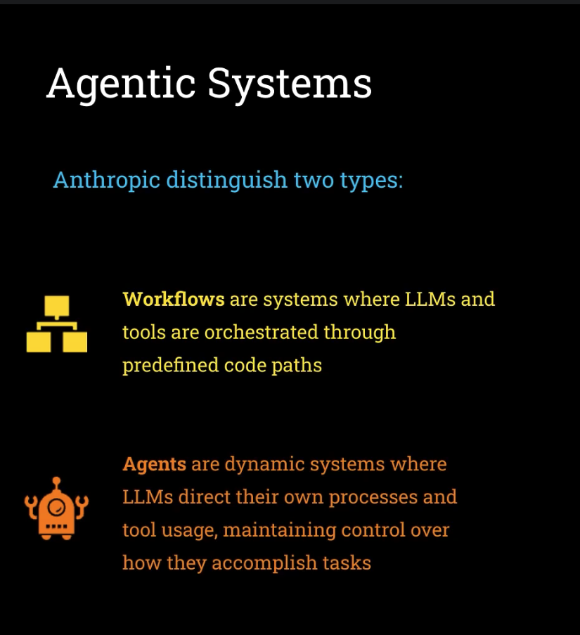
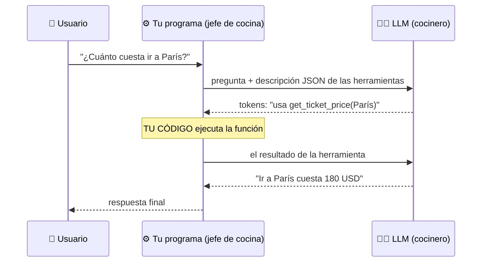
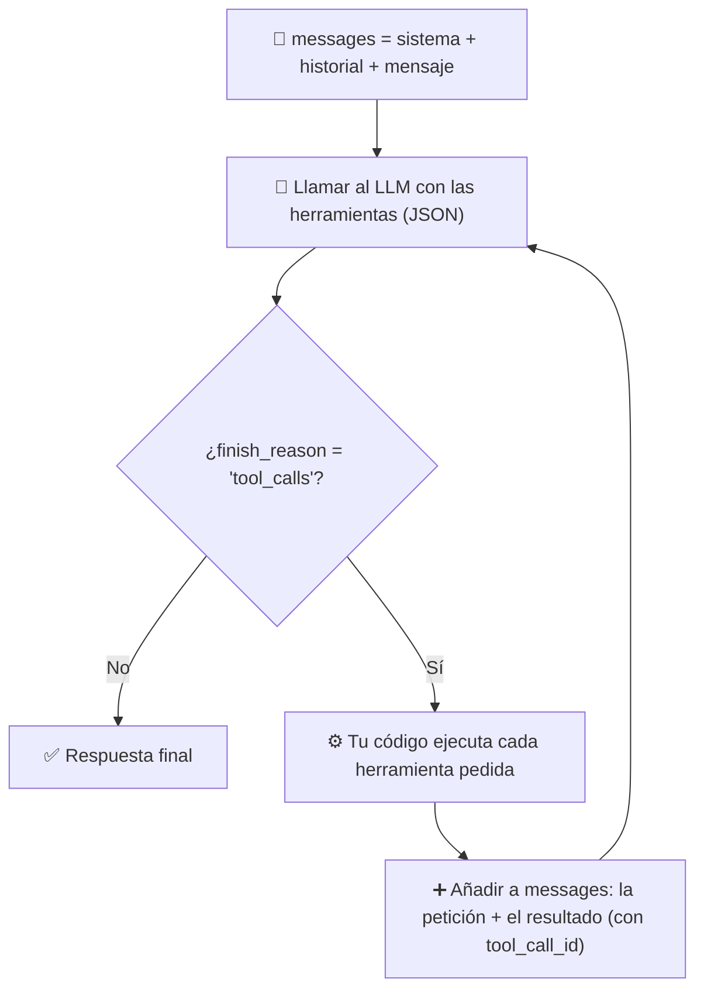
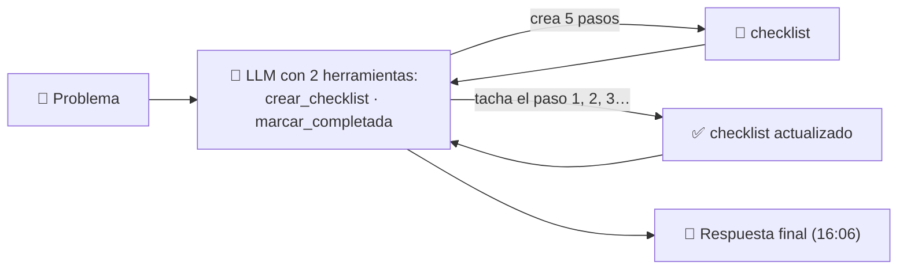
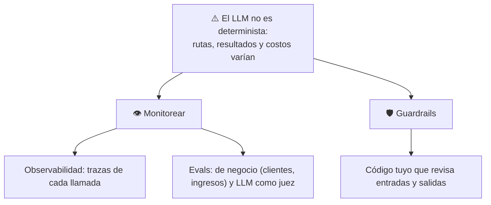

# Semana 1 · Fundamentos agénticos — lo que vale

> **Depurado:** 11 clases + 17 notas (~2 700 líneas) condensadas aquí. Lo reutilizable vive aparte: [catálogo de patrones](../patrones/README.md) y [ingeniería de contexto](../conceptos/ingenieria-de-contexto.md).
> ⬅️ [Índice del curso](README.md) · Curso: *AI Engineer Agentic Track* (Ed Donner)

---

## 🍳 Con la cocina (la semana en una imagen)

Un **cocinero muy hábil que solo sabe escribir notas** y **olvida todo cuando sales del cuarto**. Tú, el jefe de cocina, eres quien **lee sus notas, abre la despensa, enciende el fuego y le devuelve el resultado**. Un **agente** es ese cocinero repitiendo *"pido algo → tú lo haces → miro el resultado → decido lo siguiente"* hasta que dice *"listo"*.

> En palabras de la calle: **el agente no es el modelo, es tu programa que lee lo que dice el modelo y actúa.**

---

## Veredicto de la semana

| Tema | Valor para ti | Dónde quedó |
|---|---|---|
| Qué es un agente · workflow vs agente | 🟢 Conservar | Sección 1 |
| Los 5 patrones de workflow | 🟢 Conservar | [Catálogo](../patrones/README.md) |
| **Tool calling y bucle del agente** | 🟢 **Lo mejor de la semana** | Sección 2 |
| **El checklist como herramienta de planificación** | 🟢 Idea nueva | Sección 3 |
| Riesgos, trampas, ingeniería de contexto | 🟢 Conservar | Sección 4 y [concepto](../conceptos/ingenieria-de-contexto.md) |
| Modelos y proveedores, LLM como juez | 🟡 Condensar | Sección 5 |
| Gemelo digital y despliegue | 🟡 Solo los riesgos | Sección 6 |
| n8n, mapa del curso, instalación, API key, Ollama, Pushover, módulos Python | 🔴 Una chuleta | Sección 7 |

**Tu observación es correcta:** para quien ya trabaja con agentes, casi toda la semana es repaso (llamar a una API, guardar el historial, encadenar). Lo que sí aporta a tu nivel cabe en **cinco ideas**:

1. **El agente es tu código** que interpreta los tokens del modelo; no el modelo.
2. **El control vive en tu código:** lista blanca de funciones, validar argumentos, topes de iteración.
3. **Una herramienta puede moldear el comportamiento** (el checklist hace que el modelo planee).
4. **El contexto se diseña y se mide**, no se escribe "a ojo".
5. **Publicar un agente es exponer costos y superficie de ataque.**

---

## 1 · Qué es un agente

**Tres definiciones, de la más vieja a la que adopta el curso:**

| # | Definición | Utilidad |
|---|---|---|
| 1 | Sistema de IA que hace tareas por ti de forma independiente (OpenAI) | Intuitiva, vaga |
| 2 | Sistema donde **un LLM controla el flujo de trabajo** | Marca quién decide |
| 3 | **Un LLM que usa herramientas en un bucle para alcanzar un objetivo** (Simon Willison) | ⭐ La del curso |

> 🔎 Orígenes y fechas, según el instructor; no verificados.

**Lo que más pesa:** un LLM **solo genera tokens**. Decir que "controla el flujo" es una forma floja de hablar: **tu código interpreta esos tokens** y es quien actúa. Es el modelo mental de un AI Engineer.

### Workflow vs agente (Anthropic, *Building Effective Agents*)



| | **Workflow** | **Agente** |
|---|---|---|
| Camino | **Predefinido** por ti | **Abierto**: lo decide el LLM |
| 🍳 | La **receta con pasos escritos** | El cocinero que **decide qué hacer** |
| Probar | Todas las rutas | Imposible enumerarlas |
| Características | Rutas fijas | *Open-ended*, ciclos de feedback, sin camino fijo |

**En producción suele ganar el workflow:** es repetible y comprobable. Y los patrones (cadena, enrutamiento, paralelización, orquestador, evaluador) **son ideas, no reglas** y se mezclan; no memorices los nombres → [catálogo](../patrones/README.md).

---

## 2 · Tool calling y el bucle del agente ⭐



**El modelo nunca ejecuta nada: solo pide.** Tu código decide si ejecuta. Y el modelo aporta algo que una función sola no: **entender la intención** ("cuánto cuesta ir" = precio del billete) y convertirla en una acción concreta.

**Un agente = un `while`:**



Boceto ilustrativo (mío; los nombres exactos varían por SDK):

```python
while True:                                              # el bucle del agente
    resp = llamar_llm(messages, tools=herramientas)
    if resp.finish_reason != "tool_calls":
        return resp.content
    messages.append(resp.message)
    for call in resp.message.tool_calls:                 # puede pedir varias
        args = json.loads(call.arguments)                # texto JSON -> datos
        resultado = HERRAMIENTAS[call.name](**args)      # lista blanca, no globals()
        messages.append({"role": "tool", "tool_call_id": call.id, "content": resultado})
```

| Detalle | Qué es |
|---|---|
| Descripción JSON de la herramienta | Nombre, descripción (cuándo usarla) y parámetros (qué datos devolver). Los frameworks la **autogeneran** desde tu función |
| `tool_call_id` | Indica a qué petición responde cada resultado |
| `if` → `while` | Eso convierte "un LLM con herramientas" en un agente; falló con `if` al pedir tres cosas a la vez |

**Controles que viven en tu código (🔒 lo más importante):**

| Control | Por qué |
|---|---|
| **Lista blanca** (`HERRAMIENTAS[nombre]`), nunca `globals()` | Con `globals()` el modelo podría pedir `exec` u otra función que no le diste. El instructor lo reconoció y en producción usa un mapa de herramientas |
| **Validar argumentos** | Son texto generado por un modelo |
| 🧩 **Tope de iteraciones** | Un `while` sin límite gasta sin parar |
| 🧩 Permisos y aprobación en lo irreversible | Como tu `tdd-gate.sh` |

Los frameworks (semanas 2 a 5) solo automatizan esto; **el instructor recomienda empezar sin ninguno** y dice que elegir uno importa menos de lo que parece.

---

## 3 · El checklist como herramienta de planificación

Clase de cierre ("pero espera, aún hay más"). Es lo que hace sentir *agente* a Claude Code o Codex: **una lista de tareas que se va tachando**.



- Dos herramientas casi triviales (**crear una lista** y **marcar un elemento**) y el modelo **se pone a planificar y a tachar** por sí solo, mostrando el progreso.
- **Efecto secundario de dar la herramienta:** tiende a **planificar más y dedicarle más tiempo a la tarea**, lo que mejora el resultado, sobre todo si el prompt lo anima.
- El instructor cree que Claude Code hace algo similar. Usa la librería **Rich** para pintar la lista en la terminal (la *TUI* que hoy popularizan estos agentes).
- Acertijo usado: dos trenes que se encuentran (con GPT-5.5).

> 🍳 Es la **comanda con casillas**: al cocinero le das una hoja para tachar y, solo por tenerla, **ordena su trabajo**.

**La lección de diseño:** **las herramientas que das moldean cómo se comporta el agente**, no solo qué puede hacer. Lo mismo vale para `registrar_pregunta_desconocida` del gemelo (sección 6).

---

## 4 · Riesgos, trampas y contexto



| Trampa | Qué pasa | Qué hacer |
|---|---|---|
| **Solución sin problema** ("necesito un agente") | Sin problema medible no sabes si funcionó. Caso del "agente cultural": el problema real era la rotación de personal | Partir de un problema de negocio **medible**; quizá ni siquiera necesita un LLM |
| **Antropomorfizar** (pizarra de roles humanos) | Los LLM no son personas: son **generadores de tokens** | **Un LLM, un prompt, un objetivo**; medir; dividir solo si mejora de forma cuantificable |

- **Creíble ≠ correcto.** Tu trabajo es alinear la predicción del siguiente token con un resultado de negocio.
- **"Alucinó" no es excusa para un ingeniero**: estás construyendo el sistema; valida y acota.
- **"Ingeniero agéntico"** es ambiguo: *usa* agentes (Claude Code) o *diseña* agentes. Sé explícito.
- **Ingeniería de contexto** (qué entra en la ventana, cuándo, cuánto y cómo se mide): → [explicación completa](../conceptos/ingenieria-de-contexto.md).

---

## 5 · Modelos, proveedores y LLM como juez (chuleta)

| Tamaño | OpenAI | Anthropic | Google | Cuándo |
|---|---|---|---|---|
| 🟢 Pequeño | GPT Nano | Claude Haiku | Gemini Flash Lite | Tareas simples, volumen |
| 🟡 Mediano | GPT Mini | Claude Sonnet | Gemini Flash | Equilibrio |
| 🔴 Grande | GPT | Claude Opus | Gemini Pro | Lo difícil, juzgar |

- **Quién fabrica y quién ejecuta:** OpenAI, Anthropic, Google y DeepSeek fabrican; **Groq** (con Q) es un proveedor de *inferencia* de modelos abiertos; **Ollama** corre modelos pequeños en tu máquina (saltable); **OpenRouter** es una pasarela con una sola cuenta (cobra un margen pequeño). 🔎 Datos y versiones cambian rápido; verifícalos.
- **Cambiar de proveedor cuesta poco:** casi todos copian la API de OpenAI; cambias `base_url`, clave y modelo.
- **Los modelos fallan o desaparecen** (errores 404 y 503): en producción, **modelo de respaldo y reintentos**.
- **LLM como juez** (laboratorio 2): un LLM inventa la pregunta, varios responden, otro **juez que no compitió** las ordena en **JSON**, con las respuestas **anonimizadas** para evitar sesgo. Todo juez LLM tiene sesgos: valídalo. En patrones: cadena + reparto + juez, **sin ciclo de regreso** (no es evaluador-optimizador completo).
- **Dónde comparar modelos:** artificialanalysis.ai (los *benchmarks* no lo son todo).

---

## 6 · Proyecto 1: el gemelo digital

**Qué es:** un chatbot que representa a una persona (perfil de LinkedIn + resumen), **el "currículum del futuro"**, desplegado en Internet. Es prompt + 2 herramientas + el bucle `while`.

| Pieza | Para qué |
|---|---|
| Prompt del sistema (papel · contexto · reglas) | Quién es y cómo responde |
| `registrar_interes` | Anota correo, nombre y notas y **notifica al móvil** (Pushover) |
| `registrar_pregunta_desconocida` | Anota lo que **no supo responder** para decidir qué añadir a su contexto: **ciclo de mejora con datos reales** |
| 4 módulos | `context.py`, `tools.py`, `styles.py` (lo hizo Claude Code), `app.py` (función `chat` + Gradio) |

**Consejos de prompt:** **di qué hacer** (*"reconduce a lo profesional"*) en vez de solo qué evitar; **repetir una instrucción clave** sesga al modelo hacia lo que quieres; **sin instrucciones contradictorias** (el gemelo respondió sobre el queso porque el resumen lo decía). Si el modelo no usa una herramienta, **refuerza su descripción**: el fallo es de orientación, no de "mal comportamiento".

**Riesgos de publicar (🔒 lo valioso):**

| Riesgo | Control |
|---|---|
| Un Space de Hugging Face es **un repositorio público** | **Nunca** subir el `.env`; claves como **Secretos** de la plataforma |
| **Costos** de una API de pago expuesta | Modelo barato, **clave con presupuesto fijo**, limitación de tasa, retirar el despliegue |
| **Salidas sin control** | Guardrail de salida (LLM juez) antes de exponerlo |

Despliegue en una línea: `uv run gradio deploy` desde `twin/` (CPU básica gratuita; secretos en *Settings*; reiniciar el Space). Token de Hugging Face **con permiso de escritura**.

---

## 7 · Chuleta de preparación (todo lo que se descartó, en 10 líneas)

- **Orden:** IDE → clonar `agents` → `uv sync` → proveedor de modelos → `.env` con la clave.
- **Tu variante: Gemini (gratis, sin tarjeta)** en lugar de OpenAI. Como casi todos los proveedores copian la API de OpenAI, **el código del curso casi no cambia**: usas el mismo cliente de OpenAI y solo cambias **`base_url`** (el endpoint compatible de Gemini), **la clave** y **el nombre del modelo**. En el `.env`, la Guía 9 pide **dos entradas con el mismo valor**: `GOOGLE_API_KEY` y `GEMINI_API_KEY` (unas librerías buscan una y otras la otra). 🔎 Verifica en la Guía 9 el `base_url` y el modelo vigentes; el plan gratuito tiene **límites de uso** y, según las condiciones de Google, **los datos enviados en el plan gratuito pueden usarse para mejorar sus productos**: no mandes información sensible.
- **Claude por API:** la **suscripción** a Claude (claude.ai o Claude Code) **no incluye clave de API**; la API se factura aparte con crédito prepago. Por eso desde un IDE se usa Claude, pero para los ejercicios del curso conviene un proveedor con API gratuita.
- **Nombres exactos:** archivo `.env`; variable `OPENAI_API_KEY`; **sin espacios**; **guardar** el archivo.
- **API de OpenAI ≠ ChatGPT:** otra cuenta, **recarga mínima de 5 USD**; el curso entero cuesta < 5 USD y se puede hacer gratis (Guía 9: Gemini, OpenRouter, Ollama).
- **Clave de nivel de organización** con todos los permisos; cópiala antes de cerrar la ventana.
- **Notebook:** selecciona el **kernel** (`.venv`); importa el **orden de ejecución** de las celdas, no su posición.
- **Archivos en minúsculas** (`linkedin.pdf`, `summary.txt`): el servidor Linux distingue mayúsculas.
- ⚠️ **No subas tu `linkedin.pdf` ni `summary.txt` a tu fork** (git ya los sigue; un commit publicaría tu perfil).
- **Windows:** permisos de scripts, antivirus/VPN, rutas largas y Build Tools (antes de CrewAI).
- **Llamada básica:** `chat.completions.create(model, messages)` → `response.choices[0].message.content`; `messages` = lista de `{role, content}`.
- **Memoria = ilusión:** el modelo no tiene estado; **reenvías el historial completo** en cada llamada y pagas esos tokens.

---

## 8 · Qué debe dominar cada nivel

| Nivel | Debe poder... |
|---|---|
| 🟢 **Junior** | Definir un agente (LLM + herramientas + bucle + objetivo); explicar que el modelo **pide** y tu código **ejecuta**; saber que el LLM no recuerda y que se reenvía el historial. |
| 🟡 **Mid** | Describir el ciclo de `tool_calls`, el JSON de una herramienta y el `while`; distinguir workflow de agente; guardar claves en `.env` y secretos de la plataforma; elegir tamaño de modelo por tarea. |
| 🔴 **Senior** | Ubicar los controles en el código (lista blanca, validación, topes, permisos); exigir un problema y una métrica antes de construir; tratar un agente público como superficie de ataque; diseñar herramientas que moldeen el comportamiento. |

## 9 · Escaleras de entrevista

**"¿Qué es un agente y en qué se diferencia de un workflow?"**
- 🟢 "Un LLM con herramientas en un bucle para cumplir un objetivo; en un workflow yo defino los pasos, en un agente los decide el modelo."
- 🟡 "El workflow tiene rutas predefinidas y se puede probar entero; el agente es abierto, con ciclos de feedback."
- 🔴 "En producción prefiero workflow cuando conozco el camino; el agente abierto lo acoto con topes, permisos y trazas, porque no puedo enumerar todos sus caminos."

**"¿Cómo funciona el tool calling y cómo lo haces seguro?"**
- 🟢 "El modelo indica qué función y datos; mi código la ejecuta."
- 🟡 "Paso el JSON de las herramientas, reviso `tool_calls`, ejecuto, devuelvo el resultado con su id y repito en un `while`."
- 🔴 "El modelo solo genera texto: valido nombre y argumentos contra una lista blanca, pongo tope de iteraciones y permisos en lo irreversible."

**"Un cliente pide un agente. ¿Qué haces?"**
- 🟢 "Pregunto qué problema quiere resolver."
- 🟡 "Defino una métrica de negocio y empiezo con la solución más simple."
- 🔴 "Compruebo si necesita IA; si sí, itero la arquitectura solo cuando los datos demuestran mejora, con evals y guardrails antes de producción."

**"¿Cómo expones un agente a Internet?"**
- 🟢 "Claves como secretos, nunca en el repositorio."
- 🟡 "Más un presupuesto fijo en la clave, un modelo barato y limitación de tasa."
- 🔴 "Lo trato como superficie de ataque: costos acotados, guardrails de salida, validación de entradas, permisos mínimos y trazas."

---

## 10 · Qué se descartó y por qué

| Descartado | Motivo |
|---|---|
| Demo de n8n | Adelanto low-code; el curso no lo usa |
| Mapa del curso, cursos del instructor | Orientación; queda en el [índice](README.md) |
| Instalación Windows/Mac, API key, `.env`, Ollama, Pushover | Siguiente, siguiente; resumido en la chuleta |
| Función `chat`, módulos de Python, Gradio | Código básico que ya dominas |
| Resúmenes repetidos y reseñas del curso | Sin contenido nuevo |

Una copia completa de lo anterior quedó fuera del repositorio antes de depurar; el historial de git conserva las clases 01 a 07.

## 🔗 Relacionado

[Catálogo de patrones](../patrones/README.md) · [Ingeniería de contexto](../conceptos/ingenieria-de-contexto.md) · [`ia-agentes/`](../../ia-agentes) · [Production Track](../llm-production/README.md)
