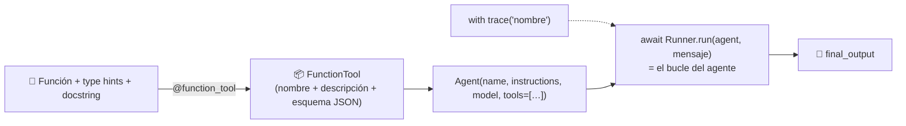
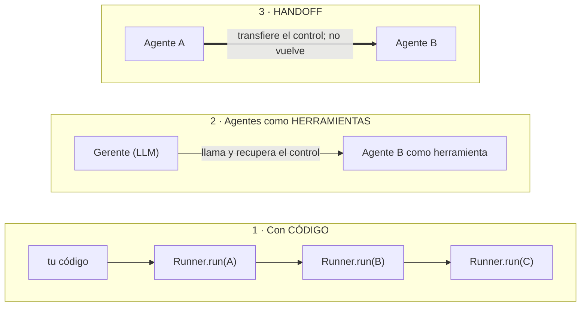
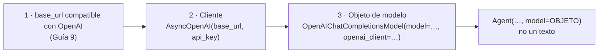
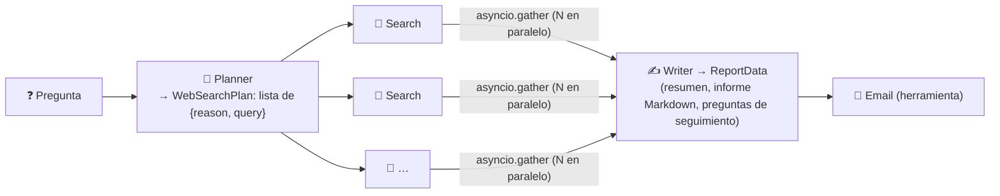

# Semana 2 · OpenAI Agents SDK — lo que vale

> **Depurado:** unas 440 líneas de notas por clase condensadas aquí. Lo reutilizable vive aparte: [catálogo de patrones](../patrones/README.md) e [ingeniería de contexto](../conceptos/ingenieria-de-contexto.md).
> ⬅️ [Índice del curso](README.md) · [Semana 1](semana-01.md)

---

## 🍳 Con la cocina (la semana en una imagen)

La semana 1 fue **cocinar a mano**. La semana 2 es **entrar a una cocina equipada**: un **puesto de trabajo ya armado** (cocinero + receta + utensilios), un **jefe de cocina que corre el servicio** (el *runner*), un **libro de registro** (las trazas), **etiquetas que fabrican la ficha de cada utensilio** (el decorador) y un **formulario por rellenar** (salida estructurada). El curso la usa para montar un **restaurante entero**: un agente de ventas y uno de investigación profunda.

> En palabras de la calle: **un framework ligero es una cocina equipada: te ahorra escribir fichas y bucles, pero tú sigues decidiendo el menú.**

---

## Veredicto de la semana

| Tema | Valor para ti | Dónde quedó |
|---|---|---|
| Las piezas del SDK: `Agent`, `Runner`, `trace`, herramienta con decorador, sesiones | 🟢 Conservar | Sección 1 |
| **Orquestar: código vs herramientas vs handoffs** | 🟢 Lo más útil | Sección 2 |
| **Usar un modelo que no es de OpenAI (tu caso: Gemini)** | 🟢 Crítico para ti | Sección 3 |
| Salidas estructuradas · guardrails · MCP (adelanto) | 🟢 Conservar | Sección 4 |
| **Proyecto: Deep Research** (arquitectura y lecciones) | 🟡 Condensar | Sección 5 |
| AsyncIO, correo SMTP, sandbox, generadores/Gradio, pasos del despliegue | 🔴 Chuleta | Sección 6 |

**Mi lectura honesta:** esta semana tiene **más sustancia** que la 1, porque el SDK enseña conceptos de framework de verdad. Aun así, **la mitad de las horas son montaje** (correo, interfaz, despliegue). Lo que aporta a tu nivel cabe en **seis ideas**:

1. **Una herramienta = una función con *type hints* y docstring** + un decorador; el SDK arma el JSON.
2. **"Memoria" = una lista de mensajes guardada**; cada `Runner.run` empieza de cero.
3. **Orquestar con código es lo más fiable; con LLM, lo más autónomo**; los *handoffs* son lo menos portable.
4. **Un modelo no OpenAI se usa pasando un objeto de modelo, no un texto.**
5. **En una salida estructurada, el orden de los campos importa** (primero el razonamiento, luego la respuesta).
6. **Los guardrails son otra llamada al modelo + un `if`**; mejor propios que del framework.

---

## 1 · Las piezas del SDK



| Pieza | Qué es | 🍳 |
|---|---|---|
| **`Agent`** | Modelo + prompt del sistema + herramientas | Un **puesto de cocina** |
| **`Runner.run`** | Ejecuta el bucle (llama, usa herramientas, repite) | El **jefe de cocina** |
| **`with trace`** | Agrupa todo bajo un nombre → **observabilidad** | El **libro de registro** |
| **`@function_tool`** | La docstring da la descripción; los *type hints*, el esquema; **describe cada argumento** | La **etiqueta que fabrica la ficha** |
| **`SQLiteSession(id[, db])`** | Guarda el historial por identificador | El **cuaderno del cliente** |

- **Revisa siempre las trazas** (prompt, herramienta usada, tiempos). No antropomorfices: que un agente se llame "Notificador" no lo hace uno.
- **Memoria sin misterio:** cada `Runner.run` **empieza de cero**; para recordar pasas una **lista de mensajes** (`to_input_list()` + el nuevo) o una **sesión**. Es **una lista guardada**. Límite: la ventana de contexto (se recorta o se resume).
- **Si el modelo no usa una herramienta**, se **fuerza por configuración** (`tool_choice` obligatorio, en la configuración del modelo) 🔎 y se mide.
- 🧩 Un `Agent` es lo que defines en un `.md` de `.claude/agents/`.

**AsyncIO en cuatro líneas:** `async def` = corrutina; llamarla **no la ejecuta**, `await` sí; varios `await` seguidos corren **en serie**, `asyncio.gather` los reparte; sirve para **E/S** (LLM), no para CPU pesada. 🧩 Para ti: `CompletableFuture` / `Mono`, `gather` ≈ `allOf`.

---

## 2 · Orquestar agentes: tres formas ⭐



| | **Código** | **Agente como herramienta** (`as_tool`) | **Handoff** (`handoffs=[…]`) |
|---|---|---|---|
| Quién decide el orden | **Tú** | El LLM | El LLM |
| Fiabilidad y predecibilidad | ⭐ La más alta | Media | **Baja**: costó que funcionara; hubo que forzar la herramienta del receptor |
| Portabilidad | Total | **Común a todos los frameworks** | **Propia del SDK** (inyecta instrucciones suyas: "vudú") |
| Autonomía | Baja | Alta | Alta |
| Postura del instructor | ⭐ La que usa en producción | Segunda opción | **La evita** |

- **Detalle práctico:** el **nombre de un agente usado como herramienta no puede tener espacios**.
- **El SDR del curso** (tres vendedores con estilos distintos en paralelo con `gather` + un agente **selector** + un **enviador** con herramienta) es **paralelización + juez + herramienta**: nada nuevo en concepto. Con código sabes qué pasa en cada paso.
- **Regla:** elige entre **código** (estable, comprensible) y **LLM** (autonomía, "estilo Claude Code"); lo de *handoffs* sí o no es la decisión menor. **Mide** si la autonomía mejora el resultado.

---

## 3 · Usar un modelo que no es de OpenAI (Gemini) ⭐

> 🍳 Todos los proveedores aceptan **el mismo formulario de pedido**; solo cambian **la dirección**, **tu credencial** y **el nombre del producto**. Si en el pedido escribes solo un **texto** ("gpt-5.4-mini"), el sistema supone que es **de la casa (OpenAI)**.



```python
from openai import AsyncOpenAI
from agents import Agent, OpenAIChatCompletionsModel

cliente = AsyncOpenAI(base_url=URL_COMPATIBLE_GEMINI, api_key=GOOGLE_API_KEY)
modelo  = OpenAIChatCompletionsModel(model="<modelo-gemini>", openai_client=cliente)
agente  = Agent(name="agente_gemini", instructions=..., model=modelo)   # objeto, no texto
```

> 🔎 Boceto mío; nombres y URL: verifícalos en la Guía 9.

- **Sin clave de OpenAI**, **todos** los agentes (incluido el gerente) necesitan un objeto de modelo de Gemini.
- Alternativas (beta): **LiteLLM** y **AnyLLM**.
- **⚠️ Las trazas** se envían a la plataforma de OpenAI y usan su clave. 🔎 Verifica cómo **desactivarlas** o cambiar el procesador; para comprobar el paralelismo, **mide el tiempo total**.
- **⚠️ Las herramientas alojadas de OpenAI no funcionan con Gemini** (ver sección 5): búsqueda web, búsqueda de archivos, intérprete de código, MCP alojado y generación de imágenes **exigen la API y los modelos de OpenAI**.
- **Lección de la demo:** Gemini Flash Lite ~2 s; **Kimi K2.6** (OpenRouter) ~77 s pero **su correo fue el elegido**; **GPT-OSS 120B** (Groq) < 1,5 s. **Velocidad ≠ calidad**; elegir modelo **por paso** es diseño.
- 🧩 Es **desacoplar el agente del proveedor**: igual que puertos y adaptadores.

---

## 4 · Salidas estructuradas, guardrails y MCP

### Salidas estructuradas (`output_type=…`)

> 🍳 Un **formulario con casillas**: el cocinero solo lo rellena, y tu código **lee casillas**, no interpreta texto.

- Defines una clase (en Python, Pydantic) con campos y **descripciones**; el SDK **la convierte en esquema JSON, la mete en el prompt y devuelve un objeto**.
- ⭐ **El orden de los campos importa:** se generan **en ese orden**. Pon **primero el razonamiento (`reason`) y luego la respuesta (`query`)**; al revés, el motivo sería una **justificación a posteriori** y rinde peor.
- **Decodificación restringida:** el proveedor **pone a cero la probabilidad de los tokens que romperían el esquema** → el JSON cumple casi seguro. **Esquemas sencillos**; lo complejo se adapta luego con código. **No todos los proveedores lo soportan** (Groq no) 🔎. No pidas cálculos a un LLM.
- 🧩 Java: un `record` con su esquema JSON; Spring AI y Quarkus LangChain4j devuelven objetos tipados 🔎.

### Guardrails

- **Tipos del SDK:** entrada (**solo el primer agente**), salida (**solo el último**) y de herramientas; si salta el ***tripwire***, **lanza una excepción**. **Corren en paralelo por defecto**: aunque salten, **ya pudieron ejecutarse herramientas** (🧩 cuidado con efectos laterales).
- ⭐ **Postura del instructor (la valiosa):** acepta el concepto, no la implementación del SDK. **Un guardrail = otra llamada al modelo con salida estructurada + un `if`** donde tú quieras; para herramientas, comprobar **dentro de la herramienta**. Es **portable a cualquier framework** y más fácil de depurar. Es tu patrón evaluador y tu `tdd-gate.sh`.

### MCP, adelanto

Un **servidor MCP ya hecho** (Context7, de Upstash) da al agente **documentación vigente** con un par de líneas: el mismo modelo viejo que "no sabía nada" respondió con precisión. 🧩 **Añádelo a tu IDE** (Claude Code, Copilot, Cursor) para que tu agente use la documentación actual de Spring, Quarkus o Next.js (instalación: ver su documentación 🔎). La semana 6 lo trata a fondo.

---

## 5 · Proyecto 3: Deep Research

> 🍳 Una **brigada de cuatro puestos**: la **planificadora** divide el encargo en búsquedas; los **buscadores** trabajan **a la vez**; la **redactora** escribe el informe; el **mesero** lo envía. El orden lo manda **el jefe de cocina** (tu código).



| Pieza | Detalle |
|---|---|
| **Búsqueda web** | **Herramienta alojada de OpenAI** (`WebSearchTool`): corre en **sus** servidores. Cuesta **~1 céntimo por búsqueda** (según el instructor; verifica tarifas) |
| **Orquestación** | **Código**: cinco funciones (planificar, buscar en paralelo, una búsqueda, redactar, enviar), cada una un `Runner.run` |
| **`yield` en `run`** | Convierte la función en **generador**; **Gradio** pinta cada actualización en la interfaz según llega |
| **Configuración** | Modelo por defecto y **número de búsquedas** sobrescribibles desde el `.env` |
| **Interfaz** | `simple.py` (Gradio básico) y `app.py` + `styles.py` **escritos por Claude Code** (a él se le da mal el CSS) |

**Lecciones que valen:**

- **Costo y calidad:** con GPT-5.4-mini y **5 búsquedas** (~5 céntimos) salió un informe bueno pero con errores; con **GPT-5.5 y 20 búsquedas** (~22 céntimos) la lista fue **correcta**. Y **solo se vio comparando con un criterio**: sin métrica, "parecía bien" en ambos.
- **Las herramientas alojadas son para prototipar**; en producción se construye la propia (**costo** y **dependencia de OpenAI**). Dice que la versión gratuita llega **la semana siguiente (CrewAI)**.
- **Hacia producción:** cuaderno para iterar prompts, **módulos** al estabilizar ([semana 1](semana-01.md)).
- **Retos del instructor:** (1) añadir un paso de **preguntas aclaratorias** antes de planificar; (2) **evaluar** si salen los frameworks correctos y ajustar; (3) rehacerlo con **orquestación por LLM** (agentes como herramientas) y **demostrar con métricas** si mejora: más libertad = **menos fiabilidad y determinismo** a cambio de resultados potencialmente mejores.
- 🧩 Es **cadena + paralelización + salida estructurada** del [catálogo](../patrones/README.md).

### Despliegue en Hugging Face Spaces (lo nuevo respecto a la semana 1)

`uv run gradio deploy`; los secretos se configuran en el Space. **Novedad:** **Hugging Face no permite enviar correo por SMTP desde el Space** (probable medida antispam) → usa **`USE_EMAIL=false` + Pushover**, o un proveedor con dominio verificado (SendGrid, Resend). El resto de riesgos (repo público, costos, guardrails) está en la [semana 1](semana-01.md#6--proyecto-1-el-gemelo-digital).

### 🧩 Para ti, con Gemini

El proyecto **tal como está no corre**: la búsqueda alojada exige OpenAI. Habría que **escribir tu propia herramienta de búsqueda** (con una API gratuita) o usar un **servidor MCP de búsqueda**. Es un buen ejercicio de **desacoplar** y de **herramientas propias**.

---

## 6 · Chuleta de lo descartado

- **Correo con SMTP:** servidor, contraseña de aplicación (Google, **sin los espacios**) y tu dirección en el `.env`; **opcional**; una función `send_message` redirige a correo, push o consola. Hay un interruptor `use_email`.
- **Sandbox agents (beta):** entorno **aislado** (manifiesto, capacidades, configuración de ejecución) donde el agente edita y ejecuta sin tocar tus archivos; no corre nativo en Windows. **Idea:** aislar lo que el agente puede tocar.
- **Herramientas alojadas** (búsqueda de archivos, intérprete de código, MCP alojado, imágenes): atajos de pago, ligados a OpenAI.
- **Detalles menores:** el paquete es `openai-agents`; ejecutar con `uv run`; los consejos de trabajo con un agente de código (precisión, concisión, tareas pequeñas, tú mandas) los aplicas ya.
- **Avance: 33 % del curso** (dos de seis semanas).

---

## 7 · Qué debe dominar cada nivel

| Nivel | Debe poder... |
|---|---|
| 🟢 **Junior** | Explicar `Agent`, `Runner.run` y `trace`; convertir una función en herramienta con decorador, tipos y docstring; saber que cada `Runner.run` empieza sin memoria. |
| 🟡 **Mid** | Elegir entre orquestar con código, con agentes-herramienta o con handoffs; usar un modelo no OpenAI con un objeto de modelo; definir una salida estructurada y poner el razonamiento antes de la respuesta; reconocer qué herramientas alojadas atan a un proveedor. |
| 🔴 **Senior** | Defender orquestación por código en producción y medir si la autonomía compensa; escribir guardrails propios y portables, cuidando que no corran en paralelo con efectos laterales; desacoplar agente y proveedor; controlar costo y calidad con una métrica (modelo, nº de búsquedas) en vez de a ojo. |

## 8 · Escaleras de entrevista

**"¿Cuándo orquestar con código y cuándo con un LLM?"**
- 🟢 "Con código si conozco los pasos; con LLM si necesito que decida."
- 🟡 "El código es más predecible y fácil de depurar; los agentes-herramienta dan autonomía; los handoffs son específicos del framework."
- 🔴 "Empiezo con código y solo cedo control al LLM si una métrica demuestra mejora; pago con menos fiabilidad y determinismo, y lo acoto con topes, guardrails y trazas."

**"¿Cómo cambias de proveedor de modelos en un framework de agentes?"**
- 🟢 "Cambio la URL, la clave y el nombre del modelo."
- 🟡 "Creo un cliente con la URL compatible y paso al agente un objeto de modelo, no un texto."
- 🔴 "Desacoplo el agente del proveedor; ojo con lo que sí ata (herramientas alojadas, trazas) y con las diferencias entre proveedores, como el soporte de salidas estructuradas."

**"¿Cómo mejoras la calidad de una salida estructurada?"**
- 🟢 "Describo cada campo."
- 🟡 "Pongo el razonamiento antes de la respuesta, porque se genera en ese orden."
- 🔴 "Además mantengo el esquema simple, valido igual, y mido el efecto de cada cambio con un conjunto de pruebas."

**"¿Cómo implementas guardrails?"**
- 🟢 "Reviso la entrada y la salida antes de usarlas."
- 🟡 "Con una llamada de comprobación que devuelve salida estructurada y un `if` que corta."
- 🔴 "Propios y portables, dentro de las herramientas cuando hay efectos; cuido que no corran en paralelo con acciones irreversibles."

---

## 9 · Qué se descartó y por qué

| Descartado | Motivo |
|---|---|
| Detalle de asyncio, `yield` y Gradio | Ya conoces la idea; queda la chuleta |
| Correo SMTP, sandbox, herramientas alojadas | Opcional, beta o de pago atadas a OpenAI |
| Pasos del despliegue y de la interfaz | Repite la semana 1; solo queda la novedad del SMTP |
| Resúmenes repetidos y reseñas del curso | Sin contenido nuevo |

Una copia completa de las notas previas quedó fuera del repositorio antes de depurar.

## 🔗 Relacionado

[Catálogo de patrones](../patrones/README.md) · [Ingeniería de contexto](../conceptos/ingenieria-de-contexto.md) · [`ia-agentes/`](../../ia-agentes) · [Semana 1](semana-01.md)
