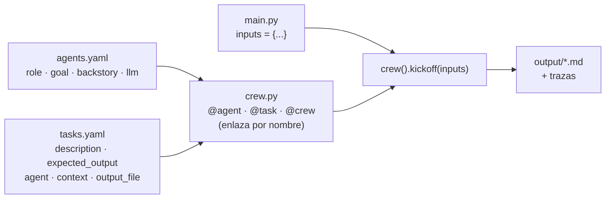
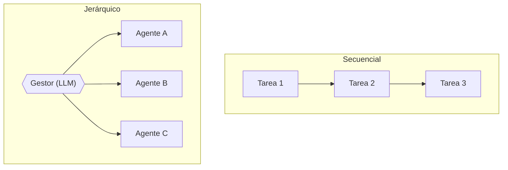
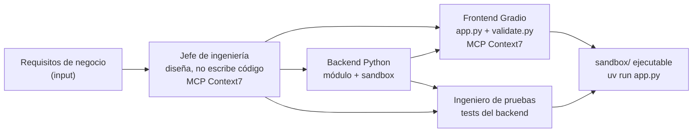

# Semana 3 · CrewAI — lo que vale

> **Depurado:** unas 2 900 líneas de transcripción (clases 50 a ~72) y mis notas de trabajo condensadas aquí. Lo reutilizable vive aparte: [catálogo de patrones](../patrones/README.md) e [ingeniería de contexto](../conceptos/ingenieria-de-contexto.md).
> 💻 **Práctica (mi fork):** [edzamo/agents · 3_crewai](https://github.com/edzamo/agents/tree/main/3_crewai) → `reference/` (del instructor) y `coursework/` (mío).
> ⬅️ [Índice del curso](README.md) · [Semana 2](semana-02.md)

---

## 🍳 Con la cocina (la semana en una imagen)

La semana 2 fue **una cocina equipada**. La semana 3 es **un restaurante con la brigada ya contratada**: no solo tienes cocineros, sino un **organigrama escrito en fichas** (los YAML), **comandas** (las tareas) y hasta un **jefe de cocina** que reparte (modo jerárquico). A cambio, la cocina tiene **reglas de la casa que nadie te cuenta**: guarda en la nevera el resultado de una comanda repetida (caché), pasa a cada cocinero las notas de los anteriores (contexto) y apunta cosas en una libreta (memoria). Si no lo sabes, te sorprende.

> En palabras de la calle: **CrewAI te da la brigada hecha y tú escribes las fichas; lo que ahorras en código lo pagas en magia que tienes que conocer.**

---

## Veredicto de la semana

| Tema | Valor para ti | Dónde quedó |
|---|---|---|
| Agente, tarea y crew; los 4 archivos (YAML + `crew.py` + `main.py`) | 🟢 Conservar | Sección 1 |
| **"Magia" escondida:** contexto, caché de herramientas, memoria, prompts inyectados | 🟢 Lo más útil | Sección 2 |
| **Herramientas:** Serper (búsqueda gratis), propias, MCP | 🟢 Conservar | Sección 3 |
| **Salida estructurada y proceso jerárquico** | 🟡 Condensar | Sección 4 |
| **Ejecutar código de un LLM dentro de Docker** | 🟢 Crítico (seguridad) | Sección 5 |
| **Proyecto: equipo de ingeniería** (4 agentes, modelos mezclados) | 🟡 Condensar | Sección 6 |
| Repasos de los "5 pasos", copiar y pegar desde `reference/`, instalación | 🔴 Chuleta | Sección 7 |

**Mi lectura honesta:** es la semana más **repetitiva** hasta ahora: el instructor repite los cinco pasos cada día y gran parte del tiempo es copiar archivos. Lo que aporta a tu nivel cabe en **siete ideas**:

1. **Agente = rol + objetivo + historia** (se convierten en el prompt de sistema); **tarea = descripción + resultado esperado**. La documentación dice que **la tarea pesa más que el agente**.
2. **Los prompts viven en YAML, separados del código**; `crew.py` solo enlaza por nombre y `main.py` pasa los `inputs`.
3. **Un framework opinionado esconde comportamiento:** contexto implícito entre tareas, caché de herramientas, memoria con un interruptor. **Hay que leer las trazas** para saber qué pasa.
4. **Búsqueda web sin OpenAI:** `SerperDevTool` (gratis hasta ~2 500 consultas 🔎). Con eso el Deep Research de la semana 2 sí se puede hacer con otro modelo.
5. **`process`:** secuencial = orquestación por código; jerárquico = un LLM gestor reparte (tu PoC3).
6. **Ejecutar código generado por un LLM va aislado:** contenedor efímero, solo un directorio montado, tiempo máximo. CrewAI **quitó** `allow_code_execution` y obliga a construirlo.
7. **Los prompts se afinan iterando con las trazas**, no se escriben una vez ("no escribas código" al diseñador; "no estropees `app.py`" al tester).

---

## 1 · Los conceptos y los 4 archivos



| Concepto | Qué es | Diferencia con el Agents SDK |
|---|---|---|
| **Agent** | LLM + `role` + `goal` + `backstory` (+ `llm`, `tools`, `mcps`, `memory`) | Allí había solo `instructions`; aquí **tres campos** que el framework combina |
| **Task** | `description` + `expected_output` + `agent` (+ `context`, `output_file`, `output_pydantic`) | No existía; es el user prompt estructurado |
| **Crew** | Agentes + tareas + `process` | — |

- **Receta de 5 pasos** (🍳 abrir una cocina nueva): `crewai create crew <nombre>` → editar los dos YAML → completar `crew.py` → ajustar `inputs` en `main.py` → `crewai run`.
- **Variables con llaves** (`{company}`, `{current_date}`) en el YAML se rellenan con `inputs`.
- **Buena práctica del instructor:** poner un **criterio de éxito** en `goal` y repetir lo importante en agente *y* tarea.
- **Una tarea por agente** es lo habitual; el nombre en `crew.py` debe coincidir **exacto** con la clave del YAML. 🧩 Un typo o una sangría mala da errores tipo "key not found", poco claros.
- **Cambiar de modelo:** vía LiteLLM, campo `llm:` por agente (`openai/…`, OpenRouter, Gemini 🔎 Guía 9). Se pueden **mezclar modelos por agente**.

**Trampas de arranque (te afectan):**

1. `GEMINI_API_KEY` (no solo `GOOGLE_API_KEY`); pon las dos.
2. **Borra el `.env` interno** que crea `crewai create` (pisa el tuyo).
3. Una `OPENAI_API_KEY` exportada en el shell **gana** sobre el `.env` (CrewAI no usa `override`).
4. En Mac con Apple Silicon, si falla la resolución de paquetes: `uv python pin 3.13` en la carpeta del proyecto (o 3.11/3.12).
5. `uv tool install crewai==1.14.4` (fijar versión; rompe compatibilidad a menudo).

---

## 2 · La "magia" escondida ⭐

El instructor lo llama *"vudú del framework"*: ventajas reales, pero **comportamiento que no escribiste**.

| Magia | Qué hace | Riesgo | Cómo se ve |
|---|---|---|---|
| **Contexto implícito** | Sin `context:`, cada tarea recibe **todas** las salidas anteriores; con `context:` solo las listadas | Un agente ve más de lo que crees | Traza → mensajes del LLM |
| **Caché de herramientas** | Misma herramienta + mismos argumentos = devuelve el resultado anterior sin ejecutar | `list_files` devolvía siempre el estado inicial aunque se hubiera escrito un archivo | Traza: el agente "no ve" lo que acaba de escribir |
| **Memoria unificada** (`memory=True`) | Los agentes reciben herramientas para leer/escribir memoria | Difícil de diagnosticar si falla | Trazas |
| **Prompts inyectados** | CrewAI añade textos propios ("entrega el contenido completo, no un resumen") | El prompt final no es el tuyo | Traza → pestaña Mensajes |

**Arreglo de la caché** (🧩 caso real, en tu fork `engineering_team/tools/sandbox_tools.py`): recorrer las herramientas y asignarles una `cache_function` que siempre devuelve `False`.

**Trazas:** `crewai traces enable` / `tracing=True`; para guardarlas: cuenta gratis en `app.crewai.com` + `crewai login`. ⚠️ Suben prompts y salidas a la plataforma de CrewAI: no usarlas con datos reales.

> 🧩 Regla mía: **con un framework opinionado, la primera vez que algo "se comporta raro", abre la traza antes de tocar el código.**

---

## 3 · Herramientas

| Herramienta | Cómo | Nota |
|---|---|---|
| **Serper** (búsqueda web) | `from crewai_tools import SerperDevTool` → `tools=[SerperDevTool()]` en el agente; `SERPER_API_KEY` en `.env` | Gratis ~2 500 consultas sin tarjeta 🔎. La búsqueda de OpenAI (semana 2) costaba ~1¢ |
| **Propia** | Decorador `@tool("nombre")` con docstring y tipos (como `@function_tool`) | Ej.: notificación push |
| **MCP** | `mcps=["https://mcp.context7.com/mcp"]` al crear el agente | Una línea; ver bug abajo |

- **Bug de MCP en la 1.14:** si el nombre de la herramienta MCP lleva **guiones** (Context7 los tiene), CrewAI la renombra y luego no la encuentra. El instructor da un `patch.py` importado en `main.py` (`# noqa: F401`, import con efecto secundario). Probablemente no hace falta en versiones nuevas 🔎.
- **Frase importante en las tareas:** "tu información debe estar **actualizada a {current_date}**" y pasar la fecha en `inputs`; si no, el modelo usa datos de su entrenamiento.

---

## 4 · Salida estructurada y proceso jerárquico

Lo muestra el `stock_picker` (3 agentes, 3 tareas: tendencias → investigación → elegir y notificar). En tu fork: `reference/stock_picker/crew.py`.

| Pieza | Cómo | Equivale a |
|---|---|---|
| **Salida estructurada** | `class X(BaseModel)` + `Task(config=…, output_pydantic=X)` | `output_type` del Agents SDK |
| **Jerárquico** | `Crew(process=Process.hierarchical, manager_agent=Agent(config=…, allow_delegation=True))` | [Orchestrator-worker](../patrones/04-orchestrator-worker/README.md) / PoC3 |
| **Memoria** | `memory=True` | Interruptor único |



- 🧩 **Cuándo cuál:** secuencial si los pasos son conocidos (más barato, depurable); jerárquico solo si el orden o el reparto cambian. Mismo riesgo del patrón 4: un mal plan del gestor arruina todo y aumenta el costo.
- **Memoria (palabras del instructor):** activarla es trivial y queda oculta; si no rinde, cuesta saber por qué.

---

## 5 · Ejecutar código de un LLM en Docker ⭐

CrewAI **eliminó** `allow_code_execution=True` (riesgo de ejecutar en tu máquina + venden sandboxes en la nube de pago). El curso lo reconstruye con **4 herramientas propias** sobre un directorio `sandbox/`:

| Herramienta | Qué hace | ¿Docker? |
|---|---|---|
| `list_sandbox_files` | Lista archivos del directorio | No |
| `read_sandbox_file` | Lee un archivo | No |
| `write_sandbox_file` | Escribe/sobrescribe un archivo | No |
| `run_sandbox_python` | Ejecuta un `.py` **dentro de un contenedor efímero** | **Sí** |

El comando (tu fork, `engineering_team/tools/sandbox_tools.py`):

```text
docker run --rm -v <sandbox>:/workspace -w /workspace \
  ghcr.io/astral-sh/uv:python3.13-bookworm-slim uv run <archivo>      # timeout 300 s
```

- `--rm`: el contenedor se borra al terminar. `-v`: **lo único visible es el directorio montado**. `timeout`: corta bucles infinitos. Devuelve `exit code`, `stdout` y `stderr` etiquetados (los tests de `unittest` escriben en **stderr**).
- Imagen de Astral con `uv` ya instalado; el sandbox es un proyecto `uv` (`uv init` + `uv add gradio`) que se **reinicia en cada ejecución**.

**🧩 Lo que añadiría yo (no lo hace el curso)** ⚠️ — como en el negocio bancario:

| Falta en la referencia | Mejora |
|---|---|
| El contenedor tiene **red** | `--network none` (o allowlist) |
| Sin límites de recursos | `--memory`, `--cpus`, `--pids-limit` |
| `write_sandbox_file(filename)` no valida la ruta | Rechazar `..` y rutas absolutas (path traversal) |
| Corre como root dentro del contenedor | `--user` no root, `--read-only` donde se pueda |
| Las tareas las escribe el humano | Correcto: **no leer requisitos de Internet o de un usuario sin control** (instructor) |

> En palabras de la calle: **lo que un LLM escribe se ejecuta en una caja cerrada, sin red, con reloj y sin acceso al resto de tu máquina.**

El instructor lo presenta como *"nuestro propio Claude Code"*: un agente con herramientas de archivos + ejecución. Es la idea de la semana 1 (LLM + herramientas + bucle) llevada a código.

---

## 6 · Proyecto: equipo de ingeniería



- **4 agentes y 4 tareas** (una por agente), secuencial; el diseño y el código viajan por `context:` (el instructor añadió el diseño al frontend y a las pruebas "sobre la marcha").
- **Pedido:** un gestor de cuentas para simulación bursátil (crear cuenta, depositar, comprar/vender con precios fijos, historial, ganancias/pérdidas, **sin comprar más de lo que se puede pagar**). Lo usará en la semana 6.
- **Iteración de prompts (lo valioso):** el diseñador "se emociona y escribe código" → se le prohíbe; el backend no importa paquetes de terceros ni toca UI; el frontend debe escribir un `validate.py`; el tester no debe romper `app.py`. Cada línea nació de un fallo observado en la traza.
- **Gradio 6 > fecha de corte del modelo:** los modelos escriben para Gradio 5 → se les avisa y se les da Context7.
- **Resultado:** funcionó a la primera en minutos por **~4 US$** (2 OpenAI + 2 OpenRouter). Mezcla: jefe GPT-5.5, backend Gemini 3.1 Pro Preview (OpenRouter), frontend Claude Opus 4.7 (OpenRouter), tester GPT-5.5.
- **Comparación (n = 1, subjetiva):** 1.º todo-GPT-5.5, 2.º mezcla, 3.º GPT+Claude (fallos de interfaz). El instructor mismo dice que **no demuestra** que un solo proveedor sea mejor y que es costoso (4–5 US$).
- **Su consejo de proceso:** debió empezar con un agente solo, **verlo fallar con una tarea compleja y recién entonces** pasar a un equipo; y hacerlo con **conjunto de pruebas y evaluación**. Lo dijo y no lo hizo "por tiempo". 🧩 Es la regla de siempre: no uses un equipo hasta que el agente solo falle.

**Retos de la semana (opcionales):** cambiar a jerárquico (jefe de ingeniería como gestor), añadir QA con ciclo de mejora, no borrar el sandbox y aceptar feedback, interfaz Gradio de control, y **Flows** para coordinar varios crews en paralelo.

---

## 7 · Chuleta de lo descartado

| Tema | Una línea |
|---|---|
| Productos de CrewAI | Solo el framework open source es gratis; AMP/Enterprise/Studio son de pago y se ignoran |
| Crews vs Flows | Flows = coordinación de nivel superior (estado entre crews); se usa poco |
| Skills para agentes de código | `npx skills add crewaiinc/skills` (opcional, Claude Code/Cursor) |
| Windows | MSBuild Tools para evitar el error de Chroma; en Mac no aplica |
| Instalar Docker | Docker Desktop, opcional si solo quieres mirar |
| Organización del repo | `reference/` del instructor, tu trabajo en `coursework/` |
| Costos | 5.4-mini ≈ 0,10–0,20 US$ por proyecto; GPT-5.5 / mezclas 2–5 US$ |

---

## 8 · Qué debe dominar cada nivel

| Nivel | Debe poder... |
|---|---|
| 🟢 **Junior** | Explicar agente (rol, objetivo, historia), tarea y crew; seguir los 5 pasos; saber que los prompts van en YAML y que `crew.py` enlaza por nombre. |
| 🟡 **Mid** | Elegir secuencial vs jerárquico; añadir herramientas (Serper, `@tool`, MCP) y salida Pydantic; usar `context:` conscientemente; leer una traza para ver el prompt real. |
| 🔴 **Senior** | Reconocer y neutralizar la "magia" (caché, contexto implícito, memoria); diseñar un sandbox de ejecución seguro (red, recursos, rutas, usuario); iterar prompts con evals en vez de a ojo; elegir modelo por agente según costo y calidad; decidir cuándo un framework opinionado compensa frente a código propio. |

## 9 · Escaleras de entrevista

**"¿Qué ventajas y riesgos tiene un framework opinionado como CrewAI?"**
- 🟢 "Es fácil y rápido de arrancar."
- 🟡 "Estructura los prompts y trae herramientas, pero esconde comportamiento: contexto implícito, caché de herramientas, memoria."
- 🔴 "Ahorra tiempo en prototipos, pero para producción reviso las trazas, desactivo lo que no entiendo y mido si compensa frente a código propio; acepto la dependencia solo si el equipo domina esa 'magia'."

**"¿Cómo ejecutas de forma segura código que genera un LLM?"**
- 🟢 "En un contenedor, no en mi máquina."
- 🟡 "Contenedor efímero, un solo directorio montado y tiempo máximo."
- 🔴 "Además sin red, con límites de CPU y memoria, usuario no root, validación de rutas, requisitos controlados por mí y registro de cada ejecución."

**"¿Cuándo un equipo de agentes y cuándo uno solo?"**
- 🟢 "Un equipo cuando hay roles distintos."
- 🟡 "Empiezo con un agente; si falla en tareas complejas, divido por roles con tareas explícitas."
- 🔴 "Solo si una evaluación demuestra mejora frente al agente solo y vale el costo extra; defino contexto entre tareas y límites de iteración y gasto."

**"¿Orquestar con código o con un gestor LLM?"**
- 🟢 "Código si conozco los pasos; gestor si no."
- 🟡 "Secuencial es predecible; jerárquico delega pero es menos testeable."
- 🔴 "Prefiero secuencial o un workflow acotado y uso gestor solo donde el reparto cambia; con topes, trazas y una métrica."

---

## 10 · Qué se descartó y por qué

| Descartado | Motivo |
|---|---|
| Repasos diarios de los 5 pasos | Repetición; queda la receta de la sección 1 |
| Copiar y pegar desde `reference/`, comentarios del resultado | Sin contenido nuevo |
| Cuenta de Serper, API keys paso a paso | Chuleta |
| Comparación detallada de las 3 interfaces de Gradio | Anecdótico (n = 1) |

Una copia completa de las notas de trabajo quedó fuera del repositorio antes de depurar.

## 🔗 Relacionado

[Catálogo de patrones](../patrones/README.md) · [Ingeniería de contexto](../conceptos/ingenieria-de-contexto.md) · [`ia-agentes/`](../../ia-agentes) · [Semana 1](semana-01.md) · [Semana 2](semana-02.md)
