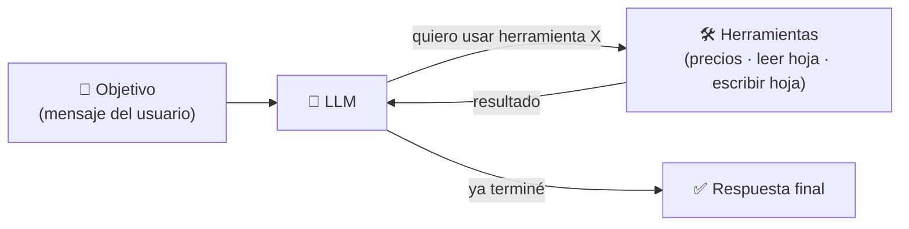

# Clase 01 · Semana 1, día 1 — Tu primer agente (demo en n8n)

> ⬅️ [Índice del curso](../README.md) · ➡️ Siguiente: [02 · Mapa del curso](02-mapa-del-curso-seis-semanas.md)
> 🗓️ **Semana 1 · Día 1 — "Make an Agentic Workflow"** · tipo: 🟠 teoría/demo · Repo del curso: <https://github.com/ed-donner/agents>
> **Qué vas a poder explicar al terminar:** qué es un agente de IA, qué tres cosas necesita (modelo, memoria, herramientas), y por qué "LLM + herramienta" todavía no se siente autónomo pero "LLM + varias herramientas + un objetivo" sí.

---

## 🍎 Con manzanas

Imagina la **frutería** del repo ([glosario](../../../messaging-streaming/glosario.md)) y al **empleado brillante** de la [clase 01 del curso de Claude](../../claude/clases/01-llm-vs-agente-harness.md).

1. **Solo chat (sin herramientas):** le preguntas "cuéntame algo curioso" y te responde desde su cabeza. Es un empleado encerrado en un cuarto: opina, no hace.
2. **Con una herramienta:** le das un teléfono para llamar a la bolsa. Preguntas "¿a cuánto está la manzana hoy?", **llama**, y te responde con el dato real.
3. **Con varias herramientas y un objetivo:** le das el teléfono, el **cuaderno de inventario** (leer) y un **lápiz** (escribir). Le dices: "equilibra mi inventario". Él solo mira el cuaderno, llama al proveedor, decide y **anota** el pedido. Nadie le dijo en qué orden. Eso es **autonomía**.

> En palabras de la calle: **un agente es un empleado al que le das un objetivo y herramientas, y él decide qué hacer y en qué orden.**

---

## 1 · La definición que usa todo el curso

> **Agente de IA = invocar un LLM en un bucle (loop) con herramientas para alcanzar un objetivo.** [~02:00]

La flecha que **vuelve** de las herramientas al LLM es el bucle. Es la misma idea ReAct (razonar → actuar → observar) del [roadmap](../../README.md#6--glosario-de-términos-imprescindibles) y del [curso de Claude](../../claude/clases/01-llm-vs-agente-harness.md#1--por-qué-un-llm-no-es-lo-mismo-que-un-agente).

## 2 · Las tres piezas que pide un agente (en n8n)

| Pieza | Qué es | 🍎 Con manzanas | En la demo |
|---|---|---|---|
| **Modelo (LLM)** | El cerebro que decide. | El empleado | OpenAI **GPT-5.4 Mini** (también valen Gemini u OpenRouter) |
| **Memoria** | Recordar lo dicho antes en la conversación. | El cuaderno de la charla | *Simple Memory* |
| **Herramientas** | Acciones que puede pedir. | Teléfono, cuaderno de inventario, lápiz | MarketStack, Google Sheets (leer), Google Sheets (escribir) |

## 3 · La demo en tres escalones

| Escalón | Qué tiene el agente | Qué se vio | ¿Autónomo? |
|---|---|---|---|
| 1 | Solo LLM + memoria | "Hola" → "Los pulpos tienen tres corazones". | ❌ Es un ChatGPT |
| 2 | + **MarketStack** (precios) | "¿Precio de Apple?" → llamó a la herramienta → "280 USD". | 🟡 Usa una herramienta, pero tú la pediste |
| 3 | + **Sheets leer** + **Sheets escribir** | "¿Valor de mi cartera?" → leyó la hoja (10 Amazon, 2 Apple) → consultó precios → sumó. Luego "equilíbrame la cartera" → **decidió** añadir SPY y después BND y los **escribió** en la hoja. | ✅ Eligió herramientas y orden por sí solo |

> ⚠️ Matiz honesto de la clase: el agente **no compró** acciones, solo **anotó** en la hoja. Escribir en una hoja es una acción real; comprar en bolsa no. Esa frontera (qué le dejas hacer) es el tema de guardrails.

## 4 · Cómo se le da una herramienta a un LLM (sin magia todavía)

En n8n se configura así, y el curso lo desarmará en código:

- **Nombre y descripción** de la herramienta ("Selecciona las filas de Google Sheets para obtener los datos de mi cartera").
- **Qué parámetros decide el modelo** (en "añadir fila": el *ticker* y el *número de acciones*) y cuáles quedan **fijos** (el filtro "más reciente" siempre activo).
- El LLM **no ejecuta** nada: **pide** la herramienta; la plataforma la ejecuta y le devuelve el resultado.

> 🔎 La clase promete explicar esto "con todo detalle" más adelante; aquí solo se ve la versión low-code. Completar este apartado cuando llegue la clase de herramientas.

## 5 · Qué debe dominar cada nivel

| Nivel | Debe poder... |
|---|---|
| 🟢 **Junior** | Decir que un agente es "un LLM con herramientas en un bucle" y dar un ejemplo (el de la cartera). Distinguir chat normal de agente. |
| 🟡 **Mid** | Nombrar las tres piezas (modelo, memoria, herramientas) y explicar que el LLM **pide** la herramienta y el sistema la ejecuta. Explicar por qué escribir (añadir fila) es más riesgoso que leer. |
| 🔴 **Senior** | Argumentar cuándo un flujo fijo (workflow) basta y cuándo hace falta un agente autónomo; hablar de límites de acciones, costo del bucle y trazabilidad de cada herramienta usada. |

## 6 · Escalera de respuesta para entrevista

**"¿Qué es un agente de IA?"**

- 🟢 *Frase junior:* "Un modelo de lenguaje que puede usar herramientas para cumplir un objetivo, en vez de solo conversar."
- 🟡 *Capa mid:* "Se ejecuta en un bucle: el modelo decide qué herramienta usar, el sistema la ejecuta, y el resultado vuelve al modelo hasta que termina. Necesita modelo, memoria y herramientas."
- 🔴 *Cierre senior:* "La clave es dónde pongo la autonomía: lo que solo lee es de bajo riesgo; lo que escribe o gasta dinero necesita límites, aprobación y registro. Y si el camino es siempre el mismo, un workflow determinista es más barato y predecible que un agente."

## 7 · Low-code vs código

n8n es **arrastrar y soltar**. Este curso **no** lo usa para construir: la demo es un adelanto para ver el concepto. Todo lo demás se hace **con código Python**. (El instructor tiene un curso aparte de n8n: *AI Builder*, ver [clase 02](02-mapa-del-curso-seis-semanas.md#4--cómo-encaja-con-los-otros-cursos-del-instructor).)

## 🔗 Relacionado

- [Curso Claude · clase 01](../../claude/clases/01-llm-vs-agente-harness.md) — misma idea (LLM + herramientas + loop) vista desde Claude Code.
- [Roadmap AI Engineering · Fase 3](../../README.md) — function calling y ReAct.
- [`ia-agentes/`](../../../ia-agentes) — agentes aplicados a este repo.
