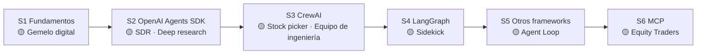

# Clase 02 · Semana 1, día 1 — Mapa del curso: 6 semanas, 8 proyectos

> ⬅️ [01 · Primer agente](01-primer-agente-n8n.md) · ➡️ Siguiente: _pendiente_
> 🗓️ **Semana 1 · Día 1** · tipo: 🟠 teoría · Instructor: **Ed Donner** (cofundador de Nebula.io; ex J.P. Morgan)
> **Qué vas a poder explicar al terminar:** qué construirás cada semana, qué framework corresponde a cada una y por qué el orden importa.

---

## 🍎 Con manzanas

Piensa en aprender a **dirigir una frutería**:

- **Semana 1:** entender cómo funciona el negocio (qué es vender, cobrar, llevar el cuaderno). Aburrido pero todo se apoya ahí.
- **Semanas 2 a 4:** aprender a usar **tres tipos de local** ya armados (cada framework es una marca de local con sus mostradores).
- **Semana 5:** visitar **muchos locales** para saber cuál elegir.
- **Semana 6:** el **teléfono estándar** que sirve para hablar con cualquier proveedor (MCP).

Cada semana termina con un **negocio de verdad** funcionando (proyecto).

---

## 1 · Qué se va a hacer: tres tipos de contenido

1. **Teoría**: agentes de IA, patrones de diseño, arquitecturas y **MCP**.
2. **Frameworks de agentes**: usarlos y **compararlos**.
3. **Proyectos comerciales reales** con impacto de negocio.

## 2 · El plan de 6 semanas

Cada semana tiene **5 días** (una casilla por día). Colores del instructor: 🟠 **naranja** = teoría · 🔵 **azul** = nuevo framework · 🟡 **amarillo** = proyecto.

| Semana | Tema | Proyecto(s) | Nº |
|---|---|---|---|
| **1** | 🟠 **Fundamentos** (hoy estamos en el día 1: "un flujo de trabajo agéntico") | **Gemelo digital personal**: chatbot profesional, "el currículum del futuro" | 1 |
| **2** | 🔵 **OpenAI Agents SDK** (su framework favorito) | Representante de desarrollo de ventas automatizado (SDR) · Investigación en profundidad (*deep research*) | 2, 3 |
| **3** | 🔵 **CrewAI** | Selector de acciones (*stock picker*) · **Equipo de ingeniería** (ingenieros back/front, jefe de ingeniería, tester) | 4, 5 |
| **4** | 🔵 **LangGraph** (muy usado en empresas) | **Sidekick** (flujo de agentes robusto) | 6 |
| **5** | 🔵 **Repaso de frameworks**: Google ADK + A2A, AWS Strands, otros de Python, y de JavaScript/TypeScript | **Agent Loop** | 7 |
| **6** | 🟠 **MCP** (Model Context Protocol) | **Equity Traders in Action** (gran final) | 8 |

### 2.1 · Día por día (temario oficial, de las capturas del curso)

| Semana | Día 1 | Día 2 | Día 3 | Día 4 | Día 5 |
|---|---|---|---|---|---|
| **1 · Fundamentos** | 🟠 Make an Agentic Workflow | 🟠 Agents and Agentic Patterns | 🟠 Orchestrating LLMs | 🟠 Autonomy and Tools | 🟡 **P1:** Your personal career agent |
| **2 · OpenAI Agents SDK** | 🔵 Understand OpenAI Agents SDK concepts | 🟡 **P2:** an SDR | 🔵 Tools vs Agents, Guardrails | 🟡 **P3:** Deep Research | 🟡 **P3:** Deep Research app |
| **3 · CrewAI** | 🔵 Understand CrewAI concepts | 🔵 Build a Crew agent | 🟡 **P4:** Stock Picker | 🟡 **P5:** Developer Agent | 🟡 **P5:** Engineering Team |
| **4 · LangGraph** | 🔵 Understand LangGraph concepts | 🔵 Build a LangGraph agent | 🔵 Tools, memory, web searches | 🟡 **P6:** Sidekick | 🟡 **P6:** Sidekick improvements |
| **5 · Agent Frameworks** | 🔵 Google ADK and A2A | 🔵 AWS Strands Agents | 🔵 Other Python frameworks | 🔵 JS/TS frameworks | 🟡 **P7:** Agent Loop |
| **6 · MCP** | 🟠 Agentic Architecture and MCP | 🔵 Building an MCP Server and Client | 🔵 Multiple local and remote MCP servers | 🟡 **P8:** AI Equity Traders | 🟡 **P8:** AI Equity Traders in Action |

> La **clase 01** de estos apuntes es el **Día 1 de la semana 1** ("Make an Agentic Workflow"). Cada clase nueva indica su semana y día para ubicarla en esta tabla.

> 🔎 La transcripción menciona "Landgraf" y "Cloud Code": son errores de dictado. Se refieren a **LangGraph** y **Claude Code**. También dice LangGraph en la semana 6; el temario confirma que es la **semana 4**.
>
> 🔎 La semana 5 es nueva: en la versión anterior era **AutoGen** (Microsoft), descartado porque la empresa lo dejó en pausa y no se generalizó.

## 3 · Orden recomendado y dependencias

- Cada semana **se apoya en la anterior**; el instructor recomienda seguir el orden.
- MCP se va introduciendo poco a poco, no aparece solo en la semana 6.
- **Atajo posible:** semanas 1 y 2 y luego la 6. Pero la semana 6 **da por hecho** que dominas el **OpenAI Agents SDK** (semana 2).

## 4 · Cómo encaja con los otros cursos del instructor

| Curso | De qué trata | Para qué te sirve aquí |
|---|---|---|
| **AI Builder** | Agentes **sin código** (n8n + ElevenLabs). | Paso previo si eres nuevo programando. |
| **AI Coder** | **Usar** agentes ya hechos (Claude Code, Codex, Copilot, Cursor, Antigravity) para generar código. | Es la otra cara de la moneda. |
| **AI Leader** | Lado de negocio: entregar proyectos de IA y montar empresas de IA. | Vínculo con el cliente. |
| **AI Engineer · Core Track** | LLMs, RAG, fine-tuning. | Base si el LLM es nuevo para ti; sus primeras semanas repasan fundamentos. |
| **AI Engineer · Agentic Track** | **Este curso.** Construir agentes con código. | — |
| **AI Engineer · Production Track** | Llevar LLMs/agentes a producción: escalable, resistente, observable. | El más avanzado. Es nuestro 2º curso: [`production-track/`](../../production-track/README.md). |

> 🍎 **Esta es la distinción clave del curso:** *este curso trata de **crear** agentes; AI Coder trata de **usar** agentes.* Escribes Python y ese código se convierte en el agente.

## 5 · Qué debe dominar cada nivel

| Nivel | Debe poder... |
|---|---|
| 🟢 **Junior** | Nombrar los frameworks del curso (OpenAI Agents SDK, CrewAI, LangGraph) y MCP, y decir que hay proyectos de ventas, investigación e ingeniería. |
| 🟡 **Mid** | Explicar por qué se aprenden **varios frameworks** (comparar para elegir) y que cada semana depende de la anterior. |
| 🔴 **Senior** | Justificar la elección de framework por caso (SDK simple vs. grafo de estados vs. equipo de roles) y el papel de un estándar como MCP/A2A frente a integraciones ad-hoc. |

## 6 · Escalera de respuesta para entrevista

**"¿Con qué frameworks de agentes has trabajado y cuándo usarías cada uno?"** _(se completará con la experiencia real de cada semana)_

- 🟢 *Junior:* "Vi OpenAI Agents SDK, CrewAI y LangGraph, y MCP para conectar herramientas."
- 🟡 *Mid:* "Los comparé en proyectos concretos: el SDK para agentes simples, CrewAI para equipos con roles y LangGraph para flujos con estado."
- 🔴 *Senior:* _(pendiente: se escribe al terminar semanas 2 a 4 con los criterios reales de elección)_

## 🔗 Relacionado

- [Índice del curso](../README.md) · [Clase 01](01-primer-agente-n8n.md)
- [Roadmap AI Engineering · Fases 3 y 4](../../README.md)
- [Production Track](../../production-track/README.md) — el segundo curso.
