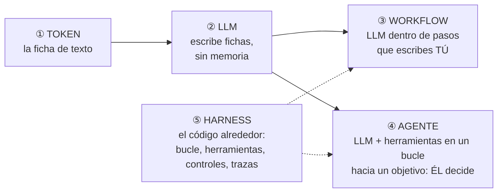
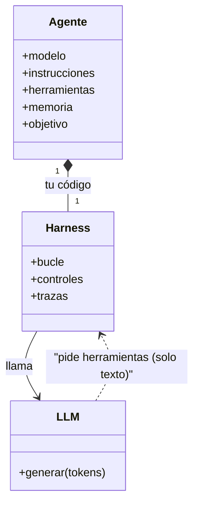
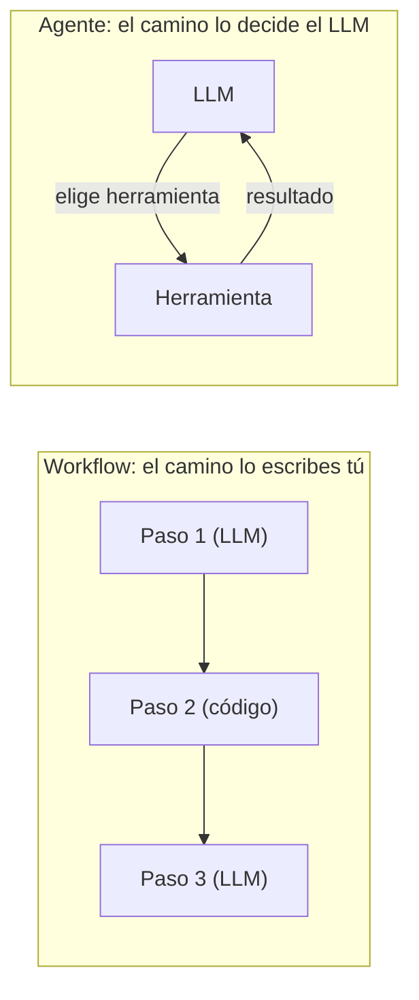
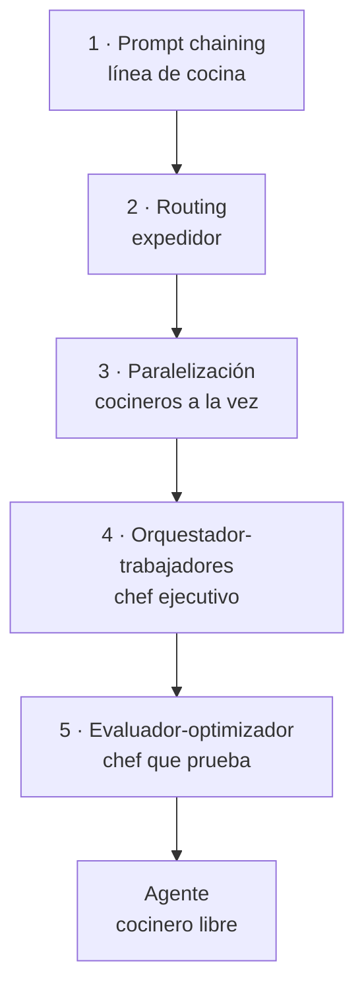

# 01 · Agentes y workflows — qué es un agente y cuándo usarlo

> **Tema 1 de 10** del Agentic Track, reordenado por oficio (no por semana). Fuentes: semanas 1, 5 y 6 del curso de Ed Donner.
> ⬅️ [Índice](README.md) · ➡️ [02 · Modelos y proveedores](02-modelos-y-proveedores.md) · [Catálogo de patrones](../patrones/README.md) · [Diagramas UML](diagramas-uml.md)

---

## 🍳 Con la cocina

Un **cocinero muy hábil que solo sabe escribir notas** y **olvida todo cuando sales del cuarto**. Tú, el jefe de cocina, **lees sus notas, abres la despensa, enciendes el fuego y le devuelves el resultado**. Un **agente** es ese cocinero repitiendo *"pido algo → tú lo haces → miro el resultado → decido lo siguiente"* hasta decir *"listo"*. Un **workflow**, en cambio, es **la receta con los pasos escritos**: no hay decisiones, solo orden.

> En palabras de la calle: **el agente no es el modelo, es tu programa que lee lo que dice el modelo y actúa. Y casi siempre conviene la receta, no el cocinero libre.**

---

## 📌 Chuleta: las 5 piezas (tenla siempre a mano)

| Pieza | En una frase | 🍳 Cocina | ¿Quién decide el camino? | Ejemplo en pagos 🧩 |
|---|---|---|---|---|
| **① Token** | La unidad de texto del modelo (palabra, trozo o signo). **Todo se cuenta en tokens**: límite, velocidad y precio | Una sílaba de la nota | — | Un recibo largo cuesta más tokens que uno corto |
| **② LLM** | Modelo que **predice el siguiente token**. No ejecuta nada y **no recuerda** | El cocinero que solo escribe notas | — | Gemini, Claude, GPT |
| **③ Workflow** | **Pasos fijos que escribes tú**, con el LLM en uno o varios | La receta con pasos escritos | **Tú** (el código) | Clasificar el pago → si el riesgo es alto, revisión humana |
| **④ Agente** | **LLM + herramientas en un bucle** hasta cumplir un objetivo | El cocinero libre | **El LLM** (con tope) | Investigar una disputa consultando varias APIs |
| **⑤ Harness** | **Todo el código alrededor del modelo**: bucle, herramientas, controles (lista blanca, topes, aprobación), memoria y trazas | El jefe de cocina y su cocina | **Tú**: pones las reglas | Lo que decide si el agente puede ejecutar un pago |

**Cómo se relacionan (la idea que une todo):** el LLM solo genera tokens. El **harness** (tu código) lee esos tokens y actúa. Si **tú** fijas los pasos, es un **workflow**; si **el LLM** decide los pasos, es un **agente**. **Los dos viven dentro de un harness.**

**Regla para decidir:** ¿puedes escribir los pasos de antemano? → **workflow**. ¿No, y vale la pena el costo y el riesgo? → **agente, con tope de iteraciones**. En duda, empieza con **una sola llamada**.

> 🔎 *Harness* lo usa el instructor del curso (semana 6) y también el marco de Deep Agents ([08](08-frameworks-y-grafos.md)); **otros autores lo definen distinto**. Aquí lo usamos así: el código que rodea al modelo.

---

## 1 · Qué es un agente

| # | Definición | Utilidad |
|---|---|---|
| 1 | Sistema de IA que hace tareas por ti de forma independiente | Intuitiva, vaga |
| 2 | Sistema donde **un LLM controla el flujo de trabajo** | Marca quién decide |
| 3 | ⭐ **Un LLM con herramientas en un bucle para alcanzar un objetivo** (Simon Willison) | **La del curso** |
| 4 | **LLM + *harness*** (herramientas y proceso alrededor) | Cómo lo dice el instructor en la semana 6 |

> 🔎 Orígenes y fechas, según el instructor; no verificados.

**Lo que más pesa:** un LLM **solo genera tokens**. Decir que "controla el flujo" es una forma floja de hablar: **tu código interpreta esos tokens** y es quien actúa. Es el modelo mental de un AI Engineer.

## 2 · Workflow vs. agente

| | **Workflow** | **Agente** |
|---|---|---|
| Camino | **Predefinido** por ti | **Abierto**: lo decide el LLM |
| 🍳 | La **receta con pasos escritos** | El cocinero que **decide qué hacer** |
| Probar | Todas las rutas | Imposible enumerarlas |
| Costo y latencia | Predecibles | Variables |
| Características | Rutas fijas | *Open-ended*, ciclos de feedback, sin camino fijo |

**En producción suele ganar el workflow** (repetible y comprobable). Lo repiten las semanas 1, 5 y 6: *"casi siempre lo que realmente se implementa es más bien un workflow que una autonomía verdadera"*.

### Los patrones (ideas, no reglas)

El detalle de cada uno (con caso de uso y cómo se prueba) está en el [catálogo de patrones](../patrones/README.md). Se **mezclan** en la práctica; no memorices los nombres.

## 3 · El camino correcto (las reglas del instructor para decidir)

| Regla | Detalle |
|---|---|
| **Problema primero** | *"Alguien me llama y quiere un agente para X: me pongo a gritar."* Empieza por un problema de negocio **medible** |
| **Una llamada primero** | Un LLM, un prompt, un objetivo; **divide solo si una métrica mejora** |
| **Orquestación por código por defecto** | Cede el orden al LLM solo si hay evidencia |
| **De lo pequeño a lo grande** | Sin diagrama gigante de entrada |
| **Un agente solo primero** | Un equipo solo cuando el agente solo falle |

### Trampas

| Trampa | Qué pasa | Qué hacer |
|---|---|---|
| **Solución sin problema** | Sin problema medible no sabes si funcionó (caso del "agente cultural": el problema era la rotación) | Partir de una métrica de negocio; quizá ni necesita LLM |
| **Antropomorfizar** (pizarra de roles humanos) | Los LLM son **generadores de tokens**, no personas | **Un LLM, un prompt, un objetivo**; medir; dividir solo si mejora |

- **Creíble ≠ correcto.** Tu trabajo es alinear la predicción del siguiente token con un resultado de negocio.
- **"Alucinó" no es excusa:** el sistema lo construyes tú; valida y acota.
- **"Ingeniero agéntico"** es ambiguo: *usa* agentes (Claude Code) o *diseña* agentes.

## 4 · Las "10 cosas que importan" (cierre del curso)

El resumen de criterio profesional del curso, en una línea cada una: 1) problema antes que solución · 2) métrica de negocio · 3) código antes que autonomía · 4) de lo pequeño a lo grande · 5) empezar con una llamada · 6) modelo grande primero · 7) contexto completo · 8) mejorar el prompt primero · 9) **mirar las trazas** · 10) ser ingeniero y científico (I+D). Detalle y matices en [10 · Observabilidad y evaluación](10-observabilidad-evaluacion-y-costos.md) y [08 · Frameworks y grafos](08-frameworks-y-grafos.md).

## 5 · Qué debe dominar cada nivel

| Nivel | Debe poder... |
|---|---|
| 🟢 **Junior** | Definir un agente (LLM + herramientas + bucle + objetivo); explicar que el modelo **pide** y tu código **ejecuta**; distinguir workflow de agente. |
| 🟡 **Mid** | Elegir entre workflow y agente por riesgo y testabilidad; reconocer cada patrón; aplicar "problema primero" y "una llamada primero". |
| 🔴 **Senior** | Exigir problema y métrica antes de construir; decidir con evidencia cuánta autonomía ceder; acotar el agente (topes, permisos, trazas); evitar las dos trampas. |

## 6 · Escalera de entrevista

**"¿Qué es un agente y en qué se diferencia de un workflow?"**
- 🟢 "Un LLM con herramientas en un bucle para cumplir un objetivo; en un workflow yo defino los pasos, en un agente los decide el modelo."
- 🟡 "El workflow tiene rutas predefinidas y se puede probar entero; el agente es abierto, con ciclos de feedback."
- 🔴 "En producción prefiero workflow cuando conozco el camino; el agente abierto lo acoto con topes, permisos y trazas, porque no puedo enumerar todos sus caminos."

**"Un cliente pide un agente. ¿Qué haces?"**
- 🟢 "Pregunto qué problema quiere resolver."
- 🟡 "Defino una métrica de negocio y empiezo con la solución más simple."
- 🔴 "Compruebo si necesita IA; si sí, itero la arquitectura solo cuando los datos demuestran mejora, con evals y guardrails antes de producción."

## 🛠️ Ejercicios (taller)

| Taller | Qué haces |
|---|---|
| **W01** | Primer agente en Spring AI: `ChatClient`, prompt y salida estructurada (con modelo falso) |
| **W03** | Los patrones 1, 2 y 3 como workflows (cadena con puerta, enrutador, paralelo) |
| **Reflexión escrita** | Elige un proceso de tu trabajo y decide **workflow o agente** con tres argumentos (riesgo, testabilidad, costo) |

→ [Plan de talleres](../talleres/README.md)

## 🔗 Relacionado

[Catálogo de patrones](../patrones/README.md) · [03 · Prompts y contexto](../conceptos/03-prompts-contexto-y-salidas-estructuradas.md) · [04 · Herramientas y bucle](04-herramientas-y-bucle-del-agente.md) · [07 · Orquestación](07-orquestacion-y-multiagente.md) · [`ia-agentes/`](../../ia-agentes)
