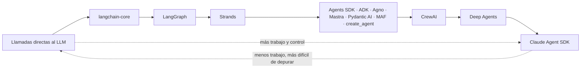
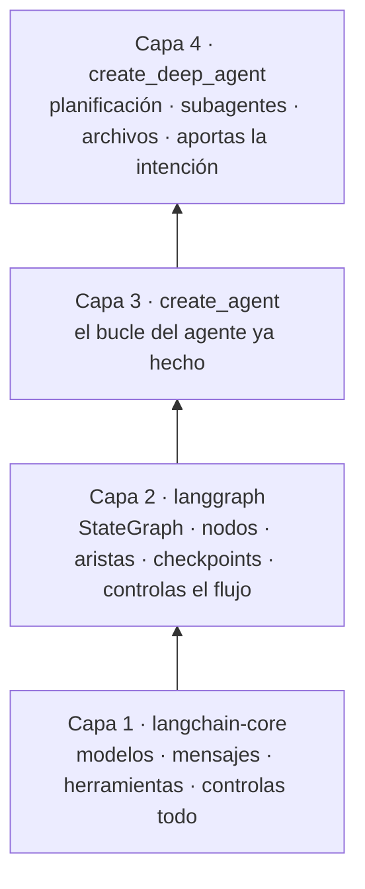
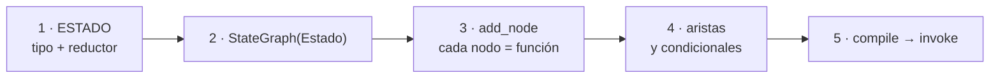
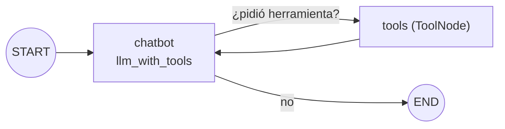

# 08 · Frameworks y grafos — qué hay debajo y cómo elegir

> **Tema 8 de 10.** Fusiona los antiguos "LangChain, LangGraph y Deep Agents" y "Frameworks y cómo elegir". **Tesis:** *una vez que conoces un marco, los conoces todos*; elige por tu equipo y tu ecosistema, no por la sintaxis, y mira siempre la traza.
> ⬅️ [07 · Orquestación](07-orquestacion-y-multiagente.md) · ➡️ [09 · Seguridad y humano en el bucle](09-seguridad-guardrails-y-humano-en-el-bucle.md) · [Índice](README.md) · [Diagramas UML](diagramas-uml.md)

---

## 🍳 Con la cocina

Los frameworks son **marcas de cocina**: otra decoración y otros nombres para los utensilios, **los mismos fogones**. Unas son **cocinas vacías** (tú pones todo), otras **traen brigada contratada** (CrewAI) y otras son un **restaurante llave en mano** (Deep Agents, Claude Agent SDK). Cuanto más equipada, **menos trabajo… y menos ves** lo que pasa por dentro.

> En palabras de la calle: **cambian los nombres de las piezas, no las piezas. Abajo controlas todo; arriba te dan todo hecho y ves menos.**

---

## 1 · La escala de abstracción

Cada uno elige un punto según el problema, la madurez del proyecto y las competencias del equipo.

## 2 · Las cuatro capas de LangChain (el ejemplo más claro)

"LangChain" son **cuatro cosas distintas**; saber en qué piso estás es lo difícil. Casi siempre conviene el **piso 3**.

| Capa | 🍳 | Equivale a | Cuándo |
|---|---|---|---|
| 1 · `langchain-core` | Ingredientes crudos | Cliente de chat + `@Tool` (Spring AI `ChatClient`) | Control total |
| 2 · `langgraph` | Plano con el recorrido de cada comanda | Motor de workflow / máquina de estados 🧩 (sin equivalente directo en Spring AI/Quarkus) | Flujos con estado, ramas, reanudar |
| 3 · `create_agent` | Servicio ya montado | `Agent` + `Runner`; AiService (Quarkus) | **Por defecto** |
| 4 · `create_deep_agent` | Llave en mano | Claude Agent SDK / subagentes de Claude Code | Tareas largas y abiertas |

**La confusión circular:** `create_agent` construye un grafo de LangGraph cuyos nodos llaman a `langchain-core`. Son paquetes distintos con el mismo apellido.

**LangSmith** (trazas y evals) sirve y tiene cuenta gratis, pero ⚠️ sube las trazas a su plataforma: sin datos reales.

### Capa 1: `bind_tools` no ejecuta nada
El modelo solo **pide** usar una herramienta (`.tool_calls`) y **tú** escribes el bucle de la [04 · Herramientas y bucle](04-herramientas-y-bucle-del-agente.md): llamar, leer las peticiones, ejecutar **solo las de la lista blanca** 🧩, devolver el resultado y volver a llamar.

## 3 · LangGraph: estado, nodos y aristas ⭐

| Término | Qué es | 🍳 | Equivale a |
|---|---|---|---|
| **Grafo** | El flujo completo | Plano de la cocina | Workflow / máquina de estados |
| **Estado** | Instantánea de la información | La **comanda** que viaja entre estaciones | Objeto de contexto inmutable |
| **Nodo** | Función `estado → estado nuevo` | Una estación | Un paso / handler |
| **Arista / condicional** | Qué viene después, según una condición | El expedidor decide | Transición / router |
| **Reductor** | Cómo **fusionar** lo que devuelve un nodo con el estado | El jefe que integra las notas de varios cocineros | `merge` / reducer de Redux |

- 🧩 Un grafo **no necesita LLM**; orquesta cualquier función.
- **El agente dibujado:** el `if`/`for` del bucle a mano, pero **como diagrama**.

**Memoria, `thread_id` y rebobinado:** → [06 · Memoria](06-memoria-busqueda-y-rag.md#memoria-persistente-con-checkpointer-langgraph--create_agent).

## 4 · `create_agent` (capa 3) ⭐

Tú aportas **modelo, herramientas y prompt** (+ memoria, formato de salida, middleware) y obtienes un grafo compilado: nodo modelo ⇄ nodo herramientas.

| Capacidad | Cómo | Equivale a |
|---|---|---|
| Modelo como texto | `"proveedor:modelo"` (dos puntos) | Atajo para no crear el cliente |
| Memoria | `checkpointer` + `thread_id` | Memoria de conversación |
| Estructura | `response_format=Clase` | `output_type` |
| **Middleware** | `middleware=[…]` | Interceptores / AOP |
| **MCP** | `MultiServerMCPClient` | Cliente MCP |

**Se pierde** el control del diseño del grafo: si necesitas ramas y aprobaciones propias, bajas a LangGraph. **Middleware y aprobación humana:** → [09](09-seguridad-guardrails-y-humano-en-el-bucle.md).

## 5 · Deep Agents y skills (capa 4)

`create_deep_agent()` trae **sin pedirlo**: lista de tareas (`write_todos`), archivos, `task` para delegar en **subagentes** y **skills**. Un subagente es un diccionario (`name`, `description`, `system_prompt`, + `tools`/`skills`). El backend de archivos restringe rutas pero ⚠️ **no es un contenedor**.

**Skills ⭐:** una carpeta con `SKILL.md` (front matter + Markdown). Al arrancar el agente solo ve **nombre y descripción**; pide el contenido completo **si es relevante** (*divulgación progresiva*: barato en contexto, por eso caben muchas).

| | Skills | Herramientas |
|---|---|---|
| Pensadas para | Quien **usa** un agente hecho (Claude Code, Codex) | Quien **construye** el agente |
| Fiabilidad | **Menor:** tokens libres para ejecutar un script | **Mayor:** esquema + decodificación restringida |

> 🧩 **Instrucciones y estilo → skill; acciones con efectos → herramienta con esquema.**

⚠️ Mucha autonomía + middleware oculto = difícil de auditar; cada subagente suma llamadas y latencia; una skill con scripts es **código que alguien ejecutará**: revisa su origen. Es **lo mismo que ya usas** (subagentes y skills de Claude Code o Copilot), pero programable.

## 6 · Los marcos en una tabla ⭐

| | Agents SDK | CrewAI | `create_agent` | **Google ADK** | **Strands** (AWS) | **Pydantic AI** | **MAF** (Microsoft) | **Agno** | **Mastra** |
|---|---|---|---|---|---|---|---|---|---|
| Prompt | `instructions` | YAML | `system_prompt` | `instruction` | `system_prompt` | `instructions` | `instructions` | `instructions` | `instructions` |
| Herramienta | `@function_tool` | `@tool` | `@tool` | función simple | `@tool` | función simple | función simple | función simple | `createTool` + Zod |
| MCP | `MCPServerStdio` | — | `MultiServerMCPClient` | `McpToolset` | `MCPClient` | `MCPToolset` | `MCPStdioTool` | `MCPTools` | `MCPClient` |
| Observabilidad | OpenAI Traces | CrewAI Traces | LangSmith | **`adk web` local** | OTel | Logfire | telemetría | AgentOS (pago) | **Studio** local |
| Lenguajes | Py | Py | Py | Py, TS… | Py, TS | Py | **Py, .NET** | Py | **TS** |
| Rasgo | Ligero | Opinionado | Capas, middleware | Gemini por defecto | Crudo, Bedrock | Tipado fuerte | Sucesor de AutoGen + Semantic Kernel | Velocidad | De los autores de Gatsby |

- **ADK:** el más natural con Gemini; su UI local (`adk web`) muestra chat, diagrama y trazas **sin salir de tu máquina**.
- **Strands:** el más ligero; natural si usas AWS/Bedrock. **Pydantic AI:** tipado y sobrio, fuerte en salidas estructuradas. **Mastra:** TypeScript nativo con Zod. **Agno:** destaca por crear agentes muy rápido.
- **Microsoft Agent Framework (MAF) ⭐:** SDK oficial de Microsoft, sucesor de **AutoGen** y **Semantic Kernel**. **Python y .NET**; 🔎 **confirma si soporta Java** antes de depender de él (Semantic Kernel sí tenía SDK de Java). Joven y con muchos renombrados en 2026: **fija la versión**.

## 7 · La "magia" escondida de los marcos opinionados ⭐

CrewAI define un agente con `role` + `goal` + `backstory` y una tarea con `description` + `expected_output`; agentes y tareas se declaran en YAML. Es cómodo, pero hay **comportamiento que no escribiste**:

| Magia | Riesgo | Cómo se ve |
|---|---|---|
| **Contexto implícito:** sin `context:`, cada tarea recibe **todas** las salidas anteriores | Un agente ve más de lo que crees | Traza → mensajes del LLM |
| **Caché de herramientas:** misma herramienta + mismos argumentos = resultado anterior | `list_files` devolvía el estado inicial aunque se hubiera escrito un archivo | El agente "no ve" lo que acaba de escribir |
| **Memoria unificada** (`memory=True`) | Difícil de diagnosticar | Trazas |
| **Prompts inyectados** por el framework | El prompt final no es el tuyo | Traza → pestaña Mensajes |

> 🧩 **Con un framework opinionado, la primera vez que algo "se comporta raro", abre la traza antes de tocar el código.** ⚠️ Las trazas en la nube del framework suben prompts y salidas: no uses datos reales.

## 8 · A2A (Agent-to-Agent) ⭐ — la opinión que importa

Estándar de Google (hoy en la Linux Foundation): cada agente publica una **tarjeta** en `/.well-known/agent-card.json` y otros agentes lo **descubren y le delegan tareas**.

| Argumento del instructor | Mi lectura |
|---|---|
| El **revuelo supera a la adopción** | 🔎 su impresión, no un dato medido |
| Se vende como complemento de MCP, pero **MCP también llama a otro agente como herramienta** | El punto más sólido |
| Será importante con agentes de **distintas empresas** | Plausible |

🧩 **Regla:** **A2A solo si dos equipos u organizaciones distintas deben colaborar sin compartir código.** Dentro de un mismo sistema basta una función o una herramienta MCP.

## 9 · Cómo elegir

| Criterio | Pregunta | Pista |
|---|---|---|
| **Equipo** | ¿Qué sabe tu equipo? | Java → Spring AI / Quarkus; TS → Vercel AI SDK / Mastra |
| **Ecosistema** | ¿Nube y proveedor? | Gemini → ADK; Microsoft → MAF; AWS → Strands |
| **Observabilidad** | ¿Dónde viven las trazas? | Local o plataforma remota ⚠️ |
| **Transparencia** | ¿Puedo depurar lo que esconde? | Capas altas = opacidad |
| **Madurez** | ¿Cambia de nombres cada mes? | Fijar versión |
| **Lenguaje** | ¿Python es obligatorio? | **No**: casi todos tienen TS, y hay opciones en Java |

> 🧩 El criterio práctico es **el ecosistema de tu proyecto**, no la sintaxis.

## 10 · Qué debe dominar cada nivel

| Nivel | Debe poder... |
|---|---|
| 🟢 **Junior** | Nombrar las 4 capas y saber en cuál está; usar `create_agent` con herramientas y memoria; explicar estado, nodo y arista. |
| 🟡 **Mid** | Dibujar un agente como grafo; usar `checkpointer` y rebobinar; elegir por ecosistema; distinguir skills de herramientas; explicar qué es A2A y cuándo **no** hace falta. |
| 🔴 **Senior** | Elegir la capa por **control vs. comodidad**; diseñar el estado y el reductor; decidir **si un marco aporta o basta con código propio**; neutralizar la magia (caché, contexto implícito); mantener el agente **desacoplado** del marco y fijar versión. |

## 11 · Escaleras de entrevista

**"¿Qué framework de agentes usarías?"**
- 🟢 "El que mejor conozca el equipo."
- 🟡 "Depende del ecosistema: Gemini → ADK, Microsoft → MAF, AWS → Strands; todos hacen lo mismo."
- 🔴 "Evalúo si aporta algo frente a código propio; elijo por observabilidad, tipado, soporte del proveedor y madurez, fijo versión y mantengo el agente desacoplado."

**"¿Qué es el estado en LangGraph y por qué es inmutable?"**
- 🟢 "La información compartida entre pasos."
- 🟡 "Cada nodo devuelve un estado nuevo; un reductor lo combina."
- 🔴 "Permite paralelismo sin pisarse y hace posibles los checkpoints y el rebobinado; el reductor define la semántica de fusión."

**"¿Ventajas y riesgos de un framework opinionado como CrewAI?"**
- 🟢 "Es rápido de arrancar."
- 🟡 "Estructura los prompts y trae herramientas, pero esconde contexto implícito, caché y memoria."
- 🔴 "Ahorra tiempo en prototipos; para producción reviso las trazas, desactivo lo que no entiendo y mido si compensa frente a código propio."

**"¿Para qué sirve A2A y en qué se diferencia de MCP?"**
- 🟢 "Para que agentes se hablen entre sí."
- 🟡 "MCP conecta un agente con herramientas; A2A conecta agentes entre sí, con una tarjeta de descubrimiento."
- 🔴 "A2A importa entre organizaciones; dentro de un sistema propio basta un agente como herramienta. Lo vigilo, pero no lo adopto hoy."

## 🛠️ Ejercicios (taller)

> Los talleres traducen esto a Java, donde **no hay un equivalente directo de LangGraph** 🧩.

| Taller | Qué haces |
|---|---|
| **W05** | **Estado y reanudación** en Java: repositorio de estado por proceso + máquina de estados |
| **Cierre Ruta 2** | **Matriz de decisión Spring AI vs. Quarkus** (madurez, ecosistema, arranque, memoria, pruebas, MCP, equipo) |
| **N1 · P1** | El mismo agente en NestJS (Vercel AI SDK) y en Python (ADK o Agents SDK) |
| **Lectura** | Dibuja el grafo de un **flujo de cobro** con ramas (reintento, rechazo, aprobación) y marca dónde guardarías un checkpoint |

## 🔗 Relacionado

[04 · Herramientas](04-herramientas-y-bucle-del-agente.md) · [06 · Memoria](06-memoria-busqueda-y-rag.md) · [07 · Orquestación](07-orquestacion-y-multiagente.md) · [09 · Seguridad](09-seguridad-guardrails-y-humano-en-el-bucle.md) · [Diagramas UML §5](diagramas-uml.md) · [Plan de talleres](../talleres/README.md)
