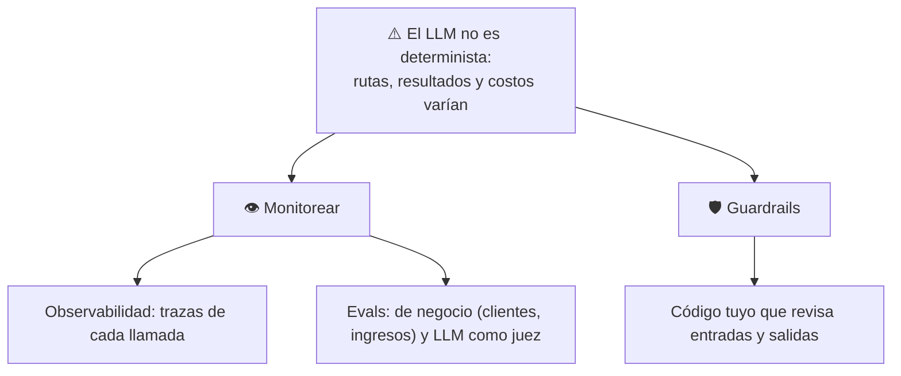
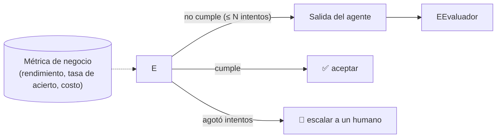
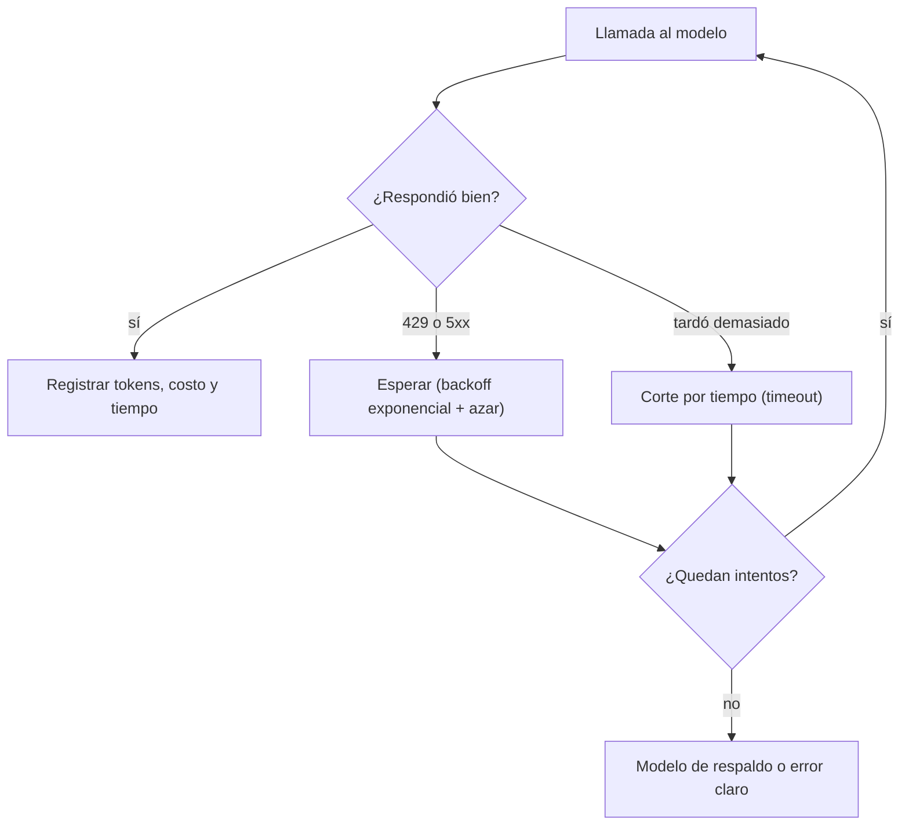

# 10 · Observabilidad, evaluación y costos

> **Tema 10 de 10.** Fuentes: semanas 1 a 6 (el tema aparece en **todas**: trazas, LLM juez, evaluador, costo). **Aviso honesto:** la **evaluación sistemática** (conjuntos fijos, regresión, calibración del juez) **casi no se enseña**: ahí los talleres W07 y W15 **añaden** lo que falta.
> ⬅️ [09 · Seguridad](09-seguridad-guardrails-y-humano-en-el-bucle.md) · [Índice](README.md)

---

## 🍳 Con la cocina

Tres cosas distinguen a una cocina profesional de una casera: el **libro de comandas** (anota qué se pidió, qué se hizo y cuánto costó: **trazas**), el **chef que prueba cada plato con un criterio fijo** (**evaluación**) y la **hoja de costos** (cuánto gasta cada plato). Sin ellas, "parece que salió bien" es todo lo que tienes.

> En palabras de la calle: **si no puedes ver qué hizo el agente, medir si lo hizo bien y saber cuánto costó, no tienes un sistema: tienes una demo.**

---

## 1 · El problema de fondo: el LLM no es determinista

- **Creíble ≠ correcto.** Tu trabajo es **alinear** la predicción del siguiente token con un resultado de negocio **medible**.
- Cada ejecución **es distinta**: se mide con **muchas ejecuciones**, no con una.

## 2 · Trazas propias y evaluación con métrica real (caso de la sala de operaciones) 🔎

| Tema | Qué se hizo |
|---|---|
| **Observabilidad propia** | `LogTracer(TracingProcessor)` con `on_trace_start/end`, `on_span_start/end`, **guardados en SQL**, registrado con `add_trace_processor(...)`. Así los trazas se pueden mostrar **en tu propia interfaz**, no solo en el panel de OpenAI |
| **Evaluación con métrica real** | El **rendimiento de la cartera**; el trader tiene la herramienta **`change_strategy`** y un **mensaje de reequilibrio** que le pide **analizar sus resultados y adaptar la estrategia** |
| **Bucle de retroalimentación** | Estrategia guardada con la cuenta → se lee en la siguiente ronda |
| **Producción ligera** | `backend/api.py` (FastAPI, `uvicorn backend.api:app`, puerto 8000) + `frontend/` (Vite + TypeScript, **escrito con Claude Code**) |

🧩 **Es la receta de "agente con evaluación":** un resultado **medible**, un **registro propio** de qué hizo, y **retroalimentación** (estrategia) que cierra el ciclo. Lo que **no** se enseña: despliegue real, seguridad, pruebas y evals sistemáticas — el instructor lo remite al **curso de producción** ("lo que falta es DevOps, no IA").

---

## 3 · Observabilidad: qué ver y dónde

| Plataforma / herramienta | Marco | ¿Sale de tu máquina? |
|---|---|---|
| OpenAI Traces | Agents SDK | **Sí**, a OpenAI |
| CrewAI Traces (`app.crewai.com`) | CrewAI | **Sí** |
| **LangSmith** | LangChain | **Sí** |
| **`adk web`** · **Mastra Studio** | ADK · Mastra | **No** (panel local) |
| OpenTelemetry (Langfuse…) | Strands, Pydantic AI | Tú decides |
| **Trazas propias** (`TracingProcessor` → SQL) | Agents SDK | **No** |
| Micrometer + OpenTelemetry 🧩 | **Java** 🔎 | Tú decides |

⚠️ **Las plataformas remotas suben prompts y respuestas**: no las uses con datos reales del cliente.

**Qué buscar en una traza:** el **prompt de sistema real** (los marcos añaden texto propio), si el agente **usó** las herramientas o **inventó**, los **argumentos**, los **tokens y costo**, las **vueltas** innecesarias (el agente de Playwright dio muchos rodeos) y **qué contexto recibió** cada tarea.

> 🧩 **Regla:** ante cualquier comportamiento raro, **abre la traza antes de tocar el código.** El instructor lo repite hasta el cansancio.

## 4 · Evaluación: de "parece bien" a una métrica

### El evaluador (LLM como juez)

Una llamada **aparte**, sin herramientas, con **salida estructurada** (`EvaluatorOutput`: ¿criterios cumplidos? ¿falta información del usuario? comentarios). Recibe la petición, los criterios, las herramientas usadas y la última respuesta. Si no cumple, **el trabajador reintenta** con el comentario. Es el [patrón 5](../patrones/05-evaluator-optimizer/README.md) puesto en producción, con **tope de intentos** (3).

| Nivel de evaluación | Qué es | Límite |
|---|---|---|
| **LLM como juez** | Otro modelo juzga con criterios | **Tiene sesgos**: valídalo contra casos etiquetados; mejor un modelo distinto |
| **Métrica de negocio** | Un número del mundo real (ej.: rendimiento de la cartera) | La mejor, y la más difícil de encontrar |
| **Casos fijos y regresión** 🧩 | Un conjunto de pruebas que se repite en cada cambio | **No lo enseña el curso** |

**Lección del Deep Research:** con un modelo mini y 5 búsquedas (~5 ¢) salió un informe con errores; con uno grande y 20 búsquedas (~22 ¢) la lista fue correcta. **Solo se vio comparando con un criterio**.

## 5 · Costos y latencia

| Palanca | Cómo |
|---|---|
| **Modelo** | Empieza grande y **reduce con una métrica** |
| **Topes** | Iteraciones, llamadas al modelo, presupuesto de la clave |
| **Contexto** | Divulgación progresiva, resumen del historial, **fecha al final del prompt** (caché) |
| **Herramientas** | Filtrar las expuestas; evitar las alojadas de pago |
| **Mide** | Costo **por ejecución** como métrica, no solo la factura mensual |

### Operar en producción: costo, velocidad y errores

| Eje | Qué vigilar | Palancas |
|---|---|---|
| **Costo** | Tokens de entrada **más** salida, por ejecución | Cachear prompts largos y estables, **topar la salida**, modelo pequeño donde la métrica lo permita |
| **Velocidad** | **Tiempo hasta la primera ficha** (lo que siente el usuario) y la cola lenta (**p95**: el tiempo que el 95 % de las llamadas no supera) | *Streaming*, prompts cortos, modelo más rápido en los pasos simples |
| **Errores** | Límite de uso (**429**), fallos del proveedor (**5xx**), cortes por tiempo | Reintentos con **espera creciente y azar**, tope de intentos, **modelo de respaldo**, **registrar todo** |

> ⚠️ **Caso de pagos ⭐ (mío 🧩):** reintentar una llamada **que ya ejecutó una herramienta con efectos** puede **duplicar un pago**. Las herramientas con efectos llevan **clave de idempotencia**: repetir la petición no repite la operación. Los reintentos automáticos se aplican a lo que se puede repetir sin riesgo. → [04](04-herramientas-y-bucle-del-agente.md) y [09](09-seguridad-guardrails-y-humano-en-el-bucle.md).

## 6 · Las 10 cosas que importan (cierre del curso) ⭐

Es la parte más valiosa del cierre del curso (lección 130). Mi versión, con tres matices míos:

| # | Idea | Mi comentario |
|---|---|---|
| 1 | **Céntrate en el problema, no en la solución** ("un agente para X") | La más importante |
| 2 | **Haz que se pueda medir** (métrica de negocio) | Difícil y vale la pena |
| 3 | **Orquestación por código primero**; en producción casi siempre es un **workflow**, no autonomía | Coincide con [01 · Agentes y workflows](01-agentes-y-workflows.md) y [07 · Orquestación y multiagente](07-orquestacion-y-multiagente.md) |
| 4 | **De lo pequeño a lo grande**, no un diagrama enorme de entrada | — |
| 5 | **Empieza con una sola llamada al LLM**; divide solo si las métricas lo justifican | — |
| 6 | **Empieza con un modelo grande**; luego baja de tamaño para ahorrar | 🧩 Y mide la caída de calidad |
| 7 | **Piensa en todo el contexto**, no solo en la memoria | [03 · Prompts y contexto](../conceptos/03-prompts-contexto-y-salidas-estructuradas.md) |
| 8 | **Muchos problemas se arreglan mejorando el prompt** | Primero esto |
| 9 | **Mira las trazas** hasta que sea un hábito (si no, el modelo "inventa" que usó la herramienta) | Crítico |
| 10 | **Sé ingeniero y científico:** I+D, no hay atajos | — |
| (11) | **Disfruta el proceso** | — |

Sobre el **marco**: *"no importa tanto; elige el que encaje con tu equipo"* (su favorito: Agents SDK + MCP). 🧩 En tu caso el criterio práctico es el **ecosistema de Arkano** (Java/Quarkus/Microsoft), no la sintaxis.

---

## 7 · Qué debe dominar cada nivel

| Nivel | Debe poder... |
|---|---|
| 🟢 **Junior** | Leer una traza (prompt, herramienta usada, tiempos); explicar por qué el LLM no es determinista. |
| 🟡 **Mid** | Montar un LLM juez con salida estructurada y tope de reintentos; comparar dos configuraciones con un criterio; estimar costo. |
| 🔴 **Senior** | Definir una **métrica de negocio**; construir un **conjunto fijo de casos** con regresión; **calibrar** al juez; decidir con evidencia; registrar trazas propias sin exponer datos. |

## 8 · Escaleras de entrevista

**"¿Cómo evalúas la salida de un agente?"**
- 🟢 "Otro LLM la revisa."
- 🟡 "Un evaluador con salida estructurada y criterios de éxito."
- 🔴 "Evaluador separado con tope de reintentos, escalamiento a humano y calibrado con casos conocidos; mido su acierto."

**"¿Cómo sabes que tu agente funciona?"**
- 🟢 "Lo pruebo con ejemplos."
- 🟡 "Con trazas y un LLM juez con criterios."
- 🔴 "Conjunto de casos fijos con métrica de negocio, evaluador calibrado, trazas propias, y todo en CI; comparo por costo y calidad."

**"¿Cómo haces fiable un bucle de agente?"**
- 🟢 "Dándole una lista de tareas."
- 🟡 "Con herramientas de planificación, criterios de éxito y un evaluador."
- 🔴 "Con una **métrica automática** que cierre el bucle, tope de iteraciones y de costo, observabilidad y pruebas con casos fijos."

## 🛠️ Ejercicios (taller)

| Taller | Qué haces |
|---|---|
| **W07** ⭐ | **Evaluador** (LLM juez) con reintentos y tope; primer **conjunto de pruebas**; rechaza N veces y escala a humano |
| **W10** | **Observabilidad local** (Micrometer/OpenTelemetry + registro propio): reconstruir qué herramienta se llamó y con qué argumentos |
| **W14** 🧩 | **API REST** con **reintentos con espera creciente, tope por tiempo e idempotencia** en la herramienta de pago; un modelo falso que falla 2 veces y acierta a la 3.ª |
| **W15** | **Evaluación sistemática**: casos fijos, regresión y **costo por ejecución**; un cambio de prompt se acepta o se rechaza **por una métrica** |
| **P4** | Evaluación y trazas en Python |

## 🔗 Relacionado

[01 · Agentes](01-agentes-y-workflows.md) · [03 · Contexto](03-prompts-contexto-y-salidas-estructuradas.md) · [09 · Seguridad](09-seguridad-guardrails-y-humano-en-el-bucle.md) · [Patrón 5 · Evaluator-optimizer](../patrones/05-evaluator-optimizer/README.md) · [Plan de talleres](../talleres/README.md)
