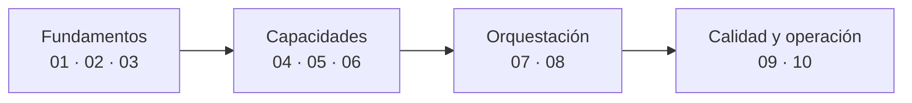

# Conceptos de AI Engineering (10 temas)

Los conceptos que hay que dominar para **construir, probar y operar agentes con LLM**, ordenados por oficio. Cada tema trae la analogía de la **cocina**, diagramas, qué debe saber un 🟢 junior, un 🟡 mid y un 🔴 senior, escaleras de entrevista y el taller que lo practica.

> Los temas parten de apuntes del curso *AI Engineer Agentic Track* (Ed Donner, Udemy; [repo del curso](https://github.com/ed-donner/agents)), reorganizados y ampliados. No son el curso ni su transcripción. Marcas: 🔎 por verificar · 🧩 aporte propio · ⚠️ riesgo · ⭐ lo que más rinde.
> **Práctica:** [talleres](../talleres/README.md) y el [repo de ejercicios](https://github.com/edzamo/ai-engineering-labs).

## 🗂️ Los 10 temas

| # | Tema | Qué responde | Bloque |
|---|---|---|---|
| **01** | [Agentes y workflows](01-agentes-y-workflows.md) | ¿Qué es un agente y cuándo conviene? | Fundamentos |
| **02** | [Modelos y proveedores](02-modelos-y-proveedores.md) | ¿Cómo llamo a un LLM y cambio de proveedor? | Fundamentos |
| **03** | [Prompts, contexto y salidas estructuradas](03-prompts-contexto-y-salidas-estructuradas.md) | ¿Qué le pongo sobre la mesa y cómo leo su respuesta? | Fundamentos |
| **04** | [Herramientas y bucle del agente](04-herramientas-y-bucle-del-agente.md) ⭐ | ¿Cómo actúa un agente de verdad? | Capacidades |
| **05** | [MCP](05-mcp.md) ⭐ | ¿Cómo enchufo herramientas de otros? | Capacidades |
| **06** | [Memoria, búsqueda y RAG](06-memoria-busqueda-y-rag.md) | ¿Cómo recuerda y cómo consulta datos? | Capacidades |
| **07** | [Orquestación y multiagente](07-orquestacion-y-multiagente.md) | ¿Cómo reparto el trabajo entre agentes? | Orquestación |
| **08** | [Frameworks y grafos](08-frameworks-y-grafos.md) | ¿Qué hay debajo (LangChain, LangGraph) y qué marco uso? | Orquestación |
| **09** | [Seguridad, guardrails y humano en el bucle](09-seguridad-guardrails-y-humano-en-el-bucle.md) ⭐ | ¿Cómo evito que haga daño? | Calidad y operación |
| **10** | [Observabilidad, evaluación y costos](10-observabilidad-evaluacion-y-costos.md) ⭐ | ¿Cómo sé que funciona y cuánto cuesta? | Calidad y operación |
| — | [Diagramas UML](diagramas-uml.md) | Clases, secuencia, estados, componentes y despliegue | Apoyo |

**Cómo estudiarlo (🧩):** el orden 01 → 10 sigue la dependencia (qué es, capacidades, coordinar, cuidar). Para **entrevista** basta con los ⭐ + 01 + 07.

## 🔗 Relacionado

[Guía de AI Engineering](../README.md) · [Calendario de estudio](../guia-de-estudio.md) · [Talleres](../talleres/README.md) · [Catálogo de patrones](../patrones/README.md) · [`ia-agentes/`](../../ia-agentes)
