# Diagramas UML de AI Engineering

> Una sola página con **los diagramas que vale la pena tener** del curso: clases, secuencia, estados, componentes y despliegue. Están hechos con Mermaid (se ven en GitHub y en el IDE).
> ⬅️ [Índice del curso](README.md) · Temas: [01 Agentes](01-agentes-y-workflows.md) · [04 Herramientas](04-herramientas-y-bucle-del-agente.md) · [05 MCP](05-mcp.md) · [07 Orquestación](07-orquestacion-y-multiagente.md) · [08 LangGraph](08-frameworks-y-grafos.md) · [09 Seguridad](09-seguridad-guardrails-y-humano-en-el-bucle.md) · [12 Proyectos](../talleres/README.md#11b--lecciones-de-los-proyectos-del-curso-qué-copiar-y-qué-dejar)

## 🍳 Con la cocina

Los diagramas son **el plano de la cocina**: no cocinan, pero te dicen **dónde está cada estación, quién habla con quién y en qué orden**. Si tu cocina cambia de marca (otro framework), el plano casi no cambia.

> En palabras de la calle: **el UML dibuja las piezas que se repiten en todos los marcos; los nombres cambian, el plano no.**

## Qué diagrama usar para qué

| Diagrama | Responde a | Dónde |
|---|---|---|
| **Clases** | ¿Qué piezas hay y cómo se relacionan? | §1, §3, §6 |
| **Secuencia** | ¿En qué orden se hablan? | §2, §4, §7 |
| **Estados** | ¿En qué estados puede estar un agente o un hilo? | §5 |
| **Componentes** | ¿Qué procesos y servicios hay? | §3, §8 |
| **Despliegue** | ¿Dónde corre cada cosa y cómo se conecta? | §8 |

Las etiquetas 🧩 son mías; lo demás sale de los labs del curso y del código de mi fork.

---

## 1 · El agente (válido para los 9 marcos)

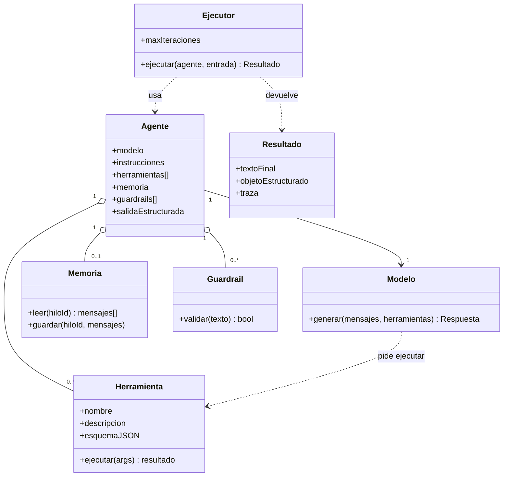

| Pieza | Agents SDK | CrewAI | LangChain | ADK | Pydantic AI |
|---|---|---|---|---|---|
| Agente | `Agent` | `Agent` (+ `Task`) | `create_agent` | `LlmAgent` | `Agent` |
| Ejecutor | `Runner.run` | `Crew.kickoff` | `agent.invoke` | `InMemoryRunner` | `agent.run` |
| Memoria | sesiones | `memory=True` | `checkpointer` | sesión | historial |
| Guardrail | `guardrails` | — | *middleware* | callbacks | validadores |

## 2 · El bucle del agente (secuencia)

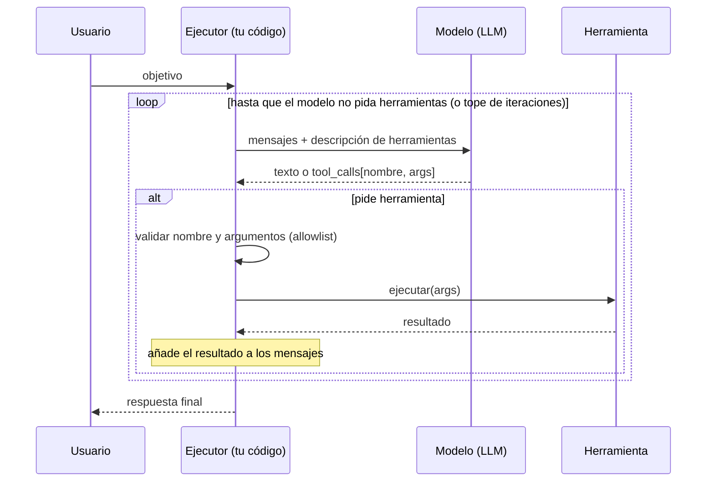

> 🧩 **Un LLM solo genera tokens; el agente es tu código que interpreta esos tokens.** Allowlist, validación de argumentos y tope de iteraciones viven en `E`, no en el modelo.

---

## 3 · MCP (clases y componentes)

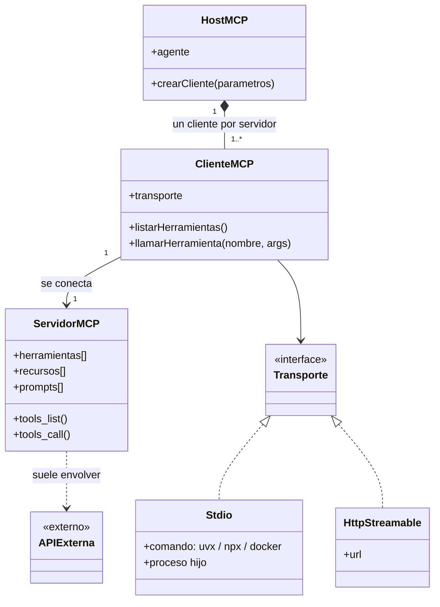

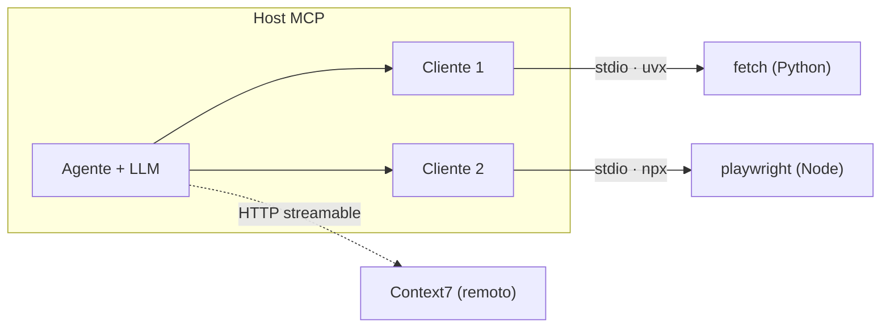

## 4 · Aprobación humana (secuencia, semana 4)

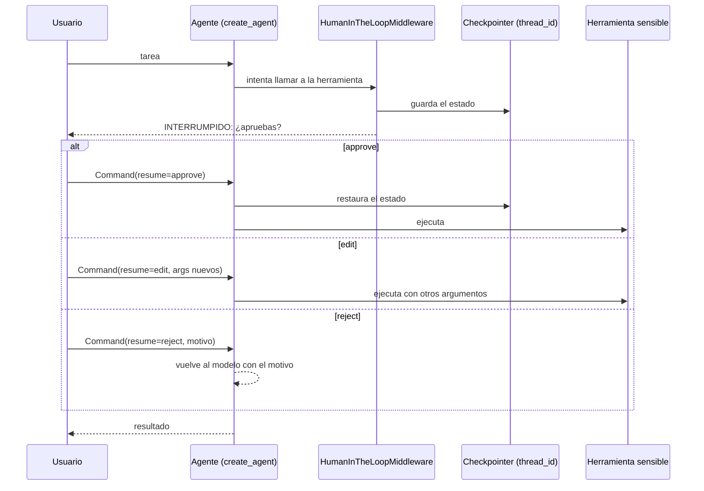

🧩 **Para un pago:** el agente **propone**, una persona **autoriza** y todo queda en el estado persistido.

## 5 · Estados de una ejecución (LangGraph / agente con pausa)

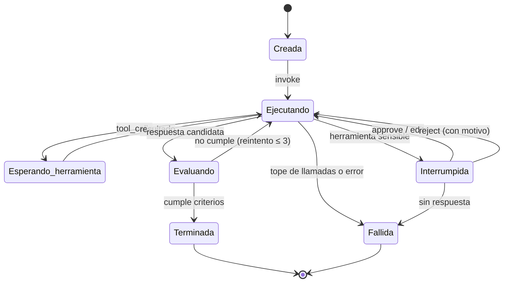

Cada transición puede guardarse como **checkpoint** (un `thread_id` + `checkpoint_id`): se puede **rebobinar** y reanudar desde cualquier punto.

---

## 6 · Sidekick (semana 4) y sala de operaciones (semana 6)

### Sidekick: trabajador + evaluador

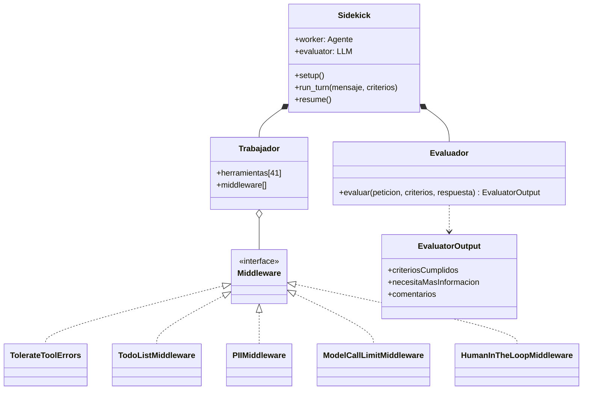

### Sala de operaciones

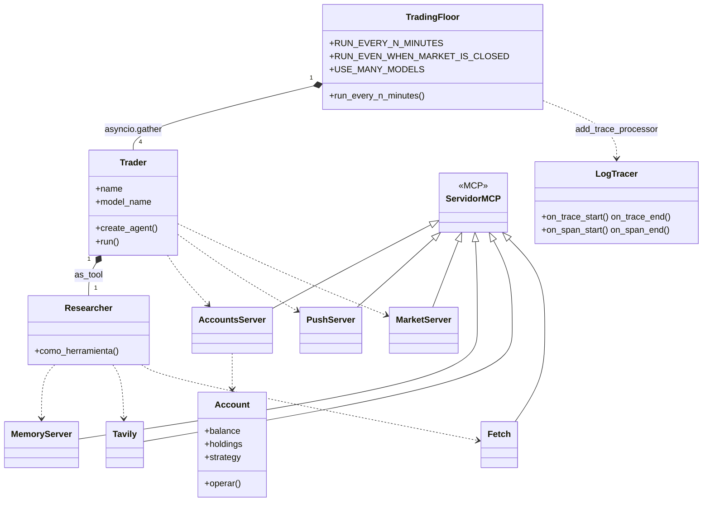

> Nombres tomados de `backend/` de mi fork (`traders.py`, `trading_floor.py`, `mcp_servers.py`, `tracers.py`).

## 7 · Orquestación: código vs. LLM (secuencia)

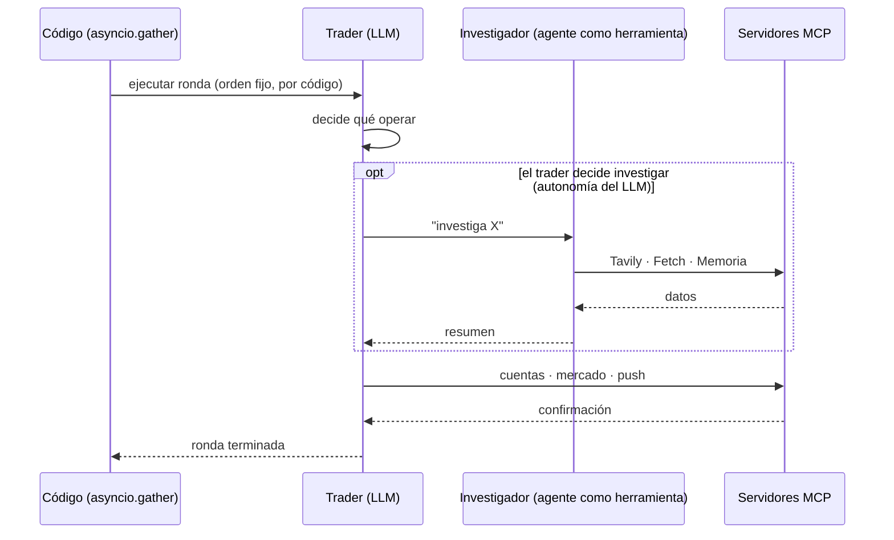

**Regla del instructor:** lo que tiene **orden fijo** va en **código**; lo **incierto** va en el **LLM**.

---

## 8 · Despliegue y componentes (agente con MCP)

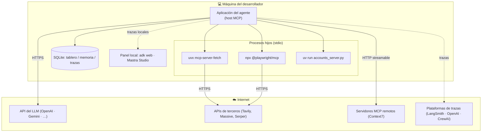

⚠️ **Lo que sale de tu red:** prompts y respuestas al **LLM**; datos a las **APIs de terceros**; y las **trazas** si usas una plataforma remota. Los paneles locales (`adk web`, Studio) **no suben nada**.

---

## 9 · Para tus PoC en Java (🧩 propuesta, no del curso)

Mismo plano con las piezas de Spring AI o Quarkus LangChain4j 🔎 (nombres a verificar al elegir framework):

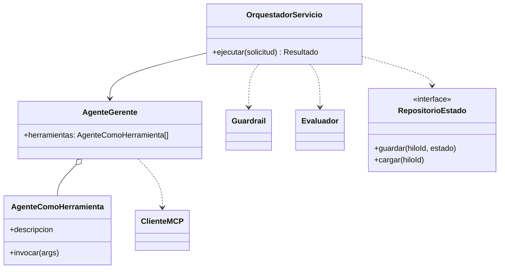

| PoC | Diagrama que lo describe |
|---|---|
| **PoC1** cadena con control (pago) | §2 con un estado persistido y aprobación humana (§4) |
| **PoC2** paralelización con selector (revisión de código) | §6 (sala de operaciones): coordinador por código + varios agentes |
| **PoC3** gerente con agentes-herramienta (reunión → funcionalidades → tareas) | §7: código orquesta lo fijo, el LLM decide lo incierto |

## Qué debe dominar cada nivel

| Nivel | Debe poder... |
|---|---|
| 🟢 **Junior** | Leer el diagrama del bucle y nombrar cada participante. |
| 🟡 **Mid** | Dibujar el diagrama de secuencia de un agente con herramienta y aprobación humana. |
| 🔴 **Senior** | Dibujar el **mapa de amenazas** y el **diagrama de estados** de un agente propio y ubicar dónde van los controles. |

## Escalera de entrevista

**"Dibuja la arquitectura de un agente con herramientas."**
- 🟢 "Usuario, modelo y herramienta en un bucle."
- 🟡 "Ejecutor, modelo y herramientas con validación; memoria por hilo y trazas."
- 🔴 "Además: lista blanca, tope de iteraciones, aprobación humana con estado persistido, aislamiento de código y evaluador."

## 🛠️ Ejercicios

Redibuja en papel (sin mirar) los diagramas §2, §4 y §5 para **un flujo de tu trabajo** y compáralos con los de esta página.

## 🔗 Relacionado

[Catálogo de patrones](../patrones/README.md) · [03 · Prompts y contexto](../conceptos/03-prompts-contexto-y-salidas-estructuradas.md) · [05 · MCP](05-mcp.md) · [08 · Frameworks y grafos](08-frameworks-y-grafos.md)
