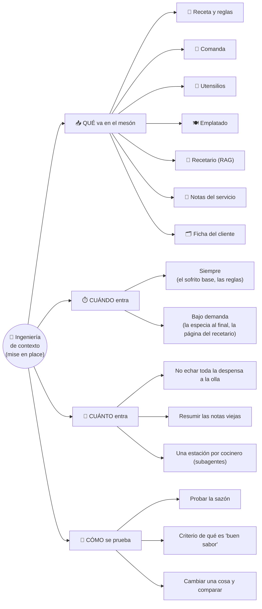
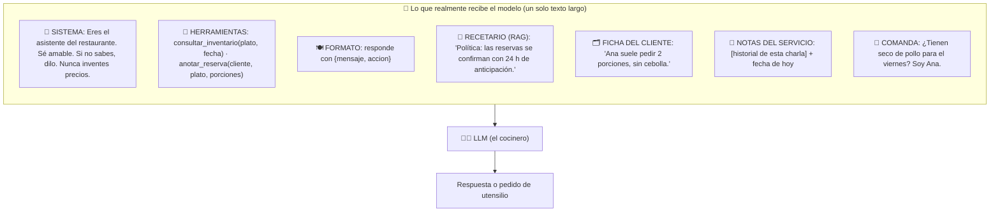
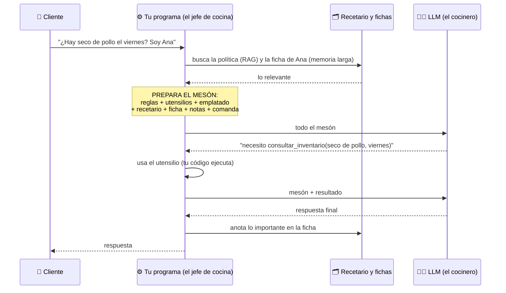
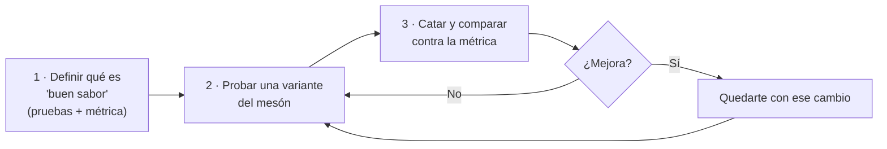

# Ingeniería de contexto: la *mise en place* del modelo

> **Para qué sirve este documento:** entender, de cero y con un mapa mental, qué es el *context engineering*, qué piezas lo forman y cómo se aplica al trabajar con agentes (Claude Code, Copilot) y al diseñar sistemas con IA.
> **Origen:** clase 22 del Agentic Track ([notas](../agentic-ai/semana-01-notas.md)); el diagrama original es de Phil Schmid (Google), según el instructor. Las secciones marcadas con 🧩 son mías, no del curso.

---

## 🍳 Con la cocina (si fueras junior)

Piensa en un **cocinero muy hábil que no recuerda nada** de la vez anterior. Cada vez que le pides un plato, **le dejas todo preparado sobre el mesón**, igual que haces la *mise en place* antes de cocinar un seco de pollo: cebolla y tomate picados, el pollo adobado, el arroz medido, las especias a mano.

| Sobre el mesón | Es... | En IA se llama |
|---|---|---|
| 📜 La **receta base y las reglas de la casa** ("sin picante", "sazón suave") | Quién es, cómo trabaja, qué reglas sigue | Prompt del sistema / instrucciones |
| 🧾 La **comanda** ("un seco de pollo, sin cebolla") | Lo que hay que resolver ahora | Mensaje del usuario |
| 🔪 **Cuchillo, olla, horno, balanza** | Lo que puede usar para actuar | Herramientas |
| 🍽️ El **emplatado estándar** ("arroz, seco y ensalada en este plato") | El formato exacto de la respuesta | Salida estructurada |
| 📖 La **página del recetario** que necesitas (no todo el libro) | Información útil sacada del archivo | RAG |
| 📝 Las **notas de este servicio** (lo que ya se cocinó esta noche) | Lo dicho en la conversación actual | Memoria a corto plazo |
| 🗂️ La **ficha del cliente habitual** ("Ana siempre pide sin cebolla") | Lo que se recuerda de antes | Memoria a largo plazo |

**Y lo clave:** el **mesón tiene un tamaño limitado** (la *ventana de contexto*). Si lo llenas de ingredientes que el plato no usa, el cocinero se estorba, se equivoca y además **pagas por cada ingrediente** que pusiste. La ingeniería de contexto es **decidir qué va sobre el mesón, cuándo y cuánto**.

> En palabras de la calle: **no es "cómo le pido el plato", es "qué le dejo listo para que le salga bien".** Un buen cocinero con un mal mesón cocina mal.

---

## 1 · El mapa mental

## 2 · Las 7 piezas, con un ejemplo real

Caso: el asistente de un restaurante. La clienta escribe: *"¿Tienen seco de pollo para el viernes? Soy Ana."*

Dos ideas para llevarte:

- **Todo es texto dentro del mismo mesón.** Las "piezas" son una forma de **pensar**, no compartimentos reales; por eso **se solapan** y la frontera no es estricta (lo dice el instructor).
- **El cocinero no sabe de dónde salió cada cosa.** Solo ve lo que hay sobre el mesón. Tu código decide **qué se prepara** antes de cada plato.

## 3 · El ciclo de un pedido: quién prepara el mesón

El **arte** está en el recuadro "PREPARA EL MESÓN": **tú** decides qué se incluye en cada pedido.

## 4 · El mesón es limitado 🧩

| Problema en la cocina | Qué pasa | Qué se hace |
|---|---|---|
| **Notas que crecen** (el historial) | Cada vuelta suma papeles; cuesta más y el mesón se llena | Resumir o descartar lo viejo |
| **Ingredientes de más** (ruido) | Estorban y el plato sale peor | Poner **solo lo que el plato usa** |
| **Toda la despensa en la olla** | Meter toda la documentación "por si acaso" | **Traer bajo demanda**: la página del recetario cuando hace falta (RAG o búsqueda) |
| **Un solo cocinero para todo el menú** | Se mezclan sabores y estaciones | **Una estación por cocinero**: subagentes, cada uno con su mesón limpio |
| **Lo que debe recordarse mañana** | El cocinero olvida entre servicios | **Libreta de la cocina**: fichas y archivos que se consultan con herramientas |

Estas técnicas son prácticas generales, no las enumeró el instructor tal cual. Lo que sí dijo: **la memoria larga se implementa normalmente con herramientas o con RAG**, y la tendencia es el **RAG agéntico** (darle herramientas para que busque la página que necesita, en vez de ponerle el recetario entero al inicio).

## 5 · Errores típicos 🧩

| ❌ Error en la cocina | ✅ En cambio |
|---|---|
| "Más ingredientes siempre es mejor" | Lo **necesario** para el plato, y probar |
| Reglas contradictorias ("sin sal" y "la casa sazona fuerte"; en el curso: "solo hablas de trabajo" + "odio el queso") | Revisar la receta como código: sin contradicciones ([clase 20](../agentic-ai/semana-01-notas.md)) |
| Obsesionarse con la redacción de la comanda | Pensar en **todo el mesón**: utensilios, fichas, formato |
| Cambiar la receta "a ojo" y servir | **Probar la sazón** antes: conjunto de pruebas y criterio |
| Rigidez ("esto va en la nota corta, esto en la ficha") | Tomarlo como **ideas**, no como fórmula |

## 6 · El método del instructor (lo más valioso)

Variantes a probar: otro orden del mesón, otro tipo de memoria, otros utensilios, RAG o RAG agéntico, otras técnicas de prompt. **No hay una receta única correcta**; depende de tu caso. Es la regla de la [clase 09](../agentic-ai/clases/09-riesgos-y-trampas-de-la-ia-agentica.md#4--trampa-2-antropomorfizar-tratarlo-como-persona) aplicada al contexto: **medir antes de complicar**.

## 7 · Tus herramientas de hoy son ingeniería de contexto 🧩

| Lo que usas | Qué pieza de la cocina es | Cuándo entra |
|---|---|---|
| `CLAUDE.md` / `AGENTS.md` | Receta base y reglas de la casa | Siempre |
| `PROJECT.md`, skills, documentación | El recetario (RAG) | **Bajo demanda** |
| Subagentes (`arch-validator-agent`, `tdd-driver-agent`…) | Una **estación** por cocinero | Por tarea |
| Hooks (`tdd-gate.sh`), permisos | El jefe de cocina que **autoriza** cada utensilio | En cada herramienta |
| Memoria del proyecto | Ficha del cliente habitual | Al iniciar |
| `/clear`, "una tarea por chat" | Limpiar el mesón entre platos | Tú decides |
| Specs y contratos de API antes de programar | La *mise en place* completa antes de encender el fuego | Antes de implementar |

**Lectura práctica:** cuando un agente "se equivoca", casi siempre hay que preguntarse **qué le faltó o le sobró en el mesón**, antes de culpar al cocinero. Es lo que hace tu kit de `ia-agentes/`.

## 8 · Qué debe dominar cada nivel

| Nivel | Debe poder... |
|---|---|
| 🟢 **Junior** | Explicar que el contexto es todo lo que recibe el modelo (instrucciones, historial, herramientas, información extra), no solo el mensaje. |
| 🟡 **Mid** | Nombrar y distinguir las 7 piezas; explicar memoria corta, larga y RAG; y recortar el historial cuando crece. |
| 🔴 **Senior** | Diseñar qué entra, cuándo y cuánto, con evals; cargar conocimiento bajo demanda, aislar contexto con subagentes y diagnosticar fallos de un agente revisando su contexto antes que el modelo. |

## 9 · Escalera de entrevista

**"¿Qué es la ingeniería de contexto?"**

- 🟢 *Frase junior:* "Decidir qué información le damos al modelo, no solo cómo le pedimos las cosas."
- 🟡 *Capa mid:* "Incluye instrucciones, historial, herramientas, formato de salida, información recuperada con RAG y memoria; se decide qué entra y cuándo."
- 🔴 *Cierre senior:* "Es diseñar y medir lo que entra en la ventana de contexto: pruebo variantes contra una métrica, cargo conocimiento bajo demanda, aíslo contexto con subagentes y recorto lo que no aporta, porque más contexto no siempre rinde mejor y cuesta más."

**"Un agente da respuestas malas, ¿qué revisas primero?"**

- 🟢 "El prompt." → 🟡 "El contexto completo: qué recibe, qué le falta, qué le sobra." → 🔴 "Reproduzco el contexto exacto de esa llamada, busco contradicciones, ruido o ausencia de datos, y valido con un caso de prueba antes de cambiar nada."

## 🔗 Relacionado

[Notas de la semana 1](../agentic-ai/semana-01-notas.md) · [Clase 09 · riesgos y trampas](../agentic-ai/clases/09-riesgos-y-trampas-de-la-ia-agentica.md) · [Catálogo de patrones](../patrones/README.md) · [`ia-agentes/`](../../ia-agentes)
