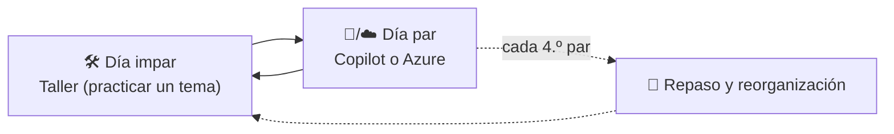

# Guía de estudio — taller un día, despliegue el siguiente

> **Qué es esto:** el **calendario de estudio** que mezcla los dos caminos: **🛠️ días de taller** (practicar los 10 temas del [Agentic Track](conceptos/README.md) en Java, luego Quarkus, TypeScript y Python) y **días 🤖 Copilot y ☁️ Azure** (curso de Copilot y despliegue en la nube del proyecto; ver la nota de abajo), con **🔁 días de repaso y reorganización** cada pocos días. Es la **opción C** que elegimos.
> ⬅️ [Guía de estudio general](README.md) · [Talleres](talleres/README.md) · [Los 10 temas](conceptos/README.md) · [Curso de Copilot](https://www.udemy.com/course/github-copilot-masterclass-java-spring-intellij-quarkus-jakartaee/)
>
> 🔀 **Cambio de rumbo (2026-10-28):** el *Production Track* se **descartó**. Los días ☁️ ahora son **🤖 Copilot** (curso Masterclass de Java/Spring) y **☁️ Azure** (despliegue en la nube del proyecto). El curso es [GitHub Copilot Masterclass for Java, Spring, AI and IntelliJ](https://www.udemy.com/course/github-copilot-masterclass-java-spring-intellij-quarkus-jakartaee/) (incluye Quarkus y Jakarta EE). El plan personal de certificaciones **no vive en este repo**.

---

## 🍳 Con la cocina

Un restaurante se aprende **alternando oficio y servicio**: un día **practicas una técnica en tu cocina** (el taller) y al siguiente **ves cómo se monta eso para cien comensales** (el despliegue). Cada pocos días paras a **repasar las recetas y reordenar la despensa** (repaso y reorganización), porque lo que no se repasa se olvida y lo que no se ordena no se encuentra.

> En palabras de la calle: **un día haces, el siguiente despliegas, y cada cuarto día repasas y reordenas. Así lo aprendido se queda.**

---

## ⚠️ Antes de empezar: dos aclaraciones honestas

| Tema | Aclaración |
|---|---|
| **Production Track** | **Descartado** (2026-10-28): demasiado teórico y por plataformas que no usas. Sus temas (trazas, guardrails, evaluación, costos) ya viven en los temas [09](conceptos/09-seguridad-guardrails-y-humano-en-el-bucle.md) y [10](conceptos/10-observabilidad-evaluacion-y-costos.md) |
| **Los tiempos** | Cada día es una sesión de ~2 h 🧩. Si estudias 3–4 días por semana, **los bloques 1 a 3 son ~8–10 semanas**. Es una estimación mía |

## 🧱 Dos repositorios: teoría aquí, práctica allá

| Repo | Para qué | Qué pasa en los días |
|---|---|---|
| 📚 **este** (`software-engineering/ai-engineering`) | **Solo teoría**: temas, escaleras, plan, guía | 🛠️ lees el tema · ☁️ tomas el curso y escribes la nota · 🔁 reorganizas |
| 🛠️ **`ai-engineering-labs`** (nuevo, por crear) | **Solo código**: un proyecto por taller | 🛠️ aquí se escribe y prueba el código del taller |

**Un día 🛠️ se ve así:** ventana 1 = este repo (tema + escalera); ventana 2 = laboratorios (`java-spring-ai/w02-herramientas/`). La nota de cierre (≤10 líneas) **vuelve a este repo**, al tema. Un día ☁️ **no necesita el repo de laboratorios**, salvo cuando la lección toque algo que desplegar de un taller ya hecho. Estructura completa en [talleres §1b](talleres/README.md#1b--dos-repositorios-teoría-aquí-práctica-allá).

## Día 0 · Triaje del curso de Copilot (una sola vez, ~30 min)

1. **Tú:** compras el curso *GitHub Copilot Masterclass for Java, Spring, AI and IntelliJ* y pegas su **índice de lecciones** en el chat para clasificarlo.
2. **Yo:** lo clasifico en 🟢 ver / 🟡 parte / 🔴 saltar y **ajusto los días 🤖** con lecciones concretas.
3. **Resultado:** los días 🤖 quedan con **lecciones reales** y se descarta lo que no sirve.

☐ Día 0 hecho

☐ **Día 1 (antes de W00):** crear el repo `ai-engineering-labs` en GitHub, clonarlo en tu disco, añadir `.gitignore` (con `.env`, `target/`, `node_modules/`) y un `README.md` índice vacío

---

## 1 · El ritmo

| Tipo | Qué haces | Duración 🧩 | Cómo se cierra |
|---|---|---|---|
| **🛠️ Taller** | Un taller del [plan](talleres/README.md) con **TDD sin llamar al modelo real** | ~2 h | Pruebas en verde + la **definición de hecho** del taller |
| **🤖 Copilot** | Lecciones del curso de Copilot, **practicadas en el IDE** + 20 min de lectura del tema del Agentic Track | ~2 h | Una **nota de 10 líneas**: qué modo usaste, qué funcionó y qué falló |
| **☁️ Azure** | Un servicio de Azure del plan, desplegando algo real del PoC | ~2 h | Una **nota de 10 líneas**: qué cambia al llevarlo a la nube y qué riesgo trae |
| **🔁 Repaso** | Releer escaleras de entrevista de los últimos temas **sin mirar**; **reorganizar** las notas | ~2 h | Notas integradas en los temas; lista "qué me falló" |

### Plantilla de cada sesión (siempre igual)

| Minuto | Qué |
|---|---|
| 0–10 | **Repaso del día anterior**: responde su escalera de entrevista en voz alta |
| 10–25 | Concepto del día (la sección del tema, con el diagrama) |
| 25–90 | **Práctica** (taller, o lecciones de despliegue) |
| 90–110 | **"¿Qué rompe esto?"**: un fallo, un riesgo de seguridad y un costo |
| 110–120 | **Nota de cierre** (máx. 10 líneas) y ☐ → ✅ en esta guía |

---

## 2 · El calendario

> **Leyenda:** 🛠️ taller · 🤖 curso de Copilot (**provisional hasta el Día 0**) · ☁️ Azure · 🔁 repaso · el estado se marca ☐ / ✅.
> Los temas **01–12** son los de [`conceptos/`](conceptos/README.md); las W/Q/N/P, los de [talleres](talleres/README.md).

### Bloque 1 · Java con Spring AI: el núcleo (días 1–12)

| Día | Tipo | Qué se hace | Tema(s) | Listo cuando… | |
|:-:|:-:|---|---|---|:-:|
| 1 | 🛠️ | **W00** Proyecto Spring Boot + Spring AI 1.1.x + **modelo falso** + clave de Gemini | [02](conceptos/02-modelos-y-proveedores.md) | `mvn test` verde **sin red** | ☐ |
| 2 | 🤖 | **C1** Copilot: instalación, Ask y Edit, instrucciones del repositorio 🔎 (ajustar tras el triaje) | [curso](https://www.udemy.com/course/github-copilot-masterclass-java-spring-intellij-quarkus-jakartaee/) | Una instrucción de repo hace que Copilot siga tu convención | ☐ |
| 3 | 🛠️ | **W01** Primer agente: `ChatClient`, prompt y **salida estructurada** (+ **W01b** tokens y temperatura, ~45 min) | [01](conceptos/01-agentes-y-workflows.md) · [03](conceptos/03-prompts-contexto-y-salidas-estructuradas.md) | Test del esquema con modelo falso | ☐ |
| 4 | 🤖 | **C2** Copilot en **modo agente**: una tarea pequeña con pruebas, revisando el diff 🔎 | [curso](https://www.udemy.com/course/github-copilot-masterclass-java-spring-intellij-quarkus-jakartaee/) | Feature pequeña hecha por el agente, con tests y tu corrección | ☐ |
| 5 | 🛠️ | **W02** Herramientas y bucle: `@Tool`, **lista blanca**, tope de iteraciones | [04](conceptos/04-herramientas-y-bucle-del-agente.md) | Un modelo falso que nunca termina corta en el tope | ☐ |
| 6 | 🤖 | **C3** Modo Plan, archivos de prompts y buenas prácticas de revisión 🔎 | [curso](https://www.udemy.com/course/github-copilot-masterclass-java-spring-intellij-quarkus-jakartaee/) | Pides plan antes de código y detectas una alucinación | ☐ |
| 7 | 🛠️ | **W03** Workflows: chaining con puerta (pago), routing y paralelización | [07](conceptos/07-orquestacion-y-multiagente.md) | Cada rama probada, fallo parcial manejado | ☐ |
| 8 | 🤖 | **C4** Seguridad con asistentes en un banco: qué datos no salen, inyección de prompt, límites del agente | [09](conceptos/09-seguridad-guardrails-y-humano-en-el-bucle.md) | Lista de 5 reglas que propondrías al equipo | ☐ |
| 9 | 🛠️ | **W04 · parte 1** Gerente: plan **validado** (formato y tope de subtareas) | [07](conceptos/07-orquestacion-y-multiagente.md) | Planes falsos (vacío, largo, JSON roto) rechazados | ☐ |
| 10 | 🛠️ | **W04 · parte 2** Agentes-herramienta y sintetizador (**tu PoC3**) | [07](conceptos/07-orquestacion-y-multiagente.md) · [12](talleres/README.md#11b--lecciones-de-los-proyectos-del-curso-qué-copiar-y-qué-dejar) | Reunión → funcionalidades → tareas, de punta a punta | ☐ |
| 11 | 🤖 | **C5** Copilot CLI, agentes personalizados y MCP en Copilot 🔎 | [05](conceptos/05-mcp.md) | Un MCP conectado a Copilot con herramientas filtradas | ☐ |
| 12 | 🔁 | **R1** Repaso de 01–04 y 07; **reorganizar** lo aprendido en C1–C5 | todos | Notas integradas en 09 y 10; borrador de tus reglas para trabajar con agentes | ☐ |

### Bloque 2 · Seguridad, MCP y evaluación (días 13–24)

| Día | Tipo | Qué se hace | Tema(s) | Listo cuando… | |
|:-:|:-:|---|---|---|:-:|
| 13 | 🛠️ | **W06** Aprobación humana + *advisors* (PII, registro, tope de llamadas) | [09](conceptos/09-seguridad-guardrails-y-humano-en-el-bucle.md) | Un pago **no se ejecuta** sin `approve` | ☐ |
| 14 | 🤖 | **C6** Medir qué ahorra Copilot (tiempo, defectos, cobertura) y qué riesgo trae | [10](conceptos/10-observabilidad-evaluacion-y-costos.md) | Una métrica de negocio para tu caso | ☐ |
| 15 | 🛠️ | **W07** Evaluador (LLM juez) + primer conjunto de pruebas | [10](conceptos/10-observabilidad-evaluacion-y-costos.md) | Rechaza N veces y escala a humano | ☐ |
| 16 | ☁️ | **A1** Azure I: contenedores y servicios gestionados (Container Apps/AKS, registro de imágenes) | [`cloud/azure`](../cloud/azure/aks-kubernetes.md) | Diagrama de despliegue de tu PoC en Azure | ☐ |
| 17 | 🛠️ | **W08** Cliente MCP con **filtro de herramientas** | [05](conceptos/05-mcp.md) | Solo las herramientas permitidas llegan al modelo | ☐ |
| 18 | ☁️ | **A2** Azure II: identidad y secretos (Entra ID, Key Vault, RBAC) | [`cloud/azure`](../cloud/azure/datos-seguridad-y-devops.md) | Tabla: quién accede a qué y con qué secreto | ☐ |
| 19 | 🛠️ | **W09** Servidor MCP propio (cuentas/pagos ficticios) | [05](conceptos/05-mcp.md) | Otro cliente lo consume | ☐ |
| 20 | ☁️ | **A3** MCP remoto: autenticación y exposición segura 🔎 | [05](conceptos/05-mcp.md) · [09](conceptos/09-seguridad-guardrails-y-humano-en-el-bucle.md) | Lista de verificación de un servidor MCP remoto | ☐ |
| 21 | 🛠️ | **W05** Memoria y estado: historial por `conversationId`, reanudar | [06](conceptos/06-memoria-busqueda-y-rag.md) · [08](conceptos/08-frameworks-y-grafos.md) | Cerrar la app y continuar la conversación | ☐ |
| 22 | ☁️ | **A4** Escala, costos y resiliencia en Azure (Cost Management, alertas) | [10](conceptos/10-observabilidad-evaluacion-y-costos.md) | Presupuesto y topes definidos para tu PoC | ☐ |
| 23 | 🛠️ | **W10** Observabilidad local (Micrometer/OpenTelemetry) | [10](conceptos/10-observabilidad-evaluacion-y-costos.md) | Reconstruyes qué herramienta se llamó y con qué argumentos | ☐ |
| 24 | 🔁 | **R2** Repaso de 05, 06, 09, 10; **reorganizar** | todos | Borrador del **tema 13 · Despliegue y operación (Azure)** | ☐ |

### Bloque 3 · Despliegue real y cierre en Java (días 25–34)

| Día | Tipo | Qué se hace | Tema(s) | Listo cuando… | |
|:-:|:-:|---|---|---|:-:|
| 25 | 🛠️ | **W12** Sandbox seguro (Docker, sin red, límites, no root) | [09](conceptos/09-seguridad-guardrails-y-humano-en-el-bucle.md) | Un intento de salir del directorio **falla** | ☐ |
| 26 | ☁️ | **A5** Desplegar el PoC en **Azure** | [`cloud/azure`](../cloud/azure/aks-kubernetes.md) | El PoC responde desde Azure con costos acotados | ☐ |
| 27 | 🛠️ | **W11a + W11b** embeddings, similitud, chunking y RAG clásico (~2 h), luego **W11** RAG agéntico (pgvector o Qdrant; puede pasar a otro día) | [06](conceptos/06-memoria-busqueda-y-rag.md) | El agente guarda y recupera datos propios | ☐ |
| 28 | ☁️ | **A6** CI/CD e **IaC** del PoC (la herramienta que use el equipo 🔎: Terraform o Bicep; Azure DevOps o GitHub Actions) | [`cloud/azure`](../cloud/azure/datos-seguridad-y-devops.md) | Pipeline que despliega con secretos fuera del repo | ☐ |
| 29 | 🛠️ | **W13 · parte 1** Multiagente con tablero compartido | [07](conceptos/07-orquestacion-y-multiagente.md) | Dos trabajadores sin pisarse | ☐ |
| 30 | 🛠️ | **W13 · parte 2** Orquestador y agente de pruebas | [07](conceptos/07-orquestacion-y-multiagente.md) · [12](talleres/README.md#11b--lecciones-de-los-proyectos-del-curso-qué-copiar-y-qué-dejar) | Flujo completo en paralelo | ☐ |
| 31 | 🛠️ | **W14** API REST de agentes y preparación para despliegue | [12](talleres/README.md#11b--lecciones-de-los-proyectos-del-curso-qué-copiar-y-qué-dejar) | Contrato OpenAPI probado | ☐ |
| 32 | ☁️ | **A7** Despliegue completo del capstone en Azure | [`cloud/azure`](../cloud/azure/aks-kubernetes.md) | El capstone vive en Azure, con trazas y límites | ☐ |
| 33 | 🛠️ | **W15** Evaluación sistemática (casos fijos, regresión, costo por ejecución) | [10](conceptos/10-observabilidad-evaluacion-y-costos.md) | Un cambio de prompt se acepta o rechaza **por una métrica** | ☐ |
| 34 | 🔁 | **R3** Repaso general; **reorganizar los temas principales** | todos | Lo de Copilot y Azure integrado (temas 09, 10 y **13**); guía de estudio actualizada | ☐ |

### Bloque 4 · Los mismos oficios en otros stacks (días 35 en adelante)

| Días | Ruta | Talleres | Notas |
|---|---|---|---|
| 35–38 | 🟧 **Quarkus** | Q1 · Q2 · Q3 · Q4 | Al terminar: matriz Spring AI vs. Quarkus; despliegue opcional (☁️ A8) |
| 39–42 | 🟩 **TypeScript (NestJS)** | N1 · N2 · N3 · N4 | El servidor MCP de N3 debe interoperar con el de Java |
| 43–46 | 🟨 **Python (FastAPI)** | P1 · P2 · P3 · P4 | El mismo servidor MCP desde 3 lenguajes |
| 47+ | 🏁 **Capstone** | Sala de conciliación | En el stack elegido, con seguridad, evaluación y despliegue |

☐ Bloque 4 iniciado

---

## 3 · Los puntos de reorganización (🔁)

| Punto | Después de | Qué se reorganiza |
|---|---|---|
| **R1** | Día 12 | Lo aprendido de Copilot y seguridad **entra en los temas 09 y 10**; se decide si hace falta un tema nuevo |
| **R2** | Día 24 | Se redacta el **tema 13 · Despliegue y operación** (nube, secretos, CI/CD, costos) |
| **R3** | Día 34 | Se **reordenan los temas principales**, se actualiza el README y esta guía |

**Regla:** nada se queda "suelto" en una nota aparte; **todo lo aprendido se integra en un tema** (el mismo criterio que usamos con las semanas del Agentic Track).

## 4 · Reglas del juego

| Regla | Detalle |
|---|---|
| **Una sesión = un objetivo** | Si no cabe en 2 h, se parte en dos días (como W04 y W13) |
| **Pruebas primero** | Los talleres usan TDD con modelo falso; el modelo real solo para comprobar |
| **Nada de claves en git** | `.env` fuera del repo; `.env.example` dentro. Credenciales de la nube, **jamás** |
| **Costos acotados** | Presupuesto fijo en cada clave y **apagar** lo desplegado al terminar el día |
| **Notas cortas** | Máximo 10 líneas por sesión; el resto va a los temas |
| **Si te atrasas** | Se **salta un ☁️**, no un 🛠️; los talleres son lo que más se nota en una entrevista |
| **Datos ficticios** | Siempre; el dominio es pagos y conciliación |
| **Código solo en el repo de laboratorios** | Este repo no recibe código de talleres; solo notas y teoría |

## 5 · Qué debe dominar cada nivel al terminar

| Nivel | Debe poder... |
|---|---|
| 🟢 **Junior** | Construir un agente con herramientas y salida estructurada en Java y explicarlo con un diagrama. |
| 🟡 **Mid** | Añadir aprobación humana, un evaluador y un servidor MCP; desplegar el PoC en una nube con secretos y topes de costo. |
| 🔴 **Senior** | Defender una arquitectura **con seguridad, evaluación y trazas por diseño**, compararla en dos o tres stacks y explicar **qué se desplegó, cuánto cuesta y cómo se vigila**. |

## 6 · Escaleras de entrevista

**"¿Cómo llevarías un agente a producción?"**
- 🟢 "Lo meto en un contenedor y lo subo a un servidor."
- 🟡 "Secretos fuera del código, trazas, topes de costo y aprobación humana en las acciones con efectos."
- 🔴 "Despliegue reproducible (CI/CD), aislamiento del código generado, evaluación con casos fijos en el pipeline, observabilidad sin datos sensibles y plan de costo y de reversa."

**"¿Cómo estudiaste IA aplicada?"**
- 🟢 "Hice un curso."
- 🟡 "Hice un curso y lo practiqué en Java con pruebas."
- 🔴 "Reorganicé un curso por oficios, practiqué los mismos patrones en cuatro stacks y desplegué uno con evaluación y trazas; sé qué parte del curso era débil (seguridad y evaluación) y la completé."

## 7 · Qué se descartó y por qué

| Descartado | Motivo |
|---|---|
| **Production Track** (curso de despliegue) | Teórico y centrado en plataformas que no usarás; se reemplazó por Copilot y Azure (2026-10-28) |
| Ver un curso completo antes de practicar | Se olvida sin práctica |
| Fechas de calendario fijas | No sé tu disponibilidad; las sesiones son relativas |
| Replicar **todos** los talleres en los cuatro stacks | Demasiado; se replican los esenciales |

## 🔗 Relacionado

[Guía de estudio general](README.md) · [Plan de talleres](talleres/README.md) · [Los 10 temas](conceptos/README.md) · [Diagramas UML](conceptos/diagramas-uml.md)
