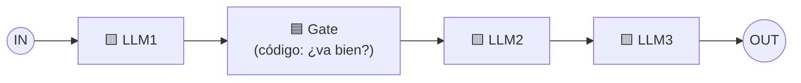

# Patrón 1 · Prompt chaining (encadenar prompts)

> ⬅️ [Catálogo de patrones](../README.md) · ➡️ [2 · Routing](../02-routing/README.md)
> 🗓️ Semana 1 · Día 2 · tipo: workflow · **Idea de la diapositiva:** *"Decompose into fixed sub-tasks"* → descomponer en **subtareas fijas**.
> ✅ Fuente: diapositivas + explicación hablada del instructor (semana 1, día 2).

---

## 🍎 Con manzanas

Una **cadena de montaje** de la frutería: **lavar → revisar → empacar**. Cada estación hace **una sola cosa** y le pasa la fruta a la siguiente. El orden **nunca cambia**. Entre dos estaciones hay un **inspector** que mira si la fruta va bien antes de dejarla pasar.

> En palabras de la calle: **dividir un trabajo grande en pasos pequeños y fijos, donde la salida de un paso es la entrada del siguiente.**

## 1 · El dibujo



| Pieza | Qué es |
|---|---|
| 🟨 **LLM1, 2, 3** | Llamadas al modelo, una por paso. |
| 🟦 **Gate (puerta)** | Una **comprobación** entre pasos: si el resultado no cumple, se corta o se reintenta. |
| Camino | **Fijo y siempre el mismo.** Es un workflow. |

> 💬 **Del instructor:** la puerta representa una decisión que *podrías* tomar en tu código, pero **no es obligatoria**: puedes simplemente tomar el resultado y pasarlo al siguiente LLM. Y el encadenamiento **suele ser parte de otros patrones más amplios**: es el más habitual de todos.

> 🎨 **Código de colores del instructor:** 🟨 amarillo = llamada a un **LLM**; 🟦 azul = **nuestro código** (Python normal). Vale para todos los dibujos de los patrones.

## 2 · Ejemplo: cotizar un pedido por mensaje

El cliente escribe: *"Quiero dos cajas de mango y una de fresa para el viernes."*

| Paso | Quién | Qué hace |
|---|---|---|
| 1 | 🟨 LLM1 | Extrae del mensaje: producto, cantidad, día. |
| Gate | 🟦 código | ¿Los productos existen en el catálogo? ¿Las cantidades son números? Si no, **para y pide aclarar**. |
| 2 | 🟨 LLM2 | Redacta la cotización con los precios que le entrega el sistema. |
| 3 | 🟨 LLM3 | Ajusta el tono (amable, corto) y lo deja listo para enviar. |

Boceto (no es un ejercicio, solo para ver la forma):

```python
datos = llm("Extrae producto, cantidad y día", mensaje)
if not valido(datos):            # Gate: código normal, sin IA
    return pedir_aclaracion()
borrador = llm("Redacta la cotización", datos, precios)
return llm("Pule el tono, máximo 3 líneas", borrador)
```

**Esto es lo que hiciste en la [clase 06](../../agentic-ai/clases/06-primeras-llamadas-openai-encadenar.md)** (pregunta → respuesta → evaluación), pero sin puerta entre pasos.

## 3 · Cuándo usarlo y cuándo no

| ✅ Úsalo cuando | ❌ Evítalo cuando |
|---|---|
| La tarea se parte limpio en pasos que **siempre son los mismos**. | Los pasos dependen de lo que aparezca en el camino. |
| Un paso simple da **mejor calidad** que un prompt gigante. | Un solo prompt ya resuelve bien: la cadena solo agrega costo. |
| Quieres **validar** a mitad de camino (el Gate). | |

**Riesgo principal:** un error del paso 1 **se arrastra** a todos los siguientes. De ahí la puerta.

## 4 · Qué debe dominar cada nivel

| Nivel | Debe poder... |
|---|---|
| 🟢 **Junior** | Explicar que se divide una tarea en pasos y la salida de uno alimenta al siguiente. |
| 🟡 **Mid** | Poner un **Gate** entre pasos y limitar la salida de cada LLM para que el siguiente reciba datos limpios. |
| 🔴 **Senior** | Decidir cuántos pasos valen la pena (cada uno suma latencia y costo), usar un modelo barato en pasos simples y registrar cada paso para depurar. |

## 5 · Escalera de entrevista

**"¿Cuándo usarías prompt chaining?"**

- 🟢 "Cuando puedo partir la tarea en pasos fijos y cada paso es más simple que el total."
- 🟡 "Y agrego una validación entre pasos para frenar errores antes de que se propaguen."
- 🔴 "Si el camino es siempre el mismo prefiero la cadena a un agente: es predecible y testeable. Mido costo y latencia por paso y uso modelos pequeños donde alcanza."

## 🧪 Caso de uso del catálogo

| | |
|---|---|
| **Caso** | Procesar un **pago** (con dinero ficticio, nunca se ejecuta un pago real). |
| **Flujo** | Texto libre *"Paga 150 USD a Frutas del Valle, ref F-102"* → 🟨 LLM1 extrae `{beneficiario, monto, moneda, referencia}` → 🟦 **Gate**: monto > 0, moneda permitida, beneficiario en la lista aprobada, monto bajo el límite → 🟨 LLM2 redacta la confirmación. |
| **Cómo se prueba** | El **Gate** se prueba **sin llamar al LLM** (datos falsos): rechaza monto negativo, moneda rara, beneficiario desconocido. |
| **Implementación** | ⏳ Pendiente → [`python/`](python/README.md) |
| **Versión con subagentes** | Tu pipeline [`/feature-implementation`](../../../ia-agentes/.claude/commands/feature-implementation.md): fases en orden fijo y `tdd-gate.sh` como puerta (código, no LLM). |

## 🔗 Relacionado

[Catálogo de patrones](../README.md) · [Clase 08](../../agentic-ai/clases/08-patrones-de-diseno-agenticos.md) · [Routing →](../02-routing/README.md) · [Clase 07 · workflow vs agente](../../agentic-ai/clases/07-que-es-un-agente-workflow-vs-agent.md)
