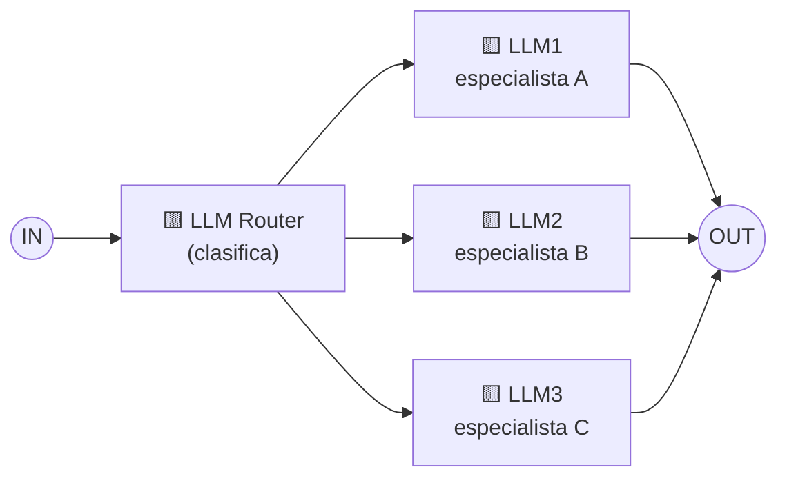

# Patrón 2 · Routing (enrutamiento)

> ⬅️ [1 · Prompt chaining](../01-prompt-chaining/README.md) · ➡️ [3 · Parallelization](../03-parallelization/README.md)
> 🗓️ Semana 1 · Día 2 · tipo: workflow · **Idea de la diapositiva:** *"Direct an input into a specialized sub-task, ensuring separation of concerns"* → dirigir una entrada a una **subtarea especializada**, separando responsabilidades.
> ✅ Fuente: diapositivas + explicación hablada del instructor (semana 1, día 2).

---

## 🍳 Con la cocina

El **expedidor** de la cocina. Llega la comanda y él **no cocina**: lee de qué se trata y la manda a la **estación correcta** (*parrilla*, *ensaladas* o *postres*). Cada estación sabe hacer **una sola cosa muy bien**.

> En palabras de la calle: **un clasificador decide a qué especialista le toca cada entrada.**

## 1 · El dibujo



- **Solo se activa un camino** por entrada (a diferencia de [paralelización](../03-parallelization/README.md), donde corren varios).
- El **router** es un LLM: su única tarea es **elegir la ruta**.
- **Separation of concerns:** cada especialista tiene su propio prompt, herramientas y reglas, sin mezclar.

> 💬 **Del instructor:** "enviarlo a un LLM" solo significa **otra llamada** a un LLM que tiene toda la información para ese tipo de consulta (técnica, empresarial u otra). **No querrías meter toda esa información en una sola consulta**: sería demasiado. Mejor un router muy bueno **solo clasificando** y especialistas muy buenos **solo respondiendo lo suyo**.

## 2 · Ejemplo: atención al cliente del restaurante

| Mensaje del cliente | El router decide | Especialista |
|---|---|---|
| "Quiero 3 porciones de seco de pollo para el viernes" | `pedido` | LLM de pedidos (extrae, cotiza) |
| "El plato llegó frío" | `reclamo` | LLM de reclamos (empatía, política de reposición) |
| "¿Cuánto cuesta el seco de pollo?" | `precios` | LLM de precios (consulta la lista) |
| "Hola" o algo fuera del negocio | `otro` | Respuesta genérica o escalar a una persona |

```python
ruta = llm("Clasifica en: pedido, reclamo, precios, otro. Responde solo la palabra.", mensaje)
especialistas = {"pedido": atender_pedido, "reclamo": atender_reclamo, "precios": ver_precios}
return especialistas.get(ruta, escalar_a_humano)(mensaje)   # boceto, no ejercicio
```

El `.get(..., escalar_a_humano)` es clave: **siempre una ruta por defecto** si el router responde algo inesperado.

## 3 · Cuándo usarlo y cuándo no

| ✅ Úsalo cuando | ❌ Evítalo cuando |
|---|---|
| Hay **categorías distintas** que piden prompts, modelos o herramientas diferentes. | Todo cae en una sola categoría. |
| Quieres **modelo barato** para lo fácil y **modelo fuerte** para lo difícil. | Las categorías se solapan mucho y el router duda. |

**Riesgo principal:** si el router **se equivoca**, toda la respuesta sale mal. Hay que **medirlo** (¿acierta?) y tener ruta por defecto.

## 4 · Qué debe dominar cada nivel

| Nivel | Debe poder... |
|---|---|
| 🟢 **Junior** | Explicar que un LLM clasifica la entrada y la manda al especialista correcto. |
| 🟡 **Mid** | Forzar una salida cerrada del router (una palabra de una lista) y tener ruta por defecto. |
| 🔴 **Senior** | Evaluar la precisión del router con un conjunto de casos, enrutar también por costo/dificultad, y manejar la ambigüedad escalando a una persona. |

## 5 · Escalera de entrevista

**"¿Cómo evitas un solo prompt gigante que haga de todo?"**

- 🟢 "Pongo un router que manda cada entrada a un prompt especializado."
- 🟡 "El router devuelve una etiqueta de una lista cerrada, y cada especialista tiene sus propias reglas y herramientas."
- 🔴 "Mido la precisión del router con casos reales, uso modelos distintos según la dificultad, y si hay duda escalo a un humano en vez de adivinar."

## 🧪 Caso de uso del catálogo

| | |
|---|---|
| **Caso** | **Fichaje y solicitudes** de empleados. |
| **Flujo** | Mensaje → 🟨 Router devuelve **una palabra**: `marcar`, `permiso`, `consulta` u `otro` → especialista: registrar entrada/salida, pedir un permiso, responder cuántas horas lleva. `otro` → **escalar a una persona**. |
| **Cómo se prueba** | El **despacho** (etiqueta → función) se prueba con etiquetas falsas, incluida una **inesperada** que debe caer en la ruta por defecto. |
| **Implementación** | ⏳ Pendiente → [`python/`](python/README.md) |

## 🔗 Relacionado

[← Prompt chaining](../01-prompt-chaining/README.md) · [Parallelization →](../03-parallelization/README.md) · [Catálogo de patrones](../README.md) · [semana 1](../../agentic-ai/semana-01.md)
