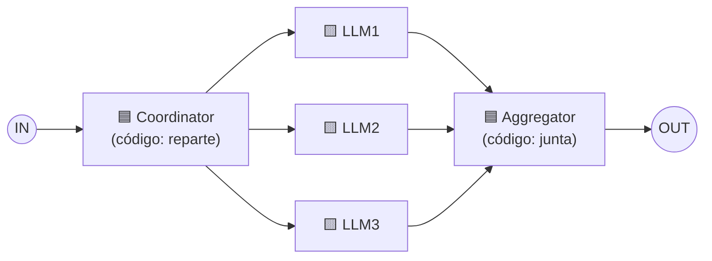

# Patrón 3 · Parallelization (paralelización)

> ⬅️ [2 · Routing](../02-routing/README.md) · ➡️ [4 · Orchestrator-worker](../04-orchestrator-worker/README.md)
> 🗓️ Semana 1 · Día 2 · tipo: workflow · **Idea de la diapositiva:** *"Breaking down tasks and running multiple subtasks concurrently"* → partir la tarea y correr **varias subtareas a la vez**.
> ✅ Fuente: diapositivas + explicación hablada del instructor (semana 1, día 2).

---

## 🍎 Con manzanas

El cierre de semana de la frutería. En vez de que **una sola persona** revise ventas, luego inventario, luego quejas, ponen a **tres empleados a la vez**. Un **coordinador** reparte el trabajo y otro **junta los resultados** en un solo informe. Se termina en **un tercio del tiempo**.

> En palabras de la calle: **hacer varias cosas independientes al mismo tiempo y juntar los resultados.**

## 1 · El dibujo



- 🟦 **Coordinator y Aggregator son código normal** (azul), no LLM: es Python que reparte el trabajo y luego agrupa los resultados. Los 🟨 son las llamadas a LLM.
- Las subtareas son **independientes**: ninguna necesita el resultado de otra. Por eso pueden correr a la vez.
- **Camino fijo:** siempre las mismas tres ramas. Es un workflow.

## 2 · Ejemplo: informe semanal de la frutería

| Rama (a la vez) | Entrada | Salida |
|---|---|---|
| 🟨 LLM1 | Ventas de la semana | "Lo más vendido y lo que bajó" |
| 🟨 LLM2 | Inventario | "Qué se está por dañar y qué falta" |
| 🟨 LLM3 | Quejas de clientes | "Los 3 problemas repetidos" |
| 🟦 Aggregator | Los tres textos | Un solo informe de una página |

```python
# boceto, no ejercicio
ventas, stock, quejas = ejecutar_en_paralelo(
    llm("Resume ventas", datos_ventas),
    llm("Resume inventario", datos_stock),
    llm("Resume quejas", datos_quejas),
)
return unir_en_informe(ventas, stock, quejas)
```

**Variante conocida** 🔎 (del artículo de Anthropic): lanzar **el mismo prompt varias veces** y **votar** para tener más confianza en una respuesta delicada. La diapositiva muestra solo la versión de repartir subtareas.

## 3 · Parallelization vs. Orchestrator-worker

| | Parallelization | [Orchestrator-worker](../04-orchestrator-worker/README.md) |
|---|---|---|
| Quién reparte | **Código** con ramas **fijas** | **Un LLM** decide las subtareas |
| Número y tipo de ramas | Siempre las mismas | Cambian según la tarea |
| 🍎 | Tres empleados con tareas de siempre | Un jefe que ve el pedido y decide a quién llamar |

## 4 · Cuándo usarlo y cuándo no

| ✅ Úsalo cuando | ❌ Evítalo cuando |
|---|---|
| Las subtareas son **independientes**. | Una rama necesita el resultado de otra (usa [chaining](../01-prompt-chaining/README.md)). |
| Quieres **bajar la latencia**. | Te preocupa el costo: son **más llamadas** a la vez. |

**Riesgo principal:** si una rama falla o tarda, hay que decidir si el informe sale **sin ella** o espera. El agregador debe manejarlo.

## 5 · Qué debe dominar cada nivel

| Nivel | Debe poder... |
|---|---|
| 🟢 **Junior** | Explicar que se corren subtareas a la vez y luego se juntan. |
| 🟡 **Mid** | Distinguir tareas independientes de dependientes, y diferenciarlo de routing (aquí corren **todas**, allí **una**). |
| 🔴 **Senior** | Manejar fallos parciales, tiempos máximos y límites de concurrencia (rate limits, costo), y cuándo votar para ganar confianza. |

## 6 · Escalera de entrevista

**"¿Cómo reducirías el tiempo de una tarea que usa varios LLM?"**

- 🟢 "Ejecuto en paralelo lo que no depende entre sí."
- 🟡 "Un coordinador reparte y un agregador junta; solo sirve si las subtareas son independientes."
- 🔴 "Controlo concurrencia por los límites del proveedor, defino qué pasa si una rama falla y evalúo si el ahorro de tiempo compensa el costo de más llamadas."

## 🧪 Caso de uso del catálogo

| | |
|---|---|
| **Caso** | **Revisar un cambio de código** (un diff de ejemplo). |
| **Flujo** | 🟦 Coordinator reparte el diff → 🟨 revisor de **seguridad** + 🟨 revisor de **estilo** + 🟨 revisor de **pruebas** (a la vez) → 🟦 Aggregator junta y ordena por severidad. |
| **Cómo se prueba** | El **agregador** se prueba con resultados falsos, incluido **una rama que falla** (el informe debe salir igual y avisar qué faltó). |
| **Implementación** | ⏳ Pendiente → [`python/`](python/README.md) |
| **Versión con subagentes** | La **fase 4** de [`/feature-implementation`](../../../ia-agentes/.claude/commands/feature-implementation.md): `code-reviewer-agent` y `security-agent` en paralelo. |

## 🔗 Relacionado

[← Routing](../02-routing/README.md) · [Orchestrator-worker →](../04-orchestrator-worker/README.md) · [Catálogo de patrones](../README.md) · [Clase 08](../../agentic-ai/clases/08-patrones-de-diseno-agenticos.md)
