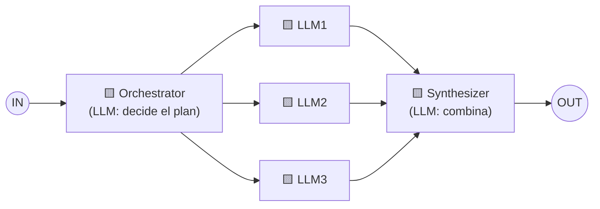

# Patrón 4 · Orchestrator-worker (orquestador y trabajadores)

> ⬅️ [3 · Parallelization](../03-parallelization/README.md) · ➡️ [5 · Evaluator-optimizer](../05-evaluator-optimizer/README.md)
> 🗓️ Semana 1 · Día 2 · tipo: workflow · **Idea de la diapositiva:** *"Complex tasks are broken down dynamically and combined"* → tareas complejas **partidas de forma dinámica** y luego combinadas.
> ✅ Fuente: diapositivas + explicación hablada del instructor (semana 1, día 2).

---

## 🍳 Con la cocina

El **chef ejecutivo** recibe un encargo grande: *"un banquete para 50 personas"*. No lo cocina: **decide en el momento qué hace falta** (¿entradas frías? ¿un menú vegetariano? ¿postre?) y **reparte** cada parte a un cocinero. Al final, el **sous-chef integra** todo en un solo servicio. Con otro encargo, **repartiría distinto**.

> En palabras de la calle: **un LLM jefe decide en el momento qué subtareas hacen falta, se las da a otros LLM y luego se combinan.**

## 1 · El dibujo



- A diferencia de [paralelización](../03-parallelization/README.md), aquí el **orquestador es un LLM** (amarillo) y **decide cuántas y cuáles subtareas** hay.
- Los **workers** pueden ser 2, 3 o 7, según el encargo. El dibujo muestra tres como ejemplo.
- El **synthesizer** también es un LLM: no solo pega textos, **los integra**.
- 🔑 **La diferencia con paralelización, según el instructor:** en el dibujo, las cajas del orquestador y del sintetizador son **amarillas** (LLM), no azules (código).
- Sigue siendo un **workflow**, porque las piezas (orquestador, workers, sintetizador) están **definidas de antemano**. Lo dinámico es **qué subtareas** salen. Es un paso hacia lo agéntico.

> 💬 **Del instructor:** "que un LLM decida" significa que **le damos un prompt** del tipo *"aquí hay un problema grande; en tu respuesta describe cómo dividirlo en pasos"*; luego **nuestro código interpreta** esa respuesta y la envía a los distintos LLM. **El LLM controla el flujo, pero siguiendo una ruta de código predefinida**; por eso sigue siendo workflow. Es un patrón **muy habitual** aunque a veces aparezca con variantes.

## 2 · Ejemplo: campaña de temporada

Encargo: *"Prepara la campaña del menú de temporada."*

| Paso | Quién | Qué pasa |
|---|---|---|
| 1 | 🟨 Orchestrator | Lee el encargo y decide: "hacen falta **precios**, **texto de WhatsApp** y **mensaje al proveedor**". |
| 2 | 🟨 Workers | Cada uno hace su pieza (puede ser en paralelo). |
| 3 | 🟨 Synthesizer | Junta las tres piezas en un plan coherente: mismo tono, mismas fechas, sin contradicciones. |

Con otro encargo (*"Resuelve el exceso de pollo en la cocina"*), el orquestador sacaría **otras** subtareas (plato del día con descuento, menú ejecutivo, donación).

```python
# boceto, no ejercicio
plan = llm("Divide este encargo en subtareas. Responde en lista", encargo)
resultados = [llm(f"Haz esto: {tarea}", contexto) for tarea in plan]
return llm("Combina estos resultados en un plan coherente", resultados)
```

## 3 · Cuándo usarlo y cuándo no

| ✅ Úsalo cuando | ❌ Evítalo cuando |
|---|---|
| **No sabes de antemano** cuántas ni cuáles subtareas habrá (varias fuentes, varios archivos). | Las subtareas son siempre las mismas: usa [paralelización](../03-parallelization/README.md), más barato y predecible. |
| La tarea es compleja y se parte distinto cada vez. | Es una tarea simple: el orquestador solo agrega costo. |

**Riesgos:** un mal plan del orquestador arruina todo; el sintetizador puede **perder o contradecir** detalles; el costo es mayor (varias llamadas + 2 LLM de coordinación).

## 4 · Qué debe dominar cada nivel

| Nivel | Debe poder... |
|---|---|
| 🟢 **Junior** | Explicar que un LLM jefe reparte el trabajo a otros y luego se junta. |
| 🟡 **Mid** | Diferenciarlo de paralelización: aquí el LLM decide **qué** subtareas. Pedir el plan en un formato estructurado para que el código lo ejecute. |
| 🔴 **Senior** | Limitar el plan (máximo de subtareas, presupuesto), validar el plan antes de ejecutarlo, y evaluar al sintetizador con casos donde se pierden detalles. |

## 5 · Escalera de entrevista

**"¿Cuándo usar orchestrator-worker en vez de paralelizar?"**

- 🟢 "Cuando las subtareas cambian según la tarea."
- 🟡 "El orquestador es un LLM que arma el plan y los workers lo ejecutan; el sintetizador combina."
- 🔴 "Solo si la variabilidad lo justifica; pongo un tope de subtareas y valido el plan, porque ahí está el riesgo y el costo."

## 🧪 Caso de uso del catálogo

| | |
|---|---|
| **Caso** | **Planificar una feature** repartida en subtareas. |
| **Flujo** | Descripción de la feature → 🟨 Orchestrator devuelve un **plan en JSON** (lista de subtareas, máximo N) → 🟨 workers hacen cada subtarea → 🟨 Synthesizer arma un plan coherente. |
| **Cómo se prueba** | La **validación del plan** (formato, tope de subtareas) se prueba con planes falsos: vacío, demasiado largo, JSON roto. |
| **Implementación** | ⏳ Pendiente → [especificación](especificacion/README.md) · taller **W04** (Java/Spring AI primero; ver [talleres](../../talleres/README.md)) |
| **Versión con subagentes** | El **orquestador** de [`/feature-implementation`](../../../ia-agentes/.claude/commands/feature-implementation.md) repartiendo trabajo a los subagentes y **verificando sus reportes**. |

## 🔗 Relacionado

[← Parallelization](../03-parallelization/README.md) · [Evaluator-optimizer →](../05-evaluator-optimizer/README.md) · [Catálogo de patrones](../README.md) · [01 · Agentes y workflows](../../agentic-ai/01-agentes-y-workflows.md)
