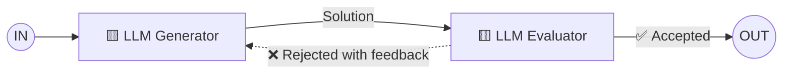

# Patrón 5 · Evaluator-optimizer (evaluador-optimizador)

> ⬅️ [4 · Orchestrator-worker](../04-orchestrator-worker/README.md) · ➡️ [Agentes (por contraste)](../06-agente/README.md)
> 🗓️ Semana 1 · Día 2 · tipo: workflow · **Idea de la diapositiva:** *"LLM output is validated by another"* → la salida de un LLM la **valida otro**.
> ✅ Fuente: diapositivas + explicación hablada del instructor (semana 1, día 2).

---

> 💬 **Del instructor:** en la práctica se habla mucho más de **"LLM como juez"** (*LLM-as-a-judge*) que de "evaluator-optimizer". Es el **quinto y último** patrón de workflow de Anthropic. No hace falta memorizar el nombre: lo importante es la idea de que un LLM juzga la salida de otro.

## 🍳 Con la cocina

El **chef prueba el plato** antes de que salga. Si le falta sal, lo **devuelve con una nota** (*"más sal, menos picante"*) y el cocinero **lo rehace**. Se repite hasta que el chef dice **"aprobado"**; con un **límite de intentos**: si no mejora, decide el chef.

> En palabras de la calle: **uno escribe, otro revisa, y si no pasa vuelve con comentarios hasta que se acepte.**

## 1 · El dibujo



- Hay un **ciclo**: la flecha roja (rechazo con comentarios) vuelve al generador.
- **Dos LLM con roles distintos**: generar y evaluar. Pueden ser modelos diferentes (uno barato escribe, uno fuerte evalúa).
- Este es el patrón que **ya viste en pequeño en la [01 · Agentes y workflows](../../agentic-ai/01-agentes-y-workflows.md)**: un modelo respondió y otro dijo si estaba bien. Aquí falta **el regreso con feedback**.
- Es el **más cercano a un agente**: tiene un bucle de retroalimentación. Pero el patrón sigue **definido de antemano** (generador y evaluador), por eso se cuenta como workflow.

## 2 · Ejemplo: respuesta a un reclamo

| Vuelta | Generador | Evaluador |
|---|---|---|
| 1 | "Lamentamos el inconveniente, revisaremos su caso." | ❌ "Genérico; no ofrece solución. Propón reposición." |
| 2 | "Lamentamos que el plato llegara frío. Le enviamos uno nuevo hoy mismo sin costo." | ✅ Aceptada |

Qué pide la rúbrica del evaluador: tono cordial, ofrece solución concreta, no promete lo que la política no permite, máximo 4 líneas.

```python
# boceto, no ejercicio
for intento in range(MAX_INTENTOS):               # tope: nunca un bucle infinito
    respuesta = llm("Redacta la respuesta", reclamo, feedback)
    veredicto = llm("Evalúa con la rúbrica. Responde OK o el motivo", respuesta)
    if veredicto == "OK":
        return respuesta
    feedback = veredicto
return escalar_a_humano(reclamo)                  # si no mejora, que decida una persona
```

## 3 · Cuándo usarlo y cuándo no

| ✅ Úsalo cuando | ❌ Evítalo cuando |
|---|---|
| Existen **criterios claros** para decir "esto está bien" y la **revisión mejora** el resultado. | No puedes definir qué es "bueno": el evaluador opinará sin criterio. |
| La calidad importa más que la velocidad. | Importa el costo o la latencia: cada vuelta suma 2 llamadas. |

**Riesgos:** bucle largo y caro (**siempre poner un tope de intentos**); un evaluador **demasiado blando** aprueba todo y uno **demasiado estricto** no aprueba nada; el generador puede **agradar al evaluador** en vez de resolver el problema.

> 🔗 Esta es la semilla de los **evals** de la Fase 5 del [roadmap](../../README.md): evaluar sistemáticamente la calidad de un LLM.

## 4 · Qué debe dominar cada nivel

| Nivel | Debe poder... |
|---|---|
| 🟢 **Junior** | Explicar que un LLM genera, otro evalúa, y si no pasa vuelve con comentarios. |
| 🟡 **Mid** | Dar al evaluador una **rúbrica** concreta, poner un **tope de intentos** y pasar el feedback al generador. |
| 🔴 **Senior** | Calibrar el evaluador con casos conocidos, usar modelos distintos para generar y evaluar, escalar a humano al agotar intentos, y medir cuánto mejora de verdad cada vuelta frente a su costo. |

## 5 · Escalera de entrevista

**"¿Cómo mejoras automáticamente la calidad de una salida de LLM?"**

- 🟢 "Un segundo LLM la revisa y, si falla, se regenera con sus comentarios."
- 🟡 "Con una rúbrica clara, un máximo de intentos y feedback que el generador realmente use."
- 🔴 "Calibro el evaluador contra ejemplos etiquetados, uso modelos distintos para no sesgar, mido la mejora por vuelta contra el costo y, si no converge, escalo a una persona."

## 🧪 Caso de uso del catálogo

| | |
|---|---|
| **Caso** | Redactar el **aviso de un pago rechazado**. |
| **Flujo** | 🟨 Generator redacta → 🟨 Evaluator aplica una **rúbrica** (tono cordial, motivo claro, sin prometer lo que la política no permite, máximo 4 líneas) → si rechaza, vuelve con feedback → **máximo 3 intentos** → si no mejora, escalar a una persona. |
| **Cómo se prueba** | El **bucle** se prueba con un evaluador falso que rechaza N veces: debe parar en el tope y escalar. |
| **Implementación** | ⏳ Pendiente → [especificación](especificacion/README.md) · taller **W07** (Java/Spring AI primero; ver [talleres](../../talleres/README.md)) |
| **Versión con subagentes** | El `arch-validator-agent`: responde `BLOCKED`, se corrige y se reenvía, **máximo 3 ciclos** (después se pregunta al usuario). |

## 🔗 Relacionado

[← Orchestrator-worker](../04-orchestrator-worker/README.md) · [Agentes por contraste →](../06-agente/README.md) · [Catálogo de patrones](../README.md) · [01 · Agentes y workflows](../../agentic-ai/01-agentes-y-workflows.md)
