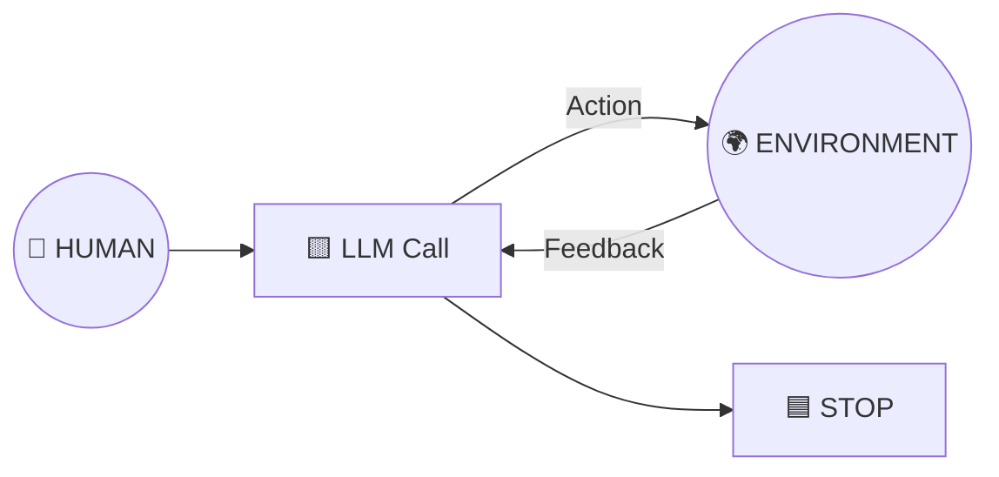

# Agentes, por contraste con los workflows

> ⬅️ [5 · Evaluator-optimizer](../05-evaluator-optimizer/README.md) · [Catálogo de patrones](../README.md) · [01 · Agentes y workflows](../../conceptos/01-agentes-y-workflows.md)
> 🗓️ Semana 1 · Día 2 · **Diapositiva:** *"By contrast, Agents: 1. Open-ended · 2. Feedback loops · 3. No fixed path"*
> ✅ Fuente: diapositivas + explicación hablada del instructor (semana 1, día 2).

---

## 🍳 Con la cocina

Los cinco patrones anteriores son **recetas con los pasos escritos**. Un **agente** es el cocinero al que le dices *"prepara la cena para 4"* y él **decide qué hacer**: mira la despensa, ve que falta tomate, cambia el plan, prueba, ajusta… hasta decir *"listo"*. Tú no escribiste los pasos.

> En palabras de la calle: **en un workflow tú fijas el camino; en un agente el camino aparece mientras se anda.**

## 1 · Las tres características de la diapositiva

| # | Característica | Qué significa |
|---|---|---|
| 1 | **Open-ended** (abierto) | No se sabe de antemano cuántos pasos habrá. |
| 2 | **Feedback loops** (ciclos de retroalimentación) | Cada acción devuelve un resultado que el modelo usa para decidir el siguiente paso. |
| 3 | **No fixed path** (sin camino fijo) | No hay un recorrido predefinido que se pueda enumerar y probar. |

## 2 · El dibujo

| Pieza | Qué es | 🍳 |
|---|---|---|
| **Human** | Da el objetivo. | El cliente hace el pedido |
| **LLM Call** | Decide la siguiente acción. | El cocinero |
| **Action → Environment** | La acción se ejecuta en el mundo (herramienta, archivo, web). | Llamar al proveedor, anotar en la libreta de la cocina |
| **Feedback** | El resultado vuelve al LLM. | "El proveedor dice que no hay pollo" |
| **STOP** | El LLM decide que terminó. | "Pedido cerrado" |

Es **el mismo bucle** de la [01 · Agentes y workflows](../../conceptos/01-agentes-y-workflows.md) y la [01 · Agentes y workflows](../../conceptos/01-agentes-y-workflows.md): *un LLM con herramientas en un bucle para lograr un objetivo.*

> 💬 **Del instructor:** este diagrama de Anthropic **anticipa casi exactamente** la definición del curso: *un LLM en un bucle con herramientas para alcanzar un objetivo*. Hay una persona que da el objetivo, el LLM interactúa con el entorno, recibe feedback y **sigue en bucle hasta que decide que cumplió su objetivo y se detiene**. Para Anthropic, eso es un agente.

## 3 · Ejemplo: el asistente de pedidos del restaurante

Objetivo: *"El cliente quiere 10 porciones de seco de pollo para el viernes. Resuélvelo."*

| Vuelta | El LLM decide | Resultado (feedback) |
|---|---|---|
| 1 | Consultar inventario | "Hay ingredientes para 4 porciones." |
| 2 | Pedir 6 al proveedor | "Solo puede entregar para 3." |
| 3 | Buscar un segundo proveedor | "Tiene para 3, llega el jueves." |
| 4 | Anotar el pedido y avisar al cliente | "Hecho." |
| — | **STOP** | El LLM da el pedido por cerrado. |

Nadie programó "si faltan ingredientes, busca otro proveedor": **lo decidió el modelo** con lo que fue viendo. Por eso un workflow no lo habría cubierto.

## 4 · El precio de la libertad

| Riesgo | Control típico |
|---|---|
| **Bucle infinito** o muy largo | Tope de iteraciones y de costo |
| **Acciones peligrosas** (escribir, gastar, borrar) | Permisos mínimos y aprobación humana en lo sensible |
| **No poder probar todos los caminos** | Registro (trazas) de cada decisión y evaluaciones |
| **Decisiones erróneas** | Guardrails y validación de cada acción |

## 5 · Workflow vs. agente de un vistazo

| | Workflow (patrones 1 a 5) | Agente |
|---|---|---|
| Camino | Definido por ti | Lo decide el LLM |
| Pasos | Conocidos | Abiertos |
| Probar | Todas las rutas | Imposible enumerarlas |
| Costo y latencia | Predecibles | Variables |
| Uso típico | **Producción** repetible | Tareas sin camino fijo |

> Lo dijo el instructor: en sistemas comerciales reales **suele ganar el workflow**. El agente abierto se reserva para lo que no tiene camino fijo, **con límites**.

## 6 · Qué debe dominar cada nivel

| Nivel | Debe poder... |
|---|---|
| 🟢 **Junior** | Citar las 3 características (abierto, ciclos de feedback, sin camino fijo) y dibujar el bucle. |
| 🟡 **Mid** | Explicar por qué un agente necesita topes y permisos, y reconocer qué parte del bucle es "acción" y cuál es "feedback". |
| 🔴 **Senior** | Decidir workflow o agente por riesgo, costo y testeabilidad; diseñar condiciones de parada, trazabilidad y límites de autonomía. |

## 7 · Escalera de entrevista

**"¿Cuándo un agente y cuándo un workflow?"**

- 🟢 "Si conozco los pasos, workflow; si dependen de lo que vaya pasando, agente."
- 🟡 "El agente es abierto y con ciclos de feedback; el workflow es predecible y se puede probar de punta a punta."
- 🔴 "En producción prefiero workflow o un agente acotado: topes de iteración, permisos mínimos, trazas y un humano aprobando lo irreversible. Solo suelto el agente donde el camino no se puede definir."

## 🧪 Caso de uso del catálogo

| | |
|---|---|
| **Caso** | **Conciliación bancaria** con herramientas (datos ficticios en un CSV). |
| **Flujo** | Objetivo *"concilia este extracto"* → bucle: 🟨 LLM elige herramienta (`leer_extracto`, `buscar_pago`, `anotar_conciliacion`) → resultado vuelve al LLM → repite → **STOP** cuando decide que terminó. |
| **Cómo se prueba** | Las **herramientas** se prueban solas (son funciones normales) y el **tope de iteraciones** con un LLM falso que nunca termina. |
| **Implementación** | ⏳ Pendiente → [especificación](especificacion/README.md) · taller **W02** (Java/Spring AI primero; ver [talleres](../../talleres/README.md)) |

## 🔗 Relacionado

[← Evaluator-optimizer](../05-evaluator-optimizer/README.md) · [Catálogo de patrones](../README.md) · [01 · Agentes y workflows](../../conceptos/01-agentes-y-workflows.md) · [Roadmap · Fases 3 y 4](../../README.md)
