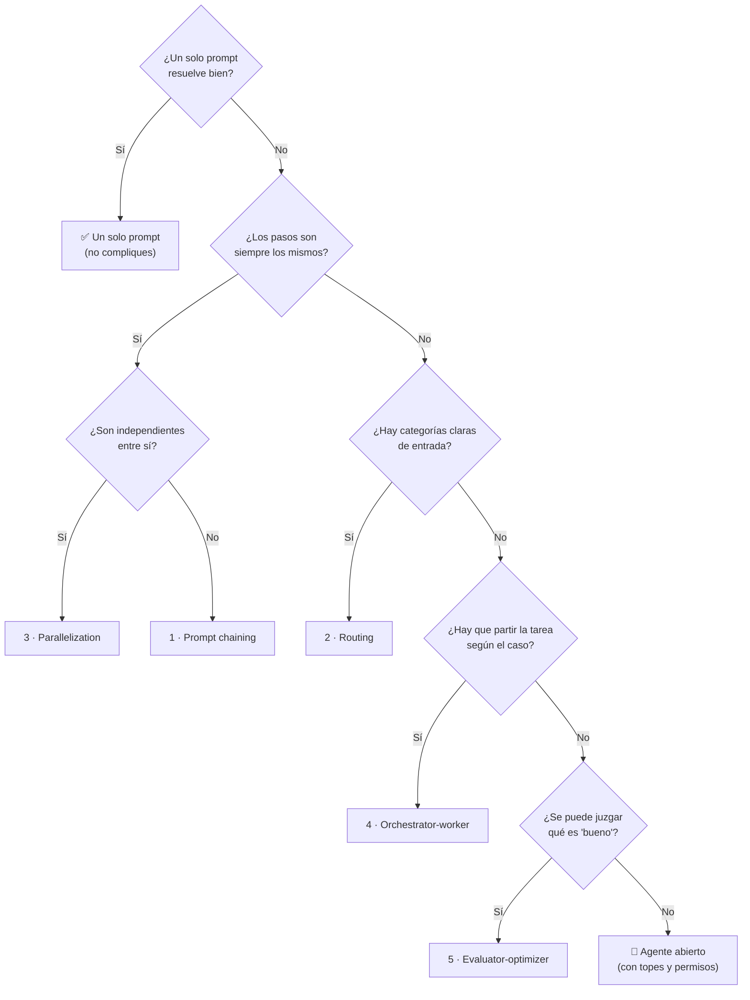

# Catálogo de patrones agénticos

> **Para qué sirve:** cuando en un proyecto piensas *"esto se parece a un patrón de IA"*, vienes aquí: eliges el patrón, lees cómo funciona, y copias la **implementación de referencia**. Es el equivalente, para LLM, a tu catálogo de arquitecturas (hexagonal, clean…).
> **Origen:** los cinco patrones de workflow y el de agente de *Building Effective Agents* (Anthropic), explicados en la [clase 08](../agentic-ai/clases/08-patrones-de-diseno-agenticos.md) del Agentic Track. Pero este catálogo **no depende del curso**.
> ⚠️ Son **ideas, no reglas**: en sistemas reales se mezclan. No memorices los nombres.

## 🍎 Con manzanas

Es el **recetario de la frutería**: cada receta dice cómo organizar a los empleados (los LLM). Cada receta trae su **explicación**, un **caso de uso** y, cuando está lista, la **receta ya cocinada** (código) para copiar.

## 📚 Índice

| # | Patrón | 🍎 | Caso de uso | Doc | Python | Subagentes (Claude Code) |
|---|---|---|---|---|---|---|
| 1 | Prompt chaining | Cadena de montaje | Procesar un pago | [📄](01-prompt-chaining/README.md) | ⏳ [spec](01-prompt-chaining/python/README.md) | [`/feature-implementation`](../../ia-agentes/.claude/commands/feature-implementation.md) |
| 2 | Routing | Recepcionista | Fichaje y solicitudes | [📄](02-routing/README.md) | ⏳ [spec](02-routing/python/README.md) | — |
| 3 | Parallelization | Equipo en paralelo | Revisar un cambio de código | [📄](03-parallelization/README.md) | ⏳ [spec](03-parallelization/python/README.md) | Fase 4 del mismo comando |
| 4 | Orchestrator-worker | Jefe que reparte | Planificar una feature | [📄](04-orchestrator-worker/README.md) | ⏳ [spec](04-orchestrator-worker/python/README.md) | El orquestador del mismo comando |
| 5 | Evaluator-optimizer | Control de calidad | Aviso de pago rechazado | [📄](05-evaluator-optimizer/README.md) | ⏳ [spec](05-evaluator-optimizer/python/README.md) | `arch-validator-agent` (≤ 3 ciclos) |
| 6 | Agente (por contraste) | Empleado libre | Conciliación bancaria | [📄](06-agente/README.md) | ⏳ [spec](06-agente/python/README.md) | — |

> **Orden sugerido para implementar:** 1 → 2 → 3 → 5 → 4 → 6 (de lo más predecible a lo más abierto). El 1 ya lo viste en el laboratorio de la [clase 06](../agentic-ai/clases/06-primeras-llamadas-openai-encadenar.md).

## 🖼️ Los dibujos juntos

```mermaid
graph TB
    subgraph P1["1 · Prompt chaining"]
        direction LR
        a1(("IN")) --> a2["LLM1"] --> a3["🟦 Gate"] --> a4["LLM2"] --> a5["LLM3"] --> a6(("OUT"))
    end
    subgraph P2["2 · Routing"]
        direction LR
        b1(("IN")) --> b2["LLM Router"]
        b2 --> b3["LLM1"]
        b2 --> b4["LLM2"]
        b2 --> b5["LLM3"]
    end
    subgraph P3["3 · Parallelization"]
        direction LR
        c1(("IN")) --> c2["🟦 Coordinator"]
        c2 --> c3["LLM1"] --> c6["🟦 Aggregator"]
        c2 --> c4["LLM2"] --> c6
        c2 --> c5["LLM3"] --> c6
    end
    subgraph P4["4 · Orchestrator-worker"]
        direction LR
        d1(("IN")) --> d2["Orchestrator"]
        d2 --> d3["LLM1"] --> d6["Synthesizer"]
        d2 --> d4["LLM2"] --> d6
        d2 --> d5["LLM3"] --> d6
    end
    subgraph P5["5 · Evaluator-optimizer"]
        direction LR
        e1(("IN")) --> e2["Generator"] --> e3["Evaluator"]
        e3 -- "Accepted" --> e4(("OUT"))
        e3 -. "Rejected + feedback" .-> e2
    end
```

> 🎨 **Código de colores del instructor:** 🟨 amarillo = llamada a un **LLM**; 🟦 azul = **nuestro código** (Gate, Coordinator, Aggregator).

## 🔀 Cómo se diferencian (las confusiones típicas)

| Pregunta | Respuesta corta |
|---|---|
| **Routing vs. Parallelization** | Routing activa **una** ruta; paralelización activa **todas** a la vez. |
| **Parallelization vs. Orchestrator-worker** | En paralelización **tú** fijas las ramas; en orchestrator-worker **un LLM** decide cuáles y cuántas. |
| **Chaining vs. Evaluator-optimizer** | Chaining avanza **sin regresar**; evaluator-optimizer **vuelve** con comentarios. |
| **Los 5 vs. un agente** | Los 5 tienen estructura **definida de antemano**; el agente decide el camino mientras anda. |

## 🧭 ¿Cuál elijo? Guía de decisión

> ✅ **Respuesta del instructor** (a *"¿divido o basta una sola llamada?"*, [clase 09](../agentic-ai/clases/09-riesgos-y-trampas-de-la-ia-agentica.md#4--trampa-2-antropomorfizar-tratarlo-como-persona)): **empieza con un solo LLM, un prompt y un objetivo; mide contra la métrica de negocio y divide solo si mejora de forma cuantificable.** La guía de abajo sigue esa regla.

> 🍎 La regla de oro: **empieza por lo más simple** (un prompt) y solo sube de nivel si lo necesitas. Cada patrón suma **costo, latencia y cosas que pueden fallar**. Y los patrones **se combinan**: por ejemplo, un router que manda a una cadena que termina en un evaluador.

## 🗺️ Dónde vive cada cosa

| Qué | Dónde | Para qué |
|---|---|---|
| **Este catálogo** | `ai-engineering/patrones/` | Explicación + implementaciones de referencia en Python |
| **Subagentes y pipelines de Claude Code** | [`ia-agentes/`](../../ia-agentes) | Kit instalado en `~/.claude` (no se mueve: `install.sh` crea symlinks a esas rutas). Es la implementación de los patrones **con subagentes** |
| **Apuntes del curso** | [`agentic-ai/`](../agentic-ai/README.md), [`llm-production/`](../llm-production/README.md) | Clases explicadas con manzanas |
| **Laboratorios del instructor** | Tu fork `edzamo/agents` | Ejercicios tal como los pide el curso |

## 🧱 Reglas del catálogo

1. **Un patrón = una carpeta** con `README.md` (explicación) y `python/` (implementación).
2. **TDD:** las pruebas **no llaman al LLM real**; el LLM se sustituye por uno falso. La puerta (Gate), el router, el agregador y los topes se prueban solos.
3. **Un entorno compartido** (uv) en esta carpeta, creado al implementar el primer patrón.
4. **Claves en `.env`** (en `.gitignore`); solo se versiona `.env.example`. Datos y dinero **ficticios**.
5. **Cada implementación nueva actualiza el índice** de arriba (⏳ → ✅).

## 🔗 Relacionado

[Clase 07 · workflow vs agente](../agentic-ai/clases/07-que-es-un-agente-workflow-vs-agent.md) · [Clase 08 · patrones (apuntes del curso)](../agentic-ai/clases/08-patrones-de-diseno-agenticos.md) · [Roadmap · Fases 3 y 4](../README.md) · [`ia-agentes/`](../../ia-agentes)
