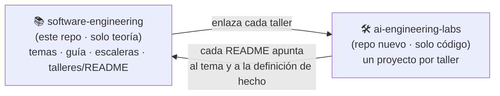
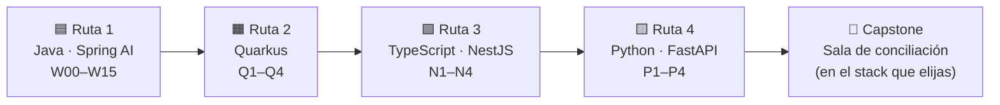
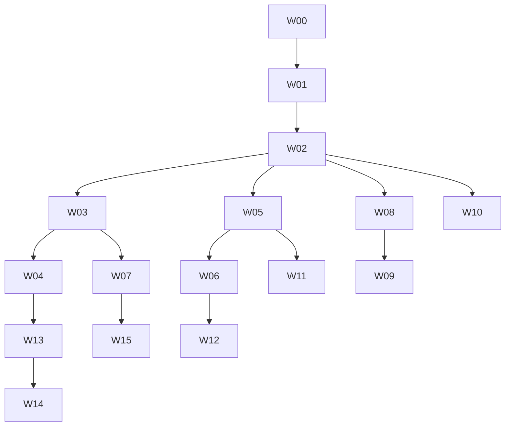
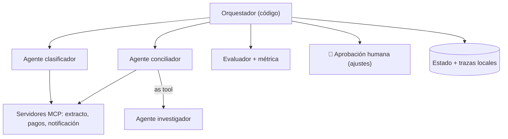

# Talleres de AI Engineering — de Java a Python

> **Qué es esto:** el plan de **práctica** que sale de los [10 temas](../conceptos/README.md) del curso *AI Engineer Agentic Track*. Cada taller es **una sesión guiada**: yo explico y reviso como profesor, **tú escribes el código** y lo probamos.
> **Orden de herramientas (decisión tuya):** primero lo que dominas → **Java con Spring AI**, luego **Quarkus**, luego **TypeScript (NestJS)** y al final **Python (FastAPI)**.
> 📅 **Cuándo se hace cada taller:** [guía de estudio día a día](../guia-de-estudio.md).
> 🧱 **El código de los talleres vive en otro repo** ([§1b](#1b--dos-repositorios-teoría-aquí-práctica-allá)); aquí solo está el plan.
> ⬅️ [Índice de AI Engineering](../README.md) · [Los 10 temas](../conceptos/README.md) · [Catálogo de patrones](../patrones/README.md) · [Diagramas UML](../conceptos/diagramas-uml.md)

---

## 🍳 Con la cocina

Ya leíste los **recetarios** (las semanas). Ahora **se cocina**. Primero en **tu cocina de siempre** (Java, donde conoces cada fogón), después en la del vecino (Quarkus, otro estilo, mismos platos), luego en una cocina de otro país (TypeScript) y, por último, en la cocina del curso original (Python). **Los platos son los mismos; cambia la sartén.** Así se ve qué es oficio y qué es marca.

> En palabras de la calle: **los mismos 5 o 6 platos cocinados en cuatro cocinas distintas; al final sabes cocinar, no solo usar una marca.**

---

## 1 · Decisiones de partida (puedes cambiarlas)

| Tema | Decisión | Por qué |
|---|---|---|
| **Orden de stacks** | Java/Spring AI → Quarkus LangChain4j → TypeScript/NestJS → Python/FastAPI | Tu pedido: dominio primero |
| **Modelo** | **Gemini** (clave gratuita de AI Studio) para las ejecuciones reales | No necesitas tarjeta; Spring AI trae starter de Google GenAI 🔎 |
| **Pruebas** | **TDD sin llamar al modelo real** (modelo falso) | Rápido, determinista, gratis |
| **Datos** | Siempre **ficticios**; dominio de **pagos y conciliación** | Tu experiencia, sin riesgo |
| **Dónde vive el código** | En **otro repositorio**: `ai-engineering-labs` (nombre propuesto 🧩); ver [§1b](#1b--dos-repositorios-teoría-aquí-práctica-allá) | Este repo es **solo teoría**; la práctica tiene su propio ciclo (build, CI, dependencias) |
| **Claves** | `.env` fuera de git; `.env.example` dentro | Seguridad básica |
| **Trazas** | Locales (sin subir prompts) | Sin datos reales en plataformas |
| **Docker** | Solo para el taller de **sandbox** | Aislar código generado |

> 🧩 **Esto reemplaza** las carpetas `patrones/*/python/` (ahora `especificacion/`): cuando exista el código en el repo de laboratorios, esas carpetas lo **enlazan**. Este repo **no recibe código de talleres**.

### Versiones y ecosistema (verificado el 2026-10; 🔎 volver a mirar al empezar cada ruta)

| Pieza | Estado |
|---|---|
| **Spring AI** | Línea **1.1.x** estable (la 1.1.8 salió en junio de 2026) y **2.0** en candidatas de lanzamiento: la 2.0 trae **cambios incompatibles** (renombres de paquetes de anotaciones MCP, migración a Jackson 3). **Recomiendo fijar 1.1.x** para los talleres y revisar si la 2.0 ya salió ([novedades](https://spring.io/blog/2026/06/12/spring-ai-1-1-8-1-0-9-avaialble-now/)) |
| **Gemini en Spring AI** | Starter `spring-ai-starter-model-google-genai`; con clave de API usa la API gratuita de Gemini; con proyecto de GCP, Vertex AI ([documentación](https://docs.spring.io/spring-ai/reference/2.1/api/chat/google-genai-chat.html)). Hay discrepancias sobre si se activa solo: activar con `spring.ai.model.chat=google-genai` |
| **Quarkus** | `quarkus-langchain4j`: servicios de IA con `@RegisterAiService`, herramientas, guardrails de entrada/salida de herramientas y **cliente MCP** (`quarkus-langchain4j-mcp`); el **servidor MCP** es otra extensión (`quarkus-mcp-server`) ([blog](https://quarkus.io/blog/quarkus-langchain4j-mcp/)). Versión exacta: confirmar en Maven Central |
| **TypeScript / NestJS** | **No hay capa de agentes oficial de NestJS**. Se usa **Vercel AI SDK** (herramientas con Zod, cliente MCP) y el **SDK oficial de MCP** envueltos en proveedores/servicios de Nest 🧩 |
| **Python** | FastAPI + un marco a elegir entonces (**Google ADK** para Gemini nativo, o Agents SDK/Pydantic AI) |

---

## 1b · Dos repositorios: teoría aquí, práctica allá



| | 📚 Teoría (este repo) | 🛠️ Laboratorios (repo nuevo) |
|---|---|---|
| **Contiene** | Temas, diagramas, escaleras, plan y guía | Código, pruebas, `pom.xml`/`package.json`, Docker |
| **Cambia cuando** | Aprendes o corriges un concepto | Terminas o rompes un taller |
| **Nunca lleva** | Código ejecutable de talleres | Explicaciones largas (solo un README corto que **enlaza** al tema) |

**Estructura propuesta del repo de laboratorios** 🧩 (un proyecto independiente por taller, así cada uno compila solo):

```text
ai-engineering-labs/
├── README.md                  # índice: taller → tema de teoría → estado ☐/✅
├── .gitignore                 # incluye .env, target/, node_modules/
├── java-spring-ai/            # Ruta 1
│   ├── w00-modelo-falso/      #   pom.xml, src/, README.md, .env.example
│   ├── w01-primer-agente/
│   └── …
├── java-quarkus/              # Ruta 2 (q1-…)
├── ts-nestjs/                 # Ruta 3 (n1-…)
├── python-fastapi/            # Ruta 4 (p1-…)
└── capstone-sala-conciliacion/
```

**README de cada taller (máx. 15 líneas):** tema de teoría (enlace), qué construyes, **criterio de aceptación** (el de la tabla de abajo), cómo correr `test` sin red, y 3 líneas de "qué aprendí / qué falló".

**Cómo se trabaja una sesión:**
1. Abres **dos ventanas**: este repo (para leer el tema y la escalera) y el de laboratorios (para escribir código).
2. Lees el tema aquí, practicas allá, y la **nota de cierre (≤10 líneas)** vuelve **aquí**, al tema correspondiente.
3. Al terminar, marcas ☐ → ✅ en [la guía](../guia-de-estudio.md) y en el índice del repo de laboratorios.

> Los enlaces entre repos son **URLs absolutas** (no relativas). El repo de laboratorios aún **no existe** 🔎: se crea en el **día 1**, antes de W00. Si lo haces **público**, revisa que no haya claves ni datos reales.

---

## 2 · El recorrido



**Cada ruta repite los mismos oficios.** La ruta 1 es la completa; las demás **replican lo esencial** para ver qué cambia.

---

## 3 · Ruta 1 — Java con Spring AI (la completa)

> **⭐ = camino mínimo** (si el tiempo aprieta, se hacen solo estos). Duración 🧩: ~1 sesión de 2 h por taller, salvo los marcados (×2).

| ID | Tema | Qué construyes | Criterio de aceptación | Patrón |
|---|---|---|---|---|
| **W00** ⭐ | [02](../conceptos/02-modelos-y-proveedores.md) | Proyecto Spring Boot + Spring AI; clave de Gemini; **modelo falso** para pruebas | `mvn test` verde **sin red**; una llamada real opcional | — |
| **W01** ⭐ | [01](../conceptos/01-agentes-y-workflows.md), [02](../conceptos/02-modelos-y-proveedores.md), [03](../conceptos/03-prompts-contexto-y-salidas-estructuradas.md) | Primer agente: `ChatClient`, prompt de sistema y **salida estructurada** (record) | El test valida el esquema con modelo falso | — |
| **W01b** 🧩 | [02](../conceptos/02-modelos-y-proveedores.md) | **Tokens y temperatura** (~45 min): contar tokens (inglés frente a español) y pasar `temperature` / `maxTokens` como opciones 🔎 | El modelo falso **recibe** las opciones que enviaste | — |
| **W02** ⭐ | [04](../conceptos/04-herramientas-y-bucle-del-agente.md) | **Herramientas**: bucle a mano y con `@Tool`; **allowlist**, validación y **tope de iteraciones** | Un modelo falso que nunca termina corta en el tope; un nombre desconocido se rechaza | 6 · Agente |
| **W03** ⭐ | [07](../conceptos/07-orquestacion-y-multiagente.md) | **Chaining + gate** (procesar un pago), **routing** y **paralelización** | Cada rama probada con modelos falsos; fallo parcial manejado | 1, 2, 3 |
| **W04** ⭐ (×2) | [07](../conceptos/07-orquestacion-y-multiagente.md) | **Gerente con agentes-herramienta**: reunión → funcionalidades → tareas (**tu PoC3**) | El plan se valida (formato, tope de subtareas); el sintetizador no pierde datos | 4 · Orquestador |
| **W05** | [06](../conceptos/06-memoria-busqueda-y-rag.md), [08](../conceptos/08-frameworks-y-grafos.md) | **Memoria y estado**: historial por `conversationId`, repositorio JDBC, **reanudar** un proceso | Cerrar la app y continuar la misma conversación | — |
| **W06** ⭐ | [09](../conceptos/09-seguridad-guardrails-y-humano-en-el-bucle.md) | **Aprobación humana** + *advisors* (PII, registro, tope de llamadas) | Un pago **no se ejecuta** sin `approve`; `reject` vuelve al modelo con motivo | — |
| **W07** ⭐ | [10](../conceptos/10-observabilidad-evaluacion-y-costos.md), [07](../conceptos/07-orquestacion-y-multiagente.md) | **Evaluador (LLM juez)** + reintentos con tope + primer **conjunto de pruebas** | Rechaza N veces y escala a humano; métrica reproducible | 5 · Evaluator |
| **W08** ⭐ | [05](../conceptos/05-mcp.md) | **Cliente MCP**: usar un servidor ya hecho (filesystem/fetch) con **filtro de herramientas** | Solo las herramientas permitidas llegan al modelo | — |
| **W09** | [05](../conceptos/05-mcp.md) | **Servidor MCP propio** (cuentas/pagos ficticios) | Otro cliente (el de W08) lo consume | — |
| **W10** | [10](../conceptos/10-observabilidad-evaluacion-y-costos.md) | **Observabilidad** local: Micrometer/OpenTelemetry + registro propio de llamadas | Se reconstruye qué herramienta se llamó y con qué argumentos | — |
| **W11a** 🧩 | [06](../conceptos/06-memoria-busqueda-y-rag.md) | **Embeddings y similitud** (~1 h): `EmbeddingModel` falso con vectores a mano y búsqueda de los k más cercanos 🔎 | *Reembolso* queda junto a *devolución*; un texto ajeno queda lejos | — |
| **W11b** 🧩 | [06](../conceptos/06-memoria-busqueda-y-rag.md) | **Chunking y RAG clásico** (~1 h): `TokenTextSplitter`, indexar, consultar y evaluar la recuperación 🔎 | Para 5 preguntas fijas, recupera el trozo esperado | — |
| **W11** | [06](../conceptos/06-memoria-busqueda-y-rag.md) | **RAG agéntico**: búsqueda vectorial (pgvector o Qdrant) como herramienta | El agente guarda y recupera datos propios | — |
| **W12** | [09](../conceptos/09-seguridad-guardrails-y-humano-en-el-bucle.md) | **Sandbox seguro**: ejecutar código generado en Docker (sin red, límites, no root) | Intento de salir del directorio o usar red **falla** | — |
| **W13** (×2) | [07](../conceptos/07-orquestacion-y-multiagente.md) | **Multiagente con tablero compartido** (la idea de la semana 5) | Dos trabajadores toman tareas sin pisarse | — |
| **W14** | 🧩 extra | **API REST** de agentes + despliegue ligero + **reintentos con espera creciente e idempotencia** en el pago | Contrato OpenAPI probado; un modelo que falla 2 veces acierta a la 3.ª sin duplicar el pago | — |
| **W15** | [10](../conceptos/10-observabilidad-evaluacion-y-costos.md) | **Evaluación sistemática**: casos fijos, regresión, costo por ejecución | Un cambio de prompt se acepta o se rechaza **por una métrica** | — |

### Dependencias entre talleres



---

## 4 · Ruta 2 — Quarkus LangChain4j (¿se puede? **sí**)

Quarkus **sí sirve** para este curso: `@RegisterAiService`, herramientas, guardrails y cliente/servidor MCP existen. Se replican **solo cuatro** talleres para comparar:

| ID | Replica | Qué cambia frente a Spring AI | Entregable |
|---|---|---|---|
| **Q1** | W01 + W02 | Interfaz anotada (`AiService`) en vez de `ChatClient`; herramientas por anotación | Agente con herramientas y salida estructurada |
| **Q2** | W06 | **Guardrails de entrada y salida de herramientas** (nativos) | Pago con aprobación y validación |
| **Q3** | W08 + W09 | `quarkus-langchain4j-mcp` (cliente) y `quarkus-mcp-server` (servidor) | Un servidor MCP consumido desde Spring **y** Quarkus |
| **Q4** | W04 | Orquestación con servicios de IA; arranque nativo/memoria | PoC3 en Quarkus |

**Cierre de la ruta:** matriz de decisión Spring AI vs. Quarkus (madurez, ecosistema, arranque, memoria, pruebas, MCP, equipo) — 🔎 **primero confirmar qué usa tu equipo**.

## 5 · Ruta 3 — TypeScript con NestJS

| ID | Qué | Entregable |
|---|---|---|
| **N1** | Agente con **Vercel AI SDK**: herramientas con **Zod**, salida estructurada | Servicio Nest con un agente probado |
| **N2** | **Workflows** (chaining, paralelo, evaluador) con servicios/módulos | Equivalente de W03 + W07 |
| **N3** | **MCP** con el SDK oficial: servidor y cliente | Interoperar con el servidor de Java |
| **N4** | **Estado y aprobación humana** (guardado de estado + reanudar) | Equivalente de W05 + W06 |

🧩 Mastra (semana 5) queda como lectura opcional: es otra opción de TypeScript, no de NestJS.

## 6 · Ruta 4 — Python con FastAPI

| ID | Qué | Entregable |
|---|---|---|
| **P1** | Agente detrás de una **API FastAPI** (Google ADK con Gemini, o Agents SDK) | Endpoint probado |
| **P2** | **Servidor MCP con FastMCP** y cliente | El mismo servidor MCP desde 3 lenguajes |
| **P3** | **Tablero compartido** multiagente (semana 5) | Trabajadores en paralelo |
| **P4** | **Evaluación y trazas** (equivalente de W10 + W15) | Reporte de métricas |

Python va **al final**: para entonces el oficio ya está aprendido y solo se traduce.

## 7 · Capstone — "Sala de conciliación"

Un sistema **ficticio** de pagos: un **orquestador (código)** llama a varios agentes (clasificar, conciliar, explicar discrepancias), con **herramientas por MCP**, **aprobación humana** para ajustes, **evaluador** y **trazas propias**. Se implementa en **un stack a elegir** y se compara con otro.



## 8 · Cómo es cada sesión (yo como profesor)

| Paso | Qué ocurre |
|---|---|
| 1 | **🍳 Analogía y objetivo** (5 min) |
| 2 | **Concepto y diagrama** (qué pieza es y por qué) |
| 3 | **Demostración mínima** (yo muestro la estructura) |
| 4 | **Ejercicio TDD**: tú escribes la prueba (**RED**), luego el código (**GREEN**), luego limpias (**REFACTOR**) con modelo falso |
| 5 | **Ejecución real** con Gemini (opcional) y lectura de la traza |
| 6 | **"¿Qué rompe esto?"**: casos de fallo, seguridad y costo |
| 7 | **Escalera de entrevista** del tópico |
| 8 | **Nota breve** (máx. 1 página) con lo aprendido; no más archivos de la cuenta |

> Reglas: **pruebas primero**, **sin llamar al modelo real en los tests**, datos ficticios, y **nunca una clave en el repositorio**.

## 9 · Honestidad

| Marca | Significado |
|---|---|
| 🔎 | Nombre de API, versión o comportamiento **por verificar** al empezar el taller |
| 🧩 | Propuesta mía, no del curso |
| ⚠️ | Riesgo (seguridad, costo, versión) |

**No he probado todavía** ninguna de estas librerías en este repo: cada taller empezará **leyendo la documentación vigente** y fijando versiones antes de escribir código.

## 10 · Escaleras de entrevista (del plan completo)

**"¿Has construido agentes en producción? ¿Con qué?"**
- 🟢 "Hice prototipos con un framework."
- 🟡 "Construí agentes con herramientas, memoria y MCP en Java y los probé sin llamar al modelo."
- 🔴 "El mismo flujo en Spring AI, Quarkus, NestJS y Python para separar oficio de marca: workflow por defecto, aprobación humana en acciones con efectos, evaluador con métrica, trazas propias y sandbox para código generado."

## 11 · Qué se descartó y por qué

| Descartado | Motivo |
|---|---|
| Replicar **todos** los talleres en los cuatro stacks | Demasiado; se replican los esenciales (Q, N, P) |
| Frameworks de Python uno por uno (semana 5) | Una tabla basta ([08 · Frameworks y grafos](../conceptos/08-frameworks-y-grafos.md)) |
| Entrenamiento y *fine-tuning* | Fuera del curso (Core Track) |
| Despliegue en la nube a gran escala | Fuera del alcance de esta guía |

## 11b · Lecciones de los proyectos del curso (qué copiar y qué dejar)

El curso construyó seis proyectos (gemelo digital, Deep Research, equipo de ingeniería con CrewAI, Sidekick, bucle de agentes y sala de operaciones con MCP). No se aprende de copiarlos, sino de **ver qué oficio ensaya cada uno** y qué se les olvidó (casi siempre **seguridad y evaluación**). El código está en el [fork `agents`](https://github.com/edzamo/agents).

| Proyecto | ✅ Copia | ❌ Deja |
|---|---|---|
| Gemelo digital | La herramienta que registra preguntas desconocidas (ciclo de mejora con datos reales) | Desplegar con datos personales |
| Deep Research | Planificar → buscar en paralelo → redactar | La búsqueda alojada de OpenAI |
| Equipo de ingeniería | **El sandbox con Docker** (y endurecerlo) | Confiar en la caché de herramientas |
| Sidekick | **Middleware + aprobación humana + evaluador con tope** | 41 herramientas a la vez |
| Bucle de agentes | Tablero compartido; agente QA | **Orquestador LLM** para un orden fijo |
| Sala de operaciones | **Código para lo fijo, agente-herramienta para lo incierto**; trazas propias | Decisiones reales de inversión (⚠️ solo educativo) |

**"Cuéntame un proyecto de agentes que hayas construido o estudiado."**
- 🟢 "Un asistente que investiga en la web y escribe un informe."
- 🟡 "Un trabajador con herramientas y un evaluador que reintenta hasta cumplir criterios, con pausa para aprobación humana."
- 🔴 "Una sala de agentes coordinada por **código** (orden fijo) donde cada uno delega en un investigador **como herramienta** (incertidumbre), con trazas propias y métrica de negocio; y sé qué le faltaba de seguridad y evaluación."

## ✅ Siguiente paso

Empezar por **W00 (preparar el proyecto Java + modelo falso + clave de Gemini)**. Antes de escribir código: confirmar (1) **Java 21**, (2) **Spring AI 1.1.x** y (3) que **Gemini gratuito** funciona desde tu red.

## 🔗 Relacionado

[Índice de AI Engineering](../README.md) · [Los 10 temas](../conceptos/README.md) · [Catálogo de patrones](../patrones/README.md) · [08 · Frameworks y grafos](../conceptos/08-frameworks-y-grafos.md) · [05 · MCP](../conceptos/05-mcp.md) · [`ia-agentes/`](../../ia-agentes) · [`frameworks/`](../../frameworks) (ya hay material de Spring Boot, Quarkus y NestJS) · [`tdd/`](../../tdd) · [`uml/`](../../uml)

Fuentes consultadas para versiones: [Spring AI 1.1.8 / 1.0.9](https://spring.io/blog/2026/06/12/spring-ai-1-1-8-1-0-9-avaialble-now/), [Spring AI 2.0.0-RC2](https://spring.io/blog/2026/06/09/spring-ai-2-0-0-RC2-available-now/), [Google GenAI en Spring AI](https://docs.spring.io/spring-ai/reference/2.1/api/chat/google-genai-chat.html), [MCP con Quarkus + LangChain4j](https://quarkus.io/blog/quarkus-langchain4j-mcp/).
