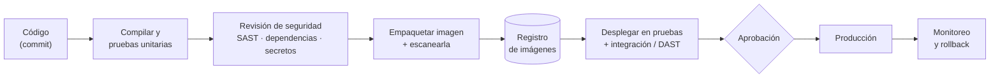

# DevOps y DevSecOps · cápsulas de conceptos

Aquí van las **ideas principales**, en cápsulas cortas. Para profundizar (comandos, scripts, manifiestos, pipelines) hay un enlace al repo de ejercicios [`ws-devops`](https://github.com/edzamo/ws-devops). Teoría aquí, práctica allá, sin repetir.

## 🍎 Con manzanas
Una frutería con **línea de empaque**: cada caja sale idéntica (**imagen**), se abre en cualquier tienda y funciona igual (**contenedor**), un **jefe de tiendas** decide cuántas abrir y las repone si una se cae (**Kubernetes**), el **camión** lleva siempre la misma caja sin abrirla (**pipeline**) y un **inspector** revisa en cada paso, no solo al final (**DevSecOps**).

---

## 1 · Docker
**La idea en una frase:** empacar la app con todo lo que necesita para que corra igual en tu máquina, en pruebas y en producción.

| Pieza | Qué es | Manzanas |
|---|---|---|
| **Dockerfile** | La receta para construir la imagen | La receta de la caja |
| **Imagen** | Paquete de solo lectura, hecho de capas | La caja sellada |
| **Contenedor** | Una imagen **en ejecución** | La caja abierta en una tienda |
| **Volumen** | Carpeta que sobrevive al contenedor | El almacén que no se borra |
| **Red** | Cómo se hablan los contenedores | Los pasillos entre cajas |
| **Registro** (Docker Hub, ACR, ECR) | Dónde se guardan las imágenes | El depósito central |

**Cómo se levanta**
```bash
docker build -t miapp:1.0 .            # construir la imagen
docker run -d -p 8080:8080 miapp:1.0   # levantar un contenedor
docker compose up -d                   # levantar varios servicios juntos
```
**Claves:** una imagen se construye **una vez**; las capas que menos cambian van primero (caché); `.dockerignore`; usuario no root; versión fija, no `latest`; ningún secreto dentro de la imagen.

👉 **Profundiza:** [`ws-devops/01-docker`](https://github.com/edzamo/ws-devops/tree/main/01-docker) (Dockerfiles, volúmenes, redes, Compose).

## 2 · Kubernetes
**La idea en una frase:** un **orquestador**: tú dices *qué quieres* ("3 copias de mi app") y él se encarga de lograrlo y mantenerlo.

| Pieza | Qué es | Manzanas |
|---|---|---|
| **Pod** | La unidad mínima: uno o más contenedores juntos | Una caja abierta con su ayudante |
| **Deployment** (y ReplicaSet) | Mantiene N pods y hace actualizaciones | "Siempre 3 tiendas abiertas" |
| **Service** | Una dirección estable hacia los pods | El teléfono fijo de la tienda |
| **Ingress** | La puerta de entrada desde afuera | La puerta de la calle |
| **ConfigMap / Secret** | Configuración y datos sensibles | El cartel de precios y la caja fuerte |
| **Namespace** | Separa entornos o equipos | Los pisos del centro comercial |
| **Labels y selectores** | Etiquetas para agrupar y encontrar | Las etiquetas de colores |
| **Helm / Kustomize** | Empaquetan y adaptan los manifiestos por ambiente | La plantilla de apertura de tienda |

**Dónde corre:** un **plano de control** (decide) y **nodos** (ejecutan). Minikube es un clúster de juguete en tu máquina; AKS, EKS y GKE son clústeres gestionados.

**Cómo se levanta**
```bash
minikube start
kubectl apply -f pod.yml        # le dices lo que quieres (manifiesto)
kubectl get pods                # ¿qué hay corriendo?
kubectl logs <pod>              # ¿qué dice?
```
**Claves:** declarativo (describes el estado deseado); límites de recursos y sondas de salud; RBAC de mínimo privilegio; secretos fuera de git.

👉 **Profundiza:** [`ws-devops/02-kubernetes`](https://github.com/edzamo/ws-devops/tree/main/02-kubernetes). Ver también [AKS](../cloud/azure/aks-kubernetes.md).

## 3 · Ciclo de vida de un despliegue (el pipeline)
**La idea en una frase:** una cadena automática que lleva un cambio desde el código hasta producción, **construyendo una sola vez** y probando en cada paso.



| Paso | Qué ocurre | Credenciales |
|---|---|---|
| Compilar y probar | Falla rápido si algo se rompe | — |
| Empaquetar y subir | Se construye **la** imagen y se sube al registro | Acceso al registro |
| Desplegar | El mismo artefacto sube de ambiente en ambiente | Acceso al clúster o a la nube |
| Operar | Métricas, logs y alertas; volver atrás si falla | — |

**Credenciales:** viven en el **almacén de secretos** del pipeline o en una bóveda (p. ej. Key Vault), **nunca en el repo**; mejor identidades federadas de corta vida que claves permanentes (🔎 verificar según la plataforma).

**Tres palabras que se confunden:** *Integración continua* (probar y juntar todo el tiempo) · *Entrega continua* (siempre listo para producción, con un botón) · *Despliegue continuo* (llega a producción solo).

**Infraestructura como código (Terraform):** el plano de la tienda escrito en archivos; se revisa, se versiona y se reconstruye entera. Estado remoto, `plan` revisado antes de aplicar.

👉 **Profundiza (scripts y pipelines):** [`ws-devops/05-devsecops-microservicios`](https://github.com/edzamo/ws-devops/tree/main/05-devsecops-microservicios): pipeline completo de 10 etapas en cuatro plataformas. Terraform queda pendiente en el repo.

## 4 · DevSecOps
**La idea en una frase:** mover la seguridad **al principio** y dentro del pipeline, no al final.

| Revisión | Qué busca | Cuándo |
|---|---|---|
| **SAST** | Fallos en tu código fuente | En cada cambio |
| **SCA** | Dependencias con vulnerabilidades conocidas | En cada cambio |
| **Detección de secretos** | Claves o contraseñas en el código | Antes de subir (hook) y en el PR |
| **Escaneo de imagen** | Vulnerabilidades en la imagen | Al empaquetar |
| **DAST** | Ataques simulados contra la app corriendo | En pruebas |
| **Firma y SBOM** | Quién construyó la imagen y qué lleva dentro | Al publicar |

**Y además:** contenedor sin root, mínimo privilegio, secretos en bóveda, ramas protegidas, aprobación antes de producción. Para el código: [OWASP Top 10](../microservices-patterns/README.md).

**Dónde se practica cada control** (pipeline de 10 etapas en [`ws-devops/05-devsecops-microservicios`](https://github.com/edzamo/ws-devops/tree/main/05-devsecops-microservicios), ejecutado en local el 2026-10-30):

| Control | Etapa | Herramienta | Estado |
|---|---|---|---|
| Detección de secretos | 1 | Gitleaks | ✅ |
| Pruebas y cobertura | 2–3 | Maven, JaCoCo | ✅ (con umbral mínimo) |
| Calidad de código | 5 | SonarQube | ✅ |
| **SAST** | 6 | Semgrep | ✅ |
| **SCA** | 6 | Trivy | ✅ |
| Escaneo de imagen y **SBOM** | 8 | Trivy | ✅ |
| **DAST** | 10 | OWASP ZAP (tras levantar el stack) | ✅ |
| Firma de imágenes | — | Cosign | ⏳ pendiente |
| Secretos como `Secret` de Kubernetes | — | — | ⏳ pendiente (paso a Minikube) |

El pipeline corre en **GitHub Actions, Jenkins, Azure DevOps y AWS CodePipeline**, con las mismas etapas.

**Para profundizar** (en `ws-devops`):
- [Conceptos de DevSecOps y ruta de junior a arquitecto](https://github.com/edzamo/ws-devops/blob/main/05-devsecops-microservicios/devsecops-pipeline/docs/05-DEVSECOPS-APRENDIZAJE.md): qué es cada control, SAST vs SCA vs DAST vs IAST, herramientas.
- [Qué hace cada etapa y en qué orden](https://github.com/edzamo/ws-devops/blob/main/05-devsecops-microservicios/devsecops-pipeline/docs/02-ETAPAS.md), con los hallazgos reales de la ejecución.
- [Arquitectura del pipeline](https://github.com/edzamo/ws-devops/blob/main/05-devsecops-microservicios/devsecops-pipeline/docs/01-ARQUITECTURA.md): capas, cómo viajan los secretos, Bash vs Python.
- [Gobernanza y nube](https://github.com/edzamo/ws-devops/blob/main/05-devsecops-microservicios/devsecops-pipeline/docs/04-GOBERNANZA-Y-NUBE.md): aprobaciones, ramas → ambientes, equivalencias AWS y Azure.
- [Plantillas de pipeline](https://github.com/edzamo/ws-devops/blob/main/05-devsecops-microservicios/devsecops-pipeline/docs/06-PLANTILLAS-DE-PIPELINE.md): Azure `extends`, reusable workflows, Jenkins Shared Library.

**Medir si mejoras (DORA):** frecuencia de despliegue · tiempo de entrega · tasa de fallos · tiempo de recuperación.

**Marcos de referencia (🔎 versión vigente):** OWASP DevSecOps Guideline · CIS Benchmarks · NIST SSDF · Twelve-Factor App.

## 5 · Qué debe dominar cada nivel

| 🟢 Junior | 🟡 Mid | 🔴 Senior / arquitecto |
|---|---|---|
| Dockerfile y Compose; imagen vs contenedor | Pipeline con pruebas y artefacto inmutable; manifiestos y Helm; secretos fuera del código | **Estrategia de entrega** (ramas, ambientes, promoción, rollback), modelo de seguridad del pipeline y gobierno entre equipos |

**Entrevista — «¿Cómo aseguras un pipeline?»:** 🟢 "Corro pruebas y un escáner" → 🟡 "SAST, SCA y secretos en cada PR, imagen firmada, el mismo artefacto a todos los ambientes" → 🔴 "…y defino qué rompe el build según el riesgo, cómo se gestionan las excepciones y qué se mide para saber si mejora".

## 6 · Cómo se organiza
| Qué | Dónde |
|---|---|
| Conceptos (esta página) | `software-engineering/devops/` |
| Ejercicios, scripts, manifiestos, pipelines | [`ws-devops`](https://github.com/edzamo/ws-devops) |

Los apuntes largos que hoy están en otro repo (Docker ×3, Terraform ×1, CI/CD ×3) se **resumen en estas cápsulas**; los detalles viven en `ws-devops`.

Relacionado: [`cloud/azure/`](../cloud/azure/README.md) · [`integracion/`](../integracion/README.md) · [`microservices-patterns/`](../microservices-patterns/README.md).
